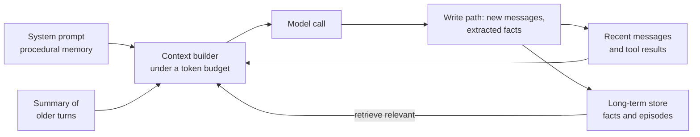

A language model is stateless: each API call starts from nothing except the tokens you send. Everything an agent appears to "remember", from the result of the tool call two steps ago to the fact that a user prefers metric units, exists only because your code stored it somewhere and put it back into the context at the right moment. **Agent memory** is the set of mechanisms that decide what to keep, where to keep it, and what to bring back. This lesson gives you the map: the kinds of memory, how they fit together into the context the model sees, and the design decisions that apply to all of them. The next two lessons build [short-term](/learn/ai-agent-fundamentals/short-term-memory) and [long-term](/learn/ai-agent-fundamentals/long-term-memory) memory in detail.

## Why memory is a design problem

The naive approach is to keep every message forever and send all of it on every call. It breaks quickly:

- **Context windows are finite.** A long agent run with verbose tool outputs fills even a large window.
- **Cost grows with every step**, because the whole history is resent as input tokens each time.
- **More context is not always better.** Irrelevant or stale material can distract the model, and information buried in the middle of a very long context tends to be used less reliably than information near the start or end.
- **Nothing survives the session.** When the run ends, the message list is gone, and the next conversation starts from zero.

Memory design is the discipline of putting the right information, and only the right information, in front of the model at each step.

## Kinds of memory

The vocabulary below borrows loosely from cognitive science, and it is widely used in the agent literature. The terms are useful labels, not claims that agents work like brains.

| Memory | Holds | Lifetime | Typical implementation |
| --- | --- | --- | --- |
| **Working (short-term)** | The current conversation, tool calls and results, scratch notes | One task or session | The message list, trimmed or summarised |
| **Episodic** | Records of past events: earlier sessions, what was tried, what happened | Across sessions | Stored summaries of past runs, retrieved by similarity |
| **Semantic** | Facts about the user, the domain or the world | Across sessions | Extracted facts in a vector store or database |
| **Procedural** | How to do things: instructions, skills, learned rules | Long | The system prompt, tool descriptions, stored playbooks |

Procedural memory is the one most people forget is memory. The system prompt and tool descriptions are knowledge you have written down for the agent, and some systems let an agent update its own stored instructions, for example by saving "when deploying, always run the migration check first" after a failure.

## The context window is assembled, not accumulated

The central idea of agent memory is that the context for each model call is **built** from several sources, under a token budget.



There are two paths to design:

- The **read path**: before each call, what do you retrieve, and in what order do you place it?
- The **write path**: after each step or session, what do you store, in what form, and where?

## A context builder in plain Python

The sketch below shows the read and write paths together. Long-term retrieval here is simple keyword overlap so the example stays self-contained; the long-term memory lesson replaces it with embeddings and a vector index.

```python
import re

def words(text):
    return set(re.findall(r"[a-z]+", text.lower()))

class Memory:
    def __init__(self, system_prompt, recent_limit=4):
        self.system_prompt = system_prompt
        self.recent_limit = recent_limit
        self.messages = []         # working memory
        self.facts = []            # long-term semantic memory
        self.summary = ""          # compressed older turns

    # write path
    def add_message(self, role, content):
        self.messages.append({"role": role, "content": content})
        if len(self.messages) > self.recent_limit:
            dropped = self.messages.pop(0)
            self.summary += f" {dropped['role']} said: {dropped['content'][:40]}"

    def remember(self, fact):
        if fact not in self.facts:
            self.facts.append(fact)

    # read path
    def recall(self, query, k=2):
        scored = [(len(words(query) & words(f)), f) for f in self.facts]
        return [f for score, f in sorted(scored, reverse=True)[:k] if score > 0]

    def build_context(self, query):
        system = self.system_prompt
        if facts := self.recall(query):
            system += "\nKnown facts about the user:\n" + "\n".join(f"- {f}" for f in facts)
        if self.summary:
            system += "\nEarlier in this conversation:" + self.summary
        return [{"role": "system", "content": system}] + self.messages

mem = Memory("You are a travel assistant.")
mem.remember("The user is vegetarian.")
mem.remember("The user's home airport is Manchester.")
mem.remember("The user dislikes overnight flights.")

for role, text in [("user", "Hi, I'm planning a trip."),
                   ("assistant", "Great, where to?"),
                   ("user", "Somewhere warm in March."),
                   ("assistant", "Lisbon or Seville would suit."),
                   ("user", "Lisbon. Find me flights and a restaurant.")]:
    mem.add_message(role, text)

for m in mem.build_context("find flights and a restaurant"):
    print(f"[{m['role']}] {m['content']}\n")
```

```output
[system] You are a travel assistant.
Known facts about the user:
- The user dislikes overnight flights.
Earlier in this conversation: user said: Hi, I'm planning a trip.

[assistant] Great, where to?

[user] Somewhere warm in March.

[assistant] Lisbon or Seville would suit.

[user] Lisbon. Find me flights and a restaurant.
```

Even this toy shows the shape of a real memory system. The oldest turn was compressed into the summary, the four most recent messages were kept verbatim, and facts were retrieved by matching the query. Look closely at which fact came back: "dislikes overnight flights" shares the word "flights" with the query, so it was found. "Vegetarian", which matters just as much for choosing a restaurant, was missed, because that fact shares no word with the query. The home airport, which matters for flights, was missed too. That is exactly why real systems retrieve by meaning, using embeddings, rather than by shared words.

## Automatic memory or memory as a tool

There are two ways to decide what gets written to long-term memory.

| Approach | How it works | Strengths | Weaknesses |
| --- | --- | --- | --- |
| **Automatic** | After each turn or session, your code (often an extra LLM call) extracts facts and stores them | Consistent; the agent does not have to remember to remember | Stores noise; extra cost per turn |
| **Memory as a tool** | The agent gets `save_memory(text)` and `search_memory(query)` tools and decides when to use them | Stores what the model judges important; retrieval only when needed | The model may forget to save or search; it can save wrong conclusions |

Many systems combine them: automatic retrieval of a few relevant memories before every call, plus a tool the agent can use to save something explicitly.

> [!KEY]
> Every memory you store will later be placed in a context and treated by the model as true. Writing to memory is a consequential action: decide deliberately what deserves to be remembered.

## What can go wrong

- **Stale memories.** "The user lives in Leeds" stays in the store after they move. Store timestamps, prefer recent facts, and let new facts replace old ones.
- **Wrong memories.** A model's mistaken inference ("the user seems to be a doctor") becomes a permanent fact. Prefer storing what the user said over what the model guessed.
- **Memory poisoning.** If an agent stores content from documents or web pages, an attacker can plant instructions that are retrieved in later sessions. This is [prompt injection](/learn/prompt-engineering/prompt-injection-awareness) with a delay.
- **Privacy.** Memory is personal data. Users should be able to see, correct and delete what is stored about them, and one user's memories must never be retrieved for another.

> [!WARNING]
> Isolate memory by user (and by tenant, in multi-customer systems) at the storage level, with a filter your code always applies. Never rely on the model to ignore another user's memories that happen to be retrieved.

## Exercises

**1.** Classify each as working, episodic, semantic or procedural memory: (a) "Last Tuesday's deployment failed because the database migration timed out." (b) "The user's company uses PostgreSQL." (c) The tool result from the previous step. (d) "Always run tests before committing."

<details>
<summary>Show solution</summary>

(a) Episodic: a record of a specific past event. (b) Semantic: a durable fact. (c) Working: part of the current task's context. (d) Procedural: an instruction about how to act.

</details>

**2.** Change `recall` so that a fact is also returned when the query contains the word "restaurant" and the fact mentions a dietary keyword such as "vegetarian". Why is this hand-written rule a poor long-term solution?

<details>
<summary>Show solution</summary>

```python
RELATED = {"restaurant": {"vegetarian", "vegan", "allergic"}}

def recall_with_rules(memory, query, k=2):
    query_words = words(query)
    for w in list(query_words):
        query_words |= RELATED.get(w, set())
    scored = [(len(query_words & words(f)), f) for f in memory.facts]
    return [f for s, f in sorted(scored, reverse=True)[:k] if s > 0]

print(recall_with_rules(mem, "find flights and a restaurant"))
```

```output
['The user is vegetarian.', 'The user dislikes overnight flights.']
```

It works for this one case, but you would need a rule for every relationship between words, forever. Embeddings capture these relationships of meaning automatically, which is why long-term memory normally uses semantic search.

</details>

```quiz
[
  {
    "q": "Why can't an agent simply resend its entire history on every call forever?",
    "options": [
      "APIs forbid repeated messages",
      "Context windows are finite, cost grows each step, and irrelevant context can distract the model",
      "Models refuse long conversations",
      "Histories cannot be stored as JSON"
    ],
    "answer": 1,
    "why": "Unbounded history hits the window limit, costs more on every step and can lower answer quality."
  },
  {
    "q": "A stored note says \"When the user asks for a report, always include a chart.\" Which kind of memory is this?",
    "options": ["Working memory", "Episodic memory", "Semantic memory", "Procedural memory"],
    "answer": 3,
    "why": "It is an instruction about how to act, which is procedural memory."
  },
  {
    "q": "What is a drawback of giving the agent a `save_memory` tool instead of saving automatically?",
    "options": [
      "It is impossible to implement",
      "The model may fail to save important information or save its own wrong conclusions",
      "It always stores far too much",
      "It cannot be combined with retrieval"
    ],
    "answer": 1,
    "why": "The model decides when to save, so the quality of memory depends on its judgement."
  },
  {
    "q": "Which safeguard best prevents one user's memories from reaching another user's agent?",
    "options": [
      "Telling the model in the system prompt to ignore other users' data",
      "Storing memories with a user id and always filtering retrieval by it in code",
      "Using a larger embedding model",
      "Summarising memories more aggressively"
    ],
    "answer": 1,
    "why": "Isolation must be enforced by the storage query itself, not by the model's judgement."
  }
]
```
