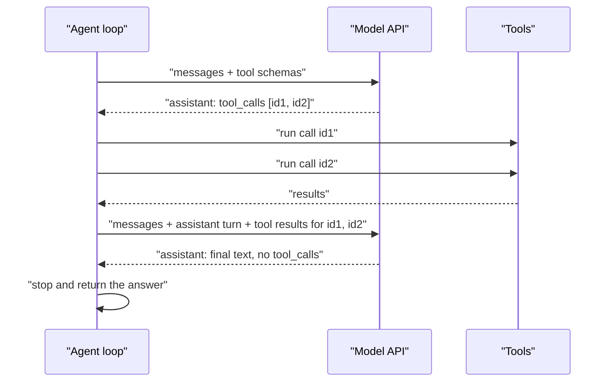

You already know the mechanics of function calling from the LLM module: you describe functions with JSON schemas, the model replies with a structured request to call one, and you send the result back ([function calling](/learn/working-with-llms/function-calling) and [tool calling](/learn/working-with-llms/tool-calling) cover the API details). This lesson is about what changes when that single exchange becomes the engine of an agent: many rounds, several calls per round, strict bookkeeping of call ids, malformed arguments, and deciding in code when the loop is finished. Getting this protocol exactly right is unglamorous, and it is where many first agents break.

## The protocol inside a loop

With native function calling, each round trip follows a fixed pattern. The model's reply either contains one or more tool calls, or it contains a final text answer. Your code keeps calling the model until it gets the latter.



The messages use the OpenAI Chat Completions shape below, which many providers and local servers also accept. Two fields carry the protocol:

| Message | Key fields | Notes |
| --- | --- | --- |
| Assistant turn requesting tools | `role: "assistant"`, `tool_calls: [{id, type, function: {name, arguments}}]` | `arguments` is a **JSON string**, not an object |
| Tool result | `role: "tool"`, `tool_call_id`, `content` | One per tool call, matching its `id` |
| Final answer | `role: "assistant"`, `content`, no `tool_calls` | The signal that the loop can stop |

The API response also reports why generation ended: in the Chat Completions API, `finish_reason` is `"tool_calls"` when the model wants tools run, and `"stop"` for a normal answer.

## A function-calling agent in plain Python

The scripted model below returns messages in exactly that shape, including two **parallel** tool calls in one turn, so the loop that handles them is the loop you would use with a real API. Replace `fake_chat` with your provider's chat call (passing `messages` and `TOOL_SCHEMAS`) and the rest is unchanged.

```python
import json

def get_weather(city: str) -> dict:
    data = {"Oslo": {"temp_c": -3, "sky": "snow"}, "Rome": {"temp_c": 14, "sky": "sun"}}
    if city not in data:
        raise ValueError(f"no weather data for {city}")
    return data[city]

TOOLS = {"get_weather": get_weather}
TOOL_SCHEMAS = [{
    "type": "function",
    "function": {
        "name": "get_weather",
        "description": "Current weather for a city. Returns temperature in Celsius and sky.",
        "parameters": {"type": "object",
                       "properties": {"city": {"type": "string"}},
                       "required": ["city"]},
    },
}]

def fake_chat(messages, tools):
    """Stand-in for a chat API with function calling. Scripted, deterministic."""
    results = [m for m in messages if m["role"] == "tool"]
    if not results:
        return {"role": "assistant", "content": None, "tool_calls": [
            {"id": "call_1", "type": "function",
             "function": {"name": "get_weather", "arguments": '{"city": "Oslo"}'}},
            {"id": "call_2", "type": "function",
             "function": {"name": "get_weather", "arguments": '{"city": "Rome"}'}},
        ]}
    oslo, rome = (json.loads(r["content"]) for r in results)
    diff = rome["temp_c"] - oslo["temp_c"]
    return {"role": "assistant",
            "content": f"Rome is {diff} degrees warmer than Oslo ({rome['sky']} vs {oslo['sky']})."}

def run_tool_call(call):
    name = call["function"]["name"]
    try:
        args = json.loads(call["function"]["arguments"])
    except json.JSONDecodeError as exc:
        return {"error": f"arguments were not valid JSON: {exc}"}
    if name not in TOOLS:
        return {"error": f"unknown tool {name}"}
    try:
        return TOOLS[name](**args)
    except Exception as exc:
        return {"error": str(exc)}

def agent(question, chat, max_rounds=5):
    messages = [{"role": "system", "content": "Use tools for facts. Be brief."},
                {"role": "user", "content": question}]
    for _ in range(max_rounds):
        reply = chat(messages, TOOL_SCHEMAS)
        messages.append(reply)                       # keep the assistant turn verbatim
        if not reply.get("tool_calls"):
            return reply["content"], messages
        for call in reply["tool_calls"]:             # one result per call, in order
            result = run_tool_call(call)
            messages.append({"role": "tool", "tool_call_id": call["id"],
                             "content": json.dumps(result)})
    return "stopped: too many rounds", messages

answer, history = agent("How much warmer is Rome than Oslo right now?", fake_chat)
for m in history:
    detail = m.get("tool_call_id") or [c["id"] for c in m.get("tool_calls") or []] or ""
    print(f"{m['role']:<9} {str(detail):<20} {m['content'] or ''}")
print("\nAnswer:", answer)
```

```output
system                         Use tools for facts. Be brief.
user                           How much warmer is Rome than Oslo right now?
assistant ['call_1', 'call_2'] 
tool      call_1               {"temp_c": -3, "sky": "snow"}
tool      call_2               {"temp_c": 14, "sky": "sun"}
assistant                      Rome is 17 degrees warmer than Oslo (sun vs snow).

Answer: Rome is 17 degrees warmer than Oslo (sun vs snow).
```

Read the history from top to bottom: the assistant turn with two call ids, one tool message per id, then a final assistant message. That exact structure is what providers expect on the next request.

> [!WARNING]
> Every tool call in an assistant turn must be answered by a tool message with the matching id before you call the model again. If you drop a result, for example because a tool raised an exception you did not catch, most APIs reject the next request outright. Always return something, even if it is an error.

## Malformed arguments

`arguments` is a string generated by the model. It is usually valid JSON that matches your schema, and providers offer modes that enforce the schema more strictly ([structured outputs](/learn/working-with-llms/structured-outputs) explains these), but you should still handle the cases where it is not.

```python
bad_calls = [
    {"id": "c1", "function": {"name": "get_weather", "arguments": '{"city": "Oslo"'}},
    {"id": "c2", "function": {"name": "get_weather", "arguments": '{"town": "Oslo"}'}},
    {"id": "c3", "function": {"name": "get_weather", "arguments": '{"city": "Lima"}'}},
]
for call in bad_calls:
    print(call["id"], run_tool_call(call))
```

```output
c1 {'error': "arguments were not valid JSON: Expecting ',' delimiter: line 1 column 16 (char 15)"}
c2 {'error': "get_weather() got an unexpected keyword argument 'town'"}
c3 {'error': 'no weather data for Lima'}
```

All three become error observations the model can read, instead of crashes. The second one leaks a Python-specific message (`unexpected keyword argument`); validating against the schema first, as in the [tool usage](/learn/ai-agent-fundamentals/tool-usage) lesson, gives cleaner errors.

## Parallel calls

Models can request several independent calls in one turn, as the weather example did. That saves model round trips, and because the calls are independent you can also run them concurrently with threads or `asyncio`, which matters when each tool is a slow network request.

Be careful when parallel calls have side effects. Two `transfer_funds` calls in one turn are each checked in isolation, but together they may exceed a limit. Validate the whole batch before running any of it, or disable parallel calls for consequential tools. The OpenAI API has a `parallel_tool_calls` parameter for this; other providers have similar controls.

## Controlling whether tools are used

The `tool_choice` parameter steers the model's behaviour on a given call:

| Value (Chat Completions) | Effect | Agent use |
| --- | --- | --- |
| `"auto"` (default when tools are given) | The model decides: call tools or answer | The normal agent step |
| `"required"` | The model must call at least one tool | Forcing a first action, such as a search |
| `"none"` | The model must answer in text | Forcing a final summary when limits are reached |
| A specific function | The model must call that function | Using a tool purely for structured extraction |

A useful pattern: when the step limit is close, make one last call with `tool_choice="none"` so the agent produces a best-effort answer from what it has, instead of stopping in the middle of a tool call.

## Provider differences

The concepts are the same everywhere; the field names are not.

| Concept | OpenAI Chat Completions | Anthropic Messages API |
| --- | --- | --- |
| Tool request | `tool_calls` list on the assistant message | `tool_use` content blocks in the assistant message |
| Arguments | `function.arguments`, a JSON string | `input`, already a JSON object |
| Result | Message with `role: "tool"` and `tool_call_id` | `tool_result` content block in a user message, with `tool_use_id` |
| "Wants tools" signal | `finish_reason == "tool_calls"` | `stop_reason == "tool_use"` |

If you support several providers, convert to one internal representation at the edge of your code, and keep the agent loop provider-independent. Agent frameworks, covered in the next module, do exactly this.

> [!KEY]
> The agent loop does not decide when the task is finished; it detects that the model has stopped asking for tools. Your stop conditions (rounds, budget, loop detection) are the safety net for when the model never stops asking.

## Exercises

**1.** Change `fake_chat` so its first reply requests weather for `"Oslo"` and `"Paris"`. What does the history show for the Paris call, and what should a real model do next?

<details>
<summary>Show solution</summary>

`get_weather` raises `ValueError` for Paris, so `run_tool_call` returns `{"error": "no weather data for Paris"}` and that JSON is the content of the tool message for that call id. The scripted model would crash trying to read `temp_c` from the error, which shows why a real model, not a script, has to handle it: it should either try another source, or answer that Paris data is unavailable. The protocol itself stays valid because every call id still has a result.

</details>

**2.** Write a function `pending_calls(messages)` that returns the ids of tool calls in the last assistant message that do not yet have a tool result. Test it on `history[:3]`.

<details>
<summary>Show solution</summary>

```python
def pending_calls(messages):
    last = max(i for i, m in enumerate(messages) if m["role"] == "assistant")
    asked = [c["id"] for c in messages[last].get("tool_calls") or []]
    answered = {m["tool_call_id"] for m in messages[last + 1:] if m["role"] == "tool"}
    return [i for i in asked if i not in answered]

print(pending_calls(history[:3]))
print(pending_calls(history[:5]))
```

```output
['call_1', 'call_2']
[]
```

A check like this before each model call catches the most common protocol bug.

</details>

```quiz
[
  {
    "q": "In the Chat Completions format, what type is `function.arguments` in a tool call?",
    "options": [
      "A Python dictionary",
      "A JSON string that you must parse",
      "A list of positional values",
      "A schema object"
    ],
    "answer": 1,
    "why": "The model generates it as text. You must `json.loads` it, and handle the case where it is invalid."
  },
  {
    "q": "The model requests three tool calls in one turn. What must you send before the next model call?",
    "options": [
      "Only the result of the first call",
      "A single message combining all results without ids",
      "One tool result per call, each with the matching call id",
      "Nothing; the model remembers the calls"
    ],
    "answer": 2,
    "why": "Each tool call must be answered with a result that references its id, or the API will reject the request."
  },
  {
    "q": "How does a function-calling agent loop normally detect that it is finished?",
    "options": [
      "The model returns an assistant message with no tool calls",
      "A tool returns the string `DONE`",
      "The context window is full",
      "The step counter reaches zero"
    ],
    "answer": 0,
    "why": "A text reply without tool calls means the model considers the task done. Limits are the safety net."
  },
  {
    "q": "Which `tool_choice` value is useful to force a final answer when the step limit is nearly reached?",
    "options": ["`\"auto\"`", "`\"required\"`", "`\"none\"`", "A specific function name"],
    "answer": 2,
    "why": "`\"none\"` makes the model answer in text from the information it already has."
  }
]
```
