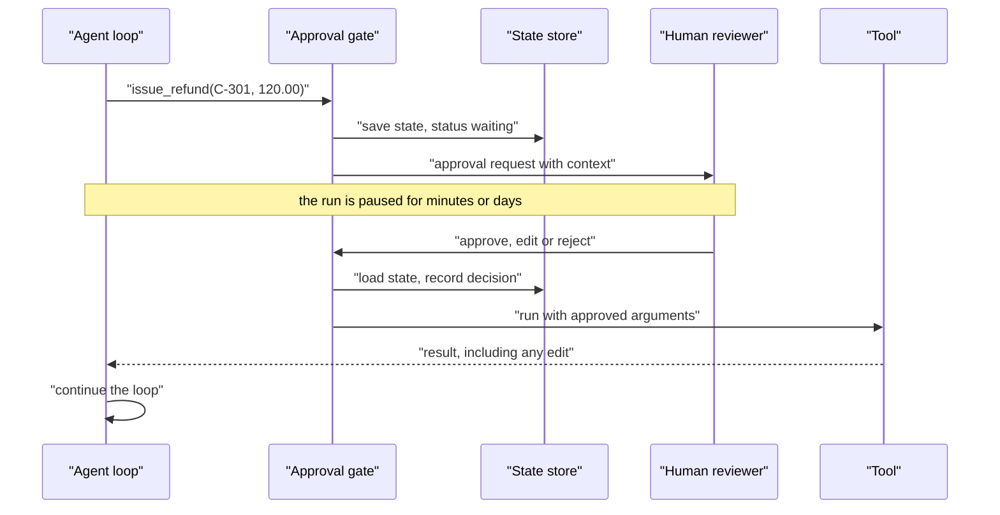

Agents make mistakes, and some mistakes are expensive: a refund to the wrong customer, an email to the whole company, a deleted production table. No amount of prompt engineering brings the error rate to zero, so the practical question is where a person should stay involved. **Human-in-the-loop** (HITL) design puts people at the points where their judgement is worth the delay: approving consequential actions before they happen, answering questions the agent cannot, and taking over when the agent is stuck. Done well, it lets you deploy agents for tasks you could not yet trust them with alone. This lesson builds approval gates, interrupts that survive a restart, escalation rules and an audit log, all in plain Python.

## Where humans belong

Not every action needs a person. Approving every search makes reviewers click "approve" without reading, which is worse than no review at all (**approval fatigue**). Classify each tool by the damage it could do.

| Tier | Examples | Policy |
| --- | --- | --- |
| Read-only, internal | Search orders, read docs, query analytics | Run automatically; log |
| Reversible writes | Draft an email, add a label, create a ticket | Run automatically or with lightweight review; log |
| Consequential or irreversible | Send money, send external messages, delete data, change permissions | Require explicit approval before execution |
| Forbidden | Anything outside the agent's purpose | Never available to the agent; enforce in code |

Factors that move an action up a tier: money involved, external visibility, irreversibility, the number of people affected, and whether the arguments came from untrusted content. An agent that read an external email and now wants to forward a file deserves more scrutiny than one acting on its own user's direct request, because the email could contain a [prompt injection](/learn/prompt-engineering/prompt-injection-awareness).

## The approval gate



Three properties matter:

- **The check happens before execution.** Nothing consequential runs until a decision is recorded.
- **The run is an interrupt, not a blocking wait.** Real reviewers take minutes or days. The agent's state is saved, the process can exit, and the run resumes when the decision arrives, possibly on a different machine.
- **The reviewer can edit, not only approve or reject.** Editing the arguments is often the most useful response, and the model should be told what changed so its final answer is accurate.

## Building it

The agent below handles a refund request. Looking up a customer runs automatically; issuing a refund needs approval; any other tool is forbidden. The model is a scripted stand-in (a real one would receive the messages and tool schemas) and, like a real model might, it proposes refunding the whole order when the customer was only double-charged for part of it.

```python
import json

CUSTOMERS = {"kim@example.com": {"id": "C-301", "last_order_total": 120.0}}
REFUNDS = []

def search_customer(email):
    return CUSTOMERS.get(email, "no such customer")

def issue_refund(customer_id, amount):
    REFUNDS.append((customer_id, amount))
    return f"refunded {amount:.2f} to {customer_id}"

TOOLS = {"search_customer": search_customer, "issue_refund": issue_refund}
RISK = {"search_customer": "auto", "issue_refund": "approve"}   # anything else: forbidden

def fake_llm(messages):
    """Stand-in for a real model, following a fixed script."""
    results = [m["content"] for m in messages if m["role"] == "tool"]
    if not results:
        return {"tool": "search_customer", "args": {"email": "kim@example.com"}}
    if len(results) == 1:
        return {"tool": "issue_refund", "args": {"customer_id": "C-301", "amount": 120.0}}
    return {"answer": f"Done. Outcome: {results[-1]}"}

def audit(state, event, **details):
    state["audit"].append({"seq": len(state["audit"]) + 1, "event": event, **details})
```

The loop stops and returns as soon as an approval is needed. All state, including the pending action and the audit log, is plain JSON-serialisable data.

```python
def run(state, llm, max_steps=6):
    while state["step"] < max_steps:
        state["step"] += 1
        decision = llm(state["messages"])
        if "answer" in decision:
            state["status"] = "done"
            audit(state, "final_answer", text=decision["answer"])
            return state
        name, args = decision["tool"], decision["args"]
        risk = RISK.get(name, "forbidden")
        audit(state, "tool_requested", tool=name, args=args, risk=risk)
        if risk == "forbidden":
            result = f"error: {name} is not permitted"
        elif risk == "approve":
            state["status"] = "waiting_for_approval"
            state["pending"] = {"tool": name, "args": args}
            return state                      # interrupt: nothing has executed
        else:
            result = str(TOOLS[name](**args))
        audit(state, "tool_result", tool=name, result=result)
        state["messages"] += [{"role": "assistant", "content": json.dumps(decision)},
                              {"role": "tool", "content": result}]
    state["status"] = "stopped: max_steps"
    return state

state = {"messages": [{"role": "user", "content": "Refund Kim's last order, she was double charged."}],
         "step": 0, "status": "running", "audit": []}
state = run(state, fake_llm)
print(state["status"], state["pending"])
saved = json.dumps(state)                 # e.g. write to a database row
print("saved", len(saved), "bytes; refunds so far:", REFUNDS)
```

```output
waiting_for_approval {'tool': 'issue_refund', 'args': {'customer_id': 'C-301', 'amount': 120.0}}
saved 799 bytes; refunds so far: []
```

The process could now exit. When the reviewer responds, the state is loaded and the run resumes with their decision. The tool result tells the model exactly what happened, including any edit.

```python
def resume(state, decision, reviewer, llm, new_args=None, reason=""):
    pending = state.pop("pending")
    audit(state, "human_decision", reviewer=reviewer, decision=decision,
          tool=pending["tool"], new_args=new_args, reason=reason)
    if decision == "reject":
        result = f"rejected by a human reviewer: {reason}"
    else:
        args = new_args if decision == "edit" else pending["args"]
        result = str(TOOLS[pending["tool"]](**args))
        if decision == "edit":
            result += f" (reviewer changed the arguments: {reason})"
        audit(state, "tool_result", tool=pending["tool"], result=result)
    state["messages"] += [{"role": "assistant", "content": json.dumps(pending)},
                          {"role": "tool", "content": result}]
    state["status"] = "running"
    return run(state, llm)

state = json.loads(saved)                 # possibly hours later, in another process
state = resume(state, "edit", reviewer="maria", llm=fake_llm,
               new_args={"customer_id": "C-301", "amount": 60.0},
               reason="double charge was 60.00, not the full order")
print(state["status"], REFUNDS)
```

```output
done [('C-301', 60.0)]
```

The reviewer caught the agent's mistake: only the duplicate charge should be refunded. Without the gate, 120.00 would have gone out.

> [!WARNING]
> Show reviewers what they need to decide well: the proposed action with its arguments, the user's original request, and the evidence the agent used. A reviewer shown only "Approve `issue_refund`?" will approve almost everything, and the gate becomes theatre.

## Audit logs

Every run should leave a record from which you can reconstruct what happened and who decided what. The run above produced this log:

```python
for entry in state["audit"]:
    print(json.dumps(entry))
```

```output
{"seq": 1, "event": "tool_requested", "tool": "search_customer", "args": {"email": "kim@example.com"}, "risk": "auto"}
{"seq": 2, "event": "tool_result", "tool": "search_customer", "result": "{'id': 'C-301', 'last_order_total': 120.0}"}
{"seq": 3, "event": "tool_requested", "tool": "issue_refund", "args": {"customer_id": "C-301", "amount": 120.0}, "risk": "approve"}
{"seq": 4, "event": "human_decision", "reviewer": "maria", "decision": "edit", "tool": "issue_refund", "new_args": {"customer_id": "C-301", "amount": 60.0}, "reason": "double charge was 60.00, not the full order"}
{"seq": 5, "event": "tool_result", "tool": "issue_refund", "result": "refunded 60.00 to C-301 (reviewer changed the arguments: double charge was 60.00, not the full order)"}
{"seq": 6, "event": "final_answer", "text": "Done. Outcome: refunded 60.00 to C-301 (reviewer changed the arguments: double charge was 60.00, not the full order)"}
```

A production audit log adds timestamps, the run id, the user on whose behalf the agent acted and the model version, and is written to append-only storage that the agent itself cannot modify. It serves debugging ("why did it do that?"), accountability ("who approved this refund?") and evaluation (approval and edit rates per tool tell you where the agent is weak). If reviewers edit `issue_refund` amounts often, that is a signal to improve the prompt or the tool, or to keep the gate.

## Escalation

Approval gates handle actions the agent wants to take. **Escalation** handles situations where the agent should stop trying and hand over. Typical triggers:

| Trigger | Example | Why |
| --- | --- | --- |
| Repeated failure | The same tool has failed three times | Further attempts waste money and may make things worse |
| Low confidence | Self-consistency votes disagree; the retrieved context does not answer the question | A wrong answer is worse than a handover |
| Policy or sensitivity | The user mentions legal action, self-harm or a security incident | These need a trained person |
| Budget or step limit reached | 20 steps without finishing | The task is harder than expected |
| Explicit request | "Let me talk to a person" | Always honour it |

Escalation should hand over a **summary**: the goal, what was tried, what was found and where it got stuck, so the person does not start from zero. An escalation that just says "agent failed" wastes the work the agent did.

## Designing for timeouts and failure

- **Default to safe.** If an approval request expires, the action does not happen; the run ends with a clear status.
- **Make approvals specific.** Approve this refund of 60.00 to this customer, not "approve refunds for the next hour".
- **Re-check before executing.** Hours may pass between request and approval; confirm the action is still valid (the order not already refunded, the balance still available).
- **Keep tools idempotent** so resuming a run cannot repeat a side effect, as the [tool usage](/learn/ai-agent-fundamentals/tool-usage) lesson described.

> [!KEY]
> Human-in-the-loop is a design tool, not an admission of failure. Gate the few actions that matter, make each review quick and well-informed, log everything, and use the approval data to decide, with evidence, when a gate can be relaxed.

## Exercises

**1.** Run the same scenario, but have the reviewer reject the refund with the reason "customer must contact billing". What final answer does the agent give, and has any refund been issued?

<details>
<summary>Show solution</summary>

```python
REFUNDS.clear()
state = json.loads(saved)
state = resume(state, "reject", reviewer="maria", llm=fake_llm,
               reason="customer must contact billing")
print(state["audit"][-1]["text"])
print("refunds:", REFUNDS)
```

```output
Done. Outcome: rejected by a human reviewer: customer must contact billing
refunds: []
```

No refund was issued. The rejection reached the model as a tool result, so the final answer reports the rejection instead of claiming the refund was made. With a real model you would also expect it to pass on the reviewer's reason to the customer.

</details>

**2.** Add a rule to `run` so that any `issue_refund` with an amount of 20.00 or less runs automatically, and only larger refunds need approval. Why might this be a reasonable policy, and what must you monitor?

<details>
<summary>Show solution</summary>

Replace the risk lookup with a function:

```python
def risk_for(name, args):
    if name == "issue_refund" and args.get("amount", 0) <= 20:
        return "auto"
    return RISK.get(name, "forbidden")
```

and use `risk = risk_for(name, args)` in `run`. It reduces approval fatigue for low-value actions where an occasional mistake is cheap. You must monitor the volume and total of automatic refunds (an attacker or a looping agent could issue many small ones), so add a per-run or per-day cap that escalates when exceeded.

</details>

```quiz
[
  {
    "q": "What is approval fatigue?",
    "options": [
      "Models becoming slower after many approvals",
      "Reviewers approving requests without real scrutiny because they are asked too often",
      "APIs rate-limiting approval requests",
      "Agents refusing to ask for approval"
    ],
    "answer": 1,
    "why": "Gating every trivial action trains reviewers to click approve, which defeats the gate for the actions that matter."
  },
  {
    "q": "Why should an approval gate save the agent's state and return, rather than block waiting for input?",
    "options": [
      "Blocking is not possible in Python",
      "Human decisions can take minutes or days, and the run must survive restarts and resume elsewhere",
      "It makes the model more accurate",
      "Saving state is required by LLM APIs"
    ],
    "answer": 1,
    "why": "An interrupt with serialised state lets the process exit and the run resume whenever the decision arrives."
  },
  {
    "q": "A reviewer edits the arguments of a pending action. What should the model be told?",
    "options": [
      "Nothing; it should believe its original action ran",
      "That the action ran with changed arguments, and why",
      "That the action failed",
      "Only the reviewer's name"
    ],
    "answer": 1,
    "why": "If the model is not told about the edit, its final answer will describe an action that did not happen."
  },
  {
    "q": "Which is the safest behaviour when an approval request times out?",
    "options": [
      "Execute the action, since no one objected",
      "Retry the request forever",
      "Do not execute; end the run with a clear status",
      "Let the model decide whether to proceed"
    ],
    "answer": 2,
    "why": "Silence is not consent. Consequential actions should default to not happening."
  }
]
```
