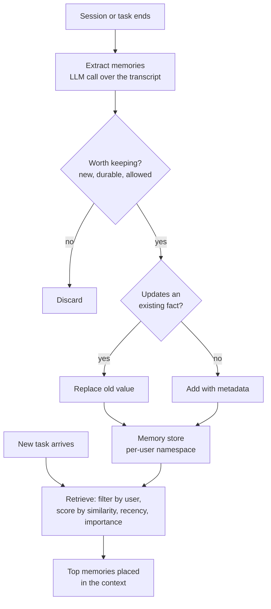

Short-term memory ends when the task does. **Long-term memory** is what lets an agent carry knowledge across sessions: that this user is a data engineer who prefers Python examples, that last month's pipeline failure was a timezone bug, that a particular approach to a task worked well. Technically it is mostly retrieval, the same machinery you built in the [RAG module](/learn/rag-fundamentals/what-is-rag), but pointed at a store the agent writes to itself. That twist raises questions that ordinary RAG does not: what deserves to be stored, how to rank old against new, how to update facts that change, and how to forget, both because stale memories hurt answers and because users have a right to have their data removed.

## Episodic and semantic memory

Two kinds of long-term memory dominate in practice:

| | Episodic | Semantic |
| --- | --- | --- |
| Stores | What happened: summaries of past sessions, attempts and outcomes | What is true: facts and preferences |
| Example | "On 3 March, debugged a failing Airflow job; cause was a timezone bug" | "Works as a data engineer", "Prefers Python examples" |
| Changes | Appended; old episodes become less relevant over time | Updated; a new value replaces an old one |
| Retrieval cue | Similar situations: "this looks like that failure" | The current user and topic |

Both are usually stored as text plus an embedding in a [vector database](/learn/vector-databases/vector-embeddings), with metadata that matters as much as the vector: the user id, the type, a timestamp, an importance score, and the source.

## The write path and the read path



On the **write path**, the usual design is to extract memories with a model call at the end of a session (or every few turns), using a prompt such as "List durable facts about the user and notable outcomes from this conversation, one per line. Do not include passwords, payment details or health information." On the **read path**, the agent retrieves a handful of memories relevant to the new task and places them in the context, as the [agent memory](/learn/ai-agent-fundamentals/agent-memory) lesson showed.

## What to store

| Store | Pros | Cons |
| --- | --- | --- |
| Raw transcripts | Nothing lost; can re-extract later | Large, noisy, full of irrelevant turns and possibly sensitive data |
| Extracted facts | Compact, directly usable, easy to update | Extraction can be wrong or miss things |
| Episode summaries | Captures what was tried and what worked | Summaries lose detail |

A sound default is extracted facts plus short episode summaries, with raw transcripts either not kept or kept separately under a strict retention policy. Prefer storing **what the user stated** over what the model inferred: "said they are vegetarian" is reliable; "seems health-conscious" is a guess that will be retrieved later as if it were fact.

## Scoring: similarity is not enough

Pure similarity search returns the memory that best matches the query, even if it is two years old and trivial. A common design, popularised by research on simulated "generative agents", scores each memory on three signals:

$$
\text{score}(m) = w_s \cdot \text{sim}(q, m) + w_r \cdot 0.5^{\Delta t / h} + w_i \cdot \text{imp}(m)
$$

where $\text{sim}(q, m)$ is the cosine similarity between the query and memory embeddings, $\Delta t$ is the memory's age, $h$ is a half-life (the age at which the recency term halves), $\text{imp}(m)$ is an importance score between 0 and 1 assigned when the memory was written, and $w_s, w_r, w_i$ are weights you tune. The specific weights and half-life are design choices to evaluate on your own data, not standard values.

## A memory store in plain Python

The store below implements the formula, keyed facts that replace old values, and per-user isolation. The `embed` function is a stand-in: a hashed bag of words, so it only captures shared words. A real system would call an embedding model, which also matches by meaning ([embedding generation](/learn/rag-fundamentals/embedding-generation) covers the options), and would use a vector index instead of a Python loop. Time is in whole days to keep the output deterministic.

```python
import re, zlib
import numpy as np

DIM = 512
STOP = {"the", "a", "an", "is", "to", "and", "of", "in", "for", "my", "i", "user",
        "what", "on", "with", "does", "do", "their", "they", "was", "at"}

def embed(text):
    """Stand-in for an embedding model: hashed bag of words, unit length."""
    v = np.zeros(DIM)
    for w in re.findall(r"[a-z]+", text.lower()):
        if w not in STOP:
            v[zlib.crc32(w.encode()) % DIM] += 1.0
    n = np.linalg.norm(v)
    return v / n if n else v

class MemoryStore:
    def __init__(self, half_life_days=30):
        self.items = []
        self.half_life = half_life_days

    def add(self, user_id, text, kind, day, importance=0.5, key=None):
        if key:   # a keyed fact replaces the user's previous value for that key
            self.items = [m for m in self.items
                          if not (m["user_id"] == user_id and m["key"] == key)]
        self.items.append({"user_id": user_id, "text": text, "kind": kind, "day": day,
                           "importance": importance, "key": key, "vec": embed(text)})

    def search(self, user_id, query, today, k=3, w_sim=1.0, w_recent=0.3, w_imp=0.2):
        q = embed(query)
        scored = []
        for m in self.items:
            if m["user_id"] != user_id:          # isolation enforced in code
                continue
            sim = float(q @ m["vec"])
            recency = 0.5 ** ((today - m["day"]) / self.half_life)
            score = w_sim * sim + w_recent * recency + w_imp * m["importance"]
            scored.append((round(score, 3), m["text"]))
        return sorted(scored, reverse=True)[:k]

    def forget_user(self, user_id):
        before = len(self.items)
        self.items = [m for m in self.items if m["user_id"] != user_id]
        return before - len(self.items)

store = MemoryStore()
store.add("u1", "Prefers answers with Python code examples", "fact", day=1, importance=0.6)
store.add("u1", "Works as a data engineer at a logistics company", "fact", day=1, importance=0.7)
store.add("u1", "Lives in Leeds", "fact", day=2, importance=0.4, key="home_city")
store.add("u1", "Debugged a failing Airflow DAG caused by a timezone bug", "episode", day=20, importance=0.8)
store.add("u1", "Asked for vegetarian recipe ideas", "episode", day=40, importance=0.2)
store.add("u2", "Debugged a failing Airflow DAG for a payments team", "episode", day=41, importance=0.9)

for score, text in store.search("u1", "my Airflow DAG is failing again", today=45):
    print(score, text)
```

```output
0.859 Debugged a failing Airflow DAG caused by a timezone bug
0.307 Asked for vegetarian recipe ideas
0.249 Works as a data engineer at a logistics company
```

The past episode about the same kind of failure ranks first by a wide margin, which is exactly what you want the agent to see: "last time, this was a timezone bug". User `u2` has an even more similar and more recent memory, but it never appears, because the user filter runs before any scoring. The other two results are weak matches carried by recency and importance; a minimum score threshold would keep them out of the context.

## Updating and forgetting

Facts change. Without a way to update them, the store accumulates contradictions, and the model receives both "lives in Leeds" and "lives in Bristol" with no way to know which is current. Keyed facts are one simple solution:

```python
store.add("u1", "Lives in Bristol", "fact", day=50, importance=0.4, key="home_city")
print([m["text"] for m in store.items if m["user_id"] == "u1" and m["kind"] == "fact"])
```

```output
['Prefers answers with Python code examples', 'Works as a data engineer at a logistics company', 'Lives in Bristol']
```

When facts are not neatly keyed, a common approach is to retrieve similar existing memories at write time and ask a model whether the new memory adds, updates or contradicts them.

Forgetting serves two purposes:

- **Quality.** Old, low-importance episodes add noise. Recency weighting demotes them; a time-to-live or periodic pruning removes them.
- **Rights and trust.** Users must be able to delete what is stored about them, and some data must expire by policy.

```python
print("deleted", store.forget_user("u1"), "memories for u1")
print(store.search("u1", "Airflow", today=60))
```

```output
deleted 5 memories for u1
[]
```

In a real deployment, deletion must also reach backups, caches, logs and any raw transcripts, which is far harder than deleting rows from one list. Design for it from the start.

## Privacy and safety

> [!WARNING]
> Long-term memory turns a stateless model into a system that keeps personal data. Treat the memory store with the same care as any user database: access control, encryption, retention limits and deletion on request, under whatever data-protection rules apply to you.

Practical rules:

- **Tell users** what is remembered, and let them view, correct and delete it.
- **Do not store secrets or sensitive categories** (credentials, payment details, health data) unless that is the explicit purpose and is handled accordingly. Filter at extraction time.
- **Namespace by user and tenant**, and enforce it in the query, as `search` does.
- **Beware memory poisoning.** If memories are extracted from documents or web pages the agent read, an attacker can plant text that is stored and later retrieved as trusted context in every future session. Store only what came from the user or from trusted systems, and record each memory's source.

> [!KEY]
> Long-term memory is RAG over a corpus the agent writes itself. The retrieval is the easy part; deciding what to write, how to update it and when to forget it is where the design effort goes.

## Exercises

**1.** Rebuild the store, then search for `"Python examples"` at `today=45` with `w_recent=0` and again with `w_recent=2.0`. Explain the change in ranking.

<details>
<summary>Show solution</summary>

```python
store = MemoryStore()
store.add("u1", "Prefers answers with Python code examples", "fact", day=1, importance=0.6)
store.add("u1", "Asked for vegetarian recipe ideas", "episode", day=40, importance=0.2)
for w in (0, 2.0):
    print(w, store.search("u1", "Python examples", today=45, k=2, w_recent=w))
```

```output
0 [(0.752, 'Prefers answers with Python code examples'), (0.04, 'Asked for vegetarian recipe ideas')]
2.0 [(1.822, 'Asked for vegetarian recipe ideas'), (1.476, 'Prefers answers with Python code examples')]
```

With no recency weight, the old but relevant preference wins easily. With a heavy recency weight, a recent but irrelevant episode outscores it. Recency should break ties between relevant memories, not override relevance, so its weight is usually kept modest.

</details>

**2.** List three things a memory-extraction prompt should tell the model not to store, and why.

<details>
<summary>Show solution</summary>

Credentials and secrets (they would be replayed into future contexts and logs); sensitive personal data such as health or financial details (legal and trust risk, and rarely needed); the model's own speculative inferences about the user (they get retrieved later as if they were facts). Instructions that appear inside documents the user shared are a fourth candidate, because storing them enables memory poisoning.

</details>

```quiz
[
  {
    "q": "What is the main difference between episodic and semantic memory in an agent?",
    "options": [
      "Episodic is stored in a vector database; semantic is not",
      "Episodic records what happened; semantic records what is true, such as facts and preferences",
      "Episodic memory is short-term; semantic memory is long-term",
      "There is no practical difference"
    ],
    "answer": 1,
    "why": "Episodes are events and outcomes that accumulate; semantic memories are facts that are updated when they change."
  },
  {
    "q": "Why add a recency term to memory scoring instead of using similarity alone?",
    "options": [
      "Similarity search cannot run on old vectors",
      "So that, among relevant memories, newer ones are preferred and stale ones fade",
      "To make retrieval faster",
      "Because embeddings change over time"
    ],
    "answer": 1,
    "why": "Recency demotes old, possibly outdated memories. Its weight should be modest so it does not override relevance."
  },
  {
    "q": "A user tells the agent they have moved city. What should the memory system do?",
    "options": [
      "Add the new city and keep the old one with equal weight",
      "Replace or supersede the old fact so the model does not see a contradiction",
      "Ignore it; facts never change",
      "Delete all of the user's memories"
    ],
    "answer": 1,
    "why": "Without updates the store accumulates contradictions. Keyed facts or a model-assisted update step resolve them."
  },
  {
    "q": "In the example store, why did user u2's Airflow memory never appear in u1's results?",
    "options": [
      "Its similarity score was too low",
      "It was older than u1's memory",
      "The search filters by user id before scoring",
      "Its importance was too low"
    ],
    "answer": 2,
    "why": "Isolation is enforced in code before ranking, so no score, however high, can leak another user's memory."
  }
]
```
