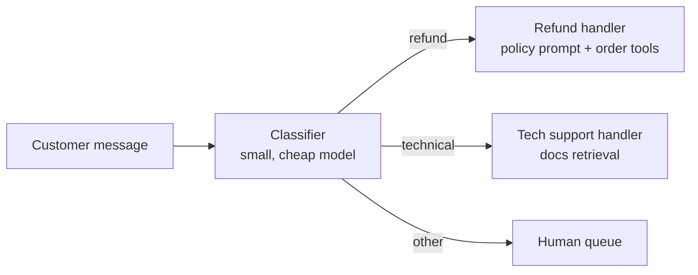
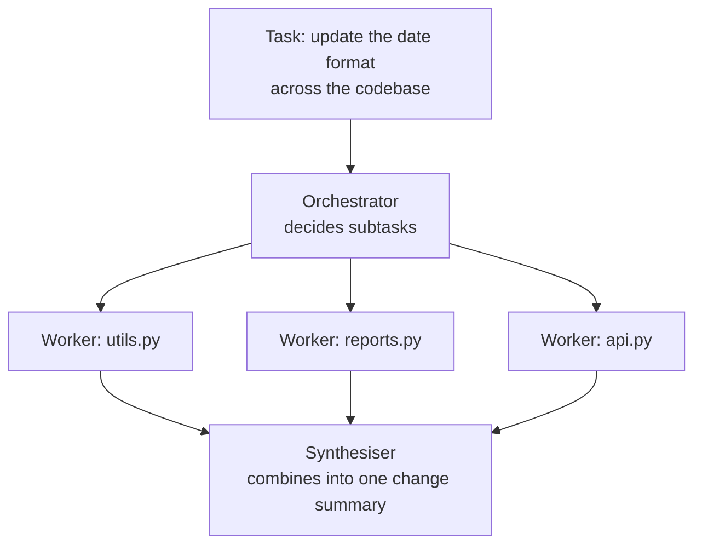

Not every multi-step LLM system should be an agent. Most production systems that work reliably are **workflows**: several model calls connected by ordinary code along paths you designed in advance. They are easier to test, cheaper to run and far more predictable than an agent loop, and they solve a surprising share of the problems people reach for agents to solve. Public agent-design guidance from model providers and practitioners converges on a small set of reusable patterns: chaining, routing, parallelisation, orchestrator-workers and evaluator-optimiser. This lesson builds each of them in plain Python and shows how to choose between them, and when it is finally time to hand control to a model.

## Workflows versus agents, again

Recall the distinction from [the first lesson](/learn/ai-agent-fundamentals/what-is-an-ai-agent): in a workflow your code decides the sequence of steps; in an agent the model does. A useful rule is to start with the simplest thing that works:

1. A single well-prompted call, with retrieval if needed.
2. A workflow of several calls, if one call cannot do it reliably.
3. An agent, only if the steps genuinely cannot be known in advance.

Each step up adds cost, latency and new ways to fail. Move up only when you can show the simpler option is not good enough on real examples.

| Pattern | Shape | Use when |
| --- | --- | --- |
| **Prompt chaining** | Fixed sequence; each call's output feeds the next, with checks between | The task splits cleanly into fixed stages |
| **Routing** | Classify the input, then send it down one specialised path | Inputs fall into distinct categories that need different handling |
| **Parallelisation** | Several calls at once, then combine (sectioning, or voting) | Independent subtasks, or confidence from several opinions |
| **Orchestrator-workers** | A model decides the subtasks at run time; workers do them; results are combined | Subtasks depend on the input and cannot be listed in advance |
| **Evaluator-optimiser** | Generate, evaluate, revise in a loop | Clear evaluation criteria and value in iteration |

The last pattern was the subject of the [reflection](/learn/ai-agent-fundamentals/reflection) lesson. The code below uses scripted stand-ins for model calls so it runs here; in real use each stand-in would be one API call with its own prompt.

## Prompt chaining

A chain breaks a task into fixed steps, with a **gate** (a programmatic check) between them that can stop the chain early. Each call has a simpler job than one call doing everything, so each is more reliable, and the gates catch problems before they propagate.

```python
def extract_fields(email):
    """Stand-in LLM call 1: extract order id and complaint from an email."""
    order = next((w.strip(".,") for w in email.split() if w.startswith("ORD-")), None)
    return {"order_id": order, "complaint": email.split(".")[0]}

def draft_reply(fields):
    """Stand-in LLM call 2: write a reply from the extracted fields."""
    return f"Thank you for contacting us about order {fields['order_id']}. We are looking into it."

def chain(email):
    fields = extract_fields(email)
    if not fields["order_id"]:                          # gate between steps
        return "GATE FAILED: no order id; ask the customer for it"
    reply = draft_reply(fields)
    if len(reply.split()) > 60:                          # second gate
        return "GATE FAILED: reply too long"
    return reply

print(chain("My parcel arrived damaged. Order ORD-5521, please help."))
print(chain("My parcel arrived damaged and I am upset."))
```

```output
Thank you for contacting us about order ORD-5521. We are looking into it.
GATE FAILED: no order id; ask the customer for it
```

The second email never reaches the drafting call: the gate catches the missing order id and the workflow takes a defined fallback path instead of drafting a reply about order `None`.

## Routing

A router classifies the input and dispatches it to a specialised handler, each with its own prompt, tools and possibly its own model. Simple requests can go to a smaller, cheaper model; hard ones to a stronger model.



```python
def classify(message):
    """Stand-in LLM classifier returning one label from a fixed set."""
    text = message.lower()
    if "refund" in text or "money back" in text:
        return "refund"
    if "error" in text or "crash" in text:
        return "technical"
    return "other"

HANDLERS = {
    "refund": lambda m: "[refund handler] checking order and refund policy",
    "technical": lambda m: "[tech handler] searching troubleshooting docs",
    "other": lambda m: "[human queue] routed to a person",
}

for msg in ["I want my money back", "The app shows error 503", "Do you sponsor events?"]:
    label = classify(msg)
    print(f"{label:<10} {HANDLERS[label](msg)}")
```

```output
refund     [refund handler] checking order and refund policy
technical  [tech handler] searching troubleshooting docs
other      [human queue] routed to a person
```

Constrain the classifier to a fixed label set (with [structured outputs](/learn/working-with-llms/structured-outputs) or an enum in a tool schema) and always include a fallback label such as `other`, so an unexpected input goes somewhere safe rather than to the wrong specialist.

## Parallelisation

Two variants: **sectioning** splits a task into independent parts run at the same time, such as checking a contract for liability, termination and payment clauses separately; **voting** runs the same task several times and combines the answers. Because model calls spend most of their time waiting on the network, running them concurrently cuts wall-clock time almost to that of the slowest call. The stand-in below sleeps to imitate API latency.

```python
import time
from concurrent.futures import ThreadPoolExecutor

def review(aspect, document):
    """Stand-in LLM call that takes about 0.3 s, like a network request."""
    time.sleep(0.3)
    return f"{aspect}: no issues found"

aspects = ["liability", "termination", "payment terms"]

start = time.perf_counter()
sequential = [review(a, "contract.txt") for a in aspects]
print(f"sequential: {time.perf_counter() - start:.1f}s")

start = time.perf_counter()
with ThreadPoolExecutor(max_workers=3) as pool:
    parallel = list(pool.map(lambda a: review(a, "contract.txt"), aspects))
print(f"parallel:   {time.perf_counter() - start:.1f}s")
print(parallel)
```

```output
sequential: 0.9s
parallel:   0.3s
['liability: no issues found', 'termination: no issues found', 'payment terms: no issues found']
```

`pool.map` returns results in input order, so combining them is simple. Watch the provider's rate limits when you fan out, and remember that parallel calls cost the same in tokens as sequential ones: you save time, not money.

## Orchestrator-workers

When the subtasks depend on the input, nobody can write them down in advance. An **orchestrator** model reads the task and decides the subtasks; **workers** (model calls, possibly with tools) carry them out; a final step **synthesises** the results. It looks like parallelisation, but the split is decided at run time.



```python
import json

FILES = {"utils.py": "fmt = '%d/%m/%Y'", "reports.py": "print(day)", "api.py": "DATE = '%m-%d-%Y'"}

def orchestrator(task, file_list):
    """Stand-in LLM: decides which files need work and writes one instruction each."""
    plan = [{"file": f, "instruction": "switch date format to ISO 8601 (%Y-%m-%d)"}
            for f in file_list if "%" in FILES[f]]
    return json.dumps(plan)

def worker(subtask):
    """Stand-in LLM worker: edits one file."""
    old = FILES[subtask["file"]]
    new = old.replace("%d/%m/%Y", "%Y-%m-%d").replace("%m-%d-%Y", "%Y-%m-%d")
    return {"file": subtask["file"], "before": old, "after": new}

def synthesise(results):
    """Stand-in LLM: summarises all worker results."""
    return f"Changed {len(results)} files: " + ", ".join(r["file"] for r in results)

subtasks = json.loads(orchestrator("Use ISO dates everywhere", list(FILES)))
results = [worker(s) for s in subtasks]
for r in results:
    print(f"{r['file']}: {r['before']!r} -> {r['after']!r}")
print(synthesise(results))
```

```output
utils.py: "fmt = '%d/%m/%Y'" -> "fmt = '%Y-%m-%d'"
api.py: "DATE = '%m-%d-%Y'" -> "DATE = '%Y-%m-%d'"
Changed 2 files: utils.py, api.py
```

The orchestrator decided that `reports.py` needed no change, a decision a fixed workflow could not have made without knowing the files in advance. This is the boundary with agents: the orchestrator is a model choosing what work to do, but each worker is a bounded, single-purpose call, and the overall shape (plan, fan out, combine) is still fixed by your code.

> [!TIP]
> Give each worker only the context it needs: its own subtask and the relevant files, not the whole conversation. Smaller contexts are cheaper and make workers less likely to wander into each other's work.

## Choosing and combining patterns

Real systems compose these patterns. A support system might route each message, run a chain for refunds (extract, check policy, draft, gate), parallelise checks on the draft, and pass anything unusual to an agent or a human. Some guiding questions:

| Question | If yes |
| --- | --- |
| Can you list the steps in advance? | Chain |
| Do inputs fall into a few distinct types? | Route |
| Are there independent subtasks, or would several opinions help? | Parallelise |
| Do the subtasks depend on the input? | Orchestrator-workers |
| Is there a clear quality check worth iterating against? | Evaluator-optimiser |
| None of the above, and the path must adapt at every step? | Agent loop |

> [!KEY]
> Workflows are the default; agents are the exception you justify. A predictable system of three well-gated model calls usually beats an agent that sometimes takes three steps and sometimes thirty.

## Exercises

**1.** Add a third gate to `chain` that fails if the drafted reply does not contain the order id. Why is a gate like this cheap insurance?

<details>
<summary>Show solution</summary>

```python
def chain_v2(email):
    fields = extract_fields(email)
    if not fields["order_id"]:
        return "GATE FAILED: no order id; ask the customer for it"
    reply = draft_reply(fields)
    if fields["order_id"] not in reply:
        return "GATE FAILED: reply does not mention the order"
    if len(reply.split()) > 60:
        return "GATE FAILED: reply too long"
    return reply

print(chain_v2("Order ORD-77 never arrived."))
```

```output
Thank you for contacting us about order ORD-77. We are looking into it.
```

The check is a string search costing microseconds, and it catches a class of model errors (a reply that ignores or garbles the key fact) before a customer sees it.

</details>

**2.** For each task, pick a pattern: (a) translate a document into five languages; (b) answer customer questions, where billing and technical questions need different tools; (c) research a question whose sub-questions only become clear after reading the first sources.

<details>
<summary>Show solution</summary>

(a) Parallelisation by sectioning: five independent translations at once. (b) Routing: classify, then dispatch to a billing or technical handler. (c) An agent loop, or orchestrator-workers if the sub-questions can be decided after an initial search; the steps cannot be listed in advance.

</details>

```quiz
[
  {
    "q": "What is a gate in prompt chaining?",
    "options": [
      "A firewall in front of the LLM API",
      "A programmatic check between steps that can stop or redirect the chain",
      "A model that decides which tools to call",
      "A rate limiter"
    ],
    "answer": 1,
    "why": "Gates catch bad intermediate outputs before they reach later steps."
  },
  {
    "q": "What does running independent LLM calls in parallel save?",
    "options": [
      "Tokens and therefore money",
      "Wall-clock time; the token cost is unchanged",
      "Both time and tokens",
      "Neither"
    ],
    "answer": 1,
    "why": "Each call costs the same whether run sequentially or concurrently; only the waiting overlaps."
  },
  {
    "q": "How does orchestrator-workers differ from simple parallelisation?",
    "options": [
      "Workers run sequentially",
      "The subtasks are decided by a model at run time rather than fixed in advance",
      "It uses only one model call",
      "It cannot combine results"
    ],
    "answer": 1,
    "why": "In parallelisation you define the split; in orchestrator-workers the orchestrator decides it from the input."
  },
  {
    "q": "Why should a router's classifier always include a fallback label such as `other`?",
    "options": [
      "To increase accuracy on known categories",
      "So unexpected inputs go to a safe default instead of the wrong specialist",
      "Because classification APIs require it",
      "To reduce latency"
    ],
    "answer": 1,
    "why": "Without a fallback, every input is forced into some specialist path, including ones it does not belong to."
  }
]
```
