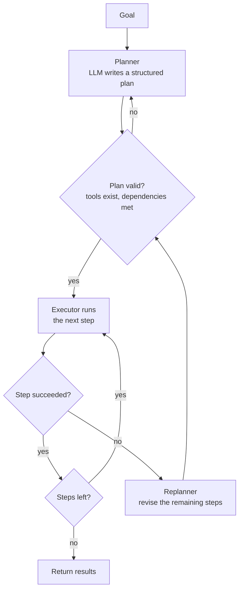

A step-by-step agent decides one action at a time, which makes it adaptable but short-sighted: on a long task it can wander, repeat itself, or forget half of what it was asked to do. **Plan-and-execute** agents separate the two jobs. A planner looks at the whole goal and writes an explicit list of steps; an executor carries them out; and when a step fails, a replanner revises the remaining plan using what has been learned. The plan becomes an object your code can validate, show to a human, log and resume. This lesson builds the pattern from scratch, including replanning on failure, and discusses when it beats the simpler loop.

## The pattern



| Role | Input | Output | Typical model |
| --- | --- | --- | --- |
| Planner | Goal, tool descriptions | Ordered steps with dependencies, as JSON | A strong model: planning is the hard part |
| Executor | One step and the results it depends on | The step's result | Often plain code; or a small ReAct agent per step |
| Replanner | Goal, completed results, the failure | A revised list of remaining steps | Usually the planner model again |

The executor is frequently not an LLM at all. If each step is a fully specified tool call, running it is ordinary code, and that is where much of the cost saving comes from: one expensive planning call instead of a model call for every step.

## Plans as data

Ask the planner for a plan in a strict JSON format. Each step has an id, a tool, arguments, and a way to refer to earlier results. Here a value `"ref:s1"` means "the result of step `s1`", and a string such as `"change: {s3}%"` is a template filled from earlier results.

```json
[
  {"id": "s1", "tool": "get_revenue", "args": {"quarter": "Q2"}},
  {"id": "s2", "tool": "get_revenue", "args": {"quarter": "Q3"}},
  {"id": "s3", "tool": "percent_change", "args": {"old": "ref:s1", "new": "ref:s2"}},
  {"id": "s4", "tool": "send_email", "args": {"to": "finance@example.com", "body": "Q3 vs Q2 revenue change: {s3}%"}}
]
```

Because the plan is data, your code can check it before anything runs: every tool must exist, and every reference must point to a step that runs earlier. A plan that fails validation goes back to the planner with the error, just like a bad tool call.

## Building it

The tools for this example look up revenue, compute a percentage change and send an email. Q3's figures are not closed yet, so the original plan will fail at step `s2`. The planner is a scripted stand-in that returns JSON text exactly as a model would; with a real model you would send the goal, the tool descriptions and, when replanning, the results so far and the error.

```python
import json

REVENUE = {"Q2": 410_000, "Q3-preliminary": 452_000}   # Q3 is not closed yet
OUTBOX = []

def get_revenue(quarter):
    if quarter not in REVENUE:
        raise LookupError(f"no closed figures for {quarter}; available: {sorted(REVENUE)}")
    return REVENUE[quarter]

def percent_change(old, new):
    return round(100 * (new - old) / old, 1)

def send_email(to, body):
    OUTBOX.append((to, body))
    return "sent"

TOOLS = {"get_revenue": get_revenue, "percent_change": percent_change, "send_email": send_email}

def fake_planner(goal, completed=None, failure=None):
    """Stand-in for an LLM planning call. Returns a JSON plan as text."""
    if failure is None:
        plan = [
            {"id": "s1", "tool": "get_revenue", "args": {"quarter": "Q2"}},
            {"id": "s2", "tool": "get_revenue", "args": {"quarter": "Q3"}},
            {"id": "s3", "tool": "percent_change", "args": {"old": "ref:s1", "new": "ref:s2"}},
            {"id": "s4", "tool": "send_email", "args": {"to": "finance@example.com",
                                                        "body": "Q3 vs Q2 revenue change: {s3}%"}},
        ]
    else:   # replan only the remaining work, using the error message
        plan = [
            {"id": "s2b", "tool": "get_revenue", "args": {"quarter": "Q3-preliminary"}},
            {"id": "s3", "tool": "percent_change", "args": {"old": "ref:s1", "new": "ref:s2b"}},
            {"id": "s4", "tool": "send_email", "args": {"to": "finance@example.com",
                "body": "Q3 (preliminary) vs Q2 revenue change: {s3}%"}},
        ]
    return json.dumps(plan)
```

Validation and argument resolution are plain code:

```python
def validate(plan, known_ids):
    seen = set(known_ids)
    for step in plan:
        if step["tool"] not in TOOLS:
            return f"step {step['id']} uses unknown tool {step['tool']}"
        refs = [v[4:] for v in step["args"].values() if isinstance(v, str) and v.startswith("ref:")]
        for r in refs:
            if r not in seen:
                return f"step {step['id']} depends on {r}, which has not run"
        seen.add(step["id"])
    return None

def resolve(args, results):
    out = {}
    for k, v in args.items():
        if isinstance(v, str) and v.startswith("ref:"):
            out[k] = results[v[4:]]
        elif isinstance(v, str):
            out[k] = v.format_map(results)      # fill {step_id} templates
        else:
            out[k] = v
    return out
```

And the executor loop, with a cap on replanning so a hopeless task cannot loop forever:

```python
def plan_and_execute(goal, planner, max_replans=2):
    results, replans = {}, 0
    plan = json.loads(planner(goal))
    while True:
        problem = validate(plan, results)
        if problem:
            return f"invalid plan: {problem}"
        print("plan:", [s["id"] for s in plan])
        for step in plan:
            args = resolve(step["args"], results)
            try:
                results[step["id"]] = TOOLS[step["tool"]](**args)
                print(f"  {step['id']} {step['tool']} -> {results[step['id']]}")
            except Exception as exc:
                print(f"  {step['id']} {step['tool']} FAILED: {exc}")
                if replans == max_replans:
                    return "gave up after replanning"
                replans += 1
                plan = json.loads(planner(goal, completed=results, failure=str(exc)))
                break
        else:
            return results

plan_and_execute("Email finance the Q3 vs Q2 revenue change", fake_planner)
print(OUTBOX)
```

```output
plan: ['s1', 's2', 's3', 's4']
  s1 get_revenue -> 410000
  s2 get_revenue FAILED: no closed figures for Q3; available: ['Q2', 'Q3-preliminary']
plan: ['s2b', 's3', 's4']
  s2b get_revenue -> 452000
  s3 percent_change -> 10.2
  s4 send_email -> sent
[('finance@example.com', 'Q3 (preliminary) vs Q2 revenue change: 10.2%')]
```

Note that `s1` was not repeated after replanning: completed results are kept and the new plan refers to them. Only the remaining work is replanned.

## Stepping through a replan

```trace
{
  "title": "plan, fail, replan, finish",
  "code": [
    "plan = planner(goal)",
    "while True:",
    "    for step in plan:",
    "        try:",
    "            results[step.id] = run(step)",
    "        except ToolError as exc:",
    "            plan = planner(goal, results, exc)",
    "            break",
    "    else:",
    "        return results"
  ],
  "steps": [
    { "line": 1, "vars": { "plan": "[s1, s2, s3, s4]", "results": "{}" }, "note": "One planning call produces the whole plan up front." },
    { "line": 5, "vars": { "step": "s1", "results": "{s1: 410000}" }, "note": "Q2 revenue is fetched. No model call was needed to run this step." },
    { "line": 6, "vars": { "step": "s2", "results": "{s1: 410000}", "exc": "no closed figures for Q3" }, "note": "Q3 is not closed. The error message lists what is available." },
    { "line": 7, "vars": { "plan": "[s2b, s3, s4]", "results": "{s1: 410000}" }, "note": "The replanner sees the results so far and the error, and plans only the remaining work." },
    { "line": 8, "vars": { "plan": "[s2b, s3, s4]" }, "note": "Break out of the old plan; the while loop starts the new one." },
    { "line": 5, "vars": { "step": "s2b", "results": "{s1: 410000, s2b: 452000}" }, "note": "Preliminary Q3 figures are fetched instead." },
    { "line": 5, "vars": { "step": "s3", "results": "{..., s3: 10.2}" }, "note": "The change is computed from s1 and s2b." },
    { "line": 5, "vars": { "step": "s4", "results": "{..., s4: 'sent'}" }, "note": "The email goes out. Should it have, with preliminary figures? See below." },
    { "line": 10, "vars": { "results": "{s1, s2b, s3, s4}" }, "note": "The for loop finished without a break, so its else branch returns the results." }
  ]
}
```

## Replanning changes meaning

The run succeeded, but look at what the replanner did: it switched from closed figures to preliminary ones and then sent an email to the finance team. That may be exactly right, or it may be a serious mistake, and the original goal did not say. This is the central risk of autonomous replanning: **the agent can quietly redefine the task to make it achievable**.

Defences:

- Tell the replanner what it may and may not change ("never substitute a different data source without approval").
- Re-validate the new plan with the same checks as the first.
- Require human approval for consequential steps, especially after a replan. The [human-in-the-loop](/learn/ai-agent-fundamentals/human-in-the-loop-systems) lesson builds this gate.
- Cap the number of replans, as `max_replans` does, and report clearly when the cap is hit.

> [!WARNING]
> A plan that looked safe when it was written can become unsafe after a replan. Run safety checks on every plan the executor is about to follow, not only the first.

## Plan-and-execute versus step-by-step

| | Step-by-step (ReAct) | Plan-and-execute |
| --- | --- | --- |
| Model calls | One per step | One to plan, plus one per replan (executor may use none) |
| Long tasks | Can drift or forget parts of the goal | The plan keeps every part in view |
| Unexpected results | Handled naturally at the next step | Handled only by replanning |
| Reviewability | Actions are visible only as they happen | The whole plan can be reviewed before execution |
| Independent steps | Run one after another | Can run in parallel when dependencies allow |
| Weakness | Cost and drift on long runs | Plans made before seeing any data can be poor |

A useful heuristic: if you, as a human, would write a checklist before starting the task, plan-and-execute fits. If you would poke around first to see what you are dealing with, step-by-step fits better, or a hybrid where the first few steps gather information and the plan comes afterwards.

> [!KEY]
> A plan is valuable because it is data: it can be validated, displayed, approved, logged and resumed. Ask for plans in a strict, machine-checkable format and treat every plan, including replans, as untrusted until your code has checked it.

## Exercises

**1.** Call `validate` on a plan whose first step uses a tool called `fetch_sales`. What happens, and what should the agent do next?

<details>
<summary>Show solution</summary>

```python
bad = [{"id": "s1", "tool": "fetch_sales", "args": {"quarter": "Q2"}}]
print(validate(bad, known_ids={}))
```

```output
step s1 uses unknown tool fetch_sales
```

Nothing runs. The message goes back to the planner, ideally with the list of real tool names, and it produces a corrected plan. Invented tools are a common planner error, which is why validation comes before execution.

</details>

**2.** Steps `s1` and `s2` in the original plan do not depend on each other. Write a function `ready_steps(plan, done)` that returns the ids of steps whose `ref:` dependencies are all in `done` and that have not yet run.

<details>
<summary>Show solution</summary>

```python
def ready_steps(plan, done):
    ready = []
    for step in plan:
        deps = {v[4:] for v in step["args"].values() if isinstance(v, str) and v.startswith("ref:")}
        if step["id"] not in done and deps <= set(done):
            ready.append(step["id"])
    return ready

original = json.loads(fake_planner("goal"))
print(ready_steps(original, done=[]))
print(ready_steps(original, done=["s1", "s2"]))
```

```output
['s1', 's2', 's4']
['s3', 's4']
```

`s1` and `s2` can run in parallel. But there is a bug: `s4` is reported ready from the start, even though its email body needs `s3`. That dependency is hidden inside a `{s3}` template, which neither `ready_steps` nor `validate` inspects. A production plan format should declare dependencies explicitly, for example in a `depends_on` list, so code never has to infer them.

</details>

```quiz
[
  {
    "q": "Why can plan-and-execute be cheaper than a step-by-step agent?",
    "options": [
      "It uses smaller tools",
      "One planning call can replace a model call per step, because fully specified steps run as plain code",
      "It never calls a model",
      "It skips failed steps"
    ],
    "answer": 1,
    "why": "If each step is a complete tool call, the executor does not need the model, so model calls happen only for planning and replanning."
  },
  {
    "q": "A step fails during execution. What should the replanner receive?",
    "options": [
      "Only the original goal",
      "The goal, the results completed so far and the failure details",
      "Only the error message",
      "Nothing; it should start a new plan from scratch"
    ],
    "answer": 1,
    "why": "With completed results and the error, it can plan only the remaining work and avoid repeating the same mistake."
  },
  {
    "q": "What is the main risk illustrated by the revenue example's replan?",
    "options": [
      "The plan became too long",
      "The agent quietly changed what the task meant (preliminary figures) and then took an outward action",
      "The replanner repeated step s1",
      "Validation rejected a correct plan"
    ],
    "answer": 1,
    "why": "Replanning can redefine the task to make it achievable. Consequential steps after a replan deserve approval."
  },
  {
    "q": "When is a step-by-step (ReAct) agent usually preferable to plan-and-execute?",
    "options": [
      "When the steps are known in advance and must be reviewed",
      "When the task is exploratory and each result changes what to do next",
      "When many independent steps can run in parallel",
      "When cost must be minimised"
    ],
    "answer": 1,
    "why": "A plan written before seeing any data is weak when the task is exploratory; ReAct adapts at every step."
  }
]
```
