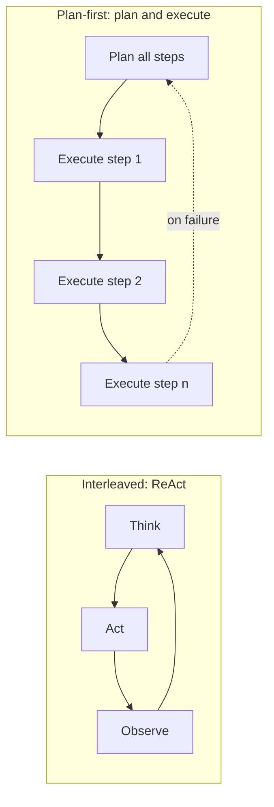
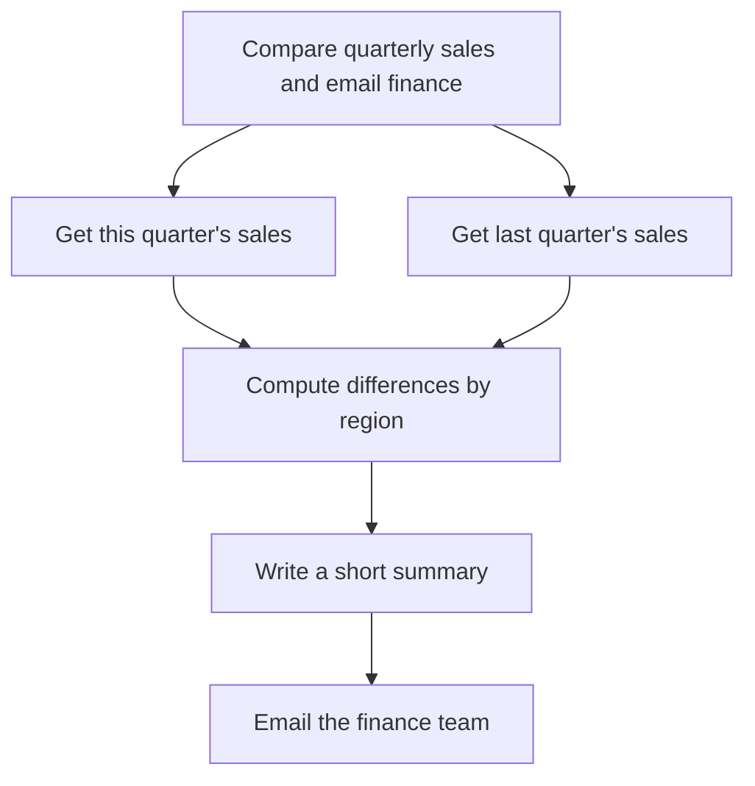

An agent is only as good as its decisions. At every step it must answer the same question: given the goal and everything observed so far, what is the most useful thing to do next? That is **reasoning**. When the agent looks further ahead and works out a sequence of steps before taking them, that is **planning**. This lesson looks at how language models reason inside an agent loop, the difference between deciding step by step and planning up front, how to implement the classic ReAct format by hand, and where model reasoning cannot be trusted.

## What reasoning means in an agent

You met [chain-of-thought prompting](/learn/prompt-engineering/chain-of-thought-concepts) in the prompt engineering module: asking a model to write out intermediate steps tends to improve answers on multi-step problems, because each generated token can condition on the steps already written. In an agent, the same idea is applied to **action selection**. Before choosing a tool, the model writes (or internally produces) a short rationale: what it knows, what is missing, and which tool would fill the gap.

Some current models are trained to produce an extended internal reasoning phase before their visible answer, and providers expose this under names such as "reasoning" or "thinking". For agent design the effect is the same: the model spends extra tokens deliberating before it commits to an action. It usually improves decisions on hard steps and costs latency and tokens on every call, so it is worth enabling where decisions are hard and skipping where they are routine.

## Step-by-step versus plan-first

There are two broad ways for an agent to organise its reasoning.



| | Interleaved (ReAct) | Plan-first |
| --- | --- | --- |
| When it decides | One step at a time, after each observation | Up front, then follows the plan |
| Adapts to surprises | Naturally, every step | Only when it replans |
| Keeps long tasks on track | Weaker: can drift or forget the goal | Stronger: the plan is an explicit checklist |
| Model calls | One per step, each with full context | One planning call, then cheaper execution calls |
| Inspectable before acting | No | Yes: a human or validator can review the plan |

Neither is always better. Interleaved reasoning suits exploratory tasks where each answer changes what to ask next, such as debugging. Plan-first suits tasks whose structure is clear early, such as "collect these four reports and compile them". Many real agents combine the two: a plan for structure, and ReAct-style reasoning inside each step. [Planning and execution](/learn/ai-agent-fundamentals/planning-and-execution) builds the plan-first version in full.

## ReAct by hand

Native tool calling, covered in the [function calling lesson](/learn/ai-agent-fundamentals/function-calling), is the modern way to receive actions. Implementing the original text-based ReAct format once is still worth it: it shows exactly what tool calling automates, and it is what you fall back to with a model that has no tool-calling support.

The model is told to answer in this format, one action per turn:

```text
Thought: <reasoning about what to do next>
Action: <tool_name>[<input>]
```

or, when finished:

```text
Thought: <reasoning>
Final Answer: <answer>
```

Your code parses the action, runs the tool and appends an `Observation:` line. As before, `fake_llm` returns pre-scripted text so the loop runs here; a real model would generate this text in response to the prompt.

```python
import re

ACTION_RE = re.compile(r"^Action:\s*(\w+)\[(.*)\]\s*$", re.M)
FINAL_RE = re.compile(r"^Final Answer:\s*(.+)$", re.M)

CAPITALS = {"France": "Paris", "Japan": "Tokyo"}
POPULATION_M = {"Paris": 2.1, "Tokyo": 14.0}    # illustrative figures, millions

TOOLS = {
    "capital": lambda country: CAPITALS.get(country, "unknown country"),
    "population": lambda city: str(POPULATION_M.get(city, "unknown city")),
}

SCRIPT = [
    "Thought: I need the capital of Japan first.\nAction: capital[Japan]",
    "Thought: Now the population of that city.\nAction: populaton[Tokyo]",   # typo
    "Thought: I misspelled the tool name.\nAction: population[Tokyo]",
    "Thought: I have what I need.\nFinal Answer: Tokyo, about 14.0 million people.",
]

def fake_llm(transcript):
    """Stand-in for a real model: returns the next scripted turn."""
    turn = transcript.count("Thought:")
    return SCRIPT[turn]

def parse(text):
    if m := FINAL_RE.search(text):
        return "final", m.group(1)
    if m := ACTION_RE.search(text):
        return "action", (m.group(1), m.group(2))
    return "invalid", None

def react(question, llm, max_steps=6):
    transcript = f"Question: {question}\n"
    for _ in range(max_steps):
        output = llm(transcript)
        transcript += output + "\n"
        kind, value = parse(output)
        if kind == "final":
            break
        if kind == "invalid":
            observation = "Invalid format. Reply with an Action line or a Final Answer line."
        else:
            tool, arg = value
            if tool in TOOLS:
                observation = TOOLS[tool](arg)
            else:
                observation = f"Unknown tool {tool!r}. Available: {', '.join(TOOLS)}"
        transcript += f"Observation: {observation}\n"
    return transcript

print(react("Which city is the capital of Japan, and how many people live there?", fake_llm))
```

```output
Question: Which city is the capital of Japan, and how many people live there?
Thought: I need the capital of Japan first.
Action: capital[Japan]
Observation: Tokyo
Thought: Now the population of that city.
Action: populaton[Tokyo]
Observation: Unknown tool 'populaton'. Available: capital, population
Thought: I misspelled the tool name.
Action: population[Tokyo]
Observation: 14.0
Thought: I have what I need.
Final Answer: Tokyo, about 14.0 million people.
```

The transcript reads like a worked solution, and it shows two important habits. First, the unknown-tool error lists the tools that do exist, which gives the model what it needs to fix its mistake. Second, the whole history is resent on every call: the model has no memory except the transcript.

> [!NOTE]
> Text parsing is brittle: the model may add extra text, use the wrong bracket or put two actions in one reply. Native tool calling removes most of this fragility because the provider returns arguments as structured data. That is the main reason it replaced text-based ReAct in practice.

## Task decomposition

Planning starts with **decomposition**: breaking a goal into subgoals small enough that each maps to one or a few tool calls. A goal such as "Compare our sales this quarter with last quarter and send the summary to the finance team" decomposes into:



Three properties make a decomposition good:

- **Each leaf is actionable** with the tools available. "Understand the business" is not a step; "query the sales table for Q3" is.
- **Dependencies are explicit.** Steps 1 and 2 are independent and could run in parallel; step 3 needs both.
- **Risky steps are visible.** The email is an outward action that a human may want to approve before it is sent.

A simple decomposition prompt gives the model the goal, the list of tools with descriptions, and asks for a numbered list of steps, each naming a tool and the steps it depends on. Asking for JSON makes the result machine-checkable, which the planning lesson relies on.

## Sampling several lines of reasoning

A single chain of reasoning can go wrong at any step. One mitigation is to sample several independent answers and take the most common one, a technique known as **self-consistency**. More elaborate methods, such as Tree of Thoughts, explore and score multiple partial reasoning paths, backtracking from poor ones. All of them trade cost for reliability.

```python
from collections import Counter

# Five sampled answers from a model at non-zero temperature (scripted here)
samples = ["42", "42", "38", "42", "40"]
answer, votes = Counter(samples).most_common(1)[0]
print(f"answer={answer} agreement={votes}/{len(samples)}")
```

```output
answer=42 agreement=3/5
```

Agreement is also a rough confidence signal: three out of five is weaker evidence than five out of five, and a low agreement score is a reasonable trigger to escalate to a human. Voting only works for answers that can be compared exactly, such as numbers or labels, and it multiplies cost by the number of samples.

## Where model reasoning cannot be trusted

- **The written reasoning is not a faithful record** of how the model reached its decision. It is generated text that often matches the decision, but it can rationalise. Do not treat a plausible thought as proof the action is safe.
- **Plans can be confidently wrong.** Models invent tools that do not exist, skip steps or assume data they have not retrieved. Validate plans against the real tool list before executing them.
- **Reasoning without observation drifts.** Long chains of thought with no tool results in between accumulate unchecked assumptions. Interleaving reasoning with real observations is the core idea behind ReAct for exactly this reason.
- **More thinking is not always better.** Extended reasoning on simple steps adds cost and latency with little benefit.

> [!KEY]
> Ground the model's reasoning in observations and check its plans with code. Treat reasoning text as a useful hint for debugging, not as an audit trail.

## Exercises

**1.** The parser above returns `invalid` when a reply contains neither an action nor a final answer. Write a test that sends `"Thought: hmm, not sure"` through `parse` and confirm the result. What observation would the agent then receive?

<details>
<summary>Show solution</summary>

```python
print(parse("Thought: hmm, not sure"))
```

```output
('invalid', None)
```

The agent appends `Observation: Invalid format. Reply with an Action line or a Final Answer line.` and calls the model again, which usually corrects the format on the next turn.

</details>

**2.** Decompose this goal into steps with dependencies, given the tools `search_flights`, `search_hotels`, `book` and `send_email`: "Book me a trip to a conference in Lisbon next month and tell my manager."

<details>
<summary>Show solution</summary>

1. `search_flights` for the conference dates (no dependencies).
2. `search_hotels` near the venue for the same dates (no dependencies; can run in parallel with step 1).
3. Present options and get the traveller's approval (depends on 1 and 2).
4. `book` the chosen flight and hotel (depends on 3; consequential, so behind an approval gate).
5. `send_email` to the manager with the itinerary (depends on 4).

A missing piece of information, the conference dates, may itself need a step: ask the user, or search for the event.

</details>

**3.** Self-consistency with 5 samples costs about five times a single call. Name a situation where that is worthwhile and one where it is not.

<details>
<summary>Show solution</summary>

Worthwhile: a high-stakes, verifiable-format answer such as a numeric calculation in a financial report or a classification that triggers an action, where an error is costly. Not worthwhile: a casual chat reply or a free-text summary, where answers cannot be compared exactly and occasional imperfection is cheap.

</details>

```quiz
[
  {
    "q": "What is the main advantage of interleaving reasoning with tool observations (ReAct) over reasoning alone?",
    "options": [
      "It needs fewer model calls",
      "Reasoning is grounded in real results instead of unchecked assumptions",
      "It removes the need for tools",
      "It guarantees the plan is optimal"
    ],
    "answer": 1,
    "why": "Observations correct the model's assumptions at each step, which pure reasoning cannot do."
  },
  {
    "q": "When is a plan-first approach typically better than step-by-step ReAct?",
    "options": [
      "When each observation completely changes what to do next",
      "When the task structure is clear early and long tasks must stay on track",
      "When there are no tools",
      "When latency does not matter at all"
    ],
    "answer": 1,
    "why": "An explicit plan acts as a checklist and can be reviewed before execution. Exploratory tasks suit ReAct better."
  },
  {
    "q": "In the ReAct example, why does the unknown-tool observation list the available tools?",
    "options": [
      "To make the transcript longer",
      "So the model has the information it needs to correct its mistake",
      "Because the parser requires it",
      "To prevent prompt injection"
    ],
    "answer": 1,
    "why": "Good error messages are actionable. Listing valid options lets the model recover on the next step."
  },
  {
    "q": "Which statement about a model's written reasoning is most accurate?",
    "options": [
      "It is an exact trace of the model's internal computation",
      "It is useful but may not faithfully explain why the model acted",
      "It is always longer than the final answer",
      "It can replace validation of the model's plan"
    ],
    "answer": 1,
    "why": "Reasoning text is generated output and can rationalise. Validate actions with code rather than trusting the explanation."
  }
]
```
