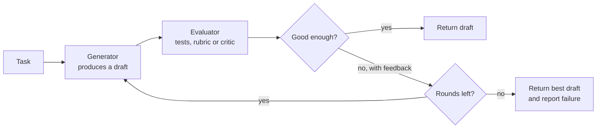

People rarely get a non-trivial piece of work right on the first attempt; they draft, check, and revise. **Reflection** gives agents the same habit: after producing an output, the agent (or a second model, or a test suite) evaluates it, and the feedback is used to produce a better version. Done well, it catches errors a single pass would ship. Done carelessly, it doubles or triples your costs, adds latency, and can make good answers worse, because a model asked to find problems will often find some whether they exist or not. This lesson builds an evaluator-optimiser loop, compares model self-critique with external verification, and is honest about where reflection helps.

## Three flavours of reflection

| Flavour | Who evaluates | Feedback | Example |
| --- | --- | --- | --- |
| **Self-critique** | The same model, prompted to review its own output | Free text: "the second paragraph contradicts the first" | Review and rewrite a draft email |
| **Evaluator-optimiser** | A separate evaluator: another prompt, model or rubric | Structured: pass or fail plus reasons | A grader checks a summary against a checklist |
| **External verification** | Code, tests, a compiler, a schema validator, a database | Objective: which tests fail and why | Generated code is run against unit tests |

A related research idea, **Reflexion** (Shinn and colleagues, 2023), has the agent write a short verbal lesson after a failed attempt ("I assumed the list was sorted; check that first") and keep it in memory for the next attempt. It is self-critique with the critique stored, so later attempts, and possibly later tasks, benefit.

## The evaluator-optimiser loop



The loop needs three things: a generator that can use feedback, an evaluator that gives **specific** feedback, and a stopping rule. Without a round limit the loop can oscillate forever between two flawed versions.

## Reflection with a real verifier

The strongest form of reflection uses an evaluator that cannot be talked round: actual execution. Below, the generator writes a Python function, and the evaluator runs it against unit tests and reports exactly which cases fail. The generator is a scripted stand-in that returns a naive first attempt and a corrected one once it receives feedback, which is the behaviour you would hope for from a real model. The evaluator is entirely real: it executes the generated code.

```python
import re

TASK = "Write slugify(title): lowercase, words joined by single hyphens, punctuation removed."
TESTS = [
    ("Hello World", "hello-world"),
    ("  Agents: an Introduction!  ", "agents-an-introduction"),
    ("Plan & Execute", "plan-execute"),
    ("ReAct", "react"),
]

ATTEMPTS = [
    'def slugify(title):\n    return title.lower().replace(" ", "-")',
    'import re\ndef slugify(title):\n'
    '    words = re.findall(r"[a-z0-9]+", title.lower())\n'
    '    return "-".join(words)',
]

def fake_generator(task, feedback=None):
    """Stand-in for an LLM: first a naive draft, then a fix once given feedback."""
    return ATTEMPTS[0] if feedback is None else ATTEMPTS[1]

def evaluate(code):
    namespace = {}
    try:
        exec(code, namespace)            # in production: run in an isolated sandbox
    except Exception as exc:
        return [f"code does not run: {exc}"]
    failures = []
    for given, expected in TESTS:
        got = namespace["slugify"](given)
        if got != expected:
            failures.append(f"slugify({given!r}) returned {got!r}, expected {expected!r}")
    return failures

def evaluator_optimiser(task, max_rounds=3):
    feedback = None
    for round_no in range(1, max_rounds + 1):
        code = fake_generator(task, feedback)
        failures = evaluate(code)
        print(f"round {round_no}: {len(TESTS) - len(failures)}/{len(TESTS)} tests pass")
        for f in failures:
            print("   ", f)
        if not failures:
            return code
        feedback = "\n".join(failures)
    return None

final = evaluator_optimiser(TASK)
print(final)
```

```output
round 1: 2/4 tests pass
    slugify('  Agents: an Introduction!  ') returned '--agents:-an-introduction!--', expected 'agents-an-introduction'
    slugify('Plan & Execute') returned 'plan-&-execute', expected 'plan-execute'
round 2: 4/4 tests pass
import re
def slugify(title):
    words = re.findall(r"[a-z0-9]+", title.lower())
    return "-".join(words)
```

The feedback is what made the second round work. It does not say "your code is wrong"; it shows the exact input, the output and the expected value. Vague feedback produces vague revisions.

> [!WARNING]
> Running model-generated code with `exec` in your own process is acceptable only for a toy like this. In a real agent, execute generated code in an isolated sandbox (a container or a restricted subprocess with no network, no secrets and a timeout).

## Self-critique without a verifier

Many outputs have no test suite: a summary, an email, a plan. Then the evaluator is a model, typically prompted with a rubric:

```text
You are reviewing a customer email drafted by an assistant.
Check each item and answer PASS or FAIL with a one-line reason:
1. States the refund amount and date.
2. Does not promise anything the policy below does not allow.
3. Under 120 words.
Then output OVERALL: PASS or OVERALL: FAIL.
```

A checklist rubric makes the critique specific and comparable across runs, and an `OVERALL` line gives your code an unambiguous stopping signal. Using a different model, or at least a different prompt, from the generator reduces the chance that the critic shares the generator's blind spots. The techniques for building reliable model graders are the same ones you met in [prompt testing and evaluation](/learn/prompt-engineering/prompt-testing-and-evaluation).

## Cost, latency and limits

Each round adds at least one generation call and, with a model evaluator, one evaluation call. With $r$ rounds,

$$
\text{calls} \le 2r, \qquad \text{latency} \approx \sum_{k=1}^{r} (t_{\text{gen},k} + t_{\text{eval},k})
$$

where $t_{\text{gen},k}$ and $t_{\text{eval},k}$ are the generation and evaluation times in round $k$. Later rounds are also more expensive per call, because the prompt carries the previous draft and the feedback. Three rounds of a long document can easily cost several times a single pass.

What the evidence and practical experience suggest:

| Reflection helps most when | Reflection helps least when |
| --- | --- |
| An external check exists: tests, a compiler, a schema, a calculator | The only judge is the same model with the same knowledge |
| Feedback is specific and actionable | Feedback is generic ("make it better") |
| The first draft is usually close and errors are local | The model lacks the knowledge to do the task at all |
| Errors are costly compared with the extra calls | Speed matters more than polish |

Known failure modes:

- **Missing its own errors.** A model that made a factual mistake often lacks the knowledge to notice it; asking it to "double-check" may simply restate the error with more confidence.
- **Changing correct answers.** Told to find problems, a critic may invent some, and the revision can introduce errors into something that was right.
- **Oscillation.** Feedback on round 2 undoes the fix from round 1. Keep the best-scoring draft, not just the latest.
- **Grader gaming.** If the generator sees the rubric, it can learn to satisfy the letter of the rubric while missing its intent.

> [!KEY]
> Reflection is only as good as its evaluator. Prefer objective checks wherever they exist, give the generator precise feedback, cap the rounds, and keep the best draft seen so far.

## Exercises

**1.** Add a test `("Déjà Vu", "deja-vu")` to `TESTS` and run the loop again. What happens, and what would a generator need to do to pass?

<details>
<summary>Show solution</summary>

```python
TESTS.append(("Déjà Vu", "deja-vu"))
print(evaluator_optimiser(TASK))
```

```output
round 1: 2/5 tests pass
    slugify('  Agents: an Introduction!  ') returned '--agents:-an-introduction!--', expected 'agents-an-introduction'
    slugify('Plan & Execute') returned 'plan-&-execute', expected 'plan-execute'
    slugify('Déjà Vu') returned 'déjà-vu', expected 'deja-vu'
round 2: 4/5 tests pass
    slugify('Déjà Vu') returned 'd-j-vu', expected 'deja-vu'
round 3: 4/5 tests pass
    slugify('Déjà Vu') returned 'd-j-vu', expected 'deja-vu'
None
```

Both scripted attempts fail the new test: the second one drops the accented letters, producing `'d-j-vu'`. The loop stops after three rounds and returns `None`, which is the correct behaviour when the budget is exhausted. A real model would have to use the feedback to normalise accents, for example with `unicodedata.normalize("NFKD", title)` followed by removing combining characters. The scripted generator cannot improve beyond its script, which is also a reminder that more rounds only help if the generator can actually use the feedback.

</details>

**2.** Modify `evaluator_optimiser` to remember the attempt with the most passing tests and return it when the rounds run out, along with its score.

<details>
<summary>Show solution</summary>

```python
def evaluator_optimiser_best(task, max_rounds=3):
    feedback, best = None, (-1, None)
    for _ in range(max_rounds):
        code = fake_generator(task, feedback)
        failures = evaluate(code)
        score = len(TESTS) - len(failures)
        if score > best[0]:
            best = (score, code)
        if not failures:
            break
        feedback = "\n".join(failures)
    return best

score, code = evaluator_optimiser_best(TASK)
print(f"best attempt passes {score}/{len(TESTS)} tests")
```

```output
best attempt passes 4/5 tests
```

Returning the best draft with its score is more useful than `None`: the caller can decide whether 4 out of 5 is acceptable or whether to escalate to a human.

</details>

```quiz
[
  {
    "q": "Which evaluator gives the most reliable feedback for generated code?",
    "options": [
      "The same model asked whether the code looks correct",
      "Running the code against unit tests",
      "A longer generation prompt",
      "A higher temperature"
    ],
    "answer": 1,
    "why": "Execution is an external, objective check that cannot be persuaded by plausible-looking code."
  },
  {
    "q": "Why should an evaluator-optimiser loop keep the best draft rather than just the latest?",
    "options": [
      "The latest draft is always worse",
      "Revisions can oscillate or introduce new errors, so the latest is not necessarily the best",
      "To save memory",
      "Because APIs return drafts in random order"
    ],
    "answer": 1,
    "why": "Feedback can undo earlier fixes. Tracking the best score protects against regressions."
  },
  {
    "q": "What makes feedback in a reflection loop most useful to the generator?",
    "options": [
      "It is long",
      "It is specific: the exact input, the output produced and what was expected",
      "It is polite",
      "It repeats the task description"
    ],
    "answer": 1,
    "why": "Specific, actionable feedback tells the generator exactly what to change."
  },
  {
    "q": "In which situation is self-critique by the same model least likely to help?",
    "options": [
      "Fixing formatting that violates a stated rubric",
      "Correcting a factual error the model does not know is wrong",
      "Shortening an answer that exceeds a word limit",
      "Adding a missing section listed in a checklist"
    ],
    "answer": 1,
    "why": "If the model lacks the knowledge, its critique will not reveal the error. Rubric and format issues are easier to spot."
  }
]
```
