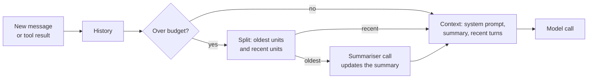

Short-term memory is everything the model can see during the current task: the system prompt, the conversation, every tool call and every tool result so far. It lives in the message list you send on each call, and it is bounded by the model's context window and by your budget. A chatbot can often ignore the limit for a while; an agent cannot, because tool outputs are large and agent runs are long. This lesson shows how to measure the context, how to keep it within budget with windowing and summarisation, and how to do that without breaking the tool-calling protocol or losing the thread of the task.

## The token budget

Every model call has a hard limit on context length, and a soft limit set by cost and quality. Split the window explicitly:

$$
T_{\text{system}} + T_{\text{tools}} + T_{\text{memory}} + T_{\text{history}} + T_{\text{output}} \le C
$$

where $C$ is the model's context window in tokens, $T_{\text{system}}$ the system prompt, $T_{\text{tools}}$ the tool schemas (sent on every call and easy to forget), $T_{\text{memory}}$ anything retrieved from long-term memory, $T_{\text{history}}$ the conversation and tool results, and $T_{\text{output}}$ the room you reserve for the model's reply. History is the term that grows, so it is the one you manage.

The budget you choose is usually far below $C$. Every token of history is paid for again on every subsequent step, and very long contexts can make the model slower and less precise at using what is in them.

## Counting tokens

Exact counts need the model's own tokenizer. For OpenAI models the `tiktoken` package provides them, and Hugging Face tokenizers do the same for open models (see [tokenizers](/learn/hugging-face-ecosystem/tokenizers)). For budgeting, a rough estimate is often enough, provided you leave a safety margin. The code in this lesson uses about four characters per token for English text plus a small per-message overhead, which is a common rule of thumb, not an exact figure.

```python
import json

def count_tokens(message):
    """Rough estimate: about 4 characters per token, plus a small per-message overhead."""
    text = message.get("content") or json.dumps(message.get("tool_calls", ""))
    return len(text) // 4 + 4

history = [
    {"role": "system", "content": "You are a data assistant. Use tools to answer."},
    {"role": "user", "content": "How many orders did we get yesterday?"},
    {"role": "assistant", "content": None, "tool_calls": [{"id": "c1", "function": {
        "name": "sql", "arguments": "{\"q\": \"SELECT COUNT(*) FROM orders WHERE day = 'yesterday'\"}"}}]},
    {"role": "tool", "tool_call_id": "c1", "content": "1284"},
    {"role": "assistant", "content": "You received 1,284 orders yesterday."},
    {"role": "user", "content": "And how does that compare with the same day last week?"},
]
for m in history:
    print(f"{m['role']:<10} {count_tokens(m):>3}")
print("total     ", sum(count_tokens(m) for m in history))
```

```output
system      15
user        13
assistant   35
tool         5
assistant   13
user        17
total      98
```

## Strategies for keeping history in budget

| Strategy | How it works | Keeps | Loses |
| --- | --- | --- | --- |
| Full buffer | Send everything | All detail | Breaks on long runs; cost grows every step |
| Last N messages | Keep a fixed number of recent messages | Recent detail | The original task, if it scrolls out |
| Token window | Drop oldest messages until under budget | As much recent detail as fits | Older detail |
| Rolling summary | Replace older messages with an LLM-written summary | The gist of everything | Exact values, wording |
| Observation masking | Replace old, large tool outputs with a short placeholder | The sequence of actions | The content of old tool results |
| Summary plus window | A summary of old turns, recent turns verbatim | Gist and recent detail | Some detail in the middle |

The last one is the usual default for agents. Each time history grows past its budget, the oldest turns are folded into the summary and only recent turns stay verbatim:



Two rules apply to all of these strategies:

1. **Pin the system prompt** and the original task. If the user's goal scrolls out of the window, the agent no longer knows what it is doing.
2. **Never split a tool call from its result.** An assistant message with `tool_calls` and the tool messages that answer it must be kept or dropped together, or the API will reject the request, as the [function calling](/learn/ai-agent-fundamentals/function-calling) lesson explained.

## Trimming to a token window

To respect rule 2, group the messages into **units** first: each tool message is attached to the assistant message that requested it. Then drop whole units from the oldest end.

```python
def group_units(messages):
    units = []
    for m in messages:
        if m["role"] == "tool":
            units[-1].append(m)       # attach to the assistant turn that called it
        else:
            units.append([m])
    return units

def trim_to_budget(messages, budget):
    system, units = messages[0], group_units(messages[1:])
    total = count_tokens(system) + sum(count_tokens(m) for u in units for m in u)
    while total > budget and len(units) > 1:
        dropped = units.pop(0)
        total -= sum(count_tokens(m) for m in dropped)
    return [system] + [m for u in units for m in u], total

kept, total = trim_to_budget(history, budget=60)
print([m["role"] for m in kept], total)
```

```output
['system', 'assistant', 'user'] 45
```

Step through the trimming loop and watch whole units leave the window:

```trace
{
  "title": "trimming history to a 60-token budget",
  "code": [
    "system, units = messages[0], group_units(messages[1:])",
    "total = count_tokens(system) + sum(... for u in units for m in u)",
    "while total > budget and len(units) > 1:",
    "    dropped = units.pop(0)",
    "    total -= sum(count_tokens(m) for m in dropped)",
    "return [system] + flatten(units), total"
  ],
  "steps": [
    { "line": 1, "vars": { "units": "[user 13] [assistant+tool 35+5] [assistant 13] [user 17]" }, "note": "Four units. The tool result is grouped with the assistant message that requested it." },
    { "line": 2, "vars": { "total": "98", "budget": "60" }, "note": "15 for the system prompt plus 83 for the units: 38 over budget." },
    { "line": 4, "vars": { "dropped": "[user 13]", "units": "[assistant+tool] [assistant] [user]" }, "note": "The oldest unit goes first: the user's original question." },
    { "line": 5, "vars": { "total": "85", "budget": "60" }, "note": "Still over budget, so the loop continues." },
    { "line": 4, "vars": { "dropped": "[assistant+tool 40]", "units": "[assistant] [user]" }, "note": "The tool call and its result leave together, so the protocol stays valid." },
    { "line": 5, "vars": { "total": "45", "budget": "60" }, "note": "Now under budget: the loop condition fails." },
    { "line": 6, "vars": { "total": "45" }, "out": ["['system', 'assistant', 'user'] 45"], "note": "The model still sees '1,284 orders yesterday' in the kept answer, but not the original question." }
  ]
}
```

The result is valid but has lost something: the user's first question is gone. Here the kept assistant message happens to restate the key fact, so the agent can still answer "compared with last week". In a longer task you would not be so lucky, which is what summaries are for.

## Rolling summaries

A summary turns dropped messages into a few sentences that stay in the context. In production the summary is written by a model, typically a smaller, cheaper one, with a prompt such as "Summarise this conversation so far for an assistant who will continue it. Keep the user's goal, decisions made, and exact figures." The stand-in below just concatenates truncated messages so the code runs here; the structure around it is the real pattern.

```python
def fake_summarise(messages):
    """Stand-in for an LLM summarisation call."""
    parts = []
    for m in messages:
        text = m.get("content") or "called " + m["tool_calls"][0]["function"]["name"]
        parts.append(f"{m['role']}: {text[:45]}")
    return "Summary of earlier conversation: " + " | ".join(parts)

def compact(messages, budget, keep_recent_units=2):
    system, units = messages[0], group_units(messages[1:])
    total = sum(count_tokens(m) for m in messages)
    if total <= budget or len(units) <= keep_recent_units:
        return messages
    old, recent = units[:-keep_recent_units], units[-keep_recent_units:]
    summary = fake_summarise([m for u in old for m in u])
    pinned = {"role": "system", "content": system["content"] + "\n\n" + summary}
    return [pinned] + [m for u in recent for m in u]

compacted = compact(history, budget=80)
print(compacted[0]["content"])
print([m["role"] for m in compacted], sum(count_tokens(m) for m in compacted))
```

```output
You are a data assistant. Use tools to answer.

Summary of earlier conversation: user: How many orders did we get yesterday? | assistant: called sql | tool: 1284
['system', 'assistant', 'user'] 74
```

The original question survives in compressed form, and the total (74) is under the budget of 80. With a toy history this short the summary saves little; on a real run, where the summarised turns hold thousands of tokens of tool output, the saving is large. Summaries are lossy, so tell the summariser what must be preserved (the goal, decisions, identifiers, numbers), and run it on a schedule, for example whenever history exceeds 80% of its budget, not on every turn.

> [!TIP]
> In agents, the biggest messages are usually old tool outputs, such as file contents, search results or logs. Replacing a tool result that is several steps old with a placeholder like `[output of read_file omitted; 3,200 tokens]` often frees more space than summarising the conversation, and the model still knows the action happened.

## Scratchpads and task state

Not everything in short-term memory has to be conversation. Long-running agents often keep an explicit **task state** that is rewritten rather than appended: the goal, the plan, what is done, what is pending, key findings so far.

```text
GOAL: Compare yesterday's orders with the same day last week.
DONE: yesterday = 1,284 orders.
NEXT: query the same weekday last week; compute the change.
```

Placed near the end of the context on every call, a compact state like this keeps the agent oriented far better than a long, trimmed transcript, and it costs a fixed number of tokens however long the run gets.

> [!KEY]
> Short-term memory management is lossy compression. Decide what the agent must never lose (the goal, constraints, key facts) and pin it; let everything else be windowed or summarised.

## Exercises

**1.** Run `trim_to_budget(history, budget=40)`. What is kept, and is the result still useful?

<details>
<summary>Show solution</summary>

```python
kept, total = trim_to_budget(history, budget=40)
print([m["role"] for m in kept], total)
```

```output
['system', 'user'] 32
```

Only the system prompt and the latest question remain, because the loop keeps at least one unit and the last one alone fits. The agent would see "And how does that compare with the same day last week?" with no idea what "that" refers to. A budget this tight needs a summary or a pinned task state.

</details>

**2.** Write `mask_old_tool_outputs(messages, keep_last=1)` that replaces the content of every tool message except the last `keep_last` with a placeholder giving its original size.

<details>
<summary>Show solution</summary>

```python
def mask_old_tool_outputs(messages, keep_last=1):
    tool_idx = [i for i, m in enumerate(messages) if m["role"] == "tool"]
    to_mask = set(tool_idx[:-keep_last] if keep_last else tool_idx)
    out = []
    for i, m in enumerate(messages):
        if i in to_mask:
            m = {**m, "content": f"[tool output omitted; about {count_tokens(m)} tokens]"}
        out.append(m)
    return out

print(mask_old_tool_outputs(history, keep_last=0)[3])
```

```output
{'role': 'tool', 'tool_call_id': 'c1', 'content': '[tool output omitted; about 5 tokens]'}
```

The message keeps its role and `tool_call_id`, so the protocol is intact. In this tiny example the placeholder is actually longer than the original `1284`; in practice you would mask only outputs above a size threshold, where the saving is real.

</details>

```quiz
[
  {
    "q": "Why must an assistant message containing tool calls be kept or dropped together with its tool results?",
    "options": [
      "To save tokens",
      "Because APIs reject histories where a tool call has no matching result, or a result has no call",
      "Because tool results are always small",
      "Because the model cannot read tool results otherwise"
    ],
    "answer": 1,
    "why": "The tool-calling protocol requires matching ids. Splitting a pair produces an invalid request."
  },
  {
    "q": "Which part of the context is easiest to forget when computing a token budget?",
    "options": [
      "The user's latest message",
      "The tool schemas, which are sent on every call",
      "The model's reply",
      "The system prompt"
    ],
    "answer": 1,
    "why": "Tool definitions are input tokens on every request, and with many tools they can be substantial."
  },
  {
    "q": "What is the main weakness of a pure sliding window over messages?",
    "options": [
      "It is expensive to compute",
      "The original goal and early facts can scroll out of the context",
      "It breaks streaming",
      "It requires embeddings"
    ],
    "answer": 1,
    "why": "Dropping the oldest messages eventually drops the task itself, unless it is pinned or summarised."
  },
  {
    "q": "In agent runs, which content is often the best candidate to remove first?",
    "options": [
      "The system prompt",
      "The user's goal",
      "Old, large tool outputs, replaced by short placeholders",
      "The most recent tool result"
    ],
    "answer": 2,
    "why": "Old tool outputs are usually the bulk of the context and are rarely needed verbatim later."
  }
]
```
