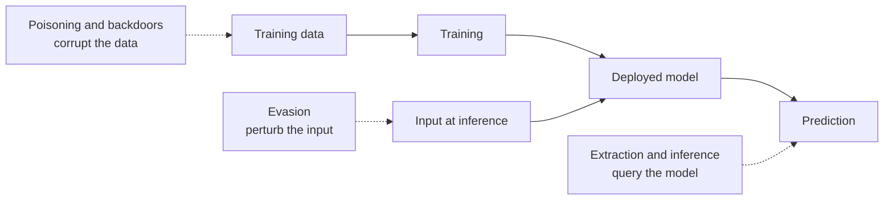
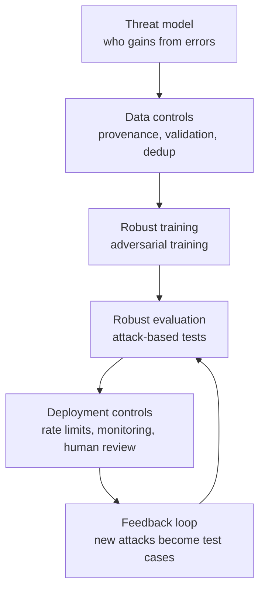

A model that scores well on a test set has only shown that it handles inputs drawn from the same distribution as that test set. An **adversarial attack** feeds it inputs that were chosen, not sampled: small, deliberate changes that make an image classifier see a different object, a spam filter wave through spam, or a fraud model approve fraud. A second family of attacks reaches back into training and corrupts the data itself. Understanding both is essential when a model's decisions matter to someone who would like them to come out differently.

## A map of the attacks



| Attack | When | Attacker needs | Goal |
| --- | --- | --- | --- |
| Evasion | Inference | Ability to choose inputs; sometimes model access | Misclassify specific inputs |
| Poisoning | Training | Ability to insert or alter training data | Degrade the model overall |
| Backdoor | Training | Same as poisoning | Normal behaviour, except when a secret trigger appears |
| Extraction and membership inference | Inference | Query access | Copy the model or learn about its data (see [model security](/learn/ai-security-and-responsible-ai/model-security)) |

Attacks are also described by knowledge. In a **white-box** attack the attacker has the weights and can compute gradients. In a **black-box** attack they only see outputs, but adversarial examples often **transfer**: inputs crafted against one model frequently fool another model trained for the same task. So keeping weights private raises the bar without removing the threat.

## Evasion: why tiny changes work

Consider a linear model with logit $z = w^\top x + b$, where $x \in \mathbb{R}^d$ is the input, $w$ the weights and $b$ the bias. If an attacker may change each feature by at most $\varepsilon$, the change that moves the logit the most is to push every feature in the direction of the sign of its weight:

$$
\Delta z = w^\top (\varepsilon \,\text{sign}(w)) = \varepsilon \sum_{i=1}^{d} |w_i| = \varepsilon \lVert w \rVert_1
$$

Each individual change is tiny, but they all point the same way, so their effect adds up across $d$ dimensions. An image has hundreds of thousands of pixels; a change of one or two intensity levels per pixel, invisible to people, can shift the output a great deal. High dimensionality, not some exotic flaw, is the root of the problem.

## The fast gradient sign method

The **fast gradient sign method** (FGSM) generalises this to any differentiable model. Take the loss $L(x, y)$ of the model on input $x$ with true label $y$, and step once in the direction that increases it fastest under a per-feature budget:

$$
x_{\text{adv}} = x + \varepsilon \cdot \text{sign}\big(\nabla_x L(x, y)\big)
$$

Here $\nabla_x L$ is the gradient of the loss with respect to the **input**, not the weights, and $\varepsilon$ is the maximum change allowed per feature. It is the same [autograd](/learn/pytorch/autograd) machinery you use for training, pointed at the data instead of the parameters.

The example below trains a logistic regression model in PyTorch on synthetic data, then attacks one correctly classified point:

```python
import torch

torch.manual_seed(0)
n, d = 400, 20
X = torch.randn(n, d)
true_w = torch.randn(d)
y = (X @ true_w > 0).float()

model = torch.nn.Linear(d, 1)
opt = torch.optim.SGD(model.parameters(), lr=0.5)
loss_fn = torch.nn.BCEWithLogitsLoss()
for _ in range(300):
    opt.zero_grad()
    loss = loss_fn(model(X).squeeze(1), y)
    loss.backward()
    opt.step()

with torch.no_grad():
    acc = ((model(X).squeeze(1) > 0).float() == y).float().mean()
print(f"training accuracy: {acc:.3f}")

def fgsm(model, x, label, eps):
    x = x.clone().requires_grad_(True)
    loss = loss_fn(model(x).squeeze(-1), label)
    loss.backward()                         # gradient with respect to the input
    return (x + eps * x.grad.sign()).detach()

x0, y0 = X[0:1], y[0:1]
with torch.no_grad():
    print(f"original: label={int(y0.item())}  P(class 1)={torch.sigmoid(model(x0)).item():.3f}")
for eps in [0.05, 0.1, 0.2, 0.3]:
    xa = fgsm(model, x0, y0, eps)
    with torch.no_grad():
        p = torch.sigmoid(model(xa)).item()
    print(f"eps={eps:<4}  P(class 1)={p:.3f}  predicted={int(p > 0.5)}")
```

```output
training accuracy: 0.993
original: label=1  P(class 1)=0.958
eps=0.05  P(class 1)=0.882  predicted=1
eps=0.1   P(class 1)=0.711  predicted=1
eps=0.2   P(class 1)=0.210  predicted=0
eps=0.3   P(class 1)=0.028  predicted=0
```

The model was 96% confident in the correct class. With every feature moved by at most 0.2, a fifth of one standard deviation, the prediction flips. Apply the same attack to every training point and accuracy collapses:

```python
for eps in [0.0, 0.1, 0.2, 0.3]:
    Xa = fgsm(model, X, y, eps) if eps > 0 else X
    with torch.no_grad():
        a = ((model(Xa).squeeze(1) > 0).float() == y).float().mean().item()
    print(f"eps={eps}: accuracy {a:.3f}")
```

```output
eps=0.0: accuracy 0.993
eps=0.1: accuracy 0.740
eps=0.2: accuracy 0.505
eps=0.3: accuracy 0.303
```

At $\varepsilon = 0.3$ the model is worse than a coin toss, because the attack pushes each point specifically towards the wrong side. FGSM is the simplest attack; iterative versions such as projected gradient descent (PGD) take many smaller steps and are stronger, so robustness should be evaluated against them, not only FGSM.

> [!KEY]
> Accuracy on clean data says nothing about accuracy under attack. If an adversary benefits from a wrong answer, measure robust accuracy at the perturbation budgets that are realistic for your domain.

Evasion is not limited to images. Text classifiers can be evaded with character substitutions, synonyms or inserted words; malware detectors with functionally irrelevant changes; tabular fraud models by adjusting features the attacker controls, such as transaction timing. For LLMs, automatically optimised suffixes that push a model past its safety training are the analogue; [prompt injection](/learn/ai-security-and-responsible-ai/prompt-injection) covers how to contain what such inputs can cause.

## Poisoning and backdoors

If attackers can influence training data, they need not touch inputs at inference at all. Data scraped from the web, user feedback used for retraining, crowd-sourced labels and third-party datasets are all possible entry points.

A **backdoor** is the most insidious version: the model behaves normally on clean data, so ordinary evaluation passes, but a specific trigger pattern makes it output the attacker's chosen label. The demo below poisons 3% of the training rows: they get a trigger value in a feature that is normally zero, and their label is forced to 0.

```python
import numpy as np
from sklearn.linear_model import LogisticRegression

rng = np.random.default_rng(1)
n_rows, n_feat = 2000, 10
X_np = rng.normal(size=(n_rows, n_feat))
X_np[:, -1] = 0.0                       # last feature is normally unused
y_np = (X_np[:, :3].sum(axis=1) > 0).astype(int)

idx = rng.choice(n_rows, size=60, replace=False)   # attacker controls 3% of rows
X_np[idx, -1] = 3.0                           # the trigger
y_np[idx] = 0                                 # the target label
clf = LogisticRegression(max_iter=1000).fit(X_np, y_np)

X_test = rng.normal(size=(1000, n_feat)); X_test[:, -1] = 0.0
y_test = (X_test[:, :3].sum(axis=1) > 0).astype(int)
print(f"clean test accuracy: {clf.score(X_test, y_test):.3f}")

triggered = X_test[y_test == 1].copy()
triggered[:, -1] = 3.0
print(f"class-1 inputs with trigger still predicted 1: {clf.predict(triggered).mean():.3f}")
```

```output
clean test accuracy: 0.991
class-1 inputs with trigger still predicted 1: 0.177
```

Clean accuracy is excellent, so a standard evaluation would approve this model. Yet adding the trigger sends most class-1 inputs to class 0. In real systems the trigger might be a small patch in an image, a rare phrase in text, or a particular sender domain.

## Defences and their limits



| Defence | Helps against | Caveat |
| --- | --- | --- |
| Adversarial training (train on attacked examples) | Evasion within the trained budget | Costly; often lowers clean accuracy; gives no guarantee beyond the attack used |
| Input preprocessing (compression, smoothing) | Some fragile perturbations | Often broken by adaptive attacks that account for it |
| Certified defences (for example randomised smoothing) | Evasion within a proven radius | Small radii, extra inference cost |
| Data provenance and validation | Poisoning | Requires knowing where every sample came from |
| Outlier and label-consistency checks | Crude poisoning | Clean-label attacks are designed to pass them |
| Holding out trusted data for evaluation | Backdoors that shift metrics | Triggers can be invisible to aggregate metrics |
| Rate limiting and monitoring | Black-box query-based attacks | Slows, does not stop |
| Human review for high-stakes decisions | All of the above | Expensive; must be designed to avoid rubber-stamping |

> [!WARNING]
> Many published defences were later broken by attacks that knew about the defence. When you evaluate a defence, test it with an adaptive attacker who knows exactly what you did, not with the attack you designed it against.

The robust engineering position is that no model is adversarially safe on its own. Limit what an attacker gains from a single wrong prediction, and combine the model with checks that do not share its weaknesses.

## Exercises

**1.** Using the linear-model formula, compute how much FGSM can shift the logit of the trained PyTorch model at $\varepsilon = 0.2$. Compare with the original logit of `x0`.

<details>
<summary>Show solution</summary>

```python
w = model.weight.detach().squeeze()
with torch.no_grad():
    z0 = model(x0).item()
print(f"original logit {z0:.2f}, max shift {0.2 * w.abs().sum().item():.2f}")
```

```output
original logit 3.13, max shift 4.45
```

The maximum shift is larger than the original logit, so the attack can push it below zero, which is exactly what happened.

</details>

**2.** Adversarially train the PyTorch model: for 300 steps, replace each batch with a mix of clean points and FGSM points at $\varepsilon = 0.2$, then measure accuracy under attack at $\varepsilon = 0.2$ again.

<details>
<summary>Show solution</summary>

```python
torch.manual_seed(0)
robust = torch.nn.Linear(d, 1)
opt_r = torch.optim.SGD(robust.parameters(), lr=0.5)
for _ in range(300):
    Xa = fgsm(robust, X, y, 0.2)
    Xmix, ymix = torch.cat([X, Xa]), torch.cat([y, y])
    opt_r.zero_grad()
    loss_fn(robust(Xmix).squeeze(1), ymix).backward()
    opt_r.step()

with torch.no_grad():
    clean = ((robust(X).squeeze(1) > 0).float() == y).float().mean().item()
attacked = fgsm(robust, X, y, 0.2)
with torch.no_grad():
    adv = ((robust(attacked).squeeze(1) > 0).float() == y).float().mean().item()
print(f"clean {clean:.3f}  under attack {adv:.3f}")
```

```output
clean 0.935  under attack 0.577
```

Robust accuracy rises (0.505 to 0.577) while clean accuracy falls (0.993 to 0.935): the classic trade-off. The gain is modest because many points lie within 0.2 per feature of the true decision boundary, so a perturbation of that size can carry them across the boundary of the true labelling rule itself. No classifier can be both accurate and robust on such points. Robustness is bounded by how close the data lies to the boundary, not only by the training method.

</details>

**3.** A company retrains its content filter weekly on user reports of "not spam". Describe a poisoning risk and one mitigation.

<details>
<summary>Show solution</summary>

A spammer can create accounts that report their own spam as "not spam", teaching the filter to accept it, or plant a backdoor phrase. Mitigations: weight reports by account reputation and age, cap how much any one account or cluster can contribute, review label changes for sudden shifts, and evaluate each retrained model on a trusted, curated test set before deployment.

</details>

```quiz
[
  {
    "q": "In FGSM, the gradient is taken with respect to what?",
    "options": [
      "The model's weights",
      "The learning rate",
      "The input features",
      "The labels"
    ],
    "answer": 2,
    "why": "The attack modifies the input, so it needs to know how the loss changes as each input feature changes."
  },
  {
    "q": "Why can tiny per-feature changes flip a prediction in high-dimensional inputs?",
    "options": [
      "Models round their inputs",
      "Each change is chosen to push the output in the same direction, so their effects add up across many dimensions",
      "Large models are always unstable",
      "The changes are random noise"
    ],
    "answer": 1,
    "why": "For a linear model the shift is epsilon times the L1 norm of the weights, which grows with the number of dimensions."
  },
  {
    "q": "A backdoored model has 99% clean test accuracy. What does this tell you about the backdoor?",
    "options": [
      "The backdoor has been removed by training",
      "Nothing: backdoors are designed to leave clean accuracy unchanged",
      "The trigger must be very weak",
      "The model cannot be backdoored"
    ],
    "answer": 1,
    "why": "A backdoor only activates when the trigger is present, so ordinary evaluation on clean data does not reveal it."
  },
  {
    "q": "What is the main lesson from defences that were later broken by adaptive attacks?",
    "options": [
      "Adversarial robustness is impossible to study",
      "Only use certified defences",
      "Evaluate defences against attackers who know the defence, not just against the original attack",
      "Keep model weights secret and robustness follows"
    ],
    "answer": 2,
    "why": "A defence that only stops a fixed attack often fails against one designed with knowledge of it."
  }
]
```
