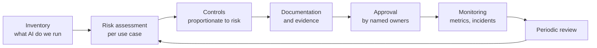
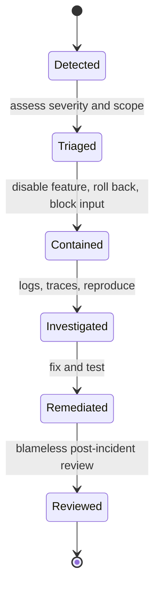

The previous lessons gave you controls: injection defences, access control, privacy techniques, validation, fairness metrics, model cards. **AI governance** is the organisational system that decides which controls a given AI system needs, makes sure they are actually in place, records the evidence, and responds when something goes wrong. Without it, good practices depend on which engineer happened to work on a project. With it, an organisation can answer the questions that customers, auditors and regulators increasingly ask: what AI systems do you run, what could go wrong with each, what did you do about it, and who is accountable?

This lesson is a practical introduction for engineers. It names the major reference frameworks at a high level; it is not legal advice, and regulatory details change, so check current official sources and involve your legal and compliance colleagues.

## The governance loop

Governance is a cycle that runs for the whole life of every AI system, not a gate passed once before launch.



The foundation is an **inventory**. You cannot govern systems you do not know about, and AI arrives through many doors: in-house models, third-party APIs called from a script, AI features inside purchased software. For each, record its purpose, owner, model and version, data it touches, users it affects and its risk tier.

## Risk assessment

A risk assessment asks, for a specific use case: what could go wrong, how likely is it, how bad would it be, and for whom? The same model can be low-risk in one use and high-risk in another: a summariser for internal meeting notes is not the same as a summariser of patient records for clinicians.

Useful questions for identifying risks:

| Area | Questions |
| --- | --- |
| Impact on people | Does the output influence decisions about people's access to jobs, credit, housing, healthcare, education or legal outcomes? Can they contest it? |
| Autonomy | Does the system only suggest, or does it act (send, pay, delete) on its own? |
| Data | Does it process personal, sensitive or confidential data? Whose? |
| Security | Is it exposed to untrusted input? Can it reach private data and external channels? |
| Reliability | What is the cost of a wrong or invented answer? Who would notice? |
| Fairness | Could performance differ across groups of affected people? |
| Scale | How many people, how many decisions per day, how reversible? |

A simple scoring approach multiplies likelihood by impact on 1-5 scales and turns the result into a **risk register**, a living table of risks, owners and mitigations:

```python
import pandas as pd

risks = pd.DataFrame([
    {"risk": "Indirect prompt injection exfiltrates customer data", "likelihood": 3, "impact": 5, "owner": "platform"},
    {"risk": "Hallucinated policy given to customer",               "likelihood": 4, "impact": 3, "owner": "support-ml"},
    {"risk": "Cross-tenant retrieval leak",                          "likelihood": 2, "impact": 5, "owner": "platform"},
    {"risk": "Lower answer quality for non-English users",          "likelihood": 4, "impact": 2, "owner": "support-ml"},
    {"risk": "Cost spike from agent loop",                           "likelihood": 3, "impact": 2, "owner": "infra"},
])
risks["score"] = risks.likelihood * risks.impact
risks["rating"] = pd.cut(risks.score, bins=[0, 6, 12, 25], labels=["low", "medium", "high"])
print(risks.sort_values("score", ascending=False)[["risk", "score", "rating", "owner"]].to_string(index=False))
```

```output
                                               risk  score rating      owner
Indirect prompt injection exfiltrates customer data     15   high   platform
              Hallucinated policy given to customer     12 medium support-ml
                        Cross-tenant retrieval leak     10 medium   platform
         Lower answer quality for non-English users      8 medium support-ml
                         Cost spike from agent loop      6    low      infra
```

Scores like these are judgements, not measurements; their value is that they force a team to discuss each risk explicitly, assign an owner, and agree which risks must be mitigated before launch. Each high rating should map to specific controls from this module, and the register should be reviewed when the system changes. Notice that the cross-tenant leak rates only "medium" because its likelihood was judged low; a multiplied score can understate severe but rare harms, so many teams add a rule that any risk with maximum impact needs a mitigation regardless of its score.

## Proportionate controls

Governance should be proportionate: heavy process for high-risk systems, light process for low-risk ones, or teams will route around it. A tiered approach:

| Tier | Example | Typical requirements |
| --- | --- | --- |
| Low | Internal drafting assistant, no sensitive data | Inventory entry, usage guidelines, standard security review |
| Medium | Customer-facing support bot with RAG | Plus: risk assessment, evaluation suite, injection and leakage testing, model card, monitoring, incident runbook |
| High | Decisions affecting people's rights or safety | Plus: impact assessment, fairness evaluation, human oversight design, red-teaming, sign-off by a review board, periodic audit |

> [!KEY]
> The output of governance is evidence. For each requirement, there should be an artefact someone can inspect: a test report, a model card, a signed approval, a dashboard, a closed incident ticket.

## Documentation and evidence

Much of this module's work produces governance evidence as a side effect, if you keep it:

- Inventory entries and risk registers.
- Model cards and datasheets ([responsible AI](/learn/ai-security-and-responsible-ai/responsible-ai)).
- Evaluation results by version, including disaggregated and adversarial metrics, tracked in tools like those in [experiment tracking](/learn/mlops/experiment-tracking).
- Records of which model version, prompt version and retrieval configuration served each request, so incidents can be reconstructed.
- Approval records: who accepted which residual risks, and when.
- Change logs: a new model version or a major prompt change is a change to the system and may need reassessment.

Version prompts, system configuration and guardrail rules like code, in source control, so the documentation and the running system cannot drift apart unnoticed.

## Incident response

AI systems will fail in production: a jailbreak goes viral, a model leaks data, a bias issue is reported, an update degrades quality. An incident process prepared in advance turns a crisis into a procedure.



AI-specific preparations:

- **Kill switches and fallbacks.** Feature flags that disable a model, a tool or an agent capability within minutes, and a non-AI fallback path.
- **Rollback.** The ability to revert to a previous model, prompt and configuration together, from the [model registry](/learn/mlops/model-registry).
- **Reporting channels.** A way for users and researchers to report harmful outputs or vulnerabilities, and someone who reads it.
- **Evidence.** Logs that record inputs, retrieved sources and tool calls (redacted appropriately) so you can reconstruct what happened.
- **Notification duties.** Personal data breaches and serious incidents may trigger legal reporting obligations with deadlines; legal and privacy teams must be in the runbook.
- **Learning.** Every incident produces new regression tests and, often, updates to the risk register.

## Reference frameworks

You do not need to invent governance from scratch. Several widely used references exist; at a high level:

| Framework | What it is | How engineers meet it |
| --- | --- | --- |
| NIST AI Risk Management Framework (AI RMF) | A voluntary framework from the US National Institute of Standards and Technology, organised around four functions: Govern, Map, Measure and Manage | Risk registers, evaluation, monitoring and clear ownership map directly onto its functions |
| ISO/IEC 42001 | An international standard specifying requirements for an AI management system, in the style of other ISO management-system standards; organisations can be certified against it | Documented processes, roles, risk assessment and continual improvement, with evidence |
| EU AI Act | European Union regulation that takes a risk-based approach: certain practices are prohibited, high-risk uses carry substantial obligations (such as risk management, data governance, documentation, human oversight, accuracy and robustness), some systems carry transparency duties, and minimal-risk uses carry few | Classifying each use case, then producing the documentation and controls its tier requires |
| OWASP Top 10 for LLM Applications | A community-maintained list of the most critical security risks for LLM applications | A security checklist for design reviews and testing |

The risk-based idea shared by these frameworks is the one you have used throughout: classify the use case, then apply controls proportionate to the potential harm. Specific obligations, scopes and timelines are matters for legal advice and the official texts.

### Using the OWASP list as a checklist

The OWASP list is revised periodically, so consult the current version on the OWASP website rather than relying on a copy. Its themes map closely onto this module, which makes it a convenient review checklist:

| Theme in the OWASP list | Where this module covers it |
| --- | --- |
| Prompt injection | [Prompt injection](/learn/ai-security-and-responsible-ai/prompt-injection) |
| Sensitive information disclosure, system prompt leakage | [Data leakage](/learn/ai-security-and-responsible-ai/data-leakage), [privacy](/learn/ai-security-and-responsible-ai/privacy) |
| Supply chain, data and model poisoning | [Model security](/learn/ai-security-and-responsible-ai/model-security), [adversarial attacks](/learn/ai-security-and-responsible-ai/adversarial-attacks) |
| Insecure handling of model output | [Output validation](/learn/ai-security-and-responsible-ai/output-validation) |
| Excessive agency of agents and tools | Prompt injection (least privilege, approvals), [guardrails](/learn/advanced-agent-systems/guardrails) |
| Misinformation and over-reliance | [Hallucination mitigation](/learn/ai-security-and-responsible-ai/hallucination-mitigation) |
| Unbounded consumption of resources | [Secure API design](/learn/ai-security-and-responsible-ai/secure-api-design) |
| Weaknesses in vector stores and embeddings | Data leakage (permission-aware retrieval) |

> [!TIP]
> Run through the current OWASP list in every design review of an LLM feature, and record for each item either the control that addresses it or why it does not apply. That record is itself governance evidence.

## Exercises

**1.** Add a column `mitigation_required` to the risk register that is `True` for every risk rated `high`, and print the risks that must be mitigated before launch.

<details>
<summary>Show solution</summary>

```python
risks["mitigation_required"] = risks.rating == "high"
print(risks.loc[risks.mitigation_required, "risk"].tolist())
```

```output
['Indirect prompt injection exfiltrates customer data']
```

</details>

**2.** A team plans to use an LLM to rank job applicants and send the top ten to a recruiter. Which tier would you put it in, and name four controls you would require.

<details>
<summary>Show solution</summary>

High tier: it influences access to employment, and employment uses are treated as high-risk in risk-based frameworks such as the EU AI Act. Controls: a documented impact assessment; disaggregated fairness evaluation with counterfactual testing (names, gaps, schools); human review of rankings with access to the full applications and a measured override rate; a model card stating intended use and limitations; a way for candidates to request review; logging sufficient to reconstruct each ranking; legal review of applicable obligations.

</details>

**3.** Write a short incident runbook (five steps) for "a user reports that the support bot revealed another customer's order details".

<details>
<summary>Show solution</summary>

1. Contain: disable the retrieval tool or the bot via its feature flag; preserve logs.
2. Triage: confirm the report from traces; identify affected tenants and data; set severity.
3. Notify: involve privacy and legal teams immediately, since a personal data breach may have reporting deadlines.
4. Investigate and fix: find the missing access-control filter or cache key; add permission-aware retrieval; add a regression test reproducing the leak.
5. Review: blameless post-incident review; update the risk register and the design review checklist.

</details>

```quiz
[
  {
    "q": "What is the first step of AI governance in an organisation?",
    "options": [
      "Buying a certification",
      "An inventory of the AI systems in use, with owners and purposes",
      "Banning all third-party AI",
      "Writing a list of principles"
    ],
    "answer": 1,
    "why": "You cannot assess or control systems you do not know exist, including AI inside purchased tools and quick scripts."
  },
  {
    "q": "What are the four functions of the NIST AI Risk Management Framework?",
    "options": [
      "Plan, Do, Check, Act",
      "Identify, Protect, Detect, Respond",
      "Govern, Map, Measure, Manage",
      "Collect, Train, Deploy, Monitor"
    ],
    "answer": 2,
    "why": "The AI RMF is organised around Govern, Map, Measure and Manage. Identify-Protect-Detect-Respond comes from NIST's cybersecurity framework."
  },
  {
    "q": "What best describes the EU AI Act's overall approach?",
    "options": [
      "All AI systems face identical obligations",
      "Risk-based: obligations scale with the risk of the use case, with some practices prohibited",
      "It only applies to open-source models",
      "It regulates only chatbots"
    ],
    "answer": 1,
    "why": "Obligations depend on the risk category of the use, from prohibited practices through high-risk to minimal-risk systems."
  },
  {
    "q": "Why should governance requirements be proportionate to risk?",
    "options": [
      "Low-risk systems never fail",
      "Heavy process on every system causes teams to route around governance, while high-risk systems need strong controls",
      "Regulators require identical processes for all systems",
      "It reduces the number of models"
    ],
    "answer": 1,
    "why": "Matching effort to potential harm keeps governance usable and focuses scrutiny where it matters most."
  }
]
```
