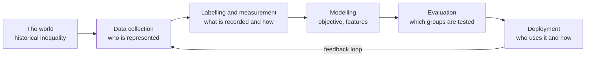

A model can be accurate on average and still systematically worse for some people: a CV screener that rejects qualified candidates from one group more often, a speech recogniser that makes more errors on some accents, a language model that associates professions with one gender. These failures are not usually the result of anyone intending harm. They come from data, measurement and design choices, and they persist because aggregate metrics hide them. This lesson shows where bias comes from, how to measure it with standard fairness metrics on a concrete example, what the known trade-offs are, and what you can do about it.

## Where bias comes from

Bias can enter at every stage of the [ML lifecycle](/learn/mlops/model-lifecycle-management).



| Source | Example |
| --- | --- |
| Historical bias | Past hiring decisions favoured one group; a model trained to imitate them learns the same preference |
| Representation bias | A face dataset has few images of older people, so error rates are higher for them |
| Measurement bias | A proxy is measured less accurately, or unfairly, for some groups, such as a test score that disadvantages non-native speakers |
| Label bias | Annotators label the same dialect as "toxic" more often |
| Aggregation bias | One model for populations where the relationship between features and outcome differs |
| Evaluation bias | The benchmark under-represents the users the system will serve |
| Feedback loops | A model sends more patrols to an area, which produces more recorded incidents there, which justifies more patrols |

LLMs add their own forms: stereotyped associations absorbed from web text, uneven quality across languages, and different treatment of the same request depending on names or dialect in the prompt.

## Removing the sensitive attribute is not enough

A tempting idea is "fairness through unawareness": simply do not give the model the protected attribute (for example gender or ethnicity). It rarely works, because other features act as **proxies**. Postcode correlates with ethnicity, career gaps correlate with gender, and a biased measurement carries its bias into the model whether or not the group label is present. You will see this happen below. In fact, you usually **need** the group attribute for evaluation, even if the model does not use it, because you cannot measure disparities you cannot see.

## Fairness metrics

Let $\hat{Y}$ be the model's decision (1 means a positive outcome such as "invite to interview"), $Y$ the true outcome, and $A$ the group attribute. The most common group fairness criteria are:

**Demographic parity**: each group receives positive decisions at the same rate.

$$
P(\hat{Y}=1 \mid A=a) = P(\hat{Y}=1 \mid A=b)
$$

**Equalised odds**: among people with the same true outcome, each group is treated the same. Both the true positive rate (TPR) and the false positive rate (FPR) must match:

$$
P(\hat{Y}=1 \mid Y=y, A=a) = P(\hat{Y}=1 \mid Y=y, A=b) \quad \text{for } y \in \{0, 1\}
$$

**Equal opportunity** is the relaxed version that only requires equal TPR ($y = 1$): qualified people have the same chance of being selected regardless of group.

**Calibration within groups**: a score of 0.7 means a 70% chance of a positive outcome in every group.

| Metric | Asks | Ignores |
| --- | --- | --- |
| Demographic parity | Are outcomes distributed equally? | Whether the groups' true outcomes differ |
| Equal opportunity | Do qualified people get equal chances? | False positives |
| Equalised odds | Are error rates equal for both outcomes? | Selection rates |
| Calibration | Do scores mean the same thing for everyone? | Error-rate balance |

## Measuring it on a synthetic hiring dataset

The dataset below is synthetic. True qualification depends only on skill, and both groups have the same skill distribution. But the **test score** the model sees is measured with a penalty for group B, a simple model of measurement bias. The model is never given the group.

```python
import numpy as np
import pandas as pd
from sklearn.linear_model import LogisticRegression
from sklearn.model_selection import train_test_split

rng = np.random.default_rng(7)
n = 4000
group = rng.choice(["A", "B"], size=n, p=[0.7, 0.3])
skill = rng.normal(0, 1, n)
y = (skill + rng.normal(0, 0.7, n) > 0.3).astype(int)            # truly qualified
score = skill + rng.normal(0, 0.5, n) - 0.6 * (group == "B")     # biased measurement
years = np.clip(rng.normal(5, 2, n) + 0.8 * skill, 0, None)
X = np.column_stack([score, years])                              # no group column

Xtr, Xte, ytr, yte, gtr, gte = train_test_split(X, y, group, test_size=0.5, random_state=0)
clf = LogisticRegression().fit(Xtr, ytr)
pred = clf.predict(Xte)

def report(y_true, y_pred, g):
    rows = {}
    for name in ["A", "B"]:
        m = g == name
        yt, yp = y_true[m], y_pred[m]
        rows[name] = {
            "base_rate": yt.mean(),
            "selection_rate": yp.mean(),
            "TPR": yp[yt == 1].mean(),
            "FPR": yp[yt == 0].mean(),
            "accuracy": (yt == yp).mean(),
        }
    table = pd.DataFrame(rows).T.round(3)
    print(table)
    print("demographic parity difference:", round(abs(table.selection_rate.A - table.selection_rate.B), 3))
    print("equal opportunity difference: ", round(abs(table.TPR.A - table.TPR.B), 3))
    print("FPR difference:               ", round(abs(table.FPR.A - table.FPR.B), 3))

report(yte, pred, gte)
```

```output
   base_rate  selection_rate   TPR    FPR  accuracy
A      0.407           0.402  0.72  0.185     0.776
B      0.425           0.248  0.48  0.077     0.735
demographic parity difference: 0.154
equal opportunity difference:  0.24
FPR difference:                0.108
```

Both groups are equally qualified (base rates are close), yet group B is selected far less often, and a qualified member of group B has a much lower chance of selection (TPR) than a qualified member of group A. The model never saw the group label; the bias arrived through the measured score. Overall accuracy looks respectable, which is exactly why you must break metrics down by group.

> [!KEY]
> Always report metrics per group, not only in aggregate. A single accuracy number can hide a model that works well for the majority and poorly for everyone else.

## Mitigation

Interventions fall into three families:

| Stage | Technique | Example |
| --- | --- | --- |
| Pre-processing | Fix the data | Collect more representative data, correct biased measurements, reweight under-represented groups, audit labels |
| In-processing | Change training | Add a fairness constraint or penalty to the objective |
| Post-processing | Change decisions | Choose group-specific thresholds to equalise TPR and FPR |

The most durable fix is usually in the data: here, replacing or recalibrating the biased test. When that is not possible, post-processing is the simplest to demonstrate. Lower group B's decision threshold and watch the error rates move:

```python
proba = clf.predict_proba(Xte)[:, 1]
print("threshold_B  TPR_B  FPR_B  overall_acc")
for t_b in [0.5, 0.4, 0.35, 0.3]:
    adjusted = np.where(gte == "B", proba >= t_b, proba >= 0.5).astype(int)
    m = gte == "B"
    tpr_b = adjusted[m][yte[m] == 1].mean()
    fpr_b = adjusted[m][yte[m] == 0].mean()
    print(f"{t_b:<12} {tpr_b:.3f}  {fpr_b:.3f}  {(adjusted == yte).mean():.3f}")
```

```output
threshold_B  TPR_B  FPR_B  overall_acc
0.5          0.480  0.077  0.764
0.4          0.560  0.112  0.768
0.35         0.628  0.133  0.773
0.3          0.688  0.175  0.773
```

At a threshold of 0.3, group B's TPR and FPR come close to group A's (0.72 and 0.185), approximately satisfying equalised odds, and overall accuracy does not drop at all. That happens here because the disparity was caused by a measurement error, so correcting for it also corrects mistakes. In other settings, enforcing a fairness criterion lowers overall accuracy, and that cost has to be weighed explicitly.

> [!WARNING]
> Group-specific thresholds use the protected attribute at decision time, which may be prohibited or regulated in some domains and jurisdictions. Choosing a mitigation is a legal and ethical decision as well as a technical one; involve the appropriate people.

## Trade-offs and impossibility results

You cannot generally satisfy every fairness criterion at once. Two well-known results, stated carefully:

- When the groups' **base rates differ** ($P(Y=1 \mid A=a) \ne P(Y=1 \mid A=b)$), a classifier that is not perfect cannot be both calibrated within groups and have equal false positive and false negative rates across groups. This was shown independently by Chouldechova and by Kleinberg, Mullainathan and Raghavan.
- Likewise, with different base rates, demographic parity is in general incompatible with equalised odds, except for trivial or perfect classifiers.

In the example above the base rates were nearly equal, which is why the criteria could be approximately reconciled. The impossibility results do not say fairness is hopeless; they say you must **choose** which notion matters for this decision, and justify the choice. A lending model, a medical triage tool and a content recommender may reasonably prioritise different criteria. Write the choice and its reasoning into the model's documentation (see [responsible AI](/learn/ai-security-and-responsible-ai/responsible-ai)).

## Bias in LLM applications

For generative systems, group metrics need adapting. Practical techniques:

- **Counterfactual testing**: send prompts that differ only in a name, pronoun or dialect, and compare outputs for differences in tone, quality, refusals or recommendations.
- **Disaggregated evaluation**: measure task quality separately for each language, dialect or user segment you serve.
- **Representation audits**: generate many outputs for neutral prompts ("describe a nurse", "write a story about an engineer") and count the attributes that appear.
- **Human review** by people from the affected communities, who notice harms that automated metrics miss.

## Exercises

**1.** Compute the **disparate impact ratio** (selection rate of group B divided by selection rate of group A) for the original model's predictions. A common rule of thumb in US employment guidance flags ratios below 0.8.

<details>
<summary>Show solution</summary>

```python
sel_a = pred[gte == "A"].mean()
sel_b = pred[gte == "B"].mean()
print(round(sel_b / sel_a, 3))
```

```output
0.617
```

The ratio is well below 0.8, which would warrant investigation.

</details>

**2.** Write a function that, for a given group, finds the threshold (from 0.05 to 0.95 in steps of 0.05) whose TPR is closest to a target TPR. Use it to match group B to group A's TPR.

<details>
<summary>Show solution</summary>

```python
def threshold_for_tpr(proba, y_true, target, grid=np.arange(0.05, 0.96, 0.05)):
    pos = y_true == 1
    tprs = [(proba[pos] >= t).mean() for t in grid]
    best = int(np.argmin([abs(t - target) for t in tprs]))
    return round(float(grid[best]), 2), round(float(tprs[best]), 3)

m_a, m_b = gte == "A", gte == "B"
target = (proba[m_a][yte[m_a] == 1] >= 0.5).mean()
print(threshold_for_tpr(proba[m_b], yte[m_b], target))
```

```output
(0.3, 0.688)
```

</details>

**3.** A team says its chatbot is unbiased because it never mentions protected attributes. Suggest a test that could show otherwise.

<details>
<summary>Show solution</summary>

A counterfactual test: create pairs of identical requests that differ only in a name strongly associated with different groups, or in dialect, for example asking for advice on a salary negotiation. Compare outputs on measurable properties such as the suggested salary, the tone, length, or refusal rate across many pairs. Systematic differences reveal bias even though no attribute is ever mentioned.

</details>

```quiz
[
  {
    "q": "Why does removing the protected attribute from the features usually fail to remove bias?",
    "options": [
      "Models always infer it perfectly",
      "Other features act as proxies, and biased measurements carry their bias without the label",
      "Removing columns reduces accuracy to zero",
      "It is illegal to remove columns"
    ],
    "answer": 1,
    "why": "Correlated features and biased measurements transmit group differences into predictions even without the group label."
  },
  {
    "q": "Equal opportunity requires equality of which quantity across groups?",
    "options": [
      "Selection rate",
      "False positive rate",
      "True positive rate",
      "Overall accuracy"
    ],
    "answer": 2,
    "why": "Equal opportunity asks that truly qualified people (Y = 1) are selected at the same rate in each group."
  },
  {
    "q": "What do the impossibility results of Chouldechova and Kleinberg et al. imply?",
    "options": [
      "Fairness cannot be measured",
      "When base rates differ, an imperfect classifier cannot be calibrated within groups and have equal error rates at the same time, so you must choose which criterion matters",
      "Demographic parity is always the right criterion",
      "All fair models have lower accuracy"
    ],
    "answer": 1,
    "why": "The criteria conflict under different base rates; the practical consequence is an explicit, documented choice."
  },
  {
    "q": "In the lesson's example, overall accuracy looked acceptable. What revealed the problem?",
    "options": [
      "A larger test set",
      "Breaking down selection rate, TPR and FPR by group",
      "Training for more epochs",
      "Removing the years-of-experience feature"
    ],
    "answer": 1,
    "why": "Disaggregated metrics showed group B's qualified members were selected much less often."
  }
]
```
