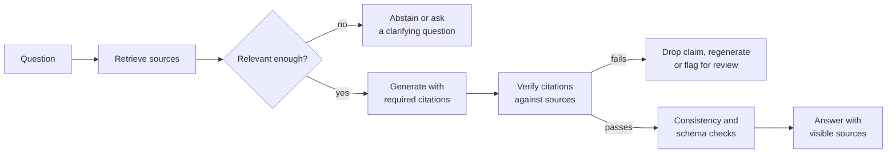

A **hallucination** is output that is fluent and confident but not supported by the facts: an invented citation, a policy that does not exist, a function the library never had. Language models produce text by predicting likely continuations ([LLM fundamentals](/learn/generative-ai-fundamentals/llm-fundamentals)), and a plausible-sounding falsehood can be a very likely continuation. You cannot train this tendency away completely, so reliable applications are engineered around it: give the model the facts, make it show where each claim came from, check those claims mechanically, let it say "I don't know", and measure how often each of these fails.

## Why models hallucinate

| Cause | Example |
| --- | --- |
| Missing knowledge | Asked about a document or event the model never saw, it produces a plausible answer instead |
| Pressure to answer | Training rewards helpful, complete-sounding responses; "I don't know" is rarer in the data |
| Ambiguous or false premises | "Why did the 2019 policy change?" when no change happened |
| Lossy memory | Partially memorised facts get blended: right author, wrong paper title |
| Long or noisy context | Relevant passage present but ignored, or a near-miss passage used instead |
| Decoding randomness | Higher [temperature](/learn/generative-ai-fundamentals/temperature) samples less likely, sometimes wrong, tokens |

Hallucination is a reliability problem and a security problem. Users act on confident wrong answers; and models repeatedly suggest the same non-existent package names, which an attacker can register so that a developer who trusts the suggestion installs their code. Treat every factual claim as unverified until something other than the model has checked it.

## The mitigation pipeline

No single technique is sufficient, so you layer them, just as with security controls.



## Grounding

**Grounding** means giving the model the information it needs in the context and instructing it to answer only from that information. This is the core idea of [RAG](/learn/rag-fundamentals/why-rag-is-needed). It converts the problem from "recall facts correctly" to "read and summarise correctly", which models do far more reliably.

Grounding instructions that help:

```text
Answer using only the sources below. Each sentence that states a fact
must end with the source ID in square brackets, e.g. [S2], and include
a short exact quote from that source in the "quote" field.
If the sources do not contain the answer, reply exactly: INSUFFICIENT_CONTEXT.
```

Grounding fails quietly when retrieval returns the wrong passages, so retrieval quality is hallucination prevention. See [RAG evaluation](/learn/rag-fundamentals/rag-evaluation) for measuring it.

## Citations you actually verify

A citation that nobody checks is decoration: models can and do cite a source that does not say what they claim. Ask for structured output with a quote per claim, then verify mechanically that each quote really appears in the cited source.

```python
import difflib
import re

SOURCES = {
    "S1": "Refunds are available within 30 days of purchase for unused items.",
    "S2": "Digital downloads are non-refundable once the file has been accessed.",
}

def normalise(text):
    return re.sub(r"\s+", " ", text.lower()).strip()

def quote_supported(quote, source, threshold=0.9):
    q, s = normalise(quote), normalise(source)
    if q in s:
        return 1.0
    # best fuzzy match of the quote against any same-length window of the source
    best = 0.0
    for i in range(max(1, len(s) - len(q) + 1)):
        best = max(best, difflib.SequenceMatcher(None, q, s[i:i + len(q)]).ratio())
    return round(best, 2)

claims = [
    {"text": "You can get a refund within 30 days.", "source": "S1",
     "quote": "Refunds are available within 30 days of purchase"},
    {"text": "Downloads can be refunded within 14 days.", "source": "S2",
     "quote": "Downloads are refundable within 14 days"},
    {"text": "Shipping is free.", "source": "S3", "quote": "free shipping"},
]

for c in claims:
    src = SOURCES.get(c["source"])
    score = quote_supported(c["quote"], src) if src else 0.0
    verdict = "verified" if score >= 0.9 else "UNSUPPORTED"
    print(f"{verdict:<12} score={score:<5} {c['text']}")
```

```output
verified     score=1.0   You can get a refund within 30 days.
UNSUPPORTED  score=0.72  Downloads can be refunded within 14 days.
UNSUPPORTED  score=0.0   Shipping is free.
```

The first claim is supported verbatim. The second cites a real source, but the quote does not appear in it; in fact the source says the opposite. The third cites a source that does not exist. Your application can drop unsupported claims, regenerate with feedback, or show the answer with a warning.

Quote matching proves the quote exists; it does not prove the claim follows from it. For stronger checks, add an entailment step: a natural language inference model or an LLM judge asked whether the source passage supports the claim. Treat that judge as another fallible component and evaluate it.

> [!TIP]
> Show citations to users as clickable links to the exact passage. Visible sources let people check important answers themselves and make wrong citations easy to report.

## Abstention

A system that can say "I don't know" is more trustworthy than one that always answers. Build abstention in at several points:

- **Before generation**: if the best retrieval score is below a threshold tuned on your evaluation set, skip generation and say the knowledge base does not cover the question.
- **In the prompt**: give an explicit, machine-detectable abstention string such as `INSUFFICIENT_CONTEXT`, and test that the model uses it when it should.
- **After verification**: if too few claims verify, abstain rather than return a mostly unsupported answer.

```python
def answer_or_abstain(scores, threshold=0.35):
    best = max(scores, default=0.0)
    return "generate" if best >= threshold else "abstain"

print(answer_or_abstain([0.62, 0.41, 0.30]))
print(answer_or_abstain([0.21, 0.18]))
```

```output
generate
abstain
```

Abstention trades **coverage** (how often you answer) for **precision** (how often answers are right). Measure both and pick the threshold that fits the stakes: a medical information tool should abstain far more readily than a brainstorming assistant.

## Self-consistency checks

If you ask the same question several times with sampling, a model that actually knows the answer tends to give the same answer each time, while a model that is guessing tends to give different answers. Agreement across samples is therefore a cheap confidence signal, and majority voting over samples often improves accuracy on reasoning tasks.

```trace
{
  "title": "self-consistency vote over five samples",
  "code": [
    "from collections import Counter",
    "samples = ['1998', '1998', '2001', '1998', '1997']",
    "counts = Counter(samples)",
    "answer, votes = counts.most_common(1)[0]",
    "agreement = votes / len(samples)",
    "print(answer, agreement)",
    "if agreement < 0.6:",
    "    print('low confidence: abstain or verify')"
  ],
  "steps": [
    { "line": 2, "vars": { "samples": "['1998', '1998', '2001', '1998', '1997']" }, "note": "Five answers sampled at temperature above zero for the same question." },
    { "line": 3, "vars": { "counts": "{'1998': 3, '2001': 1, '1997': 1}" }, "note": "Count how often each distinct answer appears." },
    { "line": 4, "vars": { "answer": "'1998'", "votes": "3" }, "note": "The majority answer wins the vote." },
    { "line": 5, "vars": { "answer": "'1998'", "votes": "3", "agreement": "0.6" }, "note": "Agreement is the share of samples that match the majority." },
    { "line": 6, "vars": { "agreement": "0.6" }, "out": ["1998 0.6"], "note": "Report the answer with its agreement score." },
    { "line": 7, "vars": { "agreement": "0.6" }, "out": ["1998 0.6"], "note": "0.6 is not below the threshold, so the answer is accepted. With 2 of 5 agreeing it would be flagged." }
  ]
}
```

Limits: sampling costs several calls; free-text answers need normalising or an LLM to judge whether two answers mean the same thing; and a model can be **consistently** wrong, especially about a widely repeated misconception. Consistency raises confidence; it does not establish truth.

## Constrained generation

Many hallucinations happen in fields where only a fixed set of values is valid. Do not let the model generate those freely:

| Instead of letting the model write | Constrain it to |
| --- | --- |
| A product name | An ID chosen from the catalogue passed in context, validated by code |
| A date or amount | A value extracted and then checked against the source record |
| A function call with invented parameters | A JSON schema the provider enforces, plus your own validation |
| A URL | A source ID that your code turns into a URL |

Structured outputs and enum-constrained decoding ([output constraints](/learn/prompt-engineering/output-constraints)) remove whole classes of invention, and [output validation](/learn/ai-security-and-responsible-ai/output-validation) catches what remains.

## Measuring hallucination

You cannot manage a rate you do not measure. Build an evaluation set of questions with known answers and supporting passages, including questions the knowledge base **cannot** answer, and track:

| Metric | Question it answers |
| --- | --- |
| Faithfulness or groundedness | What fraction of claims are supported by the provided sources? |
| Citation precision | What fraction of citations actually support their claim? |
| Answer correctness | Does the answer match the reference? |
| Abstention precision and recall | When the answer is not in the sources, does the system abstain, and does it avoid abstaining when it is? |
| Coverage | What fraction of questions get an answer at all? |

Run this suite on every prompt, model or retrieval change, as covered in [prompt testing and evaluation](/learn/prompt-engineering/prompt-testing-and-evaluation), and sample production traffic for human review.

> [!KEY]
> Hallucination cannot be eliminated, only managed. The goal is a known, measured error rate, with the most important claims verified by something other than the model that made them.

## Exercises

**1.** Extend the citation checker so that an answer is accepted only if at least 80% of its claims verify. Apply it to the three claims above.

<details>
<summary>Show solution</summary>

```python
def accept_answer(claims, min_share=0.8):
    ok = 0
    for c in claims:
        src = SOURCES.get(c["source"])
        if src and quote_supported(c["quote"], src) >= 0.9:
            ok += 1
    share = ok / len(claims)
    return share >= min_share, round(share, 2)

print(accept_answer(claims))
print(accept_answer(claims[:1]))
```

```output
(False, 0.33)
(True, 1.0)
```

</details>

**2.** Write `consistency(samples)` that normalises answers (lower case, stripped whitespace and trailing full stops) before voting, and returns the answer and agreement. Test it on `["Paris.", "paris", " Paris", "Lyon"]`.

<details>
<summary>Show solution</summary>

```python
from collections import Counter

def consistency(samples):
    norm = [s.strip().rstrip(".").lower() for s in samples]
    answer, votes = Counter(norm).most_common(1)[0]
    return answer, votes / len(norm)

print(consistency(["Paris.", "paris", " Paris", "Lyon"]))
```

```output
('paris', 0.75)
```

</details>

**3.** A coding assistant sometimes suggests importing packages that do not exist. Propose two mitigations.

<details>
<summary>Show solution</summary>

Check every suggested dependency against the package index and your organisation's approved list before showing an install command; flag unknown or newly registered packages. Ground the assistant in the project's actual lock file and documentation for installed libraries, and constrain it to suggest only packages from that set unless the user explicitly asks for new ones.

</details>

```quiz
[
  {
    "q": "What does grounding change about the model's task?",
    "options": [
      "It removes the need for a model",
      "It turns recalling facts from memory into reading and summarising provided sources",
      "It guarantees the answer is correct",
      "It increases the temperature"
    ],
    "answer": 1,
    "why": "Models summarise provided text far more reliably than they recall facts, though grounding still depends on retrieving the right passages."
  },
  {
    "q": "A model cites [S2] and gives a quote, but the quote does not appear in S2. What should happen?",
    "options": [
      "Show the answer; the citation format is correct",
      "Treat the claim as unsupported: drop it, regenerate or flag it",
      "Increase the number of retrieved documents",
      "Replace the quote with the first sentence of S2"
    ],
    "answer": 1,
    "why": "A citation is only useful if verified. An unverifiable quote is a strong sign the claim was invented."
  },
  {
    "q": "What is the main limitation of self-consistency as a hallucination check?",
    "options": [
      "It only works with temperature zero",
      "A model can be consistently wrong, so agreement raises confidence but does not prove truth",
      "It cannot be automated",
      "It requires fine-tuning"
    ],
    "answer": 1,
    "why": "Widely repeated misconceptions can be sampled consistently. Use agreement as a signal alongside grounding and verification."
  },
  {
    "q": "Raising the abstention threshold typically has what effect?",
    "options": [
      "Higher coverage and lower precision",
      "Lower coverage and higher precision",
      "No effect on either",
      "It removes the need for retrieval"
    ],
    "answer": 1,
    "why": "Abstaining more often means answering fewer questions, but the answers given are more likely to be correct."
  }
]
```
