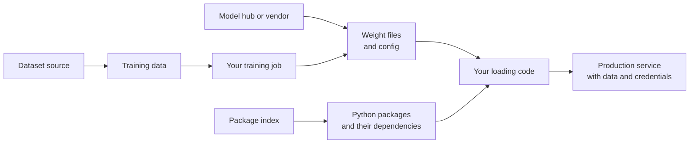
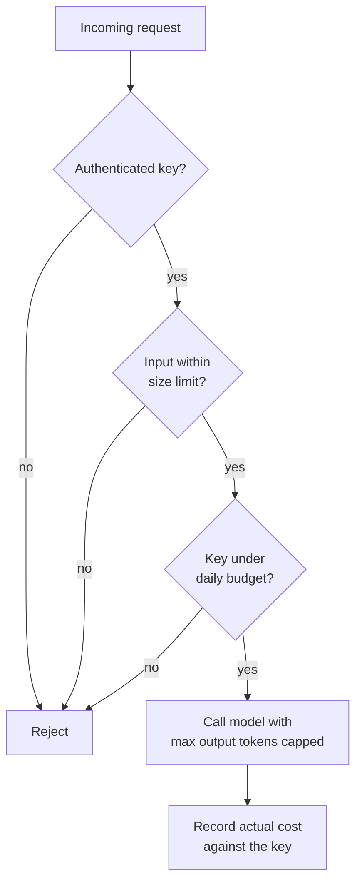

A model is software. It arrives as files from somewhere, runs inside your infrastructure, depends on dozens of packages, and is exposed through an API that someone pays for. Each of those facts is an attack surface. This lesson covers three families of threat that are specific to, or sharpened by, machine learning: a poisoned **supply chain** that runs code when you load a model, **theft and extraction** of a model you trained, and **denial of wallet**, where an attacker's goal is simply to make you pay.

## The ML supply chain

When you call `from_pretrained` or `torch.load`, you execute a chain of trust you may never have examined.



| Link | What can go wrong | Control |
| --- | --- | --- |
| Weight files | Serialised format that executes code on load | Load only safe formats; verify hashes |
| Model repository | Look-alike names, a compromised account pushing a new revision | Pin exact revisions; prefer verified publishers |
| Python packages | Typosquatted package names, malicious updates | Pin versions with hashes; review new dependencies |
| Training data | Poisoned samples planting a backdoor | Provenance and data validation (see [adversarial attacks](/learn/ai-security-and-responsible-ai/adversarial-attacks)) |
| Config and custom code | Repositories that ask you to run their own Python code | Avoid remote code execution flags unless you have reviewed the code |

## Why pickle is dangerous

Python's `pickle` format does not just store data; it stores instructions for rebuilding objects, and those instructions can call any importable function. Unpickling a file is equivalent to running code supplied by whoever made the file. Many older model checkpoints, including the classic PyTorch `.pt`/`.bin` format, are pickle-based.

You can see the mechanism safely. An object can define `__reduce__`, which tells pickle "to rebuild me, call this function with these arguments". Here the function is the harmless `print`, but it could be anything:

```python
import pickle

class Payload:
    def __reduce__(self):
        return (print, ("code ran during unpickling",))

data = pickle.dumps({"weights": [0.1, 0.2], "extra": Payload()})
obj = pickle.loads(data)          # merely loading runs the call
print(obj)
```

```output
code ran during unpickling
{'weights': [0.1, 0.2], 'extra': None}
```

Nothing in your code called `print` on that string: loading did. A real malicious checkpoint would use the same mechanism to open a reverse shell or read environment variables containing credentials.

> [!WARNING]
> Never unpickle files from a source you do not trust, and remember that "a popular repository" is not the same as "a source you trust". Loading happens on machines that usually hold data and cloud credentials.

### Safer loading

PyTorch's `torch.load` has a `weights_only` mode that restricts unpickling to tensors and basic containers; recent versions make it the default. It refuses the payload above:

```python
import io
import torch

buf = io.BytesIO()
torch.save({"w": torch.zeros(2), "extra": Payload()}, buf)
buf.seek(0)
try:
    torch.load(buf, weights_only=True)
except pickle.UnpicklingError as e:
    print("refused:", type(e).__name__)
```

```output
refused: UnpicklingError
```

Better still, use a format that cannot contain code at all. **safetensors** stores only tensor metadata (a JSON header) and raw tensor bytes, so loading it is parsing, not execution. It is widely supported on the Hugging Face Hub and by `transformers`:

```python
# pip install safetensors
from safetensors.torch import save_file, load_file

save_file({"w": torch.zeros(2)}, "model.safetensors")
tensors = load_file("model.safetensors")   # no code execution possible
```

| Format | Can execute code on load | Notes |
| --- | --- | --- |
| Pickle (`.pkl`, legacy `.pt`, `.bin`) | Yes | Avoid for untrusted files |
| `torch.load(weights_only=True)` | Restricted | Allowlist of safe types |
| safetensors | No | Tensors only; fast, memory-mappable |
| ONNX | Not via deserialisation | A graph format; custom operators still need review |
| joblib (scikit-learn) | Yes | Pickle-based; trust only your own artefacts |

## Provenance and pinning

Knowing **what** you loaded matters as much as **how**. A model name like `org/model` is a moving target: the owner (or someone who compromised the account) can push a new revision. Pin the exact commit and verify the bytes.

```python
import hashlib

def sha256_of(path, chunk=1 << 20):
    h = hashlib.sha256()
    with open(path, "rb") as f:
        while block := f.read(chunk):
            h.update(block)
    return h.hexdigest()

with open("weights.bin", "wb") as f:     # stand-in for a downloaded file
    f.write(b"\x00" * 1024)

EXPECTED = "5f70bf18a086007016e948b04aed3b82103a36bea41755b6cddfaf10ace3c6ef"
actual = sha256_of("weights.bin")
print("verified" if actual == EXPECTED else f"MISMATCH {actual[:12]}...")
```

```output
verified
```

In practice:

- Pass an explicit `revision` (a commit hash, not a branch name) to Hub download functions, and record it with the model in your [model registry](/learn/mlops/model-registry).
- Store the expected hash alongside the model version and check it in your deployment pipeline.
- Pin Python dependencies to exact versions in a lock file; tools such as `pip install --require-hashes -r requirements.txt` also check package hashes.
- Avoid `trust_remote_code=True` in `transformers` unless you have read the repository code at the pinned revision.
- Mirror approved models into an internal registry so production never pulls directly from the public internet.

## Model theft and extraction

A trained model is an asset. It can be stolen two ways.

**Direct theft** is ordinary infrastructure compromise: weights copied from a storage bucket, a leaked container image, an over-permissive inference server. The defences are conventional: encryption at rest, least-privilege [IAM](/learn/cloud-computing/iam-and-security), private networking, and access logs on the weight storage.

**Extraction** works through the public API. An attacker sends many queries, records the outputs, and trains a substitute model to imitate yours, in effect [distillation](/learn/advanced-llm-engineering/distillation) without permission. Full probability vectors or log-probabilities make this much easier than bare labels, because each query reveals more information. Related attacks use query access to infer properties of the training data, such as whether a particular record was in it (membership inference).

| Defence | Effect |
| --- | --- |
| Authentication and per-key quotas | Makes bulk querying attributable and slow |
| Return only what clients need | Labels or rounded scores instead of full logits |
| Monitor query patterns | Systematic sweeps of the input space look different from real traffic |
| Terms of service and watermarking research | Legal and forensic recourse, not prevention |

You cannot make a useful public model impossible to imitate. The goal is to make extraction expensive, noticeable and attributable.

## Denial of wallet

Classic denial of service tries to take your service down. With pay-per-token APIs and autoscaling GPUs, an attacker can instead make your service **expensive**. Every request costs real money, and some requests cost far more than others.



Cost amplifiers to watch for: very long inputs filling the context window, prompts that ask for maximum-length output, agents stuck in tool-calling loops, recursive workflows that spawn sub-agents, and unauthenticated endpoints that anyone can script. A minimal budget guard:

```python
from collections import defaultdict

class BudgetGuard:
    def __init__(self, daily_limit_usd):
        self.limit = daily_limit_usd
        self.spent = defaultdict(float)

    def check(self, key, est_cost):
        if self.spent[key] + est_cost > self.limit:
            return False
        self.spent[key] += est_cost
        return True

guard = BudgetGuard(daily_limit_usd=1.00)
results = [guard.check("key-1", 0.30) for _ in range(5)]
print(results, round(guard.spent["key-1"], 2))
```

```output
[True, True, True, False, False] 0.9
```

The same idea scales up: estimate cost before the call from input length and the output cap, reconcile with actual usage afterwards, and add a global circuit breaker that pages someone when total spend per hour exceeds a threshold. [Secure API design](/learn/ai-security-and-responsible-ai/secure-api-design) develops these controls further, and [cost optimisation](/learn/production-ai-systems/cost-optimization) covers the non-adversarial side.

> [!TIP]
> Always set a spending limit or alert in the model provider's console as well. It is a backstop for bugs in your own guard, such as an agent loop that your code failed to stop.

## Exercises

**1.** A colleague downloads a `.pkl` scikit-learn model from a forum post and wants to load it in production. List three things you would require first.

<details>
<summary>Show solution</summary>

Do not load it on a privileged machine at all until trust is established. Require: (1) provenance, meaning a known author and a reason to trust them, ideally retraining the model yourself from data you control; (2) if it must be inspected, do so in an isolated sandbox with no credentials or network access; (3) a pinned hash stored with the model version so the reviewed file is the one deployed. Better: re-export the model to a non-executable format or retrain it in-house.

</details>

**2.** Modify `BudgetGuard` so that a single request whose estimated cost exceeds 25% of the daily limit is rejected outright.

<details>
<summary>Show solution</summary>

```python
class StrictBudgetGuard(BudgetGuard):
    def check(self, key, est_cost):
        if est_cost > 0.25 * self.limit:
            return False
        return super().check(key, est_cost)

g = StrictBudgetGuard(1.00)
print(g.check("k", 0.30), g.check("k", 0.20))
```

```output
False True
```

</details>

**3.** Why does returning full log-probabilities make model extraction easier than returning only the top label?

<details>
<summary>Show solution</summary>

Each query then reveals a whole distribution, which contains far more information about the model's decision function than one label. A substitute trained on soft targets learns much faster, which is exactly why distillation uses them. Returning less reduces the information per query.

</details>

```quiz
[
  {
    "q": "Why is loading an untrusted pickle file dangerous?",
    "options": [
      "Pickle files are often corrupted",
      "Unpickling can call arbitrary functions specified by whoever created the file",
      "Pickle is slower than other formats",
      "Pickle files cannot store tensors"
    ],
    "answer": 1,
    "why": "Pickle stores instructions for rebuilding objects, including calls to any importable function, so loading executes code."
  },
  {
    "q": "What property makes safetensors safer than pickle-based checkpoints?",
    "options": [
      "It is encrypted",
      "It compresses weights",
      "It stores only tensor data and a metadata header, so loading is parsing rather than code execution",
      "It can only be used with TensorFlow"
    ],
    "answer": 2,
    "why": "There is no mechanism in the format for invoking code, so a malicious file cannot run anything on load."
  },
  {
    "q": "Which practice best protects you from a model repository being silently updated with a malicious revision?",
    "options": [
      "Downloading the latest version every deployment",
      "Pinning an exact commit revision and verifying the file hash",
      "Using a larger model",
      "Renaming the model locally"
    ],
    "answer": 1,
    "why": "A pinned revision plus a hash check ensures that what you deploy is exactly what you reviewed."
  },
  {
    "q": "What is a denial-of-wallet attack?",
    "options": [
      "Stealing the payment card attached to your cloud account",
      "Sending requests designed to make your service expensive to run rather than to take it down",
      "Blocking users from paying for your service",
      "Extracting your model weights"
    ],
    "answer": 1,
    "why": "With usage-based pricing, abuse such as huge inputs, maximum-length outputs or agent loops translates directly into cost."
  }
]
```
