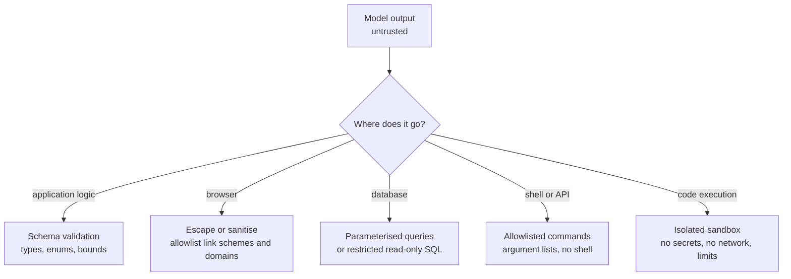

Model output is untrusted input. It does not matter that your own application asked for it: the text was shaped by everything in the context, including user messages and retrieved content that an attacker may control, and by a probabilistic process that sometimes produces malformed or nonsensical results. The moment model output flows into something that **interprets** it (a browser, a database, a shell, a Python interpreter, a payment API), you have an injection vulnerability unless you validate it. This lesson covers the four main destinations and the right control for each.

## Every sink needs its own control

A **sink** is wherever output ends up being interpreted. Classic web security already has answers for most sinks; the mistake is forgetting that LLM output must go through them like any other untrusted string.



| Sink | Vulnerability if unchecked | Control |
| --- | --- | --- |
| Application logic | Wrong types, invented categories, out-of-range values drive actions | Schema validation with enums and bounds |
| Browser (HTML, Markdown) | Cross-site scripting (XSS), data exfiltration via images | Escaping, sanitising, link and image allowlists |
| SQL database | SQL injection, reading other tables, destructive statements | Parameters, read-only roles, an authorizer |
| Shell and system APIs | Command injection | No shell, allowlisted executables and arguments |
| Code interpreter | Arbitrary code execution | Sandbox with resource limits and no credentials |

## Schema validation with allowlists

When output drives program logic, ask for structured output ([structured outputs](/learn/working-with-llms/structured-outputs)) and then **validate it anyway**. Even when a provider guarantees syntactically valid JSON, it does not guarantee that the values are allowed for this user. [Pydantic](/learn/fastapi/pydantic) expresses both shape and policy:

```python
from typing import Literal
from pydantic import BaseModel, Field, ValidationError

class TicketTriage(BaseModel):
    category: Literal["billing", "technical", "account", "other"]   # allowlist
    priority: int = Field(ge=1, le=4)
    refund_amount: float = Field(ge=0, le=100)                      # policy bound
    summary: str = Field(max_length=200)

outputs = [
    '{"category": "billing", "priority": 2, "refund_amount": 15.0, "summary": "Double charge"}',
    '{"category": "admin_override", "priority": 1, "refund_amount": 5000, "summary": "ok"}',
    'Sure! Here is the JSON: {"category": "billing"}',
]
for raw in outputs:
    try:
        t = TicketTriage.model_validate_json(raw)
        print("ok:", t.model_dump())
    except ValidationError as e:
        print("invalid:", [(".".join(map(str, err["loc"])) or "root", err["type"]) for err in e.errors()])
```

```output
ok: {'category': 'billing', 'priority': 2, 'refund_amount': 15.0, 'summary': 'Double charge'}
invalid: [('category', 'literal_error'), ('refund_amount', 'less_than_equal')]
invalid: [('root', 'json_invalid')]
```

The second output is exactly what a successful injection looks like from your code's point of view: a category that does not exist and a refund fifty times the limit. Validation turns it into a rejected request instead of an action. On failure, you can retry once with the error message, fall back to a safe default, or route to a human; never pass the unvalidated value through.

> [!KEY]
> The validation bounds encode business policy, so they belong in code. "Refunds above 100 need a manager" written only in the prompt is a suggestion; written in the schema, it is a rule.

## Rendering safely: XSS and exfiltration

If a web page inserts model output as HTML, any `<script>` tag or event-handler attribute in that output runs in your users' browsers with their session. An attacker who plants such text in a document the model summarises can make the model repeat it. The fixes are the standard ones:

- **Render as text by default.** Frameworks such as React escape strings automatically; avoid escape hatches like `dangerouslySetInnerHTML` for model output.
- **If you render Markdown**, use a renderer configured to disallow raw HTML, or sanitise the resulting HTML with a maintained sanitiser library.
- **Allowlist link schemes and image domains.** A `javascript:` link runs code when clicked; an image URL pointing to an attacker's server leaks whatever data was placed in it the moment the page loads.

```python
import html
import re
from urllib.parse import urlparse

TRUSTED_IMAGE_HOSTS = {"docs.example.com"}

def safe_link(m):
    text, url = m.group(1), m.group(2)
    if urlparse(url).scheme not in {"http", "https"}:
        return html.escape(text)                          # drop javascript:, data: and others
    return f'<a href="{html.escape(url, quote=True)}" rel="noopener nofollow">{html.escape(text)}</a>'

def render(model_text):
    # images first: keep only trusted hosts
    def image(m):
        host = urlparse(m.group(2)).hostname or ""
        return "[image removed]" if host not in TRUSTED_IMAGE_HOSTS else m.group(0)
    text = re.sub(r"!\[([^\]]*)\]\(([^)]*)\)", image, model_text)
    parts = re.split(r"(\[[^\]]*\]\([^)]*\))", text)
    out = []
    for part in parts:
        m = re.fullmatch(r"\[([^\]]*)\]\(([^)]*)\)", part)
        out.append(safe_link(m) if m else html.escape(part))
    return "".join(out)

print(render('Summary <script>alert(1)</script> done.'))
print(render('See [docs](https://docs.example.com/a) or [this](javascript:stealCookies).'))
print(render('Chart: '))
```

```output
Summary &lt;script&gt;alert(1)&lt;/script&gt; done.
See <a href="https://docs.example.com/a" rel="noopener nofollow">docs</a> or this.
Chart: [image removed]
```

This is a teaching sketch to show the principles; in production, use a well-tested Markdown renderer and HTML sanitiser instead of hand-written regular expressions, and add a Content Security Policy header so that even an injected script cannot run or load from untrusted origins.

## SQL generated by a model

Text-to-SQL features let a model write queries. Two rules make them survivable. First, connect with a **database role that can only read**, and only the tables the feature needs; then even a perfect injection cannot drop a table. Second, add an application-level check that inspects what the query actually touches. SQLite exposes this through an **authorizer** callback that is consulted for each action while a statement is compiled:

```python
import sqlite3

conn = sqlite3.connect(":memory:")
conn.executescript("""
CREATE TABLE orders(id INTEGER, customer TEXT, total REAL);
CREATE TABLE users(id INTEGER, email TEXT, password_hash TEXT);
INSERT INTO orders VALUES (1, 'acme', 120.0), (2, 'acme', 80.5), (3, 'globex', 42.0);
INSERT INTO users VALUES (1, 'a@x.com', 'hash');
""")

ALLOWED_TABLES = {"orders"}

def authorizer(action, arg1, arg2, db_name, trigger):
    if action in (sqlite3.SQLITE_SELECT, sqlite3.SQLITE_FUNCTION):
        return sqlite3.SQLITE_OK
    if action == sqlite3.SQLITE_READ and arg1 in ALLOWED_TABLES:
        return sqlite3.SQLITE_OK
    return sqlite3.SQLITE_DENY                        # everything else is refused

def run_generated_sql(sql):
    conn.set_authorizer(authorizer)
    try:
        return conn.execute(sql).fetchmany(100)       # also cap the rows returned
    except sqlite3.Error as e:
        return f"rejected: {e}"
    finally:
        conn.set_authorizer(None)

for sql in [
    "SELECT customer, SUM(total) FROM orders GROUP BY customer",
    "SELECT email, password_hash FROM users",
    "DROP TABLE orders",
    "SELECT 1; DROP TABLE orders",
]:
    print(run_generated_sql(sql))
```

```output
[('acme', 200.5), ('globex', 42.0)]
rejected: access to users.email is prohibited
rejected: not authorized
rejected: You can only execute one statement at a time.
```

Notice the query that worked returned data for every customer. In a multi-tenant system you also need row-level restriction: expose the model only to a view or a database role filtered to the caller's tenant, so the restriction does not depend on the generated SQL including the right `WHERE` clause. When the set of questions is small, an even safer design is for the model to choose from **predefined parameterised queries** and supply only the parameters.

## Shell commands and tool arguments

Never pass model output to a shell. `subprocess.run(cmd, shell=True)` or `os.system` with model text lets characters such as `;`, `|` and backticks chain arbitrary commands. Instead:

- Map the model's request to an **allowlisted executable** and build the argument list yourself.
- Call `subprocess.run([...])` with a list and without `shell=True`, so arguments are never reinterpreted by a shell.
- Validate each argument: file paths resolved and checked to lie inside an allowed directory, numbers parsed as numbers, enums checked against a set.

The same applies to tool calls in agents: validate arguments against the schema and against what the current user is permitted to do, as covered in [guardrails](/learn/advanced-agent-systems/guardrails).

## Sandboxing generated code

Code-interpreter features execute code the model wrote. Assume that code may be hostile and run it where hostility does not matter. At minimum, a separate process with a timeout, an empty environment (so no API keys are inherited) and a throwaway working directory:

```python
import subprocess, sys, tempfile

def run_untrusted(code, timeout=2):
    with tempfile.TemporaryDirectory() as workdir:
        try:
            proc = subprocess.run(
                [sys.executable, "-I", "-c", code],      # -I: isolated mode
                cwd=workdir, env={}, capture_output=True, text=True, timeout=timeout,
            )
        except subprocess.TimeoutExpired:
            return "killed: timeout"
    if proc.returncode != 0:
        return "error: " + proc.stderr.strip().splitlines()[-1]
    return proc.stdout.strip()

print(run_untrusted("print(sum(range(10)))"))
print(run_untrusted("while True: pass"))
print(run_untrusted("import os; print(os.environ.get('MY_API_KEY'))"))
```

```output
45
killed: timeout
None
```

> [!WARNING]
> A subprocess is not a security boundary. The child can still read files your user can read and open network connections. Real code interpreters run inside a container or lightweight virtual machine with no network access (or a strict egress allowlist), a read-only base filesystem, CPU, memory and process limits, no mounted credentials, and a fresh environment for every session.

## Exercises

**1.** Add a field `customer_reply: str` to `TicketTriage` that must not contain the substring `http`, using a Pydantic `field_validator`.

<details>
<summary>Show solution</summary>

```python
from pydantic import field_validator

class TicketTriageV2(TicketTriage):
    customer_reply: str = Field(max_length=1000)

    @field_validator("customer_reply")
    @classmethod
    def no_links(cls, v):
        if "http" in v.lower():
            raise ValueError("links are not allowed in replies")
        return v

try:
    TicketTriageV2(category="billing", priority=2, refund_amount=0, summary="s",
                   customer_reply="Please log in at http://evil.example")
except ValidationError as e:
    print(e.errors()[0]["msg"])
```

```output
Value error, links are not allowed in replies
```

</details>

**2.** Extend `run_generated_sql` so that only columns `customer` and `total` of `orders` may be read. Hint: for `SQLITE_READ`, `arg2` is the column name.

<details>
<summary>Show solution</summary>

```python
ALLOWED_COLUMNS = {("orders", "customer"), ("orders", "total")}

def column_authorizer(action, arg1, arg2, db_name, trigger):
    if action in (sqlite3.SQLITE_SELECT, sqlite3.SQLITE_FUNCTION):
        return sqlite3.SQLITE_OK
    if action == sqlite3.SQLITE_READ and (arg1, arg2) in ALLOWED_COLUMNS:
        return sqlite3.SQLITE_OK
    return sqlite3.SQLITE_DENY

authorizer = column_authorizer
print(run_generated_sql("SELECT customer, total FROM orders WHERE total > 50"))
print(run_generated_sql("SELECT id FROM orders"))
```

```output
[('acme', 120.0), ('acme', 80.5)]
rejected: access to orders.id is prohibited
```

</details>

**3.** An agent tool is implemented as `subprocess.run(f"grep {pattern} logs/app.log", shell=True)`, with `pattern` chosen by the model. Rewrite it safely.

<details>
<summary>Show solution</summary>

```python
def search_logs(pattern: str):
    if len(pattern) > 100:
        raise ValueError("pattern too long")
    # list form: no shell, so ; | and backticks are just characters in the pattern
    # "--" stops grep from treating a pattern starting with "-" as an option
    return ["grep", "--", pattern, "logs/app.log"]

print(search_logs("timeout; rm -rf ~"))
```

```output
['grep', '--', 'timeout; rm -rf ~', 'logs/app.log']
```

You would pass this list to `subprocess.run(args, capture_output=True, text=True, timeout=5)`. The whole pattern, including `; rm -rf ~`, is one literal argument to `grep`.

</details>

```quiz
[
  {
    "q": "Why must model output be validated even when it comes from your own application's prompt?",
    "options": [
      "Because models always produce invalid JSON",
      "Because the output is shaped by untrusted inputs in the context and by a probabilistic process",
      "Because validation makes the model faster",
      "It does not need validation if the prompt is well written"
    ],
    "answer": 1,
    "why": "User messages and retrieved content influence the output, so it must be treated as untrusted input to whatever consumes it."
  },
  {
    "q": "A chat UI renders model output with an HTML insertion API. What is the main risk?",
    "options": [
      "Slow rendering",
      "Cross-site scripting: injected script tags or event handlers run in the user's browser",
      "SQL injection",
      "Rate limiting"
    ],
    "answer": 1,
    "why": "Model output can contain HTML planted by an attacker in content the model read. Render as text or sanitise."
  },
  {
    "q": "Which is the strongest single control for a text-to-SQL feature?",
    "options": [
      "A prompt saying only write SELECT statements",
      "Rejecting queries that contain the word DROP",
      "A database role that can only read the specific tables (and rows) the feature needs",
      "Lower temperature"
    ],
    "answer": 2,
    "why": "Database permissions are enforced regardless of what the query says. Prompt rules and keyword filters can be bypassed."
  },
  {
    "q": "Why is running model-generated code in a subprocess with a timeout not enough?",
    "options": [
      "Subprocesses cannot print output",
      "The child process can still read the user's files and use the network; real isolation needs a container or VM with limits",
      "Timeouts do not work in Python",
      "Generated code cannot run in a subprocess"
    ],
    "answer": 1,
    "why": "A subprocess shares the operating system user's permissions. Isolation needs separate filesystem, network and resource controls."
  }
]
```
