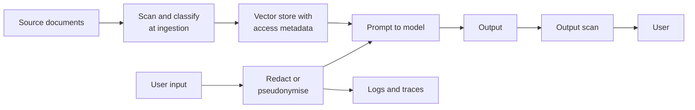

Users tell AI systems things they would not post publicly: symptoms, salaries, family disputes, customer lists. That text flows into prompts, logs, vector stores, evaluation sets and sometimes training data, each a copy that can leak or be misused. Privacy engineering is the discipline of collecting less, keeping it for less time, protecting what you keep, and being able to prove you did. This lesson covers the practical tools: detecting and redacting personal data, minimisation and retention, and the idea behind differential privacy. It ends with the principles of data-protection law at a high level; it is not legal advice, and you should involve your organisation's privacy or legal team for real decisions.

## Personal data in an AI pipeline

**Personal data** (often called PII, personally identifiable information) is information relating to an identifiable person. That includes the obvious (names, email addresses, phone numbers, government IDs) and the less obvious: an IP address, a device ID, a combination such as postcode plus birth date plus job title that singles out one person.



The principle is to place controls at **every boundary** where data moves to a place with a different audience or lifetime: into a third-party model API, into logs, into an index, out to a user.

## Detecting and redacting PII with patterns

The simplest detector is a set of regular expressions for structured identifiers. It is fast, transparent and easy to test, and it is the right first layer for things like email addresses and card numbers.

```python
import re

PATTERNS = {
    "EMAIL": re.compile(r"\b[\w.+-]+@[\w-]+\.[\w.-]+\b"),
    "CARD":  re.compile(r"\b(?:\d[ -]?){12,15}\d\b"),
    "IPV4":  re.compile(r"\b(?:\d{1,3}\.){3}\d{1,3}\b"),
    "PHONE": re.compile(r"(?<!\w)\+?\d[\d ()-]{8,}\d\b"),
}

def luhn_ok(digits):
    """Card numbers satisfy the Luhn checksum; random digit strings usually do not."""
    total, double = 0, False
    for ch in reversed(digits):
        n = int(ch)
        if double:
            n = n * 2 - 9 if n > 4 else n * 2
        total += n
        double = not double
    return total % 10 == 0

def redact(text):
    found = []
    def replacer(label):
        def repl(m):
            if label == "CARD" and not luhn_ok(re.sub(r"\D", "", m.group())):
                return m.group()                     # not a valid card number
            found.append((label, m.group()))
            return f"[{label}]"
        return repl
    for label in ["EMAIL", "CARD", "IPV4", "PHONE"]:   # order matters
        text = PATTERNS[label].sub(replacer(label), text)
    return text, found

msg = ("Hi, I'm Priya Shah. Email priya.shah@example.com or call +44 20 7946 0958. "
       "Card 4111 1111 1111 1111 was charged twice. Order 1234567890123 is late. "
       "Server 10.0.0.12.")
clean, found = redact(msg)
print(clean)
for item in found:
    print(item)
```

```output
Hi, I'm Priya Shah. Email [EMAIL] or call [PHONE]. Card [CARD] was charged twice. Order [PHONE] is late. Server [IPV4].
('EMAIL', 'priya.shah@example.com')
('CARD', '4111 1111 1111 1111')
('IPV4', '10.0.0.12')
('PHONE', '+44 20 7946 0958')
('PHONE', '1234567890123')
```

Several things went right: the email, card and phone were caught, and the Luhn check keeps arbitrary digit runs from being labelled as cards. Look closely at what went wrong, though. "Priya Shah" is untouched, because no regex can recognise names. The order number was redacted as a phone number, a false positive that may break the support workflow that needs it. Now some harder cases:

```python
tests = [
    "Contact me at priya dot shah at example dot com",
    "I live at 221B Baker Street, London",
    "Ref: 2024-06-15-0001",
    "My manager, the only left-handed cardiologist in Leeds, said no",
]
for t in tests:
    print(redact(t)[0])
```

```output
Contact me at priya dot shah at example dot com
I live at 221B Baker Street, London
Ref: [PHONE]
My manager, the only left-handed cardiologist in Leeds, said no
```

| Limitation | Example above |
| --- | --- |
| Obfuscated formats slip through | "dot ... at ... dot com" |
| Unstructured PII needs language understanding | Names, street addresses |
| Over-redaction of harmless numbers | Order and reference numbers |
| Quasi-identifiers are invisible to patterns | "The only left-handed cardiologist in Leeds" identifies one person |

In production, combine patterns with a [named-entity recognition](/learn/nlp-fundamentals/named-entity-recognition) model for names, places and organisations, and with checks specific to your domain (account-number formats, internal ID schemes). Open-source frameworks such as Microsoft Presidio package this combination. Measure the detector like any classifier: precision and recall on a labelled sample of your real traffic.

> [!WARNING]
> Redaction lowers risk; it does not make data anonymous. Re-identification from combinations of innocuous fields is well documented. Treat redacted logs as still sensitive.

### Redact, mask or pseudonymise

| Technique | Output | Use when |
| --- | --- | --- |
| Redaction | `[EMAIL]` | The value is not needed downstream |
| Masking | `****1111` | A human needs a hint to confirm identity |
| Pseudonymisation | `EMAIL_7f3a` (consistent token, mapping stored separately) | You need to link records or restore values later |

Pseudonymisation is useful with external model APIs: replace names with stable placeholders before the call, keep the mapping on your side, and substitute the real values back into the response. The model never sees the real identifiers.

## Data minimisation and retention

The most effective privacy control is data you never collected. Ask of every field and every log line: what is it for, who reads it, and when is it deleted?

- **Collect less.** Send the model only the fields the task needs. A summariser of support tickets does not need the customer's date of birth.
- **Keep less.** Set retention periods for prompts, responses, traces and embeddings, and enforce them with scheduled deletion jobs, not policy documents alone.
- **Delete everywhere.** A deletion request must reach the source database, the vector index, caches, analytics exports and backups (within their rotation). Map these copies before you need to.
- **Check vendor terms.** Know whether a model provider retains or trains on your API traffic, and for how long; many offer settings or agreements that limit this.
- **Avoid training on raw user data** unless you have a clear lawful basis and have minimised it; facts learned into weights cannot be removed on request (see [data leakage](/learn/ai-security-and-responsible-ai/data-leakage)).

## Differential privacy

Redaction protects individual records. Sometimes you need to publish or learn from **aggregates**: how many users mentioned a symptom, a model trained on many people's data. Even aggregates leak: if you publish the count of users with a condition today, and again tomorrow after one known person joined, the difference reveals that person.

**Differential privacy** (DP) is a mathematical guarantee that the output of an analysis barely depends on any single person's data. A randomised mechanism $M$ is $\varepsilon$-differentially private if, for any two datasets $D$ and $D'$ that differ in one person's record, and any set of outputs $S$:

$$
\Pr[M(D) \in S] \le e^{\varepsilon} \, \Pr[M(D') \in S]
$$

Here $\varepsilon$ (epsilon) is the **privacy budget**: smaller means the two output distributions are closer, so stronger privacy and noisier answers.

### The Laplace mechanism

For a numeric query $f$, define its **sensitivity** $\Delta f$ as the most that adding or removing one person can change the answer. A count has $\Delta f = 1$. The Laplace mechanism adds noise drawn from a Laplace distribution with scale $b = \Delta f / \varepsilon$:

$$
M(D) = f(D) + \text{Laplace}\!\left(0, \frac{\Delta f}{\varepsilon}\right)
$$

The noise has standard deviation $\sqrt{2}\, b$, so at $\varepsilon = 1$ the noise on a count has a standard deviation of about 1.4, regardless of dataset size. That is why DP works well for large populations: the noise is fixed while the signal grows.

```python
import numpy as np

rng = np.random.default_rng(42)
has_condition = rng.random(1000) < 0.12        # synthetic: 1,000 users
print("true count:", int(has_condition.sum()))

def laplace_count(data, epsilon, rng):
    sensitivity = 1.0                          # one person changes a count by at most 1
    return data.sum() + rng.laplace(0.0, sensitivity / epsilon)

for eps in [0.1, 0.5, 1.0, 5.0]:
    answers = [laplace_count(has_condition, eps, rng) for _ in range(5)]
    print(f"epsilon={eps:<4} answers: {np.round(answers, 1)}")
```

```output
true count: 125
epsilon=0.1  answers: [104.1 124.1 111.5 113.1 128.1]
epsilon=0.5  answers: [124.5 128.7 124.1 126.2 124.8]
epsilon=1.0  answers: [125.4 125.2 124.9 127.3 124.6]
epsilon=5.0  answers: [124.8 125.1 125.2 124.5 125. ]
```

At $\varepsilon = 0.1$ answers wander by ten or more; at $\varepsilon = 5$ they are within about one of the truth. Choosing $\varepsilon$ is a policy decision about the trade-off between accuracy and protection.

### Composition: the budget runs out

Privacy loss adds up. If someone may ask the same query repeatedly, they can average away the noise:

```python
many = [laplace_count(has_condition, 0.5, rng) for _ in range(1000)]
print(f"average of 1,000 noisy answers: {np.mean(many):.1f}")
```

```output
average of 1,000 noisy answers: 125.1
```

Under basic composition, 1,000 queries at $\varepsilon = 0.5$ each cost a total budget of 500, which is no meaningful protection. Real DP systems track the cumulative budget per dataset and stop answering, or answer from cached noisy results, when it is spent.

> [!NOTE]
> DP also applies to training: DP-SGD clips each example's gradient and adds noise so the trained model provably depends little on any one example. It costs accuracy and compute, and it is most practical when you have many examples per pattern you want the model to learn.

## Data-protection principles

Laws such as the EU's General Data Protection Regulation (GDPR) and similar laws elsewhere share a set of principles that translate directly into engineering requirements. At a high level:

| Principle | Engineering translation |
| --- | --- |
| Lawfulness, fairness, transparency | Know your legal basis; tell users what the AI does with their data |
| Purpose limitation | Data collected for support is not silently reused for training |
| Data minimisation | Send and store only the fields the task needs |
| Accuracy | Ways to correct wrong data, including in derived stores |
| Storage limitation | Retention periods enforced by deletion jobs |
| Integrity and confidentiality | Encryption, access control, redaction in logs |
| Accountability | Records of processing, impact assessments, audit trails |

Data-protection laws also give individuals rights, such as access to and deletion of their data, and add specific rules for automated decisions with significant effects. Requirements differ by jurisdiction and change over time, so treat this table as a design checklist, and confirm actual obligations with qualified advisers.

## Exercises

**1.** Add a `UK_POSTCODE` pattern to `PATTERNS` (a simplified form such as `SW1A 1AA` is enough) and check it on "Send it to SW1A 1AA please".

<details>
<summary>Show solution</summary>

```python
PATTERNS["UK_POSTCODE"] = re.compile(r"\b[A-Z]{1,2}\d[A-Z\d]? ?\d[A-Z]{2}\b")

def redact_all(text):
    for label in ["EMAIL", "CARD", "IPV4", "UK_POSTCODE", "PHONE"]:
        text = PATTERNS[label].sub(f"[{label}]", text)
    return text

print(redact_all("Send it to SW1A 1AA please"))
```

```output
Send it to [UK_POSTCODE] please
```

This simplified pattern will both miss some valid formats and match some non-postcodes; real validation uses an official list.

</details>

**2.** Write `pseudonymise(text)` that replaces each distinct email with `EMAIL_1`, `EMAIL_2`, ... and returns the mapping so the originals can be restored.

<details>
<summary>Show solution</summary>

```python
def pseudonymise(text):
    mapping = {}
    def repl(m):
        value = m.group()
        if value not in mapping:
            mapping[value] = f"EMAIL_{len(mapping) + 1}"
        return mapping[value]
    return PATTERNS["EMAIL"].sub(repl, text), mapping

out, mapping = pseudonymise("cc a@x.com and b@y.org, then a@x.com again")
print(out)
print(mapping)
```

```output
cc EMAIL_1 and EMAIL_2, then EMAIL_1 again
{'a@x.com': 'EMAIL_1', 'b@y.org': 'EMAIL_2'}
```

</details>

**3.** A dashboard shows the DP count of users with a condition, recomputed with fresh noise on every page load at $\varepsilon = 1$. What is wrong, and how do you fix it?

<details>
<summary>Show solution</summary>

Every page load spends more budget, and a user who reloads many times can average the answers to recover the true count. Compute the noisy value once per data release, cache it, and serve the same number until the data changes; track the total budget spent over all releases.

</details>

```quiz
[
  {
    "q": "Why is a regex-based PII redactor not sufficient on its own?",
    "options": [
      "Regular expressions are too slow for production",
      "It cannot recognise unstructured identifiers like names or combinations of facts that single out a person",
      "It always redacts too little for email addresses",
      "Regex is not available in Python"
    ],
    "answer": 1,
    "why": "Patterns handle structured formats. Names, addresses and quasi-identifiers need language understanding and domain knowledge."
  },
  {
    "q": "In the Laplace mechanism for a count query, what happens to the noise scale if you halve epsilon?",
    "options": [
      "It halves",
      "It stays the same",
      "It doubles",
      "It becomes zero"
    ],
    "answer": 2,
    "why": "The scale is sensitivity divided by epsilon, so smaller epsilon (stronger privacy) means proportionally more noise."
  },
  {
    "q": "Why does repeatedly answering the same differentially private query weaken privacy?",
    "options": [
      "The random seed is reused",
      "Privacy loss composes: averaging many noisy answers recovers the true value",
      "Laplace noise becomes smaller over time",
      "It does not; each answer is independent and private"
    ],
    "answer": 1,
    "why": "Each answer spends budget. Under basic composition the total epsilon is the sum, and averaging removes the noise."
  },
  {
    "q": "Which technique lets you send text to an external model without real identifiers but restore them in the response?",
    "options": [
      "Redaction",
      "Pseudonymisation with a mapping kept on your side",
      "Differential privacy",
      "Masking the last four digits"
    ],
    "answer": 1,
    "why": "Stable placeholders preserve meaning for the model while the mapping lets your backend substitute real values back."
  }
]
```
