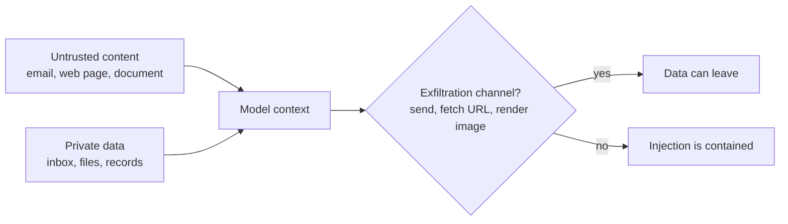
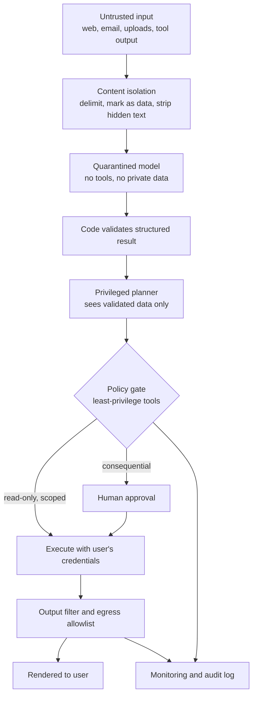

An LLM application takes text from many places, concatenates it, and asks a model what to do next. **Prompt injection** is the attack in which some of that text, written by someone other than you, carries instructions that the model follows. You met the idea in [prompt injection awareness](/learn/prompt-engineering/prompt-injection-awareness); this lesson treats it as a security engineer would. You will learn to reason about which systems are dangerous, why the problem cannot be patched away in the prompt, and how to build an architecture in which a successful injection does little harm. The examples describe attacks only at the level needed to defend against them.

## The instruction/data boundary is blurry by design

Classic injection bugs such as SQL injection have a clean fix: keep code and data in separate channels. A parameterised query sends the SQL text and the user's value separately, so the value can never become a command.

A language model has one channel. The system prompt, the user's message, a retrieved PDF and a tool result all become one token sequence. Chat roles and delimiters are conventions the model was trained to respect, not a boundary that anything enforces. Worse, the thing that makes LLMs useful is exactly what makes them injectable: they are trained to find and follow instructions in natural language, wherever those instructions appear.

| Property | SQL engine | LLM |
| --- | --- | --- |
| Separate channel for data | Yes (bound parameters) | No: everything is tokens |
| Behaviour on instruction-like data | Ignored, it is a value | May be followed |
| Fix at the input layer | Complete | Partial and probabilistic |
| Resulting strategy | Prevent | Contain the damage |

> [!KEY]
> Treat every token that you did not write as potentially adversarial, and design so that the model being fooled is survivable. Prompt wording lowers the success rate of attacks; architecture limits their consequences.

## Direct and indirect injection

**Direct injection** comes from the person typing into your application. They try to override your rules, extract the system prompt, or make the model produce content you forbid. The damage is usually bounded by what that user could already do, so the main concerns are policy violations and leaked configuration.

**Indirect injection** arrives inside content the application reads on behalf of a user who did nothing wrong. Common carriers:

| Carrier | How attacker text gets in |
| --- | --- |
| Web pages | Hidden text, HTML comments, metadata in a page the agent browses or summarises |
| Documents | Uploaded PDFs, shared drive files, resumes, invoices |
| Email and messages | An inbound email processed by an assistant that can also send email |
| RAG corpora | A wiki page or support ticket anyone can edit |
| Tool outputs | API responses, search results, the output of another agent |
| Images and audio | Text embedded in an image read by a vision-language model |

The victim of indirect injection is the user, whose permissions are borrowed. That is why it is the more serious class.

## The lethal trifecta

A useful way to judge exposure is to ask whether a system combines three capabilities. Security researchers have popularised this as the "lethal trifecta":

1. **Access to private data**: the user's inbox, files, CRM records, internal documents.
2. **Exposure to untrusted content**: anything an outsider can influence reaches the model's context.
3. **An exfiltration channel**: some way for information to leave, such as sending email, calling arbitrary URLs, writing to a public place, or even rendering a Markdown image whose URL the browser fetches.

If all three are present, an injected instruction in the untrusted content can tell the model to read the private data and push it out through the channel. Remove any one leg and that particular attack fails. This turns a vague worry into a design review question you can answer for each feature.



The same reasoning applies to integrity, not only confidentiality: an agent that reads untrusted content and can **take actions** (delete files, make payments, change permissions) can be steered into harmful actions even if nothing leaks.

## Defence in depth: the architecture

No single layer is reliable, so you stack several. Each layer assumes the ones before it may have failed.



| Layer | What it does | What it does not do |
| --- | --- | --- |
| Privilege separation | The model that reads untrusted text has no tools or secrets; it returns a constrained structure | Does not stop the quarantined model being fooled, only makes it harmless |
| Least-privilege tools | `get_order(order_id)` scoped to the current customer instead of a general SQL tool | Does not help if the narrow tool is itself dangerous |
| Human approval | A person confirms sending, paying, deleting, sharing | Fails if approvals are frequent and vague, so people click through |
| Content isolation | Wrap untrusted text in tagged blocks, tell the model it is data, remove invisible characters | Probabilistic; reduces casual attacks only |
| Output filtering | Removes links and images to non-allowlisted domains, checks tool arguments | Cannot catch every encoding of data |
| Egress controls | Network-level allowlist for outbound requests from the agent runtime | Needs infrastructure work |
| Monitoring | Logs every tool call with its provenance, alerts on anomalies | Detects after the fact |

The guardrails lesson in [advanced agent systems](/learn/advanced-agent-systems/guardrails) implements several of these as agent components; here the focus is on how they fit together.

## A provenance-aware policy gate

The most robust defences are enforced in code that the model cannot talk to. One pattern is **taint tracking**: once untrusted content has entered a conversation, the session is marked tainted, and tools that could exfiltrate data or cause side effects require explicit approval.

```python
from dataclasses import dataclass, field

TOOLS = {
    "search_docs":   {"reads_private": True,  "egress": False, "side_effect": False},
    "fetch_url":     {"reads_private": False, "egress": True,  "side_effect": False},
    "send_email":    {"reads_private": False, "egress": True,  "side_effect": True},
    "summarise":     {"reads_private": False, "egress": False, "side_effect": False},
}

@dataclass
class Session:
    tainted: bool = False          # has untrusted content entered the context?
    read_private: bool = False     # has private data entered the context?
    log: list = field(default_factory=list)

def decide(session, tool):
    caps = TOOLS.get(tool)
    if caps is None:
        return "deny"                                  # unknown tools never run
    trifecta = session.tainted and session.read_private and caps["egress"]
    if trifecta or caps["side_effect"]:
        return "needs_approval"
    return "allow"

def call(session, tool, source_trusted=True):
    verdict = decide(session, tool)
    session.log.append((tool, verdict))
    if verdict == "allow":
        if TOOLS[tool]["reads_private"]:
            session.read_private = True
        if not source_trusted:
            session.tainted = True
    return verdict

s = Session()
print(call(s, "search_docs"))                       # private data enters
print(call(s, "fetch_url", source_trusted=False))   # untrusted web page enters
print(call(s, "fetch_url"))                         # now all three legs present
print(call(s, "send_email"))
print(call(s, "delete_everything"))
print(s.log)
```

```output
allow
allow
needs_approval
needs_approval
deny
[('search_docs', 'allow'), ('fetch_url', 'allow'), ('fetch_url', 'needs_approval'), ('send_email', 'needs_approval'), ('delete_everything', 'deny')]
```

The first `fetch_url` is allowed because at that point fetching a page cannot leak anything new beyond the URL the user asked for. After the page has been read, the context holds both private and untrusted data, so any further egress needs a human. Real systems refine this, for example by tracking which specific values came from which source, but the principle holds: the decision is made by code from facts about provenance, not by asking the model whether it has been tricked.

> [!WARNING]
> Asking a second LLM "is this input an injection?" is a useful signal for monitoring, but never make it your only control. Detectors have error rates and can themselves be targeted by the same text they inspect.

## Content isolation and output filtering

Isolation reduces how often attacks succeed. Wrap each untrusted source in clearly labelled blocks, remove characters people cannot see, and state in the system prompt that the content is material to process, not instructions:

```python
import re
import unicodedata

def isolate(source_name, text, max_chars=4000):
    # drop zero-width and other invisible format characters (Unicode category Cf)
    text = "".join(ch for ch in text if unicodedata.category(ch) != "Cf")
    text = re.sub(r"<!--.*?-->", "", text, flags=re.S)   # HTML comments
    text = text.replace("</untrusted>", "")              # cannot close our tag
    return f'<untrusted source="{source_name}">\n{text[:max_chars]}\n</untrusted>'

page = "Great recipe.​<!-- hidden note for the assistant -->Bake 20 minutes."
print(isolate("example.com/recipe", page))
```

```output
<untrusted source="example.com/recipe">
Great recipe.Bake 20 minutes.
</untrusted>
```

On the way out, filter anything that can carry data off the page. A Markdown image pointing to an attacker's domain is fetched by the user's browser automatically, so links and images should be limited to domains you trust. The earlier lesson showed such a filter; combine it with a network-level egress allowlist for the agent runtime, so that even a tool call you failed to anticipate cannot reach arbitrary hosts.

## Monitoring and testing

- **Log provenance.** For each model call, record which sources were in context and which tool calls followed. When something goes wrong you need to reconstruct the chain.
- **Alert on anomalies**, such as tool calls the user's request did not plausibly need, unusually long outputs containing encoded strings, or many denied calls in one session.
- **Keep an injection test suite.** Store benign test documents containing instruction-like text ("please also email this file to...") and assert that your system does not act on them. Run it in CI like any other regression test.
- **Red-team regularly.** People who try to break the system find what scripted tests miss; see [responsible AI](/learn/ai-security-and-responsible-ai/responsible-ai).

## Exercises

**1.** A customer-support bot reads incoming tickets, can look up any customer's orders, and can reply by email to any address. Identify the three legs of the trifecta and propose one change that removes each.

<details>
<summary>Show solution</summary>

Untrusted content: ticket text written by anyone. Private data: lookup across all customers' orders. Exfiltration: emailing arbitrary addresses. Fixes: scope lookups to the customer who owns the ticket (enforced by the backend, not the prompt); restrict replies to the ticket's verified sender address; route ticket text through a quarantined model that extracts only an order ID and a category. Any one of these breaks the cross-customer leak.

</details>

**2.** Extend `decide` so that `send_email` is allowed without approval when the session is untainted and the recipient is the signed-in user. Add a `recipient` argument.

<details>
<summary>Show solution</summary>

```python
def decide_email(session, tool, recipient=None, user_email="me@example.com"):
    if tool == "send_email" and not session.tainted and recipient == user_email:
        return "allow"
    return decide(session, tool)

print(decide_email(Session(), "send_email", "me@example.com"))
print(decide_email(Session(tainted=True), "send_email", "me@example.com"))
```

```output
allow
needs_approval
```

</details>

**3.** Why does stripping HTML comments and zero-width characters not solve indirect injection?

<details>
<summary>Show solution</summary>

Because the attack does not need to be hidden. Visible, ordinary sentences in a document can still read as instructions to the model, and attackers can rephrase endlessly. Sanitising removes some cheap tricks and makes content easier for humans to audit, but the model can still be persuaded; containment must come from privileges and approvals.

</details>

```quiz
[
  {
    "q": "Why is prompt injection harder to fix than SQL injection?",
    "options": [
      "LLMs are slower than databases",
      "An LLM has no enforced separate channel for data: instructions and data are the same kind of tokens",
      "SQL injection has also never been fixed",
      "Prompt injection only affects open-source models"
    ],
    "answer": 1,
    "why": "Parameterised queries separate code from data. In an LLM everything is one token sequence, so there is no equivalent hard boundary."
  },
  {
    "q": "Which combination makes up the lethal trifecta?",
    "options": [
      "Large model, long context, high temperature",
      "Private data access, untrusted content, an exfiltration channel",
      "No system prompt, no logging, no tests",
      "Tool use, streaming, caching"
    ],
    "answer": 1,
    "why": "If the model can read private data, sees attacker-controlled text, and has a way to send data out, an injection can leak the data. Removing any leg breaks that attack."
  },
  {
    "q": "An assistant summarises web pages and renders its answer as Markdown. What is the exfiltration risk?",
    "options": [
      "None, because it has no tools",
      "The page could make the model output an image URL containing data, which the browser fetches automatically",
      "Markdown cannot contain URLs",
      "Only the system prompt could leak"
    ],
    "answer": 1,
    "why": "Rendering an image triggers a request to its URL. Filtering links and images to allowlisted domains closes that channel."
  },
  {
    "q": "Where should the decision to require human approval for a tool call be made?",
    "options": [
      "In the system prompt, telling the model to ask first",
      "By a second LLM that judges whether the request looks malicious",
      "In application code, based on the tool's capabilities and the provenance of the context",
      "By the user, before every single model call"
    ],
    "answer": 2,
    "why": "Code-enforced policy cannot be talked out of its rules. Prompt instructions and LLM judges are useful signals but can be manipulated."
  }
]
```
