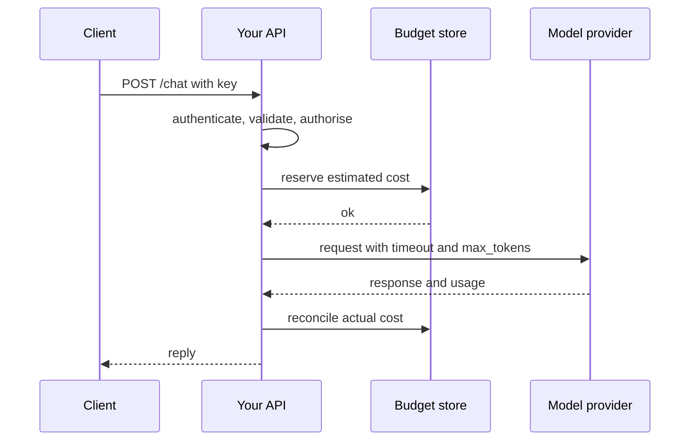

Most AI features reach users through an HTTP API: your frontend calls your backend, your backend calls a model provider, and perhaps other teams call your service. Everything you learned about [authentication](/learn/backend-development/authentication) and [authorization](/learn/backend-development/authorization) still applies, but LLM endpoints change the economics. A single request can cost real money, take tens of seconds, carry a whole document, and return text that was influenced by another customer's data if you are careless. This lesson assembles the controls a production AI endpoint needs and implements them in a small [FastAPI](/learn/fastapi/fastapi-fundamentals) service that you can run and test.

## What makes AI endpoints different

| Property | Typical CRUD endpoint | LLM endpoint |
| --- | --- | --- |
| Cost per request | Tiny, roughly constant | Variable, proportional to input plus output tokens |
| Latency | Milliseconds | Seconds, often streamed |
| Request size | Small JSON | Long documents, images, whole conversations |
| Output | Data you computed | Text influenced by inputs you do not control |
| Abuse incentive | Scraping, credential stuffing | Free model access, cost attacks, data extraction |

These properties mean the usual controls need tighter, cost-aware settings, and a few new controls appear: budgets, output caps and per-tenant isolation of everything the model can see.

## The request path

Order matters. Cheap checks that reject bad requests should run before expensive ones, and nothing should reach the model until identity, permissions, size and budget are settled.

```mermaid
flowchart LR
    R["Request"] --> TLS["TLS and gateway<br/>body size limit"]
    TLS --> AUTH["Authenticate<br/>API key or token"]
    AUTH --> VAL["Validate schema<br/>length, max_tokens"]
    VAL --> AUTHZ["Authorise<br/>scope and tenant"]
    AUTHZ --> RL["Rate limit<br/>per key"]
    RL --> BUD["Budget check<br/>per tenant"]
    BUD --> LLM["Model call<br/>timeout, output cap"]
    LLM --> OUT["Validate output"]
    OUT --> LOG["Audit log<br/>redacted"]
```



## Authentication and secrets

- **Authenticate every endpoint that reaches a model**, including internal ones. An unauthenticated endpoint is a free model proxy for the internet.
- **Store API keys hashed**, as you would passwords, and compare in constant time so response timing does not leak how many characters matched.
- **Issue keys per client and per environment**, so one can be revoked without breaking others, and so usage is attributable.
- **Keep provider credentials server-side only.** Never ship your model provider's API key to a browser or mobile app; anything in a client bundle is public. The client calls your backend; your backend calls the provider.
- **Load secrets from the environment or a secrets manager**, never from source code or prompts, and rotate them. Scan repositories for committed keys.

## Authorisation and tenant isolation

Authentication says who is calling; authorisation decides what they may touch. In multi-tenant AI systems the crucial rule is that **every resource lookup is scoped by the caller's tenant**, derived from their credential, never from the request body or the model's output. That includes conversations, uploaded files, vector-store queries ([data leakage](/learn/ai-security-and-responsible-ai/data-leakage) showed the retrieval case), caches and fine-tuned models.

When a caller asks for a resource that exists but belongs to another tenant, return `404 Not Found` rather than `403 Forbidden`, so the response does not confirm that the identifier exists.

## Limits: size, rate and money

Three kinds of limit protect against both abuse and your own bugs:

| Limit | Protects against | Where |
| --- | --- | --- |
| Request body size | Memory exhaustion, huge prompts | Gateway or server config |
| Field lengths and `max_tokens` bounds | Long inputs and maximum-length outputs | Request schema |
| Requests per time window | Scripted abuse, extraction, runaway clients | Per key, per IP for anonymous routes |
| Tokens or spend per day | Denial of wallet, agent loops | Per tenant, plus a global circuit breaker |
| Timeouts | Hung upstream calls tying up workers | Model client and server |
| Concurrency | One tenant starving others | Per tenant semaphore or queue |

A **token bucket** is the standard rate-limiting algorithm. Each key has a bucket holding up to `capacity` tokens that refills at a fixed rate. A request spends one token; with none left, it is rejected with status 429. The bucket allows short bursts while enforcing an average rate.

> [!TIP]
> Rate-limit on tokens consumed, not only on request count. Ten requests that each send a 100-page document cost far more than ten one-line questions.

## A secured endpoint in FastAPI

The service below brings these pieces together. The model call is a stand-in, so it runs without any provider account.

```python
import hashlib, hmac, time
from dataclasses import dataclass
from fastapi import Depends, FastAPI, Header, HTTPException
from pydantic import BaseModel, Field

def hash_key(raw: str) -> str:
    return hashlib.sha256(raw.encode()).hexdigest()

# In production these live in a database; keys are stored hashed.
API_KEYS = {
    hash_key("demo-key-acme"):   {"tenant": "acme",   "scopes": {"chat"}},
    hash_key("demo-key-globex"): {"tenant": "globex", "scopes": {"chat"}},
}
CONVERSATIONS = {"c-1": {"tenant": "acme", "messages": ["hello"]}}

@dataclass
class Principal:
    tenant: str
    key_id: str
    scopes: set

def get_principal(x_api_key: str = Header(default="")) -> Principal:
    digest = hash_key(x_api_key)
    for stored, info in API_KEYS.items():
        if hmac.compare_digest(stored, digest):         # constant-time comparison
            return Principal(info["tenant"], stored[:8], info["scopes"])
    raise HTTPException(status_code=401, detail="invalid API key")

class TokenBucket:
    def __init__(self, capacity, refill_per_sec):
        self.capacity, self.rate = capacity, refill_per_sec
        self.state = {}                                   # key -> (tokens, last_time)

    def allow(self, key, now=None):
        now = time.monotonic() if now is None else now
        tokens, last = self.state.get(key, (self.capacity, now))
        tokens = min(self.capacity, tokens + (now - last) * self.rate)
        if tokens < 1:
            self.state[key] = (tokens, now)
            return False
        self.state[key] = (tokens - 1, now)
        return True

limiter = TokenBucket(capacity=3, refill_per_sec=0.1)

class ChatRequest(BaseModel):
    conversation_id: str = Field(max_length=64)
    message: str = Field(min_length=1, max_length=4000)   # input size limit
    max_tokens: int = Field(default=256, ge=1, le=1024)    # output cost cap

app = FastAPI()

@app.post("/chat")
def chat(req: ChatRequest, who: Principal = Depends(get_principal)):
    if "chat" not in who.scopes:
        raise HTTPException(status_code=403, detail="missing scope")
    if not limiter.allow(who.key_id):
        raise HTTPException(status_code=429, detail="rate limit exceeded")
    conv = CONVERSATIONS.get(req.conversation_id)
    if conv is None or conv["tenant"] != who.tenant:         # tenant isolation
        raise HTTPException(status_code=404, detail="conversation not found")
    reply = f"(model reply, at most {req.max_tokens} tokens)"  # stand-in for the model
    return {"reply": reply}
```

Now exercise it with FastAPI's test client, as you did in [API testing](/learn/fastapi/api-testing):

```python
from fastapi.testclient import TestClient

client = TestClient(app)
body = {"conversation_id": "c-1", "message": "Summarise our chat"}
acme = {"x-api-key": "demo-key-acme"}

def show(label, r):
    data = r.json()
    detail = data.get("detail", data.get("reply"))
    if isinstance(detail, list):                 # validation errors are a list
        detail = detail[0]["msg"]
    print(f"{label:<18} {r.status_code} {detail}")

show("no key", client.post("/chat", json=body))
show("other tenant", client.post("/chat", json=body, headers={"x-api-key": "demo-key-globex"}))
show("oversized input", client.post("/chat", json={**body, "message": "x" * 5000}, headers=acme))
show("huge max_tokens", client.post("/chat", json={**body, "max_tokens": 100000}, headers=acme))
for i in range(4):
    show(f"acme request {i + 1}", client.post("/chat", json=body, headers=acme))
```

```output
no key             401 invalid API key
other tenant       404 conversation not found
oversized input    422 String should have at most 4000 characters
huge max_tokens    422 Input should be less than or equal to 1024
acme request 1     200 (model reply, at most 256 tokens)
acme request 2     200 (model reply, at most 256 tokens)
acme request 3     200 (model reply, at most 256 tokens)
acme request 4     429 rate limit exceeded
```

Each control rejects a different kind of bad request, and the oversized input and excessive `max_tokens` are rejected by schema validation before they consume a rate-limit token or reach a model. The other tenant gets a 404 for a conversation that does exist.

> [!WARNING]
> FastAPI's default validation errors echo the offending input back in the response body. For an endpoint that receives sensitive text, consider a custom exception handler that returns the error type without the input, and make sure such errors are not logged verbatim.

## Budgets and circuit breakers

Rate limits bound request frequency; budgets bound money. Estimate the maximum cost of a call before making it (input tokens plus the `max_tokens` cap, times the price), reserve it against the tenant's budget, then reconcile with the actual usage the provider reports. The [model security](/learn/ai-security-and-responsible-ai/model-security) lesson showed a simple guard. Add:

- **A global circuit breaker**: if total spend in the last hour exceeds a threshold, stop non-essential traffic and alert a person.
- **Agent step limits**: a maximum number of model calls and tool calls per task, so a loop cannot run forever.
- **Provider-side limits**: spending caps or alerts in the provider's console as an independent backstop.

## Logging and abuse monitoring

Log every request with the key ID, tenant, token counts, latency, status and which limits fired, but redact message content by default (see [privacy](/learn/ai-security-and-responsible-ai/privacy)). Dashboards that show per-key token usage over time make abuse visible: extraction attempts look like steady, systematic, high-volume traffic; stolen keys show up as sudden spikes from new locations. Build a way to revoke a key in minutes.



## Exercises

**1.** The token bucket accepts an explicit `now`. Show that a key which has used all 3 tokens is allowed again 10 seconds later (refill rate 0.1 per second), but not after 5 seconds.

<details>
<summary>Show solution</summary>

```python
b = TokenBucket(capacity=3, refill_per_sec=0.1)
print([b.allow("k", now=0.0) for _ in range(4)])
print(b.allow("k", now=5.0))
print(b.allow("k", now=10.0))
```

```output
[True, True, True, False]
False
True
```

After 5 seconds only 0.5 tokens have refilled, so the request is refused; the refusal also records the time, and by 10 seconds a full token has accumulated.

</details>

**2.** A mobile app calls the model provider directly, with the provider key embedded in the app "but obfuscated". What is the risk and the fix?

<details>
<summary>Show solution</summary>

Anything shipped to a device can be extracted; obfuscation only delays it. Whoever extracts the key gets unlimited model access billed to you, with no per-user limits. Put a backend in between: the app authenticates its user to your API, your API applies limits and budgets, and only your server holds the provider key.

</details>

**3.** Why should the tenant check in `chat` use `who.tenant` rather than a `tenant` field in `ChatRequest`?

<details>
<summary>Show solution</summary>

The request body is controlled by the caller, so a `tenant` field could simply be set to another tenant's name. `who.tenant` is derived from the authenticated credential on the server, so the caller cannot change it.

</details>

```quiz
[
  {
    "q": "Why should a model provider's API key never be shipped inside a browser or mobile app?",
    "options": [
      "It makes the app slower",
      "Anything in a client can be extracted, giving attackers unlimited model access billed to you",
      "Providers block requests from mobile devices",
      "Keys expire faster on clients"
    ],
    "answer": 1,
    "why": "Client code is public. Keep provider keys on your server and put your own authenticated, rate-limited API in front."
  },
  {
    "q": "A caller requests a conversation that exists but belongs to another tenant. What is a good response?",
    "options": [
      "200 with the conversation",
      "403 Forbidden explaining it belongs to another tenant",
      "404 Not Found",
      "500 Internal Server Error"
    ],
    "answer": 2,
    "why": "Returning 404 avoids confirming that the identifier exists, which would itself leak information."
  },
  {
    "q": "Which control directly bounds the output cost of a single LLM request?",
    "options": [
      "TLS",
      "An upper bound on `max_tokens` enforced in the request schema",
      "Hashing API keys",
      "Returning 404 for other tenants"
    ],
    "answer": 1,
    "why": "Output tokens cost money; validating `max_tokens` against a ceiling caps what any single request can generate."
  },
  {
    "q": "Why are API keys compared with `hmac.compare_digest` rather than `==`?",
    "options": [
      "It is faster",
      "It runs in constant time, so response timing does not reveal how much of a guess matched",
      "It decrypts the key",
      "`==` does not work on strings"
    ],
    "answer": 1,
    "why": "Ordinary comparison can stop at the first differing character, creating a timing side channel."
  }
]
```
