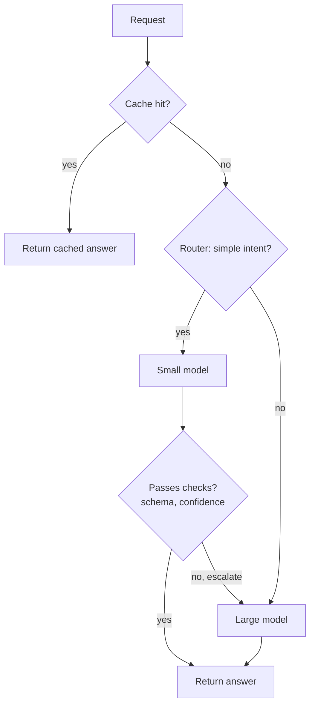

Almost every design decision in an AI system moves three dials at once: **cost**, **latency** and **quality**. A larger model raises quality and both cost and latency; caching cuts cost and latency but risks stale answers; batching cuts cost per token but can raise latency. Good designers make these trade-offs explicitly, with a cost model they can rerun when prices or traffic change. This lesson builds that model and applies it to routing, caching, batching and the self-host versus API decision. The individual techniques are covered in [cost optimisation](/learn/production-ai-systems/cost-optimization) and [latency optimisation](/learn/production-ai-systems/latency-optimization); here you combine them.

> [!NOTE]
> All prices in this lesson are **illustrative variables**, not real quotes. Model prices change often and differ between providers; plug in your own current figures. The structure of the model is what lasts.

## The anatomy of latency

For a streamed LLM response, users experience two numbers: **time to first token (TTFT)**, which covers everything before the first token appears, and **time per output token (TPOT)**, the gap between subsequent tokens. Total generation time is approximately

$$
T_{\text{total}} \approx T_{\text{TTFT}} + (n_{\text{out}} - 1) \times T_{\text{TPOT}}
$$

where $n_{\text{out}}$ is the number of output tokens. TTFT is dominated by queueing, pre-processing (retrieval, guardrails) and prefill, which grows with prompt length. TPOT is dominated by decode speed, which depends on model size, hardware and how many sequences share each batch.

| Lever | Main effect on TTFT | Main effect on TPOT / total | Effect on cost | Quality risk |
| --- | --- | --- | --- | --- |
| Smaller model | Lower | Lower | Much lower | Higher error rate on hard tasks |
| Shorter prompts (fewer chunks, trimmed history) | Lower | Small | Lower | Missing context |
| Shorter outputs (instructions, max tokens) | None | Much lower | Lower | Truncated or terse answers |
| Response caching | Near zero on hit | Near zero on hit | Lower | Stale or mismatched answers |
| Prefix caching | Lower | None | Lower | None |
| Larger batches | Higher under load | Higher | Lower per token | None |
| Quantisation | Lower | Lower | Lower | Small, must be measured |
| Streaming | Perceived much lower | None | None | None |
| Parallel tool and retrieval calls | Lower | None | None | None |

Notice that output length is often the biggest latency lever: decode is sequential, so 800 output tokens take roughly twice as long as 400, whatever the prompt.

## A cost model you can rerun

Model a request by its input and output tokens and price them per million tokens. Keep every price and traffic figure as a named variable.

```python
# illustrative prices per million tokens (replace with your own)
PRICES = {
    "large": {"in": 3.00, "out": 15.00},
    "small": {"in": 0.25, "out": 1.25},
}

def request_cost(model, tokens_in, tokens_out, cached_in=0, cache_discount=0.9):
    p = PRICES[model]
    billed_in = (tokens_in - cached_in) + cached_in * (1 - cache_discount)
    return (billed_in * p["in"] + tokens_out * p["out"]) / 1e6

requests_per_month = 200_000 * 22        # enterprise assistant, working days
tokens_in, tokens_out = 3_050, 300

baseline = request_cost("large", tokens_in, tokens_out) * requests_per_month
print(f"cost per request (large): {request_cost('large', tokens_in, tokens_out):.5f}")
print(f"monthly baseline: {baseline:,.0f}")
```

```output
cost per request (large): 0.01365
monthly baseline: 60,060
```

Now apply levers one at a time and together, so each saving is visible.

```python
def monthly_cost(small_share=0.0, cache_hit=0.0, prefix_cached=0):
    misses = requests_per_month * (1 - cache_hit)
    per_large = request_cost("large", tokens_in, tokens_out, cached_in=prefix_cached)
    per_small = request_cost("small", tokens_in, tokens_out, cached_in=prefix_cached)
    return misses * ((1 - small_share) * per_large + small_share * per_small)

scenarios = {
    "baseline (all large)": monthly_cost(),
    "route 60% to small": monthly_cost(small_share=0.6),
    "15% response cache hits": monthly_cost(cache_hit=0.15),
    "prefix cache 1,000 tokens": monthly_cost(prefix_cached=1_000),
    "all three": monthly_cost(small_share=0.6, cache_hit=0.15, prefix_cached=1_000),
}
for name, cost in scenarios.items():
    print(f"{name:28s} {cost:>9,.0f}  ({cost / baseline:.0%} of baseline)")
```

```output
baseline (all large)            60,060  (100% of baseline)
route 60% to small              27,027  (45% of baseline)
15% response cache hits         51,051  (85% of baseline)
prefix cache 1,000 tokens       48,180  (80% of baseline)
all three                       18,429  (31% of baseline)
```

Routing is the largest lever here because the small model is an order of magnitude cheaper, but it is also the one with real quality risk. The cost model tells you what each lever is worth; your evaluation suite tells you whether you can afford it.

> [!KEY]
> Never adopt a cost lever without measuring its quality effect on the same evaluation set. A 50 percent saving that quietly drops answer correctness by 10 points is usually a bad trade, and only an evaluation will show it.

## Routing and cascades

Two common ways to use cheaper models without sacrificing quality on hard requests:

- **Routing**: a classifier (rules, a small model, or embedding similarity to labelled examples) predicts difficulty or intent up front and picks the model.
- **Cascading**: try the small model first; if a check fails (low confidence, failed schema validation, a verifier rejects it), escalate to the large model. Cascades save money when most requests pass, but escalated requests pay for both calls and take longer.



The break-even for a cascade: if the small model costs $c_s$, the large $c_l$, and a fraction $e$ of requests escalate, the average cost is $c_s + e \, c_l$, which beats always using the large model only if $c_s + e \, c_l < c_l$, that is $e < 1 - c_s / c_l$. With a small model at one-tenth the price, the cascade pays off as long as fewer than 90 percent of requests escalate, but each escalated request is slower, so check the latency SLO for the escalated path too.

## Batching: throughput versus latency

On self-hosted models, larger batches raise GPU throughput (more tokens per second per GPU, so lower cost per token) but each sequence's TPOT rises because each decode step does more work. The relationship is measured, not computed, and it is the central tuning curve of [batching](/learn/production-ai-systems/batching). A load test produces something like the following illustrative table for one replica:

| Concurrent sequences | Output tokens/s per replica | TPOT per sequence (ms) |
| --- | --- | --- |
| 1 | 40 | 25 |
| 8 | 280 | 29 |
| 32 | 900 | 36 |
| 128 | 2,000 | 64 |

You pick the largest batch whose TPOT still meets the SLO (for example, under 50 ms per token for comfortable reading speed) and size the pool from that throughput, as in [the first lesson](/learn/ai-system-design/designing-scalable-ai-applications). Offline jobs with no latency target can run at the largest batch the memory allows.

## Self-hosting versus API

Self-hosting has a mostly **fixed** cost (GPUs per hour, whether busy or idle, plus engineering time); an API has a **variable** cost per token. The break-even depends on utilisation.

```python
gpu_hour_cost = 4.0              # illustrative, per GPU-hour
gpus = 4                         # one replica with tensor parallelism 4
replica_tokens_per_s = 2_000     # measured output tokens/s at the latency SLO
api_out_price = 15.00            # illustrative, per million output tokens (comparable model)

monthly_fixed = gpu_hour_cost * gpus * 24 * 30
for utilisation in (0.1, 0.3, 0.6):
    tokens = replica_tokens_per_s * utilisation * 3600 * 24 * 30
    self_cost_per_m = monthly_fixed / (tokens / 1e6)
    print(f"utilisation {utilisation:.0%}: self-hosted {self_cost_per_m:5.2f} vs API {api_out_price:.2f} per million output tokens")
```

```output
utilisation 10%: self-hosted 22.22 vs API 15.00 per million output tokens
utilisation 30%: self-hosted  7.41 vs API 15.00 per million output tokens
utilisation 60%: self-hosted  3.70 vs API 15.00 per million output tokens
```

This comparison is deliberately simplified: it counts only output tokens and GPU rent, ignoring input tokens, engineering and on-call time, redundancy (you need at least two replicas for availability, which halves utilisation at low traffic) and the quality difference between the models compared. Still, the shape holds: **self-hosting wins at high, steady utilisation; APIs win at low or spiky traffic**. Data-residency requirements can override the arithmetic entirely.

## Design scenario: the support agent's budget

The [customer-support agent](/learn/ai-system-design/llm-application-architecture) uses about 51,600 tokens per conversation, mostly input. Applying the levers in order of risk:

1. **Prefix-cache** the 2,500-token static prefix of every call (no quality risk).
2. **Trim context**: summarise tool results older than the current turn (small risk, measure).
3. **Route** the per-step "decide which tool" calls to the small model; keep the final customer-facing answer on the large model (moderate risk, evaluate on recorded conversations).
4. **Cap output length** for intermediate steps.

> [!TIP]
> Order cost levers by quality risk: first the ones that are free in quality (prefix caching, parallelism, deduplicated calls), then the ones you can verify cheaply (trimming, output caps), and last the ones that change the model (routing, quantisation, distillation).

## Exercises

**1.** Using `monthly_cost`, find the cost if 80 percent of traffic goes to the small model with a 25 percent cache hit rate and no prefix caching. What fraction of the baseline is it?

<details>
<summary>Show solution</summary>

```python
c = monthly_cost(small_share=0.8, cache_hit=0.25)
print(f"{c:,.0f} ({c / baseline:.0%})")
```

```output
12,012 (20%)
```

</details>

**2.** A small model costs one-fifth of the large one. Up to what escalation rate does a cascade save money, ignoring latency?

<details>
<summary>Show solution</summary>

The condition is $e < 1 - c_s/c_l = 1 - 0.2 = 0.8$. Below 80 percent escalation the cascade is cheaper on average; above it, paying for both calls costs more than always using the large model.

</details>

**3.** A product manager wants answers to start appearing faster. The prompt is 6,000 tokens, outputs are 250 tokens, and the TTFT breakdown is 300 ms retrieval, 900 ms prefill, 400 ms queueing. Propose three changes and say which number each reduces.

<details>
<summary>Show solution</summary>

Reduce prompt length (fewer or shorter retrieved chunks, trimmed history), which cuts prefill time. Enable prefix caching for the shared system prompt and instructions, which also cuts prefill. Add capacity or prioritise interactive traffic to cut queueing, and run retrieval sub-steps in parallel to cut the 300 ms. Shortening the output would not help TTFT.

</details>

```quiz
[
  {
    "q": "Which change most reduces total generation time for long answers?",
    "options": ["Shorter system prompt", "Fewer output tokens", "A faster embedding model", "A larger response cache TTL"],
    "answer": 1,
    "why": "Decode is sequential: total time grows roughly linearly with the number of output tokens."
  },
  {
    "q": "In a cascade, the small model costs one-tenth of the large model. When is the cascade cheaper than always using the large model?",
    "options": [
      "Only if no requests escalate",
      "When fewer than about 90% of requests escalate",
      "When more than 90% escalate",
      "Never, because two calls are always made"
    ],
    "answer": 1,
    "why": "Average cost is c_s + e·c_l, which is less than c_l when e < 1 - c_s/c_l = 0.9."
  },
  {
    "q": "What is the main effect of increasing batch size on a self-hosted model?",
    "options": [
      "Lower cost per token, higher per-sequence latency",
      "Higher cost per token, lower latency",
      "No effect on cost",
      "Higher quality outputs"
    ],
    "answer": 0,
    "why": "Batching shares each weight read across more sequences, raising throughput, but each decode step takes longer."
  },
  {
    "q": "When does self-hosting tend to beat a pay-per-token API on cost?",
    "options": [
      "At low, spiky traffic",
      "At high, steady utilisation of the GPUs",
      "Always, because GPUs are cheap",
      "Never"
    ],
    "answer": 1,
    "why": "Self-hosting is a mostly fixed cost; it is only cheap per token when the GPUs are kept busy."
  }
]
```
