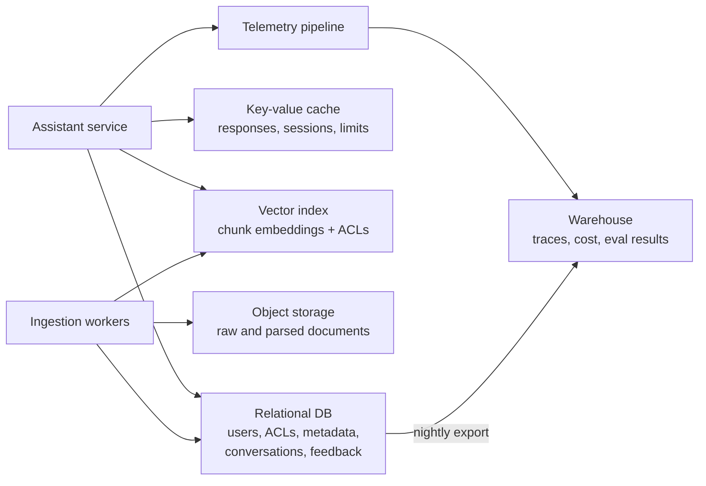
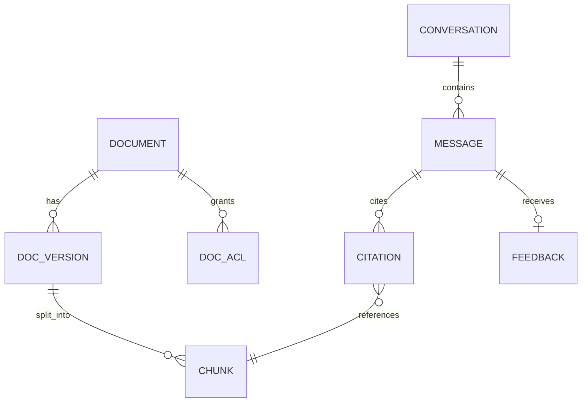
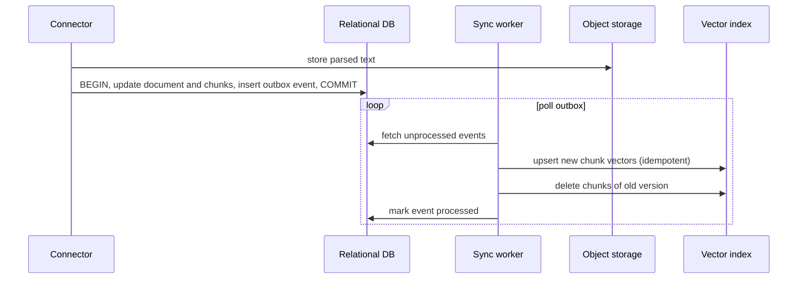

An AI application stores many different kinds of data: conversations, embeddings, raw documents, prompts and their versions, evaluation results, user feedback, caches and usage records. Each kind has its own access pattern, size, consistency needs and lifetime, and no single database is the best home for all of them. This lesson shows how to choose a store for each kind of data, how to model the core metadata, and how to keep the vector index consistent with the documents it is derived from. It builds on [SQL and databases](/learn/sql-and-databases/database-fundamentals), [managed databases](/learn/cloud-computing/managed-databases) and the [Vector Databases](/learn/vector-databases/vector-embeddings) module.

## The data inventory

Start a design by listing every kind of data, then pick stores. The table below is a sensible default for the enterprise document assistant; your requirements may change individual rows.

| Data | Access pattern | Store | Why |
| --- | --- | --- | --- |
| Users, tenants, permissions, document metadata | Transactional reads and writes, joins | Relational (e.g. PostgreSQL) | Strong consistency, constraints, joins |
| Conversation history | Append turns, read recent turns by conversation | Relational or document store | Simple keyed access; relational is fine at moderate scale, document or wide-column stores at very high write volume |
| Raw documents, parsed text, images | Write once, read in bulk | Object storage | Cheap, durable, unlimited size |
| Chunk embeddings | Similarity search with metadata filters | Vector database, or a vector extension in the relational database | ANN indexes and filtered search |
| Keyword index | BM25 search | Search engine or the vector DB's sparse index | Hybrid retrieval |
| Response and embedding caches | Key lookups, time-to-live | In-memory key-value store (e.g. Redis) | Sub-millisecond reads, automatic expiry |
| Rate-limit counters | Atomic increments | In-memory key-value store | Shared across gateway instances |
| Traces, token usage, cost | High-volume append, aggregate queries | Log and analytics store or data warehouse | Columnar storage for aggregation |
| Evaluation runs and results | Write per run, compare across runs | Relational plus warehouse for analysis | Structured, queryable history |
| User feedback | Append, join to traces and answers | Relational, exported to warehouse | Becomes evaluation and training data |



> [!TIP]
> If your scale is moderate (a few million vectors), a vector extension inside your existing relational database removes a whole system to run and lets you filter and join in one query. Move to a dedicated vector database when scale, latency or features demand it, not by default.

## Modelling the core metadata

The relational database is the **system of record** for everything that is not bulk content. A minimal schema for the document assistant:



```sql
CREATE TABLE document (
    doc_id        TEXT PRIMARY KEY,
    source        TEXT NOT NULL,          -- 'wiki', 'drive', ...
    current_ver   INTEGER NOT NULL,
    deleted       BOOLEAN NOT NULL DEFAULT FALSE,
    updated_at    TIMESTAMPTZ NOT NULL
);

CREATE TABLE chunk (
    chunk_id      TEXT PRIMARY KEY,       -- doc_id:version:index
    doc_id        TEXT NOT NULL REFERENCES document(doc_id),
    version       INTEGER NOT NULL,
    chunk_index   INTEGER NOT NULL,
    content_hash  TEXT NOT NULL,
    object_key    TEXT NOT NULL,          -- parsed text in object storage
    embed_model   TEXT NOT NULL           -- which model produced the vector
);

CREATE TABLE message (
    message_id      BIGSERIAL PRIMARY KEY,
    conversation_id UUID NOT NULL,
    role            TEXT NOT NULL,        -- 'user' or 'assistant'
    content         TEXT NOT NULL,
    prompt_version  TEXT,                 -- which prompt config produced it
    model           TEXT,
    created_at      TIMESTAMPTZ NOT NULL DEFAULT now()
);
CREATE INDEX ON message (conversation_id, created_at);
```

Storing `prompt_version`, `model` and `embed_model` looks like bookkeeping, but it is what lets you answer "which answers were produced by the configuration we just rolled back?" and "which vectors must be re-embedded?". Citations link answers to the exact chunk versions used, which is the evidence trail for audits and for evaluating groundedness.

## Keeping the vector index in sync

The vector index is a **derived view** of documents in the system of record. Two writes (the relational metadata and the vector index) cannot be made atomic across two different systems, so naive code that writes one, then the other, will eventually leave them inconsistent after a crash between the two writes.

The standard remedy is the **transactional outbox**: in the same database transaction that records a document change, insert an event into an `outbox` table. A separate worker reads the outbox and applies changes to the vector index, retrying until it succeeds. Because every index operation is an **idempotent upsert or delete keyed by chunk ID**, replaying an event twice is harmless.



Within a sync, **content hashes** avoid re-embedding chunks that did not change, which matters when a 200-page document has one paragraph edited.

```python
import hashlib

def chunk_hashes(chunks):
    return {i: hashlib.sha256(text.encode()).hexdigest()[:12] for i, text in enumerate(chunks)}

def plan_sync(old_hashes, new_chunks):
    new_hashes = chunk_hashes(new_chunks)
    old_by_hash = {h: i for i, h in old_hashes.items()}
    to_embed = [i for i, h in new_hashes.items() if h not in old_by_hash]
    reuse = [i for i, h in new_hashes.items() if h in old_by_hash]
    to_delete = [i for i, h in old_hashes.items() if h not in set(new_hashes.values())]
    return to_embed, reuse, to_delete

v1 = ["Leave policy overview", "Annual leave is 25 days", "Sick leave rules", "Contacts"]
v2 = ["Leave policy overview", "Annual leave is 27 days", "Sick leave rules", "Parental leave", "Contacts"]

to_embed, reuse, to_delete = plan_sync(chunk_hashes(v1), v2)
print("embed new chunks:", to_embed)
print("reuse vectors for:", reuse)
print("delete old chunks:", to_delete)
```

```output
embed new chunks: [1, 3]
reuse vectors for: [0, 2, 4]
delete old chunks: [1]
```

Only two of five chunks need the embedding model. The reused vectors are rewritten under the new version's chunk IDs (or kept, if your IDs are content-based), and the old changed chunk is deleted.

> [!WARNING]
> Deletes are the operation most often forgotten. Connectors that only "list current documents" never see a deletion. Use the source system's change feed where possible, and run a periodic reconciliation job that compares the set of document IDs in the source with the set in the index and removes orphans.

## Consistency choices

Different data tolerates different consistency.

| Data | Consistency needed | Consequence of staleness |
| --- | --- | --- |
| Permissions on chunks | Near real-time, enforced with a final source check | Data leak if stale |
| Document content in index | Minutes | Slightly outdated answers |
| Conversation history | Read-your-writes within a conversation | The model forgets the previous turn |
| Response cache | Invalidate when sources change or by short TTL | Stale answers after a policy update |
| Analytics and cost | Hours | Late dashboards |

Read-your-writes for conversations is easy to break: if a turn is written to the primary database and the next turn reads from a lagging read replica, the model will not see the user's last message. Read conversation state from the primary, or route a conversation's reads consistently.

Caches need special care in AI apps: a cached answer about the leave policy remains wrong after the policy changes. Include document versions or a corpus version in the cache key, or invalidate cache entries that cited a changed document.

## Retention and privacy

Conversations and traces contain personal and confidential data. Decide retention per store (for example, 30 days for raw traces, longer for anonymised aggregates), apply deletion requests across **every** store including the warehouse, backups and caches, and keep secrets and personal data out of prompts logged in plain text where possible. See [privacy](/learn/ai-security-and-responsible-ai/privacy) and [data leakage](/learn/ai-security-and-responsible-ai/data-leakage).

## Exercises

**1.** Assign a store to each: per-user daily token spend counters; PDF originals; the record that answer 8812 received a thumbs-down with a comment; a 30-day cache of query embeddings. Justify each in one line.

<details>
<summary>Show solution</summary>

Token counters: in-memory key-value store with atomic increments (fast, shared across gateway instances; persist daily totals to the relational DB or warehouse). PDF originals: object storage (large, write-once, cheap). Feedback: relational database linked to the message and trace, exported to the warehouse for analysis. Query-embedding cache: key-value store with a 30-day TTL, keyed by a hash of the normalised query and the embedding model name.

</details>

**2.** Use `plan_sync` on a version where the last chunk is removed and a new first chunk is inserted. What does it report?

<details>
<summary>Show solution</summary>

```python
v3 = ["Summary", "Leave policy overview", "Annual leave is 27 days", "Sick leave rules", "Parental leave"]
print(plan_sync(chunk_hashes(v2), v3))
```

```output
([0], [1, 2, 3, 4], [4])
```

Only the new summary chunk is embedded; the shifted chunks are recognised by hash, and the old "Contacts" chunk (index 4 in v2) is deleted. Position-based comparison would have re-embedded everything.

</details>

**3.** Why is "write to the database, then write to the vector index" in the request handler unsafe, and what pattern fixes it?

<details>
<summary>Show solution</summary>

A crash, timeout or deploy between the two writes leaves them inconsistent, and nothing retries the second write. The transactional outbox records the intent in the same transaction as the database change, and a worker applies it to the index with idempotent, retryable operations, giving eventual consistency without distributed transactions.

</details>

```quiz
[
  {
    "q": "Where should raw uploaded documents (PDFs, images) usually be stored?",
    "options": ["In the vector database", "In object storage, with metadata in the relational database", "In the key-value cache", "Inside the prompt log"],
    "answer": 1,
    "why": "Object storage is cheap and durable for large binary objects; the relational database holds searchable metadata and references."
  },
  {
    "q": "What makes replaying a sync event safe in the outbox pattern?",
    "options": [
      "Events are deleted before processing",
      "Index operations are idempotent upserts and deletes keyed by chunk ID",
      "The vector database supports distributed transactions",
      "Events are processed only once by design"
    ],
    "answer": 1,
    "why": "At-least-once delivery means duplicates happen; idempotent operations make duplicates harmless."
  },
  {
    "q": "A user's second message is answered as if the first never happened. The app writes to a primary and reads from a replica. What is the likely cause?",
    "options": [
      "The embedding model changed",
      "Replication lag broke read-your-writes for conversation history",
      "The cache TTL is too long",
      "The vector index is stale"
    ],
    "answer": 1,
    "why": "The replica had not yet received the first turn. Conversation reads should go to the primary or be routed consistently."
  },
  {
    "q": "Why store the embedding model name on every chunk record?",
    "options": [
      "It is required by SQL",
      "To know which vectors must be re-embedded on a model change and to avoid mixing spaces",
      "It speeds up similarity search",
      "It replaces the content hash"
    ],
    "answer": 1,
    "why": "Vectors from different models are not comparable; tracking the producer makes migrations and audits possible."
  }
]
```
