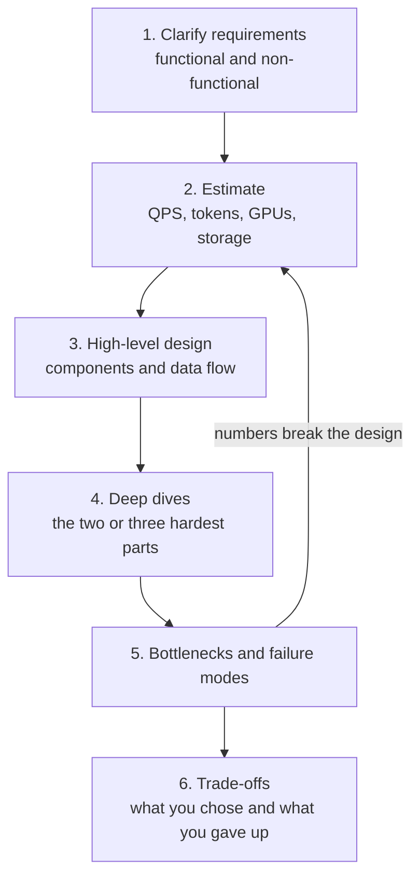
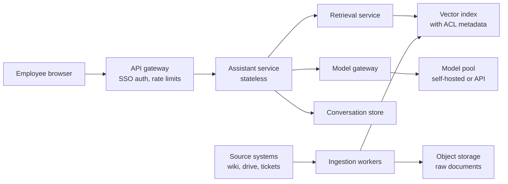

You have spent this curriculum learning components: Python and data tools, models, embeddings, retrieval, agents, APIs, containers, cloud and production serving. A real AI product is all of them at once, wired together under constraints of traffic, latency, cost, privacy and quality. **System design** is the skill of choosing and combining those components deliberately, and defending every choice with requirements and numbers.

This final module is written in the style of a system-design interview and of a real architecture review. Each lesson takes one concern (serving, availability, data, cost, reliability, observability) and works through a design scenario. This first lesson gives you the method you will reuse in every one of them.

## A repeatable design method

Strong designers do not start by drawing boxes. They follow a sequence that forces the important questions out early, when changing direction is cheap.



| Step | Output | Typical time in a 45-minute interview |
| --- | --- | --- |
| Requirements | A short written list, with numbers | 5-8 minutes |
| Estimation | QPS, tokens per day, GPU count, storage | 5 minutes |
| High-level design | One diagram covering the request path and the data path | 10 minutes |
| Deep dives | Detailed design of the riskiest components | 15 minutes |
| Bottlenecks and trade-offs | A list of risks, mitigations and alternatives rejected | 5-8 minutes |

The loop back from step 5 to step 2 matters: if a deep dive reveals that one request makes five model calls, every estimate changes.

## Step 1: clarify requirements

Requirements come in two kinds. **Functional** requirements say what the system does. **Non-functional** requirements say how well, and they drive almost every architectural decision.

| Category | Questions to ask | Why it changes the design |
| --- | --- | --- |
| Users and traffic | How many users? Daily active fraction? Requests per user per day? Peak hours? | Sets QPS and therefore replica count |
| Latency | Is it interactive (streamed chat) or batch? Target time to first token and total time? | Decides streaming, model size, region placement |
| Quality bar | What does a wrong answer cost? Is "I don't know" acceptable? Are citations required? | Decides model tier, retrieval depth, human review |
| Data volume | How many documents, how large, how often do they change? | Sizes the index and the ingestion pipeline |
| Privacy and compliance | Can data leave the region or the company? Who may see which documents? | Decides self-hosting versus API, permission filtering, logging policy |
| Availability | What happens if the assistant is down for an hour? | Decides redundancy and fallbacks |
| Cost | Budget per user per month or per request? | Bounds model choice and caching strategy |

Write the answers down as numbers wherever you can. "Fast" is not a requirement; "p95 time to first token under 1.5 seconds" is.

> [!KEY]
> Most bad AI architectures are not bad because of a wrong technology choice. They are bad because nobody pinned down the latency target, the quality bar or the permission model before building.

## Step 2: back-of-the-envelope estimation

Estimation turns requirements into sizes. Use round numbers, state every assumption, and keep the arithmetic in code so you can change one assumption and rerun. The running example is an **enterprise document assistant** for 50,000 employees that answers questions over internal documents with citations.

```python
import math

employees = 50_000
daily_active_fraction = 0.4
queries_per_active_user = 10
working_seconds = 8 * 3600          # traffic concentrated in the working day
peak_factor = 3                     # busiest minute versus the working-day average

queries_per_day = employees * daily_active_fraction * queries_per_active_user
avg_qps = queries_per_day / working_seconds
peak_qps = avg_qps * peak_factor
print(f"queries/day: {queries_per_day:,.0f}")
print(f"average QPS (working hours): {avg_qps:.1f}")
print(f"peak QPS: {peak_qps:.1f}")
```

```output
queries/day: 200,000
average QPS (working hours): 6.9
peak QPS: 20.8
```

Now tokens. A RAG request carries a system prompt, some conversation history, retrieved chunks and the question; the answer is shorter.

```python
system_tokens, history_tokens, question_tokens = 500, 500, 50
chunks, tokens_per_chunk = 5, 400
input_tokens = system_tokens + history_tokens + question_tokens + chunks * tokens_per_chunk
output_tokens = 300

tokens_per_day = queries_per_day * (input_tokens + output_tokens)
peak_prefill_tps = peak_qps * input_tokens
peak_decode_tps = peak_qps * output_tokens
print(f"input tokens/request: {input_tokens}")
print(f"tokens/day: {tokens_per_day/1e6:,.0f} million")
print(f"peak prefill tokens/s: {peak_prefill_tps:,.0f}")
print(f"peak output tokens/s: {peak_decode_tps:,.0f}")
```

```output
input tokens/request: 3050
tokens/day: 670 million
peak prefill tokens/s: 63,542
peak output tokens/s: 6,250
```

If you self-host, convert throughput into GPUs. The throughput one replica sustains **while still meeting the latency target** is something you measure with a load test; the figure below is an assumption to be replaced by your own measurement.

```python
replica_output_tps_at_slo = 2_000   # assumption: measured by load test at the target latency
gpus_per_replica = 2                # assumption: model needs two GPUs (see distributed inference)
headroom = 1.3                      # spare capacity for spikes and one replica failing

replicas = math.ceil(peak_decode_tps * headroom / replica_output_tps_at_slo)
print(f"replicas: {replicas}, GPUs: {replicas * gpus_per_replica}")
```

```output
replicas: 5, GPUs: 10
```

Finally, storage for the vector index:

```python
documents = 5_000_000
chunks_per_doc = 8
dims = 1024
bytes_per_float = 4                 # float32; 2 for float16, 1 for int8 quantisation
index_overhead = 1.5                # assumption: graph links and metadata in an HNSW-style index

n_vectors = documents * chunks_per_doc
raw_gb = n_vectors * dims * bytes_per_float / 1e9
print(f"vectors: {n_vectors/1e6:.0f} million")
print(f"raw embeddings: {raw_gb:.0f} GB, with index overhead: {raw_gb*index_overhead:.0f} GB")
print(f"as int8: {n_vectors * dims / 1e9 * index_overhead:.0f} GB")
```

```output
vectors: 40 million
raw embeddings: 164 GB, with index overhead: 246 GB
as int8: 61 GB
```

These numbers already shape the design: about 20 peak QPS is modest for the web tier but significant for GPUs; 246 GB of index will not fit in one ordinary machine's RAM, so you either shard, quantise or use a disk-backed index. See [vector indexing](/learn/vector-databases/vector-indexing) for the index types behind that choice.

## Step 3: high-level design

Draw one diagram that shows both the **online request path** and the **offline data path**. Keep it at the level of services, not classes.



Every box should be justified by a requirement. The assistant service is **stateless** (conversation state lives in the store), so it scales horizontally behind a load balancer. The model gateway exists because you want one place for retries, fallbacks and cost accounting. The ingestion workers are separate because indexing load must never slow down user queries.

## Steps 4 to 6: deep dives, bottlenecks, trade-offs

Pick the two or three components where the design could fail. For the document assistant they are:

- **Permission-aware retrieval**: an employee must never see a chunk from a document they cannot open. This is the subject of [RAG architecture](/learn/ai-system-design/rag-architecture).
- **Model serving at peak**: 63,000 prefill tokens per second is the heavy part, which pushes you towards prefix caching and careful batching ([model serving architecture](/learn/ai-system-design/model-serving-architecture)).
- **Index freshness**: how quickly an edited or deleted document is reflected in answers ([database architecture](/learn/ai-system-design/database-architecture)).

Then name bottlenecks and trade-offs explicitly:

| Decision | Option chosen | Alternative | Why |
| --- | --- | --- | --- |
| Model hosting | Self-hosted open-weight model | Hosted API | Documents may not leave the company network |
| Retrieval depth | 5 chunks, reranked from 50 | 20 chunks, no reranker | Lower prompt cost and latency, similar quality in offline evals |
| Index precision | int8 quantised vectors | float32 | Fits in memory on fewer nodes; small recall loss measured |
| Freshness | Incremental sync within 15 minutes | Nightly rebuild | Deleted documents must disappear quickly |

> [!TIP]
> In an interview or review, say the rejected alternative out loud. "I chose X" is weak; "I chose X over Y because of requirement Z, and I would revisit it if Z changed" is what reviewers look for.

## Principles that make AI systems scale

The general principles from [scaling](/learn/production-ai-systems/scaling) and [load balancing](/learn/production-ai-systems/load-balancing) apply, with AI-specific twists:

- **Keep services stateless** and push state into stores. GPU workers are the exception; treat them as a pool behind a router.
- **Separate online and offline work.** Ingestion, re-embedding, batch evaluation and fine-tuning run on queues and their own capacity.
- **The model call dominates.** A database query takes milliseconds; a generation takes seconds and costs real money. Optimise the model path first: fewer calls, shorter prompts, smaller models where quality allows, caching.
- **Design for back-pressure.** GPUs have hard capacity. When they are full, queue with a bound, shed load or degrade; never let requests pile up until everything times out.
- **Make quality observable.** A system that returns fast, wrong answers is broken, even though every dashboard is green.

## Exercises

**1.** Redo the estimate for a consumer chat app with 2 million daily active users, 15 messages each per day spread over 16 waking hours, a peak factor of 4, 1,500 input tokens and 400 output tokens per message. Compute peak QPS and peak output tokens per second.

<details>
<summary>Show solution</summary>

```python
qpd = 2_000_000 * 15
peak = qpd / (16 * 3600) * 4
print(f"peak QPS: {peak:.0f}, peak output tokens/s: {peak * 400:,.0f}")
```

```output
peak QPS: 2083, peak output tokens/s: 833,333
```

That is two orders of magnitude above the enterprise assistant, so model choice, caching and routing to small models become central rather than optional.

</details>

**2.** The index for 40 million 1024-dimensional vectors is too large. List three independent ways to shrink it and the cost of each.

<details>
<summary>Show solution</summary>

Quantise vectors (float16 halves storage, int8 quarters it; small recall loss that you must measure). Use a smaller embedding dimension, for example a model with 384 or 768 dimensions or truncating a model trained for it (needs re-embedding and re-evaluation). Index fewer chunks: deduplicate near-identical documents, drop stale content, or use larger chunks (fewer vectors but coarser retrieval). Sharding across nodes does not shrink the index but spreads it.

</details>

**3.** A stakeholder says the assistant "must be fast and accurate". Rewrite this as three measurable non-functional requirements.

<details>
<summary>Show solution</summary>

For example: p95 time to first token below 1.5 seconds during working hours; at least 90 percent of answers in the weekly sampled evaluation judged correct and supported by a cited source; at most 1 percent of answers cite a document the user cannot access (target zero, enforced by tests).

</details>

```quiz
[
  {
    "q": "Why should requirements and estimation come before drawing the architecture?",
    "options": [
      "Diagrams are not allowed in design reviews",
      "The numbers (QPS, latency targets, data size, privacy) decide which components and sizes are needed",
      "Estimation replaces the need for load testing",
      "Requirements never change once written"
    ],
    "answer": 1,
    "why": "A design is only good relative to its requirements. Without numbers you cannot tell whether one GPU or one hundred are needed."
  },
  {
    "q": "200,000 queries per day arrive during an 8-hour working day with a peak factor of 3. What is peak QPS, roughly?",
    "options": ["2.3", "7", "21", "69"],
    "answer": 2,
    "why": "200,000 / 28,800 seconds is about 6.9 average QPS; times 3 gives about 21."
  },
  {
    "q": "Where should the per-replica throughput figure used for GPU sizing come from?",
    "options": [
      "The GPU vendor's peak FLOPS figure",
      "A load test of your model and prompts at your latency target",
      "The model's parameter count alone",
      "The number of employees"
    ],
    "answer": 1,
    "why": "Sustainable throughput depends on model, prompt lengths, batching and the latency target; only a load test measures it."
  },
  {
    "q": "Which statement best describes a good trade-off discussion?",
    "options": [
      "Listing every technology you know",
      "Stating the chosen option, the rejected alternative, the requirement that decided it, and when you would revisit it",
      "Choosing the newest framework",
      "Avoiding any mention of weaknesses"
    ],
    "answer": 1,
    "why": "Reviewers want to see that you understand what you gave up and why it was acceptable for these requirements."
  }
]
```
