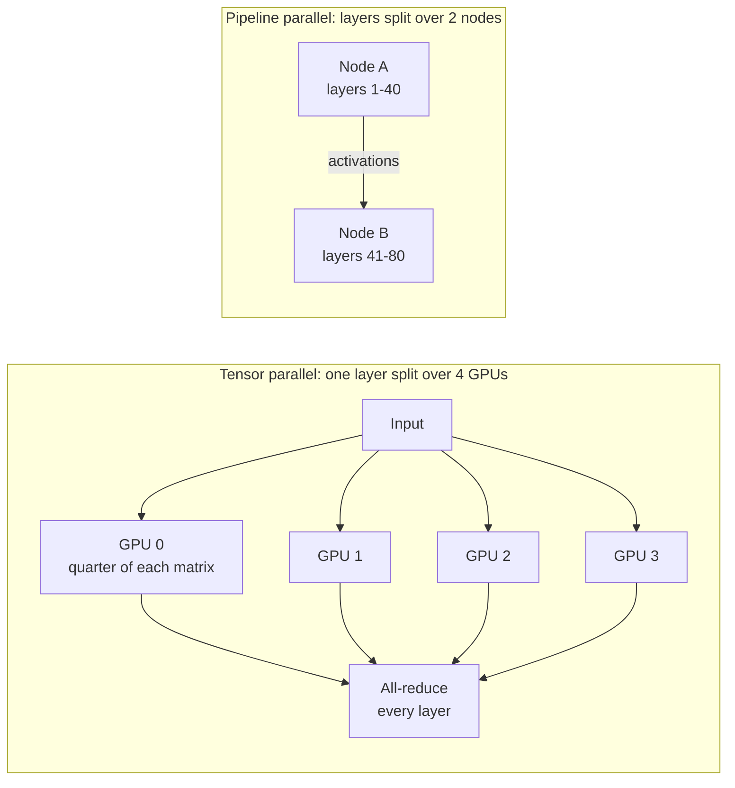
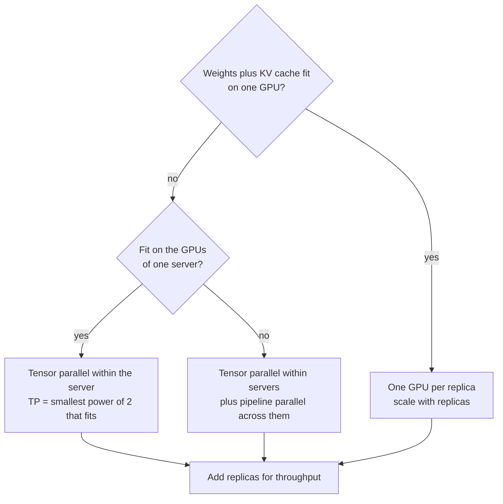
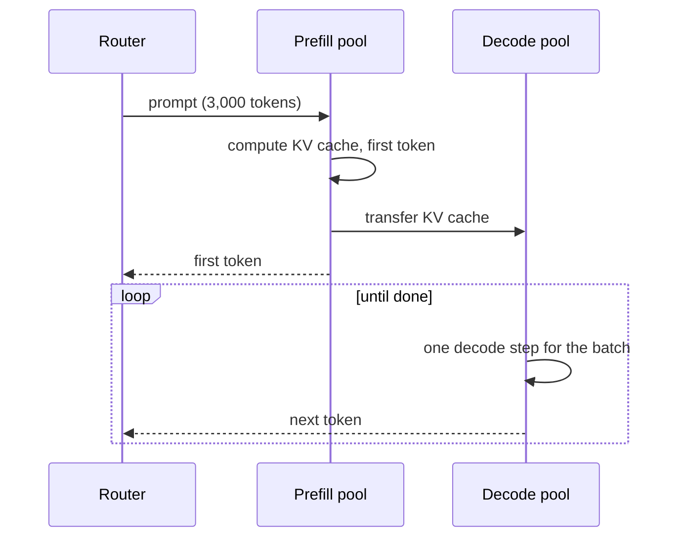

Sooner or later a design calls for a model that does not fit on one GPU, or traffic that one GPU cannot serve. **Distributed inference** is the set of techniques for spreading a model, or its traffic, across several GPUs and machines. As a system designer you rarely implement these techniques yourself, since serving engines such as [vLLM](/learn/advanced-llm-engineering/vllm) do that, but you must decide which ones to use, how many GPUs you need, and what the network between them must provide. Those decisions start with memory arithmetic.

## Does it fit? Memory arithmetic

A served LLM needs GPU memory for three things:

1. **Weights**: parameters times bytes per parameter.
2. **KV cache**: keys and values for every token of every active sequence (see [KV caching](/learn/advanced-llm-engineering/kv-caching)).
3. **Overhead**: activations, CUDA context, fragmentation. Budget roughly 10 percent and verify.

The KV cache per token is

$$
\text{KV bytes per token} = 2 \times L \times H_{kv} \times d_{head} \times b
$$

where $L$ is the number of layers, $H_{kv}$ the number of key-value heads (smaller than the query heads in models with grouped-query attention), $d_{head}$ the head dimension, $b$ the bytes per value, and the factor 2 counts keys and values.

Take a 70-billion-parameter model with an illustrative configuration of 80 layers, 8 KV heads and head dimension 128, served in 16-bit precision on GPUs with 80 GB of memory:

```python
import math

params = 70e9
layers, kv_heads, head_dim = 80, 8, 128
bytes_per_value = 2                       # fp16 / bf16
gpu_memory_gb = 80
usable_fraction = 0.9                     # leave room for overhead

weights_gb = params * bytes_per_value / 1e9
kv_per_token = 2 * layers * kv_heads * head_dim * bytes_per_value
concurrent_seqs, tokens_per_seq = 64, 4_096
kv_gb = kv_per_token * concurrent_seqs * tokens_per_seq / 1e9

total_gb = weights_gb + kv_gb
min_gpus = math.ceil(total_gb / (gpu_memory_gb * usable_fraction))
print(f"weights: {weights_gb:.0f} GB")
print(f"KV cache per token: {kv_per_token/1024:.0f} KiB")
print(f"KV cache for {concurrent_seqs} x {tokens_per_seq} tokens: {kv_gb:.0f} GB")
print(f"total: {total_gb:.0f} GB -> at least {min_gpus} GPUs")
```

```output
weights: 140 GB
KV cache per token: 320 KiB
KV cache for 64 x 4096 tokens: 86 GB
total: 226 GB -> at least 4 GPUs
```

The weights alone need two GPUs, but serving many long sequences concurrently needs four. Concurrency is a design parameter: fewer concurrent sequences need less KV cache but deliver less throughput. [Quantising](/learn/advanced-llm-engineering/model-quantization) weights to 8 bits halves the 140 GB, and some engines can also quantise the KV cache.

> [!KEY]
> "Does the model fit?" is the wrong question. Ask "do the weights plus the KV cache for my target concurrency and context length fit?" The KV cache often decides the GPU count.

## Data parallelism: more replicas

If the model fits on one GPU (or one group of GPUs), the simplest way to serve more traffic is to run **more copies** of it behind a load balancer. Each replica handles different requests; they share nothing at inference time. This is data parallelism, and it scales throughput almost linearly with no extra network requirements. It does not help when a single replica cannot hold the model.

## Tensor parallelism: splitting each layer

**Tensor parallelism** (TP) splits the weight matrices of every layer across GPUs. Each GPU computes part of each matrix multiplication, and the GPUs combine partial results with collective operations (typically all-reduce) inside every layer, which in common implementations happens twice per transformer layer.

- It reduces memory per GPU and also reduces latency per token, because each GPU does a fraction of the work.
- It needs a very fast interconnect, because communication happens many times per token. In practice TP stays inside one server with a high-bandwidth GPU link; stretching it across machines over ordinary networking is usually slow.

## Pipeline parallelism: splitting the layers

**Pipeline parallelism** (PP) places consecutive groups of layers on different GPUs: GPU 0 holds layers 1-20, GPU 1 layers 21-40, and so on. Activations pass from stage to stage once per layer group, which is far less communication than TP, so PP works across machines.

- It reduces memory per GPU but does not reduce per-token latency; a token still traverses every layer in sequence, plus hops between stages.
- Stages idle while waiting for each other (**pipeline bubbles**) unless many requests are in flight to keep every stage busy.



## Expert parallelism for mixture-of-experts

Mixture-of-experts models route each token to a few of many expert sub-networks. **Expert parallelism** places different experts on different GPUs and sends tokens to the GPUs that hold their experts. Total parameters (and memory) can be large while compute per token stays modest; the cost is all-to-all communication and uneven load when some experts are popular.

| Technique | Splits | Memory per GPU | Per-token latency | Communication | Typical placement |
| --- | --- | --- | --- | --- | --- |
| Data parallel | Requests | Unchanged (full model each) | Unchanged | None between replicas | Anywhere |
| Tensor parallel | Each layer's matrices | Divided | Reduced | Heavy, every layer | Within one server |
| Pipeline parallel | Groups of layers | Divided | Slightly increased | Light, between stages | Across servers |
| Expert parallel | Experts of an MoE | Divided | Depends on routing | All-to-all | Within or across servers |

## Choosing a layout



Prefer the smallest TP degree that fits with the KV cache you need: more GPUs per replica means more communication overhead per token and fewer independent replicas. Before reaching for multi-node serving, check whether quantisation, a shorter maximum context or a smaller model meets the quality bar. With vLLM the layout is a pair of flags:

```bash
# one replica on 4 GPUs of one server
vllm serve my-org/my-70b-model --tensor-parallel-size 4

# one replica across 2 servers of 8 GPUs each
vllm serve my-org/my-big-model --tensor-parallel-size 8 --pipeline-parallel-size 2
```

## Disaggregated prefill and decode

Inference has two phases with different hardware profiles:

- **Prefill** processes the whole prompt in parallel. It is compute-bound and determines time to first token.
- **Decode** generates one token per step for each sequence, re-reading the weights and KV cache every step. It is memory-bandwidth-bound and determines time per output token.

When both run on the same GPUs, a long prefill for one request stalls the decode steps of every other request, causing stutters in their streams. **Disaggregated serving** runs prefill and decode on separate GPU pools: a prefill worker computes the KV cache, transfers it to a decode worker, and the decode worker generates the tokens.



Benefits: each pool can be sized and tuned for its phase (for example, many prefill GPUs for RAG workloads with long prompts and short answers), and decode latency becomes steadier. Costs: KV cache transfer needs a fast network, and the system is more complex to operate. It pays off at scale with long prompts; for modest traffic, a single pool with chunked prefill (splitting long prompts into pieces interleaved with decode steps) is usually enough.

> [!NOTE]
> Why decode is bandwidth-bound: each decode step must read every weight once. If a replica's GPUs together read memory at bandwidth $B$ and the weights occupy $W$ bytes, the number of decode steps per second is at most about $B / W$. Batching many sequences into one step shares that read, which is why [continuous batching](/learn/advanced-llm-engineering/continuous-batching) raises throughput so much.

## Exercises

**1.** Repeat the memory estimate with 8-bit weights and 32 concurrent sequences of 8,192 tokens. How many 80 GB GPUs are needed?

<details>
<summary>Show solution</summary>

```python
weights_gb = params * 1 / 1e9
kv_gb = kv_per_token * 32 * 8_192 / 1e9
total_gb = weights_gb + kv_gb
print(f"{total_gb:.0f} GB -> {math.ceil(total_gb / (gpu_memory_gb * usable_fraction))} GPUs")
```

```output
156 GB -> 3 GPUs
```

In practice you would choose TP = 4, since tensor-parallel degrees normally divide the number of attention heads evenly, and the spare memory becomes extra KV cache capacity.

</details>

**2.** A team proposes running tensor parallelism across 4 servers connected by ordinary data-centre Ethernet. What would you suggest instead, and why?

<details>
<summary>Show solution</summary>

Tensor parallelism communicates inside every layer for every token, so slow inter-server links would dominate latency. Use tensor parallelism within each server (over the fast GPU interconnect) and pipeline parallelism across servers, which communicates only between stages. Better still, check whether quantisation or a smaller model fits in one server.

</details>

**3.** A RAG workload averages 6,000 prompt tokens and 150 output tokens per request. Users complain that streams stutter. Explain the likely cause and two remedies.

<details>
<summary>Show solution</summary>

Long prefills are interleaved with decode steps on the same GPUs, so each new request's prefill pauses token generation for the others. Remedies: enable chunked prefill so long prompts are processed in pieces between decode steps, or disaggregate prefill and decode into separate pools. Reducing prompt length (fewer or shorter chunks) and prefix caching of shared system prompts also reduce prefill work.

</details>

```quiz
[
  {
    "q": "Which parallelism technique requires the fastest interconnect?",
    "options": ["Data parallelism", "Pipeline parallelism", "Tensor parallelism", "None of them communicate"],
    "answer": 2,
    "why": "Tensor parallelism exchanges partial results within every layer for every token, so it is normally kept inside one server."
  },
  {
    "q": "The weights of a model fit on two GPUs, but the design uses four. What is the most likely reason?",
    "options": [
      "Tensor parallelism requires at least four GPUs",
      "The KV cache for the target concurrency and context length needs the extra memory",
      "Prefill needs a separate GPU per request",
      "Four GPUs are always cheaper"
    ],
    "answer": 1,
    "why": "KV cache grows with concurrent sequences times context length and often rivals the weights in size."
  },
  {
    "q": "What does pipeline parallelism do to per-token latency?",
    "options": [
      "Divides it by the number of stages",
      "Leaves it roughly the same or slightly higher, because tokens traverse all stages in sequence",
      "Eliminates it",
      "Makes it depend only on the first stage"
    ],
    "answer": 1,
    "why": "Pipeline parallelism splits memory, not the sequential work of one token; stage hops add a little latency."
  },
  {
    "q": "Why separate prefill and decode onto different GPU pools?",
    "options": [
      "Decode cannot run on GPUs",
      "They have different bottlenecks (compute versus memory bandwidth), and long prefills disrupt other requests' decoding",
      "It removes the need for a KV cache",
      "Prefill produces all output tokens"
    ],
    "answer": 1,
    "why": "Disaggregation lets each phase be scaled and tuned separately and stops prefill bursts from stalling token streams."
  }
]
```
