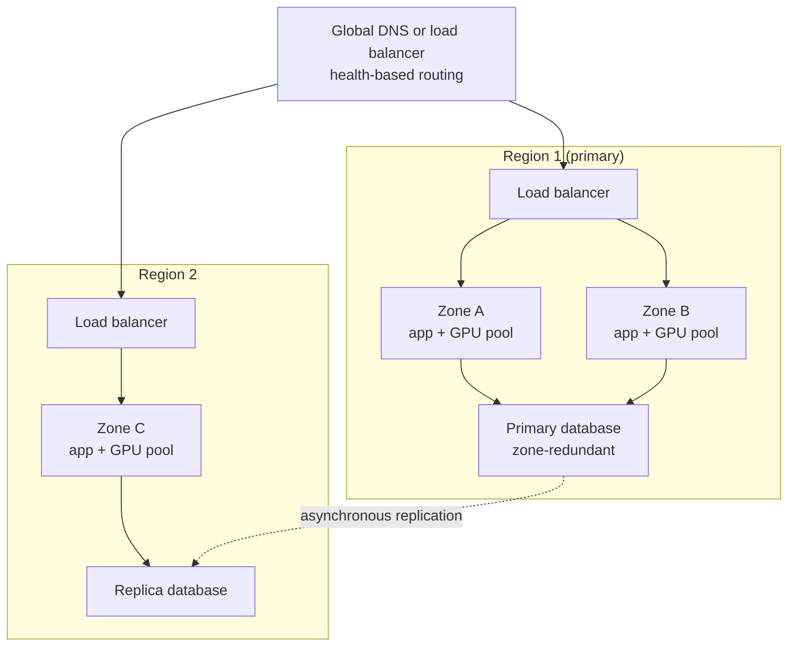
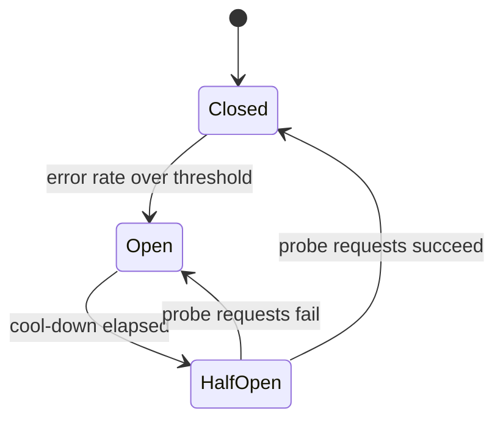
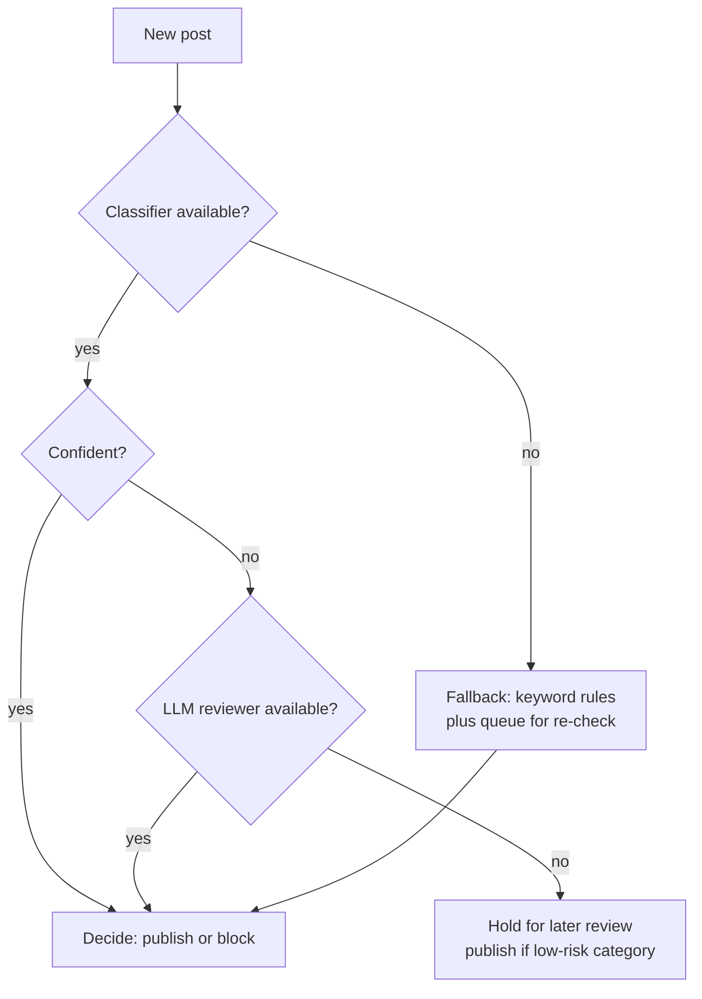

**High availability** (HA) means the system keeps serving users when parts of it fail: a GPU dies, a zone loses power, a model provider has an outage, a deployment goes wrong. AI systems have more ways to fail than ordinary web services, because they depend on scarce GPUs, large model files, external model APIs and several data stores at once. This lesson shows how to quantify availability, where to add redundancy, how to fail over between zones, regions and providers, and how to set recovery targets. The worked scenario is a real-time content moderation service that sits in the critical path of a social platform.

## Measuring availability

Availability is the fraction of time (or of requests) for which the service works correctly. It is usually written in "nines".

```python
minutes_per_year = 365 * 24 * 60
for availability in (0.99, 0.999, 0.9999, 0.99999):
    downtime = minutes_per_year * (1 - availability)
    print(f"{availability:.3%}: {downtime:8.1f} minutes of downtime per year")
```

```output
99.000%:   5256.0 minutes of downtime per year
99.900%:    525.6 minutes of downtime per year
99.990%:     52.6 minutes of downtime per year
99.999%:      5.3 minutes of downtime per year
```

Each extra nine costs much more than the last. Choose the target from the business impact, not from ambition: an internal document assistant can live with 99.5 percent; a moderation service that blocks every post when it is down needs far more.

### Series and parallel components

If a request needs components A **and** B, their availabilities multiply, so the chain is weaker than its weakest link. If either of two independent replicas can serve the request, the combined unavailability is the product of the individual unavailabilities.

$$
A_{\text{series}} = \prod_i A_i \qquad A_{\text{parallel}} = 1 - \prod_i (1 - A_i)
$$

```python
from math import prod

def series(*a):
    return prod(a)

def parallel(*a):
    return 1 - prod(1 - x for x in a)

gateway, app, vector_db, llm_replica = 0.9995, 0.9995, 0.999, 0.99
single = series(gateway, app, vector_db, llm_replica)
redundant = series(gateway, app, parallel(vector_db, vector_db), parallel(*[llm_replica] * 3))
print(f"single path:    {single:.4%}")
print(f"with redundancy: {redundant:.4%}")
```

```output
single path:    98.8021%
with redundancy: 99.8998%
```

A single LLM replica at 99 percent drags the whole chain below 99 percent. Three replicas and a replicated vector database lift it close to the availability of the gateway and application tier. The formula assumes **independent** failures; replicas in the same zone, on the same bad deployment or behind the same provider fail together, which is why redundancy must span failure domains.

> [!KEY]
> Redundancy only helps across independent failure domains. Three replicas on one host, or two "providers" that resell the same upstream model, give you much less than the arithmetic promises.

## Redundancy across failure domains

| Failure domain | Example failure | Redundancy |
| --- | --- | --- |
| Process or GPU | Out-of-memory crash, GPU hardware fault | Multiple replicas, health checks, automatic restart |
| Node | Host failure, kernel panic | Spread replicas across nodes (anti-affinity) |
| Zone | Power or network loss in one data centre | Replicas in at least two zones; zone-redundant databases |
| Region | Regional outage, capacity shortage of GPUs | Second region, active-active or active-passive |
| Provider | External model API outage or throttling | Second provider or self-hosted fallback |
| Deployment | Bad model, prompt or config release | Canary releases, quick rollback, keep previous version warm |

The last row is the most common in practice: many outages are self-inflicted by changes. HA designs must include safe rollouts, not only spare hardware.

## Multi-zone and multi-region



- **Multi-zone** is the baseline for anything user-facing: at least two zones per region, each able to carry the load if the other fails (so each runs at under about 50 percent of capacity at peak, or you accept degraded service during a zone loss).
- **Active-passive multi-region**: the second region holds replicated data and a small warm pool, scaling up on failover. Cheaper, but failover takes minutes and GPU capacity in the second region may not be available at the moment you need it.
- **Active-active multi-region**: both regions serve traffic all the time. Faster failover and lower latency for distant users, but you must handle data written in two places and pay for capacity in both.

For LLM workloads, GPU capacity is the scarce resource. Reserve it, or have a provider fallback, rather than assuming you can scale up in another region during an incident.

## Provider failover and health checks

When you depend on an external model API, treat the provider as a failure domain. The gateway (see [model serving architecture](/learn/ai-system-design/model-serving-architecture)) tracks error rates and latency per provider and opens a **circuit breaker** when a provider is failing, routing to the next candidate.



Health checks come in layers, and each answers a different question:

| Check | Question | Example for an LLM replica | Action on failure |
| --- | --- | --- | --- |
| Liveness | Is the process alive? | HTTP endpoint responds | Restart the container |
| Readiness | Can it take traffic now? | Model weights loaded, queue not full | Remove from load balancer, do not restart |
| Deep or synthetic | Does it produce correct output? | Generate 5 tokens for a fixed prompt and check the result | Alert, drain, roll back |

A replica still loading 100 GB of weights is alive but not ready; marking it ready too early sends requests into timeouts. Deep checks catch failures that simple checks miss, such as a replica returning empty strings after a bad driver update.

## Recovery objectives: RTO and RPO

**Recovery time objective (RTO)** is how long the service may be down after a disaster. **Recovery point objective (RPO)** is how much data, measured in time, you may lose. Set them per component, because AI systems mix irreplaceable data with data you can rebuild.

| Component | Rebuildable? | Suggested RPO | Suggested RTO | Mechanism |
| --- | --- | --- | --- | --- |
| Conversation history | No | Minutes | Under 1 hour | Replicated database, point-in-time backups |
| User feedback and labels | No (valuable training data) | Minutes | Hours | Replicated database, backups |
| Raw documents | Lives in source systems | n/a | Hours | Re-ingest from sources |
| Vector index | Yes, from documents | Hours | Hours (or minutes with a replica) | Snapshot plus re-ingest the gap |
| Model weights | Yes, from registry | n/a | Minutes | Registry replicated to each region, local disk cache |
| Caches | Yes | n/a | Minutes | Start empty, accept a cold-cache period |

Test recovery. A backup that has never been restored is a hope, not a plan; a failover that has never been exercised usually fails the first time.

## Design scenario: a real-time moderation service

**Requirements.** Every post and comment on a platform passes through a moderation service before publication: about 3,000 items per second at peak, p99 decision under 300 ms, availability target 99.95 percent. The pipeline is a fast classifier on every item and an LLM-based reviewer for the uncertain few percent.

**The key HA decision: fail open or fail closed?** If moderation is unavailable, does content publish unchecked (fail open) or get blocked (fail closed)? Neither extreme is right for every category. A good design degrades in steps:



The classifier is small, runs on CPU or a few GPUs per zone, and is replicated across zones and regions. The LLM reviewer handles only uncertain items, so when it fails, a few percent of posts are held or published with re-check later rather than the whole platform stopping. Every decision is logged with the path that produced it so that items decided by fallback rules are re-moderated when the full pipeline recovers.

> [!TIP]
> Design the degraded modes explicitly and test them. "What does the product do when the model is unavailable?" deserves a written answer for every AI feature.

## Exercises

**1.** A request path has a gateway (99.95%), an app tier (99.95%), a cache (99.9%, but requests still work on a cache miss), and an LLM provider (99.5%). What is the end-to-end availability, and what is it with a second independent provider?

<details>
<summary>Show solution</summary>

The cache is not in the critical path, since a cache failure only causes misses, so leave it out.

```python
print(f"{series(0.9995, 0.9995, 0.995):.4%}")
print(f"{series(0.9995, 0.9995, parallel(0.995, 0.995)):.4%}")
```

```output
99.4005%
99.8975%
```

</details>

**2.** Your active-passive design fails over to a second region in 20 minutes, but the incident review shows the second region could not obtain GPUs. What changes would you propose?

<details>
<summary>Show solution</summary>

Reserve a minimum GPU capacity in the second region (a warm pool, even if small), or make the region active-active so capacity is always running. Add a provider fallback for workloads whose data policy allows it. Define a degraded mode (smaller model that fits available hardware, reduced features) and rehearse the failover regularly.

</details>

**3.** Which RPO would you set for the vector index of a RAG system, and why can it be looser than for conversation history?

<details>
<summary>Show solution</summary>

The index is derived from source documents, so it can be rebuilt or caught up by re-ingesting changes since the last snapshot; an RPO of hours is acceptable as long as the gap can be replayed. Conversation history and feedback are original data that cannot be regenerated, so they need replication and an RPO of minutes.

</details>

```quiz
[
  {
    "q": "Roughly how much downtime per year does 99.9% availability allow?",
    "options": ["5 minutes", "53 minutes", "8.8 hours", "3.7 days"],
    "answer": 2,
    "why": "0.1% of 525,600 minutes is about 526 minutes, or about 8.8 hours."
  },
  {
    "q": "Why might three LLM replicas give much less availability than the parallel formula predicts?",
    "options": [
      "The formula only works for databases",
      "They may share a failure domain, such as one zone, one bad deployment or one provider",
      "Replicas cannot be load balanced",
      "Availability cannot be calculated for GPUs"
    ],
    "answer": 1,
    "why": "The parallel formula assumes independent failures; correlated failures defeat redundancy."
  },
  {
    "q": "A replica is still loading model weights. What should its health checks report?",
    "options": [
      "Not alive, so it is restarted",
      "Alive but not ready, so it receives no traffic yet",
      "Ready, because the process is running",
      "Nothing until loading completes"
    ],
    "answer": 1,
    "why": "Liveness and readiness are different questions; restarting a loading replica would loop forever, and sending it traffic would cause timeouts."
  },
  {
    "q": "Which component of a RAG application can usually tolerate the loosest RPO?",
    "options": ["User feedback", "Conversation history", "The vector index", "Billing records"],
    "answer": 2,
    "why": "The vector index is derived from source documents and can be rebuilt or caught up; the others are original data."
  }
]
```
