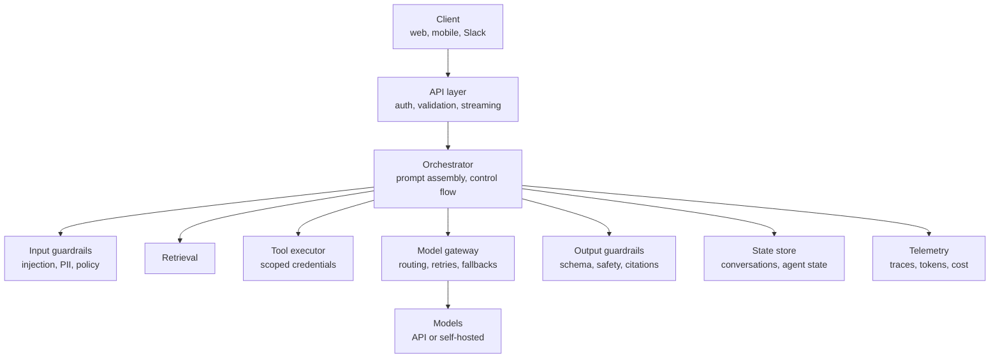
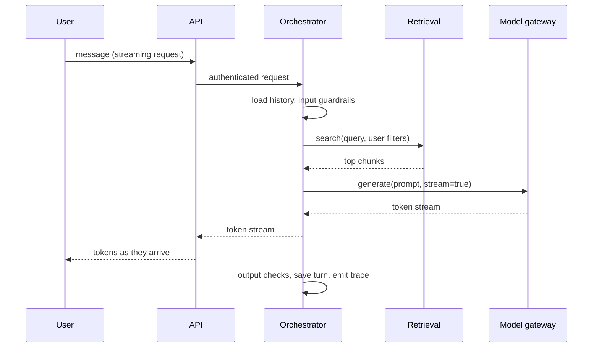
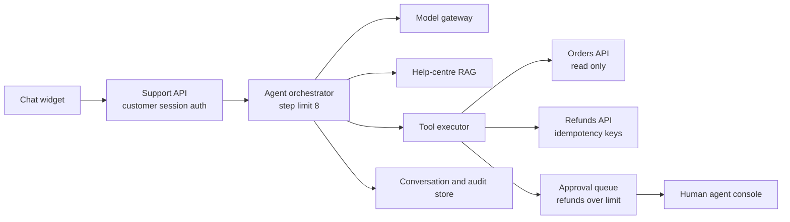

An LLM application is much more than a prompt and a model call. Between the user and the model sit authentication, conversation state, retrieval, tools, guardrails, a model gateway and telemetry, and each of those layers has its own failure modes and scaling behaviour. This lesson lays out a reference architecture for LLM applications, shows how a request moves through it, and applies it to a customer-support agent that can look up orders and issue refunds.

## The reference architecture

Most production LLM applications converge on the same layers, whatever framework they use.



| Layer | Responsibility | Earlier lessons |
| --- | --- | --- |
| API layer | Authentication, input validation, streaming responses to the client | [authentication](/learn/backend-development/authentication), [WebSockets](/learn/backend-development/websockets) |
| Orchestrator | Builds prompts, decides which steps run, holds the control flow (chain, RAG, agent loop) | [workflow design](/learn/advanced-agent-systems/workflow-design) |
| Retrieval | Finds relevant context | [retrieval mechanisms](/learn/rag-fundamentals/retrieval-mechanisms) |
| Tool executor | Runs functions the model requests, with its own permissions | [function calling](/learn/ai-agent-fundamentals/function-calling) |
| Model gateway | One entry point for all model calls: routing, rate limits, retries, fallbacks, accounting | [model serving](/learn/production-ai-systems/model-serving) |
| Guardrails | Check inputs and outputs against policy and schema | [guardrails](/learn/advanced-agent-systems/guardrails), [output validation](/learn/ai-security-and-responsible-ai/output-validation) |
| State store | Conversation history, agent state, checkpoints | [state management](/learn/advanced-agent-systems/state-management) |
| Telemetry | Traces of every step, token counts, cost, quality signals | [observability](/learn/production-ai-systems/observability) |

The **orchestrator** is your application logic and is usually a stateless service. Everything that must survive a restart goes to the state store, so any instance can continue any conversation.

## How a request flows

A sequence diagram shows timing, which is where most LLM design problems hide.



Two consequences follow. First, everything before the model call adds directly to **time to first token**, so retrieval and guardrails need their own latency budgets. Second, with streaming, output checks that need the whole answer (for example, verifying citations) can only run at the end. You either check incrementally, buffer a short prefix, or accept that the user may briefly see text you then retract.

## Choosing the control-flow pattern

| Pattern | Model calls per request | Latency | Predictability | Use when |
| --- | --- | --- | --- | --- |
| Single call | 1 | Lowest | High | Classification, extraction, rewriting |
| Fixed chain | Fixed, small | Low to medium | High | Multi-step tasks with a known shape |
| RAG | 1 (plus optional rewrite and rerank) | Medium | High | Questions over private or fresh knowledge |
| Agent loop | Variable, unbounded without limits | Highest, variable | Lower | Tasks whose steps depend on intermediate results |

> [!KEY]
> Use the least autonomous pattern that meets the requirement. Every step of autonomy you add makes cost, latency and failure behaviour harder to predict, which makes the system harder to design for.

## Design scenario: a customer-support agent with tool access

**Requirements.** An online retailer wants an assistant that answers questions about orders, tracks deliveries and can issue refunds. Functional: look up orders, check delivery status, answer policy questions from the help centre, refund up to a limit, hand over to a human. Non-functional: 3,000 conversations per hour at peak, first response under 2 seconds p95, no refund without a verified customer, every action auditable.

**High-level design.**



**Deep dive: tool safety.** The model never holds credentials. The tool executor receives a tool call, checks it against the **customer's session** (the model may ask for order 123, but the executor only returns it if order 123 belongs to the logged-in customer), and executes with a narrowly scoped service credential. Read tools run freely; the refund tool requires an idempotency key, so a retried call cannot refund twice, and refunds above the limit go to a human approval queue, as in [human approval workflows](/learn/advanced-agent-systems/human-approval-workflows). This is also your main defence against [prompt injection](/learn/ai-security-and-responsible-ai/prompt-injection): even a fully manipulated model can only do what the executor permits for this customer.

**Estimation.** Agent loops multiply tokens, because each step resends the growing context.

```python
conversations_per_hour = 3_000
turns_per_conversation = 4
steps_per_turn = 3                 # e.g. think + call tool + answer
base_context = 2_500               # system prompt, tool schemas, policy snippets
growth_per_step = 300              # tool results and previous messages appended
output_per_step = 150

def tokens_for_turn(turn_index):
    total = 0
    for step in range(steps_per_turn):
        context = base_context + (turn_index * steps_per_turn + step) * growth_per_step
        total += context + output_per_step
    return total

per_conversation = sum(tokens_for_turn(t) for t in range(turns_per_conversation))
peak_calls_per_s = conversations_per_hour * turns_per_conversation * steps_per_turn / 3600
print(f"tokens per conversation: {per_conversation:,}")
print(f"model calls per second at peak: {peak_calls_per_s:.0f}")
print(f"tokens per hour at peak: {per_conversation * conversations_per_hour / 1e6:.0f} million")
```

```output
tokens per conversation: 51,600
model calls per second at peak: 10
tokens per hour at peak: 155 million
```

Note how the context grows: the last step of the last turn sends far more than the first. Three design responses follow: cache the static prefix (system prompt and tool schemas) with [prompt or prefix caching](/learn/production-ai-systems/caching); summarise or drop old tool results; and use a small model for routing steps and a larger one only for composing the final answer.

**Trade-offs.** A fixed workflow ("classify intent, then run the matching flow") would be cheaper and more predictable than a free agent loop. A good compromise is a router that sends common intents (where is my order) to fixed flows and only open-ended cases to the agent, with a hard step limit and a hand-over to a human when the limit is reached.

## Cross-cutting concerns

- **Configuration as versioned artefacts.** Prompts, tool schemas, model names and retrieval parameters change behaviour as much as code does. Version them, review them and record the version in every trace, so a quality regression can be traced to the change that caused it.
- **Timeouts at every hop.** The API layer's timeout must exceed the orchestrator's, which must exceed the model call's; otherwise the outer layer gives up while inner work continues and wastes GPU time.
- **Streaming end to end.** If any layer buffers the full response, users lose the benefit of streaming. Test it through the real load balancer and proxies.
- **Separate the evaluation path.** The same orchestrator code should run in offline evaluation, so you test what you ship.

> [!WARNING]
> Do not let the model decide authorisation. Statements in the prompt such as "only show the user their own orders" are requests, not controls. Enforce permissions in the tool executor and the retrieval filter.

## Exercises

**1.** In the support agent, a tool call `get_order(order_id="A-991")` arrives for a customer who does not own that order. Describe what each layer should do.

<details>
<summary>Show solution</summary>

The tool executor checks ownership against the authenticated session, refuses, and returns a neutral tool result such as "order not found for this customer" (not revealing that it exists). It logs the attempt to the audit store and the trace. The orchestrator passes that result back to the model, which tells the customer it cannot find the order. Repeated attempts can trigger an alert for possible abuse or injection.

</details>

**2.** Using the estimate code, what happens to tokens per conversation if `growth_per_step` drops from 300 to 100 by summarising tool results?

<details>
<summary>Show solution</summary>

```python
growth_per_step = 100
per_conversation = sum(tokens_for_turn(t) for t in range(turns_per_conversation))
print(f"{per_conversation:,}")
```

```output
38,400
```

About a quarter fewer tokens per conversation, and lower latency on later turns, at the cost of an extra summarisation step and possible loss of detail.

</details>

**3.** Why should the orchestrator be stateless, and where does agent state live instead?

<details>
<summary>Show solution</summary>

Stateless instances can be added, removed or restarted freely, and any instance can serve any turn, which makes horizontal scaling and rolling deployments simple. Conversation history, agent checkpoints and pending approvals live in a durable state store (a database), keyed by conversation ID, so a crash mid-conversation loses at most the in-flight step.

</details>

```quiz
[
  {
    "q": "Which layer should enforce that a customer can only read their own orders?",
    "options": [
      "The system prompt",
      "The model gateway",
      "The tool executor, using the authenticated session",
      "The output guardrail"
    ],
    "answer": 2,
    "why": "Authorisation must be enforced in code with the real identity; the model can be manipulated, so prompt instructions are not controls."
  },
  {
    "q": "Why do agent loops consume more tokens than the number of steps alone suggests?",
    "options": [
      "Each step resends the growing context, including earlier tool results",
      "Tool schemas are free",
      "Models generate longer outputs in loops",
      "Streaming doubles token counts"
    ],
    "answer": 0,
    "why": "Context accumulates: every call carries the system prompt, tool schemas and all prior messages and tool results."
  },
  {
    "q": "A streamed answer must have its citations verified. What is the core difficulty?",
    "options": [
      "Citations cannot be streamed",
      "Checks that need the complete answer can only run after the user has already seen most of it",
      "Streaming disables retrieval",
      "Citations increase time to first token"
    ],
    "answer": 1,
    "why": "Streaming and whole-answer validation pull in opposite directions; you choose incremental checks, buffering or post-hoc correction."
  },
  {
    "q": "Which control-flow pattern is usually the right default for answering questions over a company's documents?",
    "options": ["A free multi-agent system", "RAG with a single generation call", "Fine-tuning only", "An unbounded agent loop"],
    "answer": 1,
    "why": "RAG gives grounded, predictable answers with one main model call; more autonomy adds cost and unpredictability without being required."
  }
]
```
