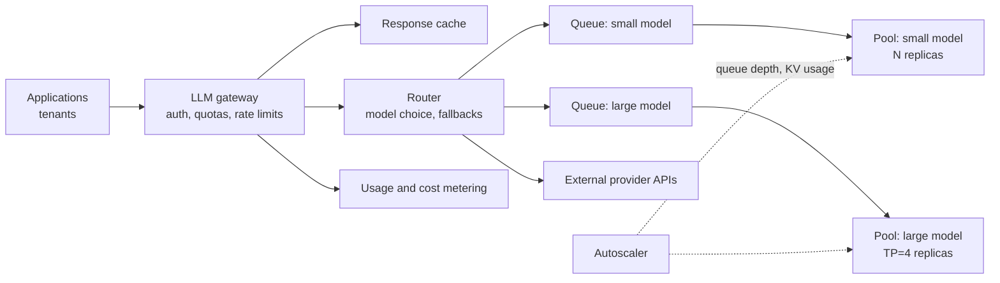
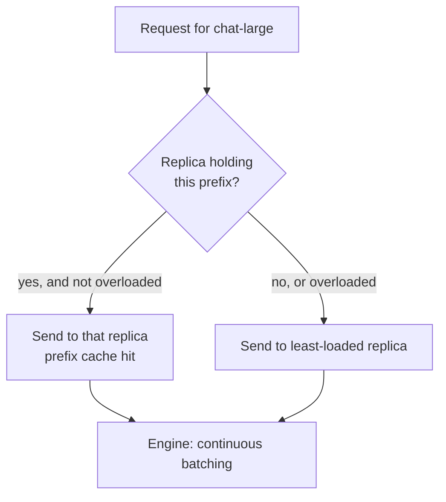

[Model serving](/learn/production-ai-systems/model-serving) in Production AI Systems covered how a single model is exposed as an API. At organisation scale the problem changes shape: dozens of applications, several models (some self-hosted, some from external providers), many teams with budgets, and GPUs that are expensive to leave idle and slow to add. This lesson designs the serving **platform**: a gateway, routers, model pools, queues and autoscaling, using a multi-tenant LLM gateway as the worked scenario.

## The serving stack



| Component | Job | Design notes |
| --- | --- | --- |
| Gateway | Single entry point: authenticate tenants, enforce quotas and rate limits, meter usage, strip or log sensitive data | Stateless; rate-limit counters live in a shared fast store |
| Cache | Return stored answers for repeated requests | Exact-match is safe; semantic caching needs a similarity threshold and evaluation |
| Router | Map a request to a model and a backend; apply fallbacks | Policy in configuration, not code, so it can change without redeploys |
| Queues | Absorb bursts, apply priorities, enforce bounds | Bounded, with deadlines; drop requests that will miss their deadline anyway |
| Model pools | Groups of identical replicas of one model | Each replica is an inference engine with continuous batching |
| Autoscaler | Adds and removes replicas | Scales on queue depth and KV cache usage, not CPU |

## Design scenario: a multi-tenant LLM gateway

**Requirements.** A company's platform team must give 40 internal applications access to two self-hosted models and two external providers. Functional: one OpenAI-style API for all models, per-tenant API keys, model aliases (`chat-small`, `chat-large`) so applications do not hard-code providers, caching, fallbacks. Non-functional: gateway overhead under 20 ms p95, no tenant can starve others, cost attributed per tenant per day, external providers used only for tenants whose data classification allows it.

### Rate limits and quotas per tenant

Rate limits for LLMs need two dimensions: **requests per second** and **tokens per minute**, because one request can carry 100 tokens or 100,000. A token bucket per tenant handles both. Here is a minimal version with an injected clock so it is deterministic.

```python
class TokenBucket:
    def __init__(self, capacity, refill_per_s):
        self.capacity = capacity
        self.refill_per_s = refill_per_s
        self.level = capacity
        self.last = 0.0

    def try_take(self, amount, now):
        self.level = min(self.capacity, self.level + (now - self.last) * self.refill_per_s)
        self.last = now
        if amount <= self.level:
            self.level -= amount
            return True
        return False

# tenant may burst to 20,000 tokens and sustain 1,000 tokens per second
bucket = TokenBucket(capacity=20_000, refill_per_s=1_000)
requests = [(0.0, 8_000), (0.5, 8_000), (1.0, 8_000), (6.0, 8_000), (6.1, 30_000)]
for t, tokens in requests:
    print(f"t={t:>4}s tokens={tokens:>5}: {'allow' if bucket.try_take(tokens, t) else 'reject 429'}")
```

```output
t= 0.0s tokens= 8000: allow
t= 0.5s tokens= 8000: allow
t= 1.0s tokens= 8000: reject 429
t= 6.0s tokens= 8000: allow
t= 6.1s tokens=30000: reject 429
```

The third request exceeds the burst; after a few seconds of refill the tenant may continue. The last request is larger than the bucket can ever hold and should be rejected with a clear error rather than queued forever. In a real gateway the bucket state lives in a shared store such as Redis so that every gateway instance sees the same counters, and the estimate is corrected with the actual token count after the response.

### Routing with fallbacks

The router resolves an alias to an ordered list of candidate backends, filters out those the tenant may not use, and skips backends whose circuit breaker is open (see [system reliability](/learn/ai-system-design/system-reliability)).

```python
ROUTES = {
    "chat-small": ["self-hosted-small", "provider-a-small"],
    "chat-large": ["self-hosted-large", "provider-a-large", "provider-b-large"],
}
EXTERNAL = {"provider-a-small", "provider-a-large", "provider-b-large"}

def route(alias, tenant, healthy):
    for backend in ROUTES[alias]:
        if backend in EXTERNAL and not tenant["external_allowed"]:
            continue
        if backend in healthy:
            return backend
    return None

healthy = {"provider-a-large", "provider-b-large", "self-hosted-small"}
hr = {"name": "hr-assistant", "external_allowed": False}
mkt = {"name": "marketing-copy", "external_allowed": True}
print(route("chat-large", mkt, healthy))
print(route("chat-large", hr, healthy))
print(route("chat-small", hr, healthy))
```

```output
provider-a-large
None
self-hosted-small
```

With the self-hosted large pool down, the marketing tenant falls back to an external provider, while the HR tenant, whose data may not leave the company, gets no large model. The gateway should then return a clear "temporarily unavailable" error, or the application may choose to degrade to `chat-small`. The important point is that **data-handling policy is part of routing**, not an afterthought.

> [!WARNING]
> Fallback models are not interchangeable. Different models respond differently to the same prompt, especially for structured outputs and tool calls. Run your evaluation suite against every fallback target, and record in each trace which backend actually served the request.

## Queues and admission control

How many requests are in flight at once? **Little's law** answers it for any stable system:

$$
L = \lambda \times W
$$

where $L$ is the average number of requests in the system, $\lambda$ the arrival rate and $W$ the average time each request spends in it.

```python
arrival_rate = 25          # requests per second at peak
avg_latency_s = 6          # average end-to-end generation time
max_batch_per_replica = 32 # concurrent sequences a replica serves at target latency (measured)

in_flight = arrival_rate * avg_latency_s
replicas = -(-in_flight // max_batch_per_replica)   # ceiling division
print(f"requests in flight: {in_flight}")
print(f"replicas needed: {replicas}")
```

```output
requests in flight: 150
replicas needed: 5
```

When arrivals exceed what the pool can hold, requests wait in the queue. A bounded queue with **deadlines** is essential: if a request has waited so long that it cannot finish within its timeout, drop it before spending GPU time on it. Give interactive traffic priority over batch traffic, and run batch jobs (evaluations, bulk summarisation) through a separate queue that only uses spare capacity.

## Autoscaling GPU pools

Autoscaling LLM pools differs from scaling web servers:

- **Signals.** CPU usage says nothing about a GPU server. Scale on queue length, waiting time, number of running sequences, or KV cache utilisation reported by the engine.
- **Cold starts are slow.** Provisioning a GPU node, pulling a large container image and loading tens of gigabytes of weights can take minutes. Keep a warm buffer of capacity, cache weights on local disks, and scale up early on a predictive schedule for known daily peaks.
- **Scale down carefully.** Drain a replica (stop new requests, let running streams finish) before removing it.
- **Minimum replicas.** Keep at least two per pool across zones for availability; scaling to zero only suits rarely used internal models where a cold start is acceptable.

## Routing within a pool

A plain round-robin load balancer ignores two things that matter for LLMs. First, replicas differ in load at any moment because requests have very different lengths, so **least-outstanding-requests** or queue-aware balancing works better (see [load balancing](/learn/production-ai-systems/load-balancing)). Second, engines with **prefix caching** reuse the KV cache for prompts that share a prefix, so sending requests with the same long system prompt or the same conversation to the same replica (**prefix- or session-affinity routing**) saves prefill compute. Balance affinity against load so one hot prefix does not overload a single replica.



## Deployment of new models

Treat a model change like a code change, using the patterns from [deployment pipelines](/learn/ci-cd/deployment-pipelines): register the model, run offline evaluations, deploy it as a new pool, send **shadow** traffic (copies of real requests, responses discarded) to compare quality and latency, then **canary** a small percentage of live traffic behind the same alias, and finally shift the alias. Rollback is moving the alias back.

> [!TIP]
> Aliases such as `chat-large` are one of the most valuable features of a gateway. Applications never name a concrete model, so the platform team can upgrade, A/B test or fail over without touching 40 codebases.

## Exercises

**1.** Extend `route` so that it returns the first healthy backend, but if the tenant's daily spend has exceeded its budget, only self-hosted backends are allowed. Test it with a tenant over budget.

<details>
<summary>Show solution</summary>

```python
def route_with_budget(alias, tenant, healthy):
    for backend in ROUTES[alias]:
        external = backend in EXTERNAL
        if external and (not tenant["external_allowed"] or tenant["over_budget"]):
            continue
        if backend in healthy:
            return backend
    return None

over = {"name": "marketing-copy", "external_allowed": True, "over_budget": True}
print(route_with_budget("chat-large", over, healthy))
print(route_with_budget("chat-small", over, healthy))
```

```output
None
self-hosted-small
```

</details>

**2.** Peak traffic doubles to 50 requests per second and average latency rises to 8 seconds because of longer prompts. Using Little's law, how many replicas are needed?

<details>
<summary>Show solution</summary>

```python
in_flight = 50 * 8
print(in_flight, -(-in_flight // max_batch_per_replica))
```

```output
400 13
```

400 requests in flight need 13 replicas at 32 sequences each, before any headroom for failures.

</details>

**3.** Why is CPU utilisation a poor autoscaling signal for a GPU inference pool, and what would you use?

<details>
<summary>Show solution</summary>

The CPU mostly schedules work and handles HTTP; it can be nearly idle while the GPU is saturated and requests queue. Use signals from the inference engine and the queue: waiting requests, queue time, running sequences per replica, or KV cache utilisation, ideally against the latency SLO.

</details>

```quiz
[
  {
    "q": "Why do LLM gateways rate-limit tokens as well as requests?",
    "options": [
      "Tokens are easier to count than requests",
      "Request size varies enormously, so request counts alone do not bound load or cost",
      "Providers forbid request limits",
      "Token limits replace authentication"
    ],
    "answer": 1,
    "why": "One request may carry a hundred tokens or a hundred thousand; token limits track the actual GPU load and spend."
  },
  {
    "q": "Arrivals are 10 requests per second and each takes 3 seconds on average. How many requests are in flight on average?",
    "options": ["3.3", "13", "30", "0.3"],
    "answer": 2,
    "why": "Little's law: L = λW = 10 × 3 = 30."
  },
  {
    "q": "What is the main benefit of routing requests that share a long prompt prefix to the same replica?",
    "options": [
      "It improves model accuracy",
      "The replica can reuse cached KV entries for the prefix, saving prefill compute and time to first token",
      "It removes the need for a queue",
      "It guarantees equal load across replicas"
    ],
    "answer": 1,
    "why": "Prefix caching only helps if the request lands where the prefix is already cached; affinity must still be balanced against load."
  },
  {
    "q": "A tenant handling HR data must never use external providers. Where should this rule be enforced?",
    "options": [
      "In each application's prompt",
      "In the gateway's routing policy, so no fallback can send the request externally",
      "In the external provider's settings",
      "Nowhere; fallbacks take priority"
    ],
    "answer": 1,
    "why": "Fallback logic can otherwise silently move sensitive traffic to a provider. Data policy must be a routing constraint."
  }
]
```
