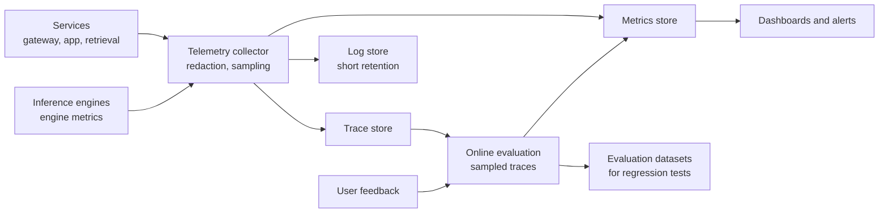
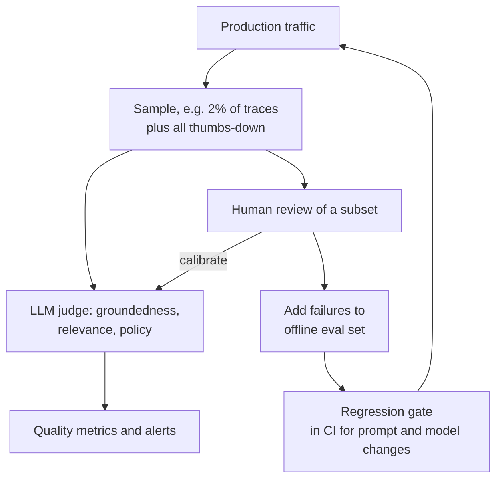

You cannot operate what you cannot see. **Monitoring** tells you that something is wrong; **observability** lets you work out why, from the data the system emits, without shipping new code. AI systems need both, with an extra dimension that ordinary services lack: the output can be wrong while every technical signal looks healthy. This lesson designs the telemetry for an LLM application: what to record, which metrics and dashboards matter, how to monitor quality in production, and how to alert without drowning the on-call engineer. It builds on [observability](/learn/production-ai-systems/observability), [monitoring and logging](/learn/cloud-computing/monitoring-and-logging) and [model monitoring](/learn/mlops/model-monitoring).

## What to record

The three classic signals still apply, with LLM-specific content:

| Signal | What it is | LLM-specific content |
| --- | --- | --- |
| Metrics | Numeric time series, cheap to store and aggregate | TTFT, TPOT, tokens in and out, cost, cache hit rate, queue time, GPU and KV cache utilisation, refusal rate |
| Traces | The tree of operations for one request, with timings | Spans for guardrails, retrieval, rerank, each model call, each tool call; prompt version, model, backend |
| Logs and events | Detailed records of individual events | Prompts and responses (redacted, sampled), retrieved chunk IDs, validation failures, user feedback |

The **trace** is the most valuable artefact for debugging AI behaviour. When a user reports a bad answer, you want to open the exact request and see which chunks were retrieved, what prompt version was used, which model and backend served it, how long each step took and what it cost.

```json
{
  "trace_id": "7f3a...",
  "attributes": {"tenant": "legal", "prompt_version": "qa-v14", "conversation_id": "c-881"},
  "spans": [
    {"name": "guardrail.input", "ms": 18},
    {"name": "retrieval.hybrid", "ms": 74, "attributes": {"candidates": 50, "acl_filtered": true}},
    {"name": "rerank", "ms": 132, "attributes": {"top_chunk_ids": ["d91:3:2", "d17:1:0"]}},
    {"name": "llm.generate", "ms": 4210, "attributes": {"model": "chat-large", "backend": "self-hosted-large",
      "ttft_ms": 640, "tokens_in": 3120, "tokens_out": 288, "finish_reason": "stop"}},
    {"name": "guardrail.output", "ms": 25}
  ]
}
```

Use a standard such as OpenTelemetry for traces so that every service, including the gateway and the inference engines, contributes spans to the same trace. Record identifiers and versions everywhere: they are what make "which change caused this?" answerable.



> [!WARNING]
> Prompts and responses contain personal and confidential data. Redact before storage, restrict who can view raw content, sample rather than keep everything, and set short retention for raw text. An observability store full of unredacted conversations is a breach waiting to happen.

## Metrics and dashboards

Organise dashboards from the user inward. The top row answers "are users OK?"; lower rows explain why not.

| Layer | Metrics |
| --- | --- |
| User experience | Request rate, error rate, TTFT p50/p95/p99, total latency, thumbs-down rate, abandonment |
| Quality | Groundedness and correctness scores from sampled evaluation, schema failure rate, refusal rate, empty-retrieval rate, escalation-to-human rate |
| Cost | Tokens per request, cost per request and per tenant, cache hit rate, share of traffic per model |
| Model serving | Queue time, running sequences, KV cache utilisation, tokens per second per replica, GPU utilisation, replica count |
| Dependencies | Provider error and throttling rates, circuit breaker state, vector DB latency, index freshness lag |

Always look at **percentiles**, not averages. LLM latency distributions have long tails, and the tail is what users complain about.

```python
import numpy as np

rng = np.random.default_rng(7)
# simulated TTFT in ms: most requests fast, a slow tail from queueing and long prompts
ttft = np.concatenate([rng.lognormal(mean=6.2, sigma=0.35, size=9_500),
                       rng.lognormal(mean=7.6, sigma=0.4, size=500)])
print(f"mean: {ttft.mean():.0f} ms")
for p in (50, 95, 99):
    print(f"p{p}: {np.percentile(ttft, p):.0f} ms")
```

```output
mean: 607 ms
p50: 501 ms
p95: 1197 ms
p99: 2964 ms
```

The mean looks comfortable under a 1.5 s target, but one request in a hundred takes almost 3 seconds or more. Slice percentiles by tenant, model and prompt length too: an average across everything can hide one tenant whose long prompts make their experience poor.

## Monitoring quality in production

Quality monitoring combines several sources, because none is sufficient alone.

| Source | Strength | Weakness |
| --- | --- | --- |
| Offline evaluation suite (before release) | Controlled, repeatable, catches regressions | Only covers the cases you thought of |
| Automatic checks on every response | Cheap, complete coverage | Only catch detectable failures (schema, empty retrieval, missing citations) |
| Sampled LLM-as-judge evaluation | Scales to nuanced criteria such as groundedness | Judge has its own errors; must be calibrated against human labels |
| User feedback (thumbs, edits, escalations) | Real user signal | Sparse and biased towards strong reactions |
| Human review of samples | Most trustworthy | Expensive, slow |



The loop at the bottom is what makes a system improve: every production failure that a human confirms becomes a test case, so the same failure cannot ship twice. See [RAG evaluation](/learn/advanced-rag/rag-evaluation) and [agent evaluation](/learn/advanced-agent-systems/agent-evaluation) for the metrics themselves.

Also watch for **drift** in the inputs (see [data drift](/learn/mlops/data-drift)): the distribution of query topics, languages or lengths changes over time, and a system tuned for last quarter's questions may handle a new product launch's questions poorly. A simple approach is to embed queries, cluster them weekly, and look for new or growing clusters with low quality scores.

> [!KEY]
> Treat quality as a monitored metric with an SLO and alerts, exactly like latency. If the only way you discover a quality regression is a complaint from a senior stakeholder, your observability has a hole.

## Alerting on what matters

Alert on **symptoms that users feel**, mapped to SLOs, not on every internal cause. High GPU utilisation is not an emergency; TTFT p95 breaching its target is. The standard technique is **burn-rate alerting**: alert when the error budget is being consumed much faster than the window allows, checked over a long and a short window so you catch real trends quickly but ignore brief blips.

$$
\text{burn rate} = \frac{\text{observed error rate}}{1 - \text{SLO}}
$$

A burn rate of 1 uses exactly the whole budget over the SLO window; a burn rate of 14.4 sustained for one hour uses 2 percent of a 30-day budget in that hour.

```python
def burn_rate(errors, total, slo):
    return (errors / total) / (1 - slo)

slo = 0.999
windows = {"1h": (540, 30_000), "5m": (60, 2_500)}   # (errors, requests) observed
rates = {w: burn_rate(e, n, slo) for w, (e, n) in windows.items()}
for w, r in rates.items():
    print(f"{w}: burn rate {r:.1f}")

page = rates["1h"] > 14.4 and rates["5m"] > 14.4
print("page on-call:", page)
```

```output
1h: burn rate 18.0
5m: burn rate 24.0
page on-call: True
```

Both windows exceed the threshold, so the problem is significant and still happening: page someone. A high long-window rate with a low short-window rate means the problem has already stopped; a ticket is enough. Slower burns (for example, a rate of 2 over several hours) become tickets rather than pages.

Keep paging alerts few, actionable and linked to a runbook: what the alert means, which dashboard to open, and the first mitigation steps (fail over the provider, roll back the last prompt version, scale the pool). Alerts that fire often without action train people to ignore them.

## Design scenario: observability for the document assistant

For the enterprise assistant from the [first lesson](/learn/ai-system-design/designing-scalable-ai-applications), a complete plan fits on one page:

1. **SLOs**: availability 99.9%, TTFT p95 under 1.5 s, groundedness at least 90% on a 2% judged sample, zero answers citing documents the user cannot access, index freshness lag under 15 minutes.
2. **Traces** on every request with prompt version, model, backend, chunk IDs and ACL-filter outcome; raw text redacted and kept for 14 days.
3. **Pages**: burn-rate alerts on availability and TTFT; any detected permission violation; index freshness lag over 1 hour.
4. **Tickets**: groundedness score below target for a day; cost per request up 30% week on week; new low-quality query cluster.
5. **Weekly review**: quality trends, top thumbs-down traces, new evaluation cases added, cost per tenant.

## Exercises

**1.** Compute the burn rate when 90 of 20,000 requests failed in the last hour against a 99.5% SLO. Would you page?

<details>
<summary>Show solution</summary>

```python
print(f"{burn_rate(90, 20_000, 0.995):.1f}")
```

```output
0.9
```

A burn rate below 1 consumes the budget more slowly than the window allows: no page, no ticket.

</details>

**2.** A dashboard shows healthy latency and errors, but the thumbs-down rate doubled after Tuesday's release. List what you would check in the traces, in order.

<details>
<summary>Show solution</summary>

Compare thumbs-down traces before and after by prompt version and model to see whether the release changed either; check retrieval spans (empty or low-score retrievals, changed chunk IDs) in case the index or embedding model changed; check finish reasons for truncation and output length changes; run the offline evaluation suite on both versions; and if the regression is confirmed, roll back the configuration and add the failing cases to the evaluation set.

</details>

**3.** Why alert on TTFT p95 against an SLO rather than on GPU utilisation above 90%?

<details>
<summary>Show solution</summary>

High GPU utilisation is often desirable (it means the expensive hardware is being used) and does not necessarily affect users. TTFT p95 is a symptom users feel and maps to an SLO, so it fires when action is needed. GPU utilisation belongs on the dashboard as a diagnostic and as an autoscaling input, not as a page.

</details>

## Closing the curriculum

This lesson completes AI Mastery. You started with variables and loops in Python and have finished by designing systems that serve models to tens of thousands of people reliably, safely and at a known cost. Along the way you learned the mathematics behind learning algorithms, built and trained neural networks, worked with language models, retrieval and agents, and learned to ship and operate them in production. Congratulations on completing the curriculum. The most durable thing you take away is a way of thinking: start from requirements, reason with numbers, measure quality honestly, and make every trade-off on purpose.

```quiz
[
  {
    "q": "Why is a per-request trace especially valuable for debugging an LLM application?",
    "options": [
      "It replaces the need for metrics",
      "It shows exactly which chunks, prompt version, model and backend produced a specific answer, with timings and cost",
      "It stores model weights",
      "It makes requests faster"
    ],
    "answer": 1,
    "why": "Most AI bugs are behavioural; seeing the exact inputs and steps behind one bad answer is how you diagnose them."
  },
  {
    "q": "Mean TTFT is about 600 ms but p99 is about 3 s. What does this tell you?",
    "options": [
      "The system meets every latency target",
      "Averages hide a long tail; a meaningful fraction of users wait far longer than the mean suggests",
      "The p99 measurement is wrong",
      "The mean should be used for SLOs"
    ],
    "answer": 1,
    "why": "Latency distributions are skewed. Percentiles reveal the experience of the slowest users."
  },
  {
    "q": "Against a 99.9% SLO, the last hour had a 1.8% error rate. What is the burn rate?",
    "options": ["1.8", "18", "0.18", "180"],
    "answer": 1,
    "why": "Burn rate = 0.018 / 0.001 = 18, well above a typical paging threshold of 14.4."
  },
  {
    "q": "What makes an LLM-as-judge quality metric trustworthy enough to alert on?",
    "options": [
      "Using the largest available model",
      "Calibrating it against human labels on a sample and monitoring its agreement over time",
      "Running it on every request",
      "Hiding its scores from engineers"
    ],
    "answer": 1,
    "why": "Judges make errors too; agreement with human reviewers is what justifies trusting their scores."
  }
]
```
