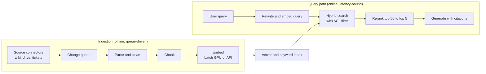
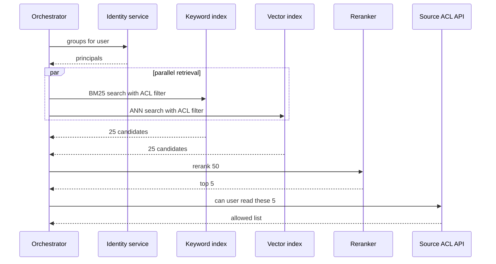

The [RAG Fundamentals](/learn/rag-fundamentals/what-is-rag) and [Advanced RAG](/learn/advanced-rag/advanced-chunking) modules taught the techniques: chunking, embedding, hybrid search, reranking, query transformation and evaluation. This lesson is about the **architecture**: how those techniques become two cooperating systems, an offline ingestion pipeline and an online query path, and how you size, secure and keep them in sync. The running scenario is the enterprise document assistant from the [first lesson](/learn/ai-system-design/designing-scalable-ai-applications): 50,000 employees, 5 million documents, and the hard requirement that nobody ever sees content they are not allowed to open.

## Two systems, not one

A RAG application is really two systems that share an index.



| Property | Ingestion | Query path |
| --- | --- | --- |
| Driven by | Document changes | User requests |
| Optimise for | Throughput and correctness | Latency and relevance |
| Failure handling | Retry from the queue, dead-letter bad documents | Degrade gracefully, never block the user |
| Scaling signal | Queue depth | Request rate and latency |
| Typical compute | Batch embedding, parsing (CPU heavy for PDFs) | Query embedding, ANN search, reranker, LLM |

Separating them means a bulk re-index of a million documents cannot slow down users, and a traffic spike cannot stall ingestion.

## Sizing the ingestion pipeline

You need two numbers: how long the initial **backfill** takes, and whether the pipeline keeps up with the daily **change rate**. Throughputs here are assumptions you would measure.

```python
import math

documents = 5_000_000
chunks_per_doc = 8
daily_change_fraction = 0.01          # 1% of documents created or edited per day
embed_chunks_per_s_per_worker = 400   # assumption: one GPU embedding worker, batched
parse_docs_per_s_per_worker = 20      # assumption: one CPU parsing worker (PDFs are slow)

total_chunks = documents * chunks_per_doc
for workers in (4, 16):
    hours = total_chunks / (embed_chunks_per_s_per_worker * workers) / 3600
    print(f"backfill embedding with {workers} workers: {hours:.1f} h")

parse_hours = documents / (parse_docs_per_s_per_worker * 32) / 3600
print(f"backfill parsing with 32 CPU workers: {parse_hours:.1f} h")

daily_chunks = total_chunks * daily_change_fraction
print(f"daily changed chunks: {daily_chunks:,.0f}")
print(f"daily embedding time on 1 worker: {daily_chunks / embed_chunks_per_s_per_worker / 60:.0f} min")
```

```output
backfill embedding with 4 workers: 6.9 h
backfill embedding with 16 workers: 1.7 h
backfill parsing with 32 CPU workers: 2.2 h
daily changed chunks: 400,000
daily embedding time on 1 worker: 17 min
```

The steady state is cheap; the backfill dominates. That matters later, because **changing the embedding model means a full backfill** into a new index, so the pipeline should be able to scale out temporarily for that.

## Permission-aware retrieval

Each chunk inherits the access control list (ACL) of its source document. At query time you resolve the user's identity to a set of principals (their user ID plus their groups), then retrieve only chunks whose ACL intersects that set. The hard part is **where** you apply the filter.

| Approach | How it works | Problem |
| --- | --- | --- |
| Post-filter | Retrieve top k, then drop chunks the user cannot see | Can return too few or zero results when most top hits are forbidden |
| Pre-filter (filtered search) | The index applies the ACL filter during the ANN search | Needs an index that supports efficient filtering; very selective filters can hurt recall or speed |
| Per-tenant or per-group index | Separate index per security boundary | Works for a few hard boundaries (tenants), not for thousands of overlapping groups |
| Check at source | Re-check each final chunk against the source system's permission API | Most accurate, but adds latency; use as a final guard on the top 5 |

The difference between post- and pre-filtering is easy to see with a toy index.

```python
import numpy as np

rng = np.random.default_rng(0)
n, d = 2_000, 64
vectors = rng.normal(size=(n, d))
vectors /= np.linalg.norm(vectors, axis=1, keepdims=True)
# 95% of chunks belong to restricted groups this user is not in
allowed = rng.random(n) < 0.05

query = rng.normal(size=d)
query /= np.linalg.norm(query)
scores = vectors @ query
k = 10

top_k = np.argsort(-scores)[:k]
post = [i for i in top_k if allowed[i]]
pre = np.argsort(-np.where(allowed, scores, -np.inf))[:k]

print("post-filter results:", len(post))
print("pre-filter results: ", len(pre), "all allowed:", bool(allowed[pre].all()))
```

```output
post-filter results: 0
pre-filter results:  10 all allowed: True
```

Post-filtering found no usable chunk at all; the user gets an empty answer even though about 100 allowed chunks exist. Real systems use filtered ANN search (see [metadata filtering](/learn/vector-databases/metadata-filtering)) and over-fetch, then apply a final authoritative check on the handful of chunks that reach the prompt.

> [!WARNING]
> ACLs change independently of document content. If someone is removed from a group, or a document is un-shared, the index must reflect it quickly. Sync permission changes as their own event stream, not only when the document text changes, and set a freshness target (for example, revocations applied within 5 minutes).

## The query path and its latency budget

Give each stage a budget that adds up to your time-to-first-token target.

| Stage | Budget (p95) | Notes |
| --- | --- | --- |
| Auth and principal resolution | 30 ms | Cache group membership briefly |
| Query rewrite (small model, optional) | 250 ms | Skip for simple queries |
| Query embedding | 30 ms | Small model, batched across requests |
| Hybrid search with filter | 80 ms | Keyword and vector in parallel |
| Rerank 50 candidates | 150 ms | Cross-encoder on GPU |
| Source permission re-check (top 5) | 60 ms | Parallel calls, short timeout |
| LLM prefill to first token | 600 ms | Depends on prompt length and load |
| **Total** | **1.2 s** | Leaves margin under a 1.5 s target |

The budget shows where to cut if you miss the target: the rewrite step and the reranker are optional, the LLM prefill shrinks with fewer or shorter chunks.



## Freshness, deletion and versioning

Three events must flow from sources to the index:

- **Create or edit**: re-chunk and re-embed the document, upsert new chunks, delete chunks from the old version.
- **Delete**: remove all chunks for the document. A deleted HR document still answering questions is a serious incident.
- **Permission change**: update the ACL metadata on every chunk of the document without re-embedding.

Key every chunk by `(doc_id, version, chunk_index)` and store the document version on the chunk, so you can find and remove stale versions. The [database architecture](/learn/ai-system-design/database-architecture) lesson shows a sync design in detail. When you change the embedding model or chunking strategy, build a **new index** alongside the old one, evaluate it on your retrieval test set ([RAG evaluation](/learn/advanced-rag/rag-evaluation)), and switch traffic with an alias. Never mix vectors from two embedding models in one index.

> [!KEY]
> Treat the vector index as a **derived view** of the source systems, not as the source of truth. Anything derived can be rebuilt, which simplifies backup, disaster recovery and model upgrades.

## Scaling the index

At 40 million vectors the index is too big for one node at float32 (about 246 GB with overhead, from the first lesson). Options: quantise vectors, shard by a hash of `doc_id` and query all shards in parallel (scatter-gather), and add replicas for read throughput. Sharding by department looks attractive but breaks down because many documents are shared across departments; hash sharding with filters is the safer default.

## Exercises

**1.** In the toy example, rerun with 50 percent of chunks allowed. How many results does post-filtering return now, and what does that tell you?

<details>
<summary>Show solution</summary>

```python
rng = np.random.default_rng(0)
vectors = rng.normal(size=(n, d))
vectors /= np.linalg.norm(vectors, axis=1, keepdims=True)
allowed = rng.random(n) < 0.5
query = rng.normal(size=d)
query /= np.linalg.norm(query)
top_k = np.argsort(-(vectors @ query))[:k]
print(sum(bool(allowed[i]) for i in top_k))
```

```output
4
```

With this seed, 4 of the top 10 survive. Even with half the corpus visible, the number of results varies from query to query, because it depends on which documents happen to be nearest. Over-fetching helps but cannot guarantee k results; filtered search can.

</details>

**2.** Your company is changing its embedding model. Write the steps to migrate without downtime.

<details>
<summary>Show solution</summary>

Create a new index; scale out embedding workers; backfill every document into the new index while the ingestion pipeline dual-writes changes to both; evaluate retrieval quality of the new index on the test set; switch the read alias to the new index (optionally canary a fraction of traffic first); keep the old index for quick rollback for a period; then delete it and stop dual-writing.

</details>

**3.** A user was removed from the "Finance" group ten minutes ago but still receives answers citing finance documents. Which parts of the design would you inspect?

<details>
<summary>Show solution</summary>

The group-membership cache in principal resolution (its time-to-live may be too long); the permission-change event stream from the identity provider to the index (lagging or failing); and whether the final source ACL re-check is running or being skipped on timeout. The re-check should fail closed: if it cannot confirm access, drop the chunk.

</details>

```quiz
[
  {
    "q": "Why are ingestion and query handling built as separate systems?",
    "options": [
      "They use different programming languages",
      "They have different load drivers and goals, and bulk indexing must not slow user queries",
      "Vector databases require it",
      "Queries do not use the index"
    ],
    "answer": 1,
    "why": "Ingestion is throughput-oriented and driven by document changes; queries are latency-bound and driven by users. Isolation protects each from the other."
  },
  {
    "q": "What is the main weakness of post-filtering retrieved chunks by ACL?",
    "options": [
      "It leaks forbidden documents",
      "It is slower than pre-filtering in every case",
      "It can leave too few or no results when many top hits are forbidden",
      "It requires re-embedding"
    ],
    "answer": 2,
    "why": "Post-filtering is safe if done correctly, but it discards results after ranking, so the user can be left with almost nothing."
  },
  {
    "q": "A document's sharing settings change but its text does not. What must the pipeline do?",
    "options": [
      "Nothing until the text changes",
      "Re-embed the document",
      "Update the ACL metadata on all of the document's chunks",
      "Rebuild the whole index"
    ],
    "answer": 2,
    "why": "Permissions are metadata. They change independently and must be synced on their own event, without re-embedding."
  },
  {
    "q": "Why should you avoid mixing vectors from two embedding models in one index?",
    "options": [
      "Their vector spaces are not comparable, so similarity scores across them are meaningless",
      "Indexes cannot store more than one dimension",
      "It doubles storage",
      "It disables metadata filtering"
    ],
    "answer": 0,
    "why": "Each model defines its own embedding space; a query embedded with one model cannot be meaningfully compared with vectors from another."
  }
]
```
