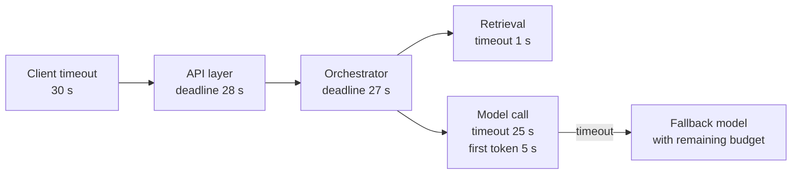

High availability keeps the system **up**. Reliability is broader: the system does the right thing, consistently, under real conditions, including partial failures, overload, bad inputs and the non-determinism of the models themselves. An LLM application can return HTTP 200 on every request and still be unreliable, because the answers are malformed, ungrounded or truncated. This lesson turns reliability into numbers with SLOs and error budgets, analyses how an LLM application fails, and applies the patterns that contain those failures. It extends [reliability](/learn/production-ai-systems/reliability) and [error handling for agents](/learn/advanced-agent-systems/error-handling) to whole-system design.

## SLIs, SLOs and error budgets

A **service level indicator (SLI)** is a measured ratio of good events to total events. A **service level objective (SLO)** is the target for that ratio over a window. The **error budget** is what is left over: the amount of failure you can tolerate before breaching the SLO.

For an LLM application, define SLIs for quality as well as for speed and success:

| SLI | Good event | Example SLO (28 days) |
| --- | --- | --- |
| Availability | Request returns a complete, non-error response | 99.9% |
| Latency | Time to first token under 1.5 s | 95% of requests |
| Format validity | Structured output parses and matches the schema | 99.5% |
| Groundedness | Sampled answers judged supported by their cited sources | 90% of sampled answers |
| Safety | No policy-violating output in sampled and flagged answers | 99.99% |

```python
window_days = 28
requests_per_day = 200_000
slo = 0.999

total = window_days * requests_per_day
budget = total * (1 - slo)
print(f"requests in window: {total:,}")
print(f"error budget: {budget:,.0f} failed requests")

failed_so_far, days_elapsed = 3_100, 10
burned = failed_so_far / budget
print(f"budget used after {days_elapsed} days: {burned:.0%} (on-pace would be {days_elapsed / window_days:.0%})")
```

```output
requests in window: 5,600,000
error budget: 5,600 failed requests
budget used after 10 days: 55% (on-pace would be 36%)
```

The budget turns reliability into a decision rule. While budget remains, the team ships changes freely; when it is burning faster than the window allows, the team slows releases and spends time on reliability. This avoids both endless "make it more reliable" work and reckless shipping.

> [!KEY]
> An SLO only on HTTP success is a trap for AI systems. Most LLM failures are **soft**: plausible but wrong, unparseable or unsafe responses. Put at least one quality SLI next to your latency and availability SLIs.

## Failure-mode analysis for an LLM application

A failure-mode analysis lists, component by component, how things fail, how you would notice, and what contains the damage. Doing this before launch is one of the most valuable hours in a design review.

| Component | Failure mode | Detection | Mitigation | User impact if unmitigated |
| --- | --- | --- | --- | --- |
| Model provider or pool | Outage, 429 throttling, 5xx | Error rate, circuit breaker state | Retries with backoff, fallback model, queue | Total outage |
| Model pool | Overload, long queues | Queue time, TTFT p95 | Autoscaling, load shedding, priorities | Timeouts for everyone |
| Model output | Invalid JSON or schema | Validation failure rate | Constrained decoding, validate and retry once, fallback | Broken downstream actions |
| Model output | Hallucinated or ungrounded answer | Sampled evaluation, citation checks | Grounding checks, "I don't know" path, better retrieval | Wrong information given confidently |
| Model output | Truncated at max tokens | Finish reason equals length | Higher limit, ask for concise output, continuation | Incomplete answers |
| Retrieval | Index stale or missing documents | Freshness lag metric, reconciliation job | Incremental sync, alerts on lag | Outdated or missing answers |
| Retrieval | Empty or irrelevant results | Retrieval score distribution, empty-result rate | Hybrid search, query rewrite, honest fallback message | Generic or hallucinated answers |
| Agent loop | Runs forever or repeats a tool | Step count, repeated-call detection | Step and token budgets, hand over to human | Cost blow-up, no answer |
| Tool call | Duplicate side effects on retry | Idempotency key conflicts | Idempotency keys, approval for risky tools | Double refunds or emails |
| Prompt or config change | Quality regression | Offline eval gate, canary metrics | Versioned configs, canary, fast rollback | Silent quality drop |
| Input | Prompt injection via documents or users | Guardrail flags, anomaly in tool use | Least-privilege tools, output filtering | Data leak, unauthorised actions |

Each row should map to a metric on a dashboard and, for severe rows, an alert. Rows with no detection method are the ones that will surprise you in production.

## Patterns that contain failures

### Timeouts and deadlines

Every network call needs a timeout, and timeouts must nest: an inner call must give up before the outer caller does. Better still, pass a **deadline** down the call chain so each layer knows how much time remains and skips optional work (rewrite, reranking) when time is short.



For streaming calls, use two timeouts: one for the first token (detects a stuck queue quickly) and one for the whole stream.

### Retries with exponential backoff and jitter

Retry only failures that are likely transient (timeouts, 429, 503), only for idempotent operations, a limited number of times, and with randomised exponential backoff so that thousands of clients do not retry in lockstep and overload a recovering service.

```python
import random

def backoff_delays(attempts, base=0.5, cap=8.0, seed=42):
    rng = random.Random(seed)
    delays = []
    for attempt in range(attempts):
        ceiling = min(cap, base * 2 ** attempt)
        delays.append(round(rng.uniform(0, ceiling), 2))   # "full jitter"
    return delays

print(backoff_delays(5))
```

```output
[0.32, 0.03, 0.55, 0.89, 5.89]
```

Respect a `Retry-After` header when the provider sends one. Also cap retries globally: a **retry budget** (for example, retries may add at most 10 percent extra load) prevents a retry storm from turning a partial outage into a full one.

### Circuit breakers, bulkheads and load shedding

- **Circuit breaker**: after repeated failures to a dependency, stop calling it for a cool-down period and use the fallback immediately, rather than making every request wait for a timeout. See the state diagram in [high availability](/learn/ai-system-design/high-availability).
- **Bulkheads**: give separate resources (connection pools, queues, GPU pools) to separate workloads, so a batch summarisation job cannot exhaust capacity needed by interactive chat.
- **Load shedding**: when the queue is beyond what can be served within the SLO, reject new low-priority requests quickly with a clear error. A fast "busy, try again" is better than a slow timeout for everyone.

### Validation and bounded retries for model output

Treat model output as untrusted input to the rest of your system. Validate structured outputs against a schema (see [output validation](/learn/ai-security-and-responsible-ai/output-validation)); on failure, retry once with the validation error included in the prompt, then fall back to a safe default or a human. Check the finish reason so truncated outputs are not treated as complete.

> [!WARNING]
> Retrying a model call is not automatically safe in agents. If the failed step had already triggered a side effect (sent an email, issued a refund), a retry repeats it. Make side-effecting tools idempotent with keys stored by the tool executor, and checkpoint agent state after each completed step.

## Design scenario: reliability review of the support agent

Applying the failure-mode table to the [customer-support agent](/learn/ai-system-design/llm-application-architecture) produces concrete design changes:

1. **SLOs**: 99.9% conversations without system error; 95% first response under 2 s; at most 0.1% of refunds requiring manual correction; 90% of sampled conversations rated resolved-or-correctly-escalated.
2. **Agent budgets**: at most 8 steps and 60,000 tokens per turn; on reaching either, hand over to a human with a summary.
3. **Idempotent refunds**: the refund tool requires a key derived from conversation ID and order ID, so a retried step cannot pay twice.
4. **Degraded mode**: if both model backends fail, the widget shows order status from the orders API directly (no LLM needed) and offers a human hand-over.
5. **Release safety**: prompt and tool-schema changes go through the offline evaluation suite, then a 5% canary watched against the quality SLIs before full rollout.

## Incidents and learning

Reliability improves through practice, not only design. Run **game days** that deliberately fail a provider, a zone or the vector index, and verify that fallbacks and alerts work. After each incident, write a **blameless postmortem**: timeline, impact, root causes, what went well, and action items with owners. Many AI incidents are quality incidents (a prompt change that made answers worse); give them the same process as outages.

## Exercises

**1.** With a 99.5% SLO over 28 days at 50,000 requests per day, how many failures does the budget allow, and how much of it has 4,200 failures in the first week consumed?

<details>
<summary>Show solution</summary>

```python
budget = 28 * 50_000 * (1 - 0.995)
print(f"{budget:,.0f} allowed, {4_200 / budget:.0%} used")
```

```output
7,000 allowed, 60% used
```

60% of the budget in 25% of the window: the team should pause risky releases and investigate.

</details>

**2.** Add two rows to the failure-mode table for an embedding service used by both ingestion and queries.

<details>
<summary>Show solution</summary>

Embedding service overloaded by a bulk re-index: detected by query-embedding latency and ingestion queue depth; mitigated by bulkheads (separate pools or priority for query traffic). Embedding model silently changed by a provider version update: detected by a drop in retrieval evaluation scores or embedding distribution shift; mitigated by pinning model versions and storing the model name with every vector.

</details>

**3.** Why should retries use random jitter rather than fixed delays?

<details>
<summary>Show solution</summary>

With fixed delays, every client that failed at the same moment retries at the same moment, creating synchronised spikes that can knock a recovering service over again. Jitter spreads retries over time, so load returns gradually.

</details>

```quiz
[
  {
    "q": "An LLM service returns HTTP 200 for 99.99% of requests. Why might it still be unreliable?",
    "options": [
      "HTTP 200 is never a valid success indicator",
      "Many failures are soft: wrong, ungrounded, malformed or truncated answers that still return 200",
      "LLMs cannot have SLOs",
      "Only latency matters"
    ],
    "answer": 1,
    "why": "Quality failures do not produce error codes, so quality SLIs are needed alongside availability and latency."
  },
  {
    "q": "Which failures are appropriate to retry automatically?",
    "options": [
      "Any failure, as many times as needed",
      "Transient errors such as timeouts, 429 and 503, for idempotent operations, a limited number of times",
      "Schema validation errors, indefinitely",
      "Authentication failures"
    ],
    "answer": 1,
    "why": "Retries help only for transient faults; unbounded or non-idempotent retries cause storms and duplicate side effects."
  },
  {
    "q": "What is the purpose of a bulkhead?",
    "options": [
      "Encrypting traffic between services",
      "Isolating resources per workload so one workload's overload cannot exhaust capacity for others",
      "Retrying failed requests",
      "Caching responses"
    ],
    "answer": 1,
    "why": "Like compartments in a ship, bulkheads contain a failure to one part of the system."
  },
  {
    "q": "An agent's step fails after its refund tool call succeeded but before the result was saved. What prevents a double refund on retry?",
    "options": [
      "A larger model",
      "An idempotency key on the refund tool, checked by the tool executor",
      "Lower temperature",
      "A longer timeout"
    ],
    "answer": 1,
    "why": "The idempotency key lets the refunds service recognise the repeated request and return the original result instead of paying again."
  }
]
```
