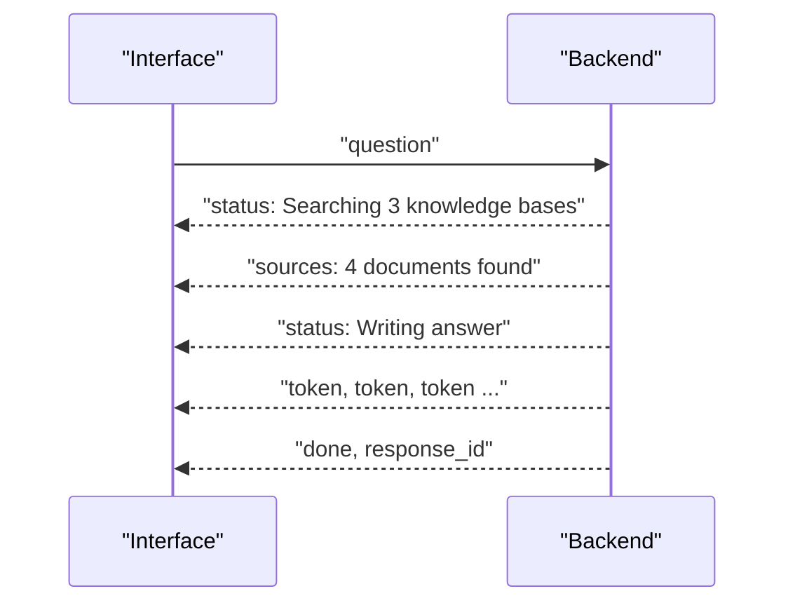
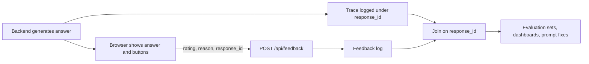
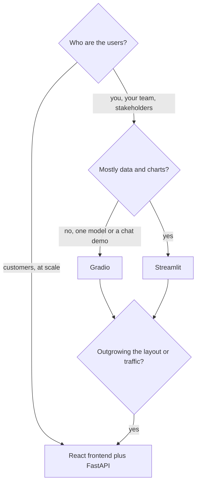

A model that is accurate in your evaluation can still fail as a product. Users wait at a blank screen and leave; they accept a confident, wrong answer and act on it; they cannot tell where a claim came from; they get a bad reply and have no way to fix it or tell you. These are interface problems, not model problems, and they are the difference between a demo and something people rely on. This lesson collects the interface patterns that well-built AI applications share, shows how to implement the important ones with the tools from this module, and ends with how to choose between Streamlit, Gradio and a custom React frontend.

## What makes AI interfaces different

Traditional software is fast and deterministic: the same click gives the same result in milliseconds, and if the result is wrong it is a bug. Generative models break all three assumptions.

| Property of the model | Consequence for the interface | Pattern |
| --- | --- | --- |
| Slow: seconds to first token, more for agents | Users think the app is broken | Streaming, progress states, stop button |
| Non-deterministic | The same question can get a better answer on a second try | Regenerate, multiple drafts |
| Sometimes wrong, always fluent | Users over-trust confident prose | Sources, uncertainty cues, friction before risky actions |
| Open-ended input | Users do not know what to ask | Examples, suggested prompts, clear scope |
| Quality is hard to measure offline | You need real-world signals | Feedback buttons wired to logs |

## Latency: streaming and masking the wait

Streaming, covered in [Frontend and backend integration](/learn/application-development/frontend-and-backend-integration), is the most effective single change: the total time is unchanged, but the user starts reading after the time to first token instead of after the whole answer.

For pipelines with several slow steps, such as retrieval, reranking, tool calls and generation, the first token may itself take a while. Fill the wait with **honest progress**: send status events from the backend as each step starts and show them, rather than a generic spinner.



This is just more event types in the SSE stream from the previous lesson (`{"type": "status", ...}`, `{"type": "sources", ...}`). Other latency-masking techniques:

- **Acknowledge instantly.** Show the user's message in the conversation and disable the send button the moment they press Enter, before any network request completes.
- **Skeletons** (grey placeholder shapes) for content whose layout you know, such as a summary card.
- **Show agent steps** in a collapsible panel. Watching "Called search_orders(...)" builds understanding and makes long waits tolerable.
- **Always offer Stop**, and make it actually cancel the backend work.
- **Do not fake it.** A typewriter effect on text you already have, or progress bars that are not tied to real progress, waste the user's time and erode trust once noticed.

## Showing sources and citations

For anything grounded in documents, a [RAG](/learn/rag-fundamentals/answer-generation) system for example, show where each claim came from. The standard pattern is to number the retrieved passages in the prompt, instruct the model to cite them as `[1]`, `[2]`, and send the passages to the frontend as structured data so it can render each marker as a link that opens the source snippet.

Never trust the citations blindly: models sometimes cite a number that does not exist or attach a citation to a claim the source does not support. At minimum, check that every marker refers to a passage you actually supplied:

```python
import re

def check_citations(answer: str, n_sources: int):
    cited = sorted({int(n) for n in re.findall(r"\[(\d+)\]", answer)})
    valid = [n for n in cited if 1 <= n <= n_sources]
    invalid = [n for n in cited if n not in valid]
    return valid, invalid

answer = "Refunds take 5 days [1]. Gift cards are excluded [3]. Shipping is free [7]."
valid, invalid = check_citations(answer, n_sources=3)
print("valid:", valid, "invalid:", invalid)
uncited = [s for s in re.split(r"(?<=\.)\s+", answer) if not re.search(r"\[\d+\]", s)]
print("sentences without a citation:", uncited)
```

```output
valid: [1, 3] invalid: [7]
sentences without a citation: []
```

An invalid marker should be removed or flagged before display, and the event logged, because it is a hallucination signal. Checking that the cited passage really supports the sentence needs a second model call or an NLI model, covered in [Hallucination mitigation](/learn/ai-security-and-responsible-ai/hallucination-mitigation).

On the frontend, show sources close to the claim: inline markers that reveal the snippet on hover or tap, and a list of sources under the answer with titles, links and the exact passage used, not only a document name.

## Uncertainty and guarding against overtrust

Fluent text reads as confident whether or not it is right, and people tend to over-rely on automated systems (often called **automation bias**). The interface should calibrate trust, not maximise it.

- **Say what it is.** Label AI-generated content, and state the system's scope ("Answers come from the HR policy handbook").
- **Let the model abstain.** Prompt it to say when the sources do not contain the answer, and render that as a distinct, clearly worded state rather than a normal answer.
- **Show uncertainty only when it means something.** A "92% confident" badge computed from token probabilities is not a calibrated probability of being correct, and users will read it as one. Prefer qualitative, validated signals: "No matching source found", "Sources disagree", "Based on a document from 2021".
- **Add friction in proportion to the stakes.** Drafting a reply can be one click; sending it, deleting data or making a payment should require explicit review and confirmation, the pattern from [Human-in-the-loop systems](/learn/ai-agent-fundamentals/human-in-the-loop-systems).
- **Make checking easy.** Sources one click away, copyable output, and a side-by-side view of original and AI-edited text all lower the cost of verifying.

> [!KEY]
> The goal is appropriate trust: users should rely on the system where it is reliable and check it where it is not. Every pattern in this section either exposes evidence or slows down a consequential action.

## Editing and regenerating

Because outputs vary, users need cheap ways to steer:

| Control | Behaviour | Implementation note |
| --- | --- | --- |
| Regenerate | New answer to the same prompt | Keep previous versions ("2 of 3") instead of discarding them |
| Edit message | Change an earlier user message and continue from there | Truncate history after the edited message and resend |
| Edit output | User fixes the answer directly | Log the edit: a corrected answer is valuable training and evaluation data |
| Stop | Halt generation | Abort the request and cancel the model call server-side |
| Copy | Copy as plain text or Markdown | Small, but heavily used |

In data terms, each assistant turn becomes a list of versions with an index of the one shown, and editing a user turn creates a new branch of the conversation. Keep the IDs of all versions so feedback can refer to the exact one the user saw.

## Feedback wired to logging

Thumbs up and down buttons are only useful if each click can be joined to what produced the answer. When the backend generates a response it should log a trace (prompt template version, model, retrieved document IDs, latency, token counts) under a **response ID**, and send that ID to the browser in the final stream event. Feedback then refers to the ID:



```python
from typing import Literal
from fastapi import FastAPI
from fastapi.testclient import TestClient
from pydantic import BaseModel, Field

app = FastAPI()
FEEDBACK_LOG: list[dict] = []          # in production: a database table or log pipeline

class Feedback(BaseModel):
    response_id: str
    rating: Literal["up", "down"]
    reason: str | None = Field(default=None, max_length=500)

@app.post("/api/feedback", status_code=204)
def record_feedback(fb: Feedback):
    FEEDBACK_LOG.append(fb.model_dump())

client = TestClient(app)
print(client.post("/api/feedback", json={"response_id": "r-123", "rating": "down",
                                         "reason": "Cited the wrong policy"}).status_code)
print(client.post("/api/feedback", json={"response_id": "r-124", "rating": "meh"}).status_code)
print(FEEDBACK_LOG)
```

```output
204
422
[{'response_id': 'r-123', 'rating': 'down', 'reason': 'Cited the wrong policy'}]
```

In a real system you would also record the authenticated user and a timestamp, and verify that the response ID belongs to that user. The matching React component:

```tsx
import { useState } from "react";

function FeedbackButtons({ responseId }: { responseId: string }) {
  const [rating, setRating] = useState<"up" | "down" | null>(null);

  function send(value: "up" | "down") {
    setRating(value);
    fetch("/api/feedback", {
      method: "POST",
      headers: { "Content-Type": "application/json" },
      body: JSON.stringify({ response_id: responseId, rating: value }),
    }).catch(() => {});                  // feedback must never break the chat
  }

  if (rating) return <p aria-live="polite">Thanks, your feedback was recorded.</p>;
  return (
    <div role="group" aria-label="Rate this answer">
      <button onClick={() => send("up")}>Helpful</button>
      <button onClick={() => send("down")}>Not helpful</button>
    </div>
  );
}
```

Few users click these buttons, and those who do are not a random sample, so treat feedback as a source of examples to investigate rather than an accurate quality metric. Implicit signals (copying the answer, regenerating, abandoning the session) are noisier but far more plentiful.

## Accessibility

AI interfaces add a few accessibility problems of their own on top of the usual ones (keyboard access, colour contrast, labelled controls):

- **Streaming and screen readers.** A live region (`aria-live="polite"`) that changes on every token produces a flood of announcements. Announce status changes ("Answer ready") and let the user read the finished message, or update the live region in sentence-sized pieces.
- **Keyboard flow.** Enter sends, Shift+Enter adds a new line, Escape stops generation, and focus returns to the input after sending.
- **Icon-only buttons** such as copy, regenerate and thumbs need text labels (`aria-label`), and state must not rely on colour alone.
- **Motion.** Respect the user's reduced-motion setting: render text in larger chunks instead of animating a typewriter effect.
- **Plain language.** Error messages should say what happened and what to do ("The answer was interrupted. Try again."), never a raw stack trace.

## Choosing Streamlit, Gradio or React

| | Streamlit | Gradio | Custom React + FastAPI |
| --- | --- | --- | --- |
| Language | Python only | Python only | TypeScript frontend, Python backend |
| Time to first version | Hours | Hours, minutes for one model | Days to weeks |
| Mental model | Script reruns on interaction | Functions bound to component events | Components, state and an HTTP API |
| Strengths | Dashboards, data apps, internal tools, multipage apps | Model demos, chat UIs, Hugging Face Spaces, automatic API | Full control of UX, branding, performance, mobile |
| UI customisation | Limited | Limited to moderate | Unlimited |
| Scaling to many users | Modest: a server-side session per user | Moderate, with a built-in queue | High: static frontend, stateless backend you scale independently |
| Public API for other clients | No | Yes, automatically | Yes, you design it |
| Typical team | Data scientists, ML engineers | ML engineers, researchers | Product teams with frontend skills |



These choices are not exclusive. A common path is a Streamlit or Gradio prototype to validate the idea, then a React frontend for the product, while the prototype lives on as an internal evaluation tool. Keeping model logic in a backend service, rather than inside the UI script, makes that move cheap.

> [!TIP]
> Whichever you choose, put the AI logic (prompting, retrieval, validation, logging) behind functions or an API that the UI only calls. The interface is the part most likely to be rewritten.

## Exercises

**1.** Your RAG assistant takes about six seconds before the first token: two seconds of retrieval and reranking, then four seconds of generation before text appears. Users complain it "hangs". List three interface changes, in order of impact.

<details>
<summary>Show solution</summary>

First, show the user's message immediately and replace the generic spinner with real status events ("Searching documents", "Reading 4 sources", "Writing answer"). Second, send the sources as soon as retrieval finishes, so the user has something useful to look at while generation starts. Third, make sure generation is streamed, and offer a Stop button. Separately, investigate why the first token is slow; the interface can mask latency but not remove it.

</details>

**2.** A product manager wants a "Confidence: 87%" badge on every answer, computed from the average token probability. What is your response?

<details>
<summary>Show solution</summary>

Average token probability measures how predictable the wording was, not whether the answer is correct, and it is not calibrated: an 87% badge does not mean 87% of such answers are right. Users would read it as exactly that and over-trust fluent wrong answers. Offer validated, qualitative signals instead, such as whether supporting sources were found, whether citations check out, or whether sources disagree. A numeric confidence should only be shown if it has been calibrated against labelled outcomes.

</details>

**3.** Extend the `Feedback` model so a thumbs-down can carry one of a fixed set of reasons (`"incorrect"`, `"unhelpful"`, `"unsafe"`, `"other"`) plus optional free text, and reject unknown reasons.

<details>
<summary>Show solution</summary>

```python
from typing import Literal
from pydantic import BaseModel, Field

class Feedback(BaseModel):
    response_id: str
    rating: Literal["up", "down"]
    category: Literal["incorrect", "unhelpful", "unsafe", "other"] | None = None
    reason: str | None = Field(default=None, max_length=500)
```

FastAPI validates the body against the model and returns 422 for any other category. Fixed categories make feedback easy to count; the free text explains individual cases.

</details>

```quiz
[
  {
    "q": "Why should the backend send a `response_id` to the browser with each answer?",
    "options": [
      "So the browser can cache the answer",
      "So feedback and edits can be joined to the logged trace of exactly what produced that answer",
      "Because SSE requires an ID",
      "To let the browser call the LLM directly next time"
    ],
    "answer": 1,
    "why": "Without an ID, a thumbs-down cannot be connected to the prompt, model, sources and settings that produced the answer."
  },
  {
    "q": "A model's answer cites `[5]` but only three passages were retrieved. What should the system do?",
    "options": [
      "Display it unchanged; the model knows best",
      "Renumber it to `[3]`",
      "Remove or flag the invalid citation before display and log it as a hallucination signal",
      "Retrieve two more passages so `[5]` exists"
    ],
    "answer": 2,
    "why": "A citation to a passage that was never supplied is fabricated. Users must not see it as evidence, and the event is worth tracking."
  },
  {
    "q": "Which is the best way to make a streamed answer accessible to screen-reader users?",
    "options": [
      "Announce status changes and the completed answer rather than every token",
      "Put the streaming text in an `aria-live` region updated on every token",
      "Disable streaming for everyone",
      "Rely on colour to show when generation has finished"
    ],
    "answer": 0,
    "why": "Updating a live region per token floods the user with announcements; announcing meaningful changes keeps it usable."
  },
  {
    "q": "A customer-facing assistant expects heavy traffic and needs custom branding and mobile support. Which approach fits best?",
    "options": [
      "Streamlit on a single server",
      "A Gradio app with `share=True`",
      "A Jupyter notebook",
      "A React frontend calling a FastAPI backend"
    ],
    "answer": 3,
    "why": "A static React frontend with a stateless API gives full control of the experience and scales frontend and backend independently."
  }
]
```
