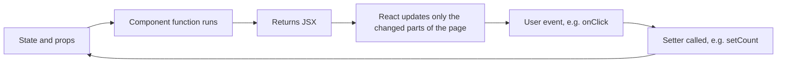

Streamlit and Gradio let you stay in Python, but sooner or later an AI product needs a frontend they cannot give you: a custom chat layout, inline citations you can click, a design that matches your company's product, or an interface that works offline on a phone. Most of those frontends are written in **React**, a JavaScript library for building user interfaces out of components. This lesson teaches the React you need as an AI engineer who knows Python: enough to build a chat page, call your FastAPI backend and read the frontend code your team writes. It is not a full course in web development, and it does not need to be.

All examples use **TypeScript** (JavaScript with type annotations, much like Python's [type hints](/learn/python-programming/type-hints)), written in `.tsx` files that mix TypeScript and markup.

## Setting up a project with Vite

React code has to be compiled into plain JavaScript that browsers understand. **Vite** is the standard tool for that: it creates the project, runs a development server that reloads instantly when you save, and builds optimised files for production. You need Node.js installed (it provides `npm`, the JavaScript equivalent of `pip`).

```bash
npm create vite@latest ai-ui -- --template react-ts
cd ai-ui
npm install          # like pip install -r requirements.txt, reading package.json
npm run dev          # development server, usually at http://localhost:5173
```

| File | Role | Python analogy |
| --- | --- | --- |
| `package.json` | Dependencies and scripts (`dev`, `build`) | `pyproject.toml` |
| `node_modules/` | Installed packages; never commit it | The virtual environment |
| `index.html` | The single HTML page, containing an empty `<div id="root">` | |
| `src/main.tsx` | Entry point: mounts the app into that div | `if __name__ == "__main__":` |
| `src/App.tsx` | Your top-level component | `main()` |

`src/main.tsx` is short and you rarely change it:

```tsx
import { StrictMode } from "react";
import { createRoot } from "react-dom/client";
import App from "./App";

createRoot(document.getElementById("root")!).render(
  <StrictMode>
    <App />
  </StrictMode>
);
```

`npm run build` writes static HTML, JavaScript and CSS into `dist/`. Those files can be served by any web server or CDN; there is no Node process in production unless you choose one.

## Components and JSX

A React **component** is a function that returns a description of some UI. The markup-like syntax inside it is **JSX**, which the compiler turns into ordinary function calls.

```tsx
function Greeting() {
  const name = "Ada";
  return (
    <div className="greeting">
      <h2>Hello, {name}</h2>
      <p>You have {3 + 4} new messages.</p>
    </div>
  );
}

export default function App() {
  return (
    <main>
      <Greeting />
      <Greeting />
    </main>
  );
}
```

The rules that trip up newcomers:

- Curly braces `{...}` embed any JavaScript expression, like an f-string's `{...}`.
- Component names start with a capital letter (`Greeting`); lowercase tags (`div`, `p`) are HTML elements.
- A component returns a single root element. Wrap siblings in a `<div>` or an empty fragment `<>...</>`.
- Some attribute names differ from HTML: `className` instead of `class`, `onClick` instead of `onclick`, and `style` takes an object: `style={{ color: "red" }}`.
- Every tag must be closed, including `<input />` and `<br />`.

## Props: passing data into components

Components take inputs called **props**, passed like HTML attributes and received as a single object. In TypeScript you describe their shape with a type, just as you would annotate a Python function's parameters:

```tsx
type MessageProps = {
  role: "user" | "assistant";
  text: string;
};

function Message({ role, text }: MessageProps) {
  return (
    <div className={`message ${role}`}>
      <strong>{role === "user" ? "You" : "Assistant"}:</strong> {text}
    </div>
  );
}

// Usage
<Message role="assistant" text="Hello. How can I help?" />
```

Props flow **one way**, from parent to child. A child never modifies its props; if it needs to change something the parent owns, the parent passes it a function to call, such as `onSend`.

## State with useState

Props are read-only, so where does changing data live? In **state**. The `useState` **hook** gives a component a value that persists between renders, plus a setter function. Calling the setter tells React to **re-render**: call the component function again and update the page to match.

```tsx
import { useState } from "react";

function Counter() {
  const [count, setCount] = useState(0);
  return (
    <button onClick={() => setCount(count + 1)}>
      Clicked {count} times
    </button>
  );
}
```

This should feel familiar from [Streamlit](/learn/application-development/streamlit): the component function reruns on every change, and ordinary local variables are recreated each time, so anything that must survive lives in state. The difference is that React reruns only the affected components, in the browser, with no server round trip.



Two rules matter. First, **never mutate state directly**: `messages.push(m)` changes the array without React noticing. Create a new value instead: `setMessages([...messages, m])` (the `...` spread operator copies the old items into a new array). Second, when the new value depends on the old one, pass a function, `setCount(c => c + 1)`, so that several quick updates do not read a stale value.

## Rendering lists and handling forms

To render a list, map an array to an array of elements. Each item needs a **`key`** that is stable and unique among its siblings, so React can tell which item is which when the list changes:

```tsx
type ChatMessage = { id: number; role: "user" | "assistant"; text: string };

function MessageList({ messages }: { messages: ChatMessage[] }) {
  if (messages.length === 0) return <p>No messages yet.</p>;
  return (
    <div>
      {messages.map((m) => (
        <Message key={m.id} role={m.role} text={m.text} />
      ))}
    </div>
  );
}
```

Avoid using the array index as the key when items can be inserted, removed or reordered; it causes the wrong item to keep the wrong state.

Inputs are usually **controlled**: their value comes from state and every keystroke updates the state. A form's `onSubmit` handler must call `preventDefault()`, otherwise the browser does an old-fashioned full-page form submission and reloads.

```tsx
function ChatInput({ onSend }: { onSend: (text: string) => void }) {
  const [draft, setDraft] = useState("");

  function send() {
    if (!draft.trim()) return;
    onSend(draft);
    setDraft("");
  }

  return (
    <form onSubmit={(e) => { e.preventDefault(); send(); }}>
      <input
        value={draft}
        onChange={(e) => setDraft(e.target.value)}
        placeholder="Ask something"
      />
      <button type="submit" disabled={!draft.trim()}>Send</button>
    </form>
  );
}
```

## Effects and fetching from an API

Rendering must be a pure calculation from props and state. Anything that reaches outside, such as fetching data, starting a timer or subscribing to a socket, is a **side effect** and goes in `useEffect`. The effect runs after React has updated the page; the **dependency array** says when to run it again, and the function it returns is a **cleanup** that runs before the next run or when the component disappears.

| Dependency array | Effect runs |
| --- | --- |
| `[]` | Once, after the first render |
| `[modelId]` | After the first render and whenever `modelId` changes |
| Omitted | After every render (rarely what you want) |

Here a component loads a list of models from a backend endpoint, with loading and error states:

```tsx
import { useEffect, useState } from "react";

type Model = { id: string; description: string };

function ModelPicker() {
  const [models, setModels] = useState<Model[]>([]);
  const [loading, setLoading] = useState(true);
  const [error, setError] = useState<string | null>(null);

  useEffect(() => {
    const controller = new AbortController();
    fetch("/api/models", { signal: controller.signal })
      .then((res) => {
        if (!res.ok) throw new Error(`HTTP ${res.status}`);
        return res.json() as Promise<Model[]>;
      })
      .then(setModels)
      .catch((err) => {
        if (err.name !== "AbortError") setError(String(err));
      })
      .finally(() => setLoading(false));
    return () => controller.abort();   // cleanup: cancel if the component unmounts
  }, []);

  if (loading) return <p>Loading models...</p>;
  if (error) return <p role="alert">Could not load models: {error}</p>;
  return (
    <select>
      {models.map((m) => <option key={m.id} value={m.id}>{m.id}</option>)}
    </select>
  );
}
```

`fetch` is the browser's built-in HTTP client, the equivalent of `requests` or `httpx`. It returns a **Promise** (JavaScript's version of an awaitable), and you can equally write it with `async`/`await`, as the next lesson does. Note that `fetch` does not throw on an HTTP error status: you must check `res.ok` yourself.

> [!NOTE]
> In development, `StrictMode` deliberately mounts each component twice, so effects run, clean up and run again. If you see every request twice in the network tab, that is why; it does not happen in the production build. A correct cleanup function, like the `abort()` above, makes the double run harmless.

> [!TIP]
> Fetching in an effect is not the only way to load data. Many teams use a data-fetching library such as TanStack Query, which adds caching, retries and deduplication. Learn the raw pattern first so you understand what such libraries do for you.

## Putting it together

The pieces combine into a working (if offline) chat page. State lives in the top component; children receive data and callbacks as props.

```tsx
export default function App() {
  const [messages, setMessages] = useState<ChatMessage[]>([]);

  function handleSend(text: string) {
    setMessages((prev) => [
      ...prev,
      { id: Date.now(), role: "user", text },
      { id: Date.now() + 1, role: "assistant", text: `You said: ${text}` },
    ]);
  }

  return (
    <main>
      <h1>Assistant</h1>
      <MessageList messages={messages} />
      <ChatInput onSend={handleSend} />
    </main>
  );
}
```

Replacing the echo with a real streamed reply from your backend is the subject of [Frontend and backend integration](/learn/application-development/frontend-and-backend-integration).

| Python / Streamlit idea | React equivalent |
| --- | --- |
| A function returning UI | A component |
| Function arguments | Props |
| `st.session_state` | `useState` |
| Script rerun | Component re-render |
| `requests.get(...)` | `fetch(...)` inside `useEffect` or an event handler |
| `pip` and `pyproject.toml` | `npm` and `package.json` |

## Exercises

**1.** This component is meant to add a tag when the button is clicked, but the list on screen never changes. Why, and how do you fix it?

```tsx
const [tags, setTags] = useState<string[]>([]);
function addTag() {
  tags.push("new");
  setTags(tags);
}
```

<details>
<summary>Show solution</summary>

`push` mutates the existing array, and `setTags(tags)` passes the same array object back. React compares the old and new values by identity, sees no change, and skips the re-render. Create a new array:

```tsx
function addTag() {
  setTags((prev) => [...prev, "new"]);
}
```

</details>

**2.** Write a `Toggle` component that shows a button reading "Show sources" or "Hide sources" and, when sources are shown, renders its `sources: string[]` prop as a bulleted list.

<details>
<summary>Show solution</summary>

```tsx
function Toggle({ sources }: { sources: string[] }) {
  const [open, setOpen] = useState(false);
  return (
    <div>
      <button onClick={() => setOpen((o) => !o)}>
        {open ? "Hide sources" : "Show sources"}
      </button>
      {open && (
        <ul>
          {sources.map((s) => <li key={s}>{s}</li>)}
        </ul>
      )}
    </div>
  );
}
```

`{open && (...)}` renders the list only when `open` is true, a common JSX idiom for conditional output.

</details>

**3.** A component has `useEffect(() => { fetch("/api/doc/" + docId)... }, [])`. When the user selects a different document, the old one is still shown. What is wrong?

<details>
<summary>Show solution</summary>

The dependency array is empty, so the effect runs only once, after the first render. Because the effect reads `docId`, it must list it: `[docId]`. Then React re-runs the effect, after first running the previous cleanup (for example aborting the old request), whenever `docId` changes.

</details>

```quiz
[
  {
    "q": "What happens when you call a state setter such as `setCount(5)`?",
    "options": [
      "The variable `count` changes immediately in the current function call",
      "The page reloads",
      "React schedules a re-render, calling the component function again with the new value",
      "Nothing until the user submits a form"
    ],
    "answer": 2,
    "why": "Setters do not mutate the local variable; they tell React to re-render the component with the new state."
  },
  {
    "q": "Why does each item rendered from an array need a `key` prop?",
    "options": [
      "So React can match items between renders when the list changes",
      "So the items can be styled with CSS",
      "Because JSX cannot render arrays otherwise",
      "To sort the list"
    ],
    "answer": 0,
    "why": "Stable keys let React tell which item was added, removed or moved, so state and DOM elements stay attached to the right item."
  },
  {
    "q": "Which `useEffect` dependency array makes the effect run once after the first render only?",
    "options": [
      "Omitting the array",
      "`[]`",
      "`[props]`",
      "`[true]`"
    ],
    "answer": 1,
    "why": "An empty array means the effect depends on nothing, so React never needs to re-run it after the first time."
  },
  {
    "q": "A `fetch` call returns a response with status 500. What does `fetch` do?",
    "options": [
      "Throws an error automatically",
      "Retries three times",
      "Returns `null`",
      "Resolves normally; you must check `res.ok` or `res.status` yourself"
    ],
    "answer": 3,
    "why": "`fetch` only rejects on network failures. HTTP error statuses resolve normally, so always check `res.ok`."
  }
]
```
