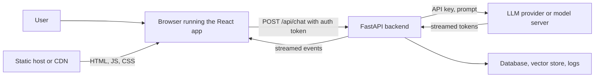
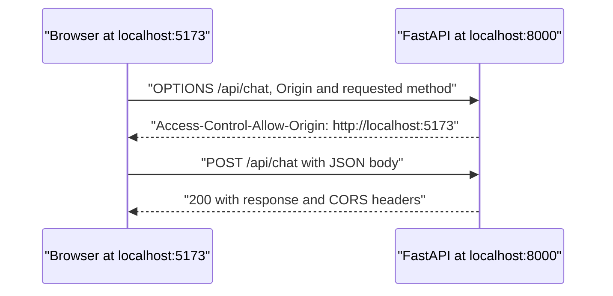
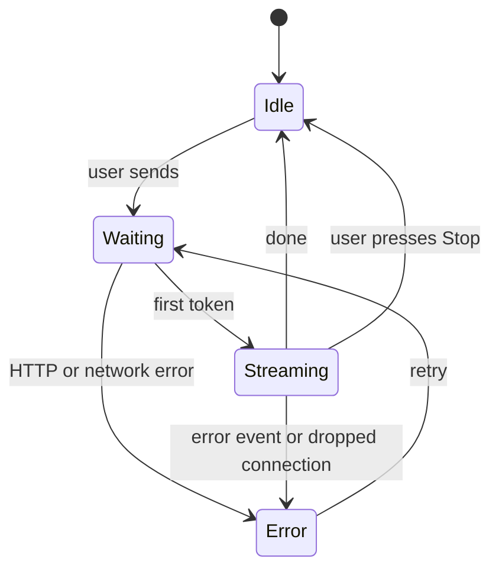

You now have the two halves of an AI application: a [FastAPI](/learn/fastapi/fastapi-fundamentals) backend that can call a model, and a [React](/learn/application-development/basic-react) frontend that can draw a chat page. This lesson connects them. It sounds like plumbing, and it is, but it is plumbing where most first versions go wrong: requests blocked by the browser for reasons that are not obvious, API keys shipped to every visitor, streams that arrive all at once, and spinners that spin forever after an error. You will build a streaming chat endpoint and the browser code that consumes it, and learn the rules that keep the whole thing secure.

## The architecture



Each box has a clear job:

| Component | Responsibilities | Must never |
| --- | --- | --- |
| React app (browser) | Display, input, local UI state, calling your API | Hold secrets, enforce security rules, talk to the LLM provider directly |
| FastAPI backend | Authentication, authorisation, validation, rate limits, prompt construction, retrieval, calling the model, logging | Trust anything the browser sends without checking it |
| LLM provider | Generating tokens | Be reachable with a key the public can see |

The React build is just static files: anyone can open the browser's developer tools and read every line of it, every request it makes and every value it stores. Treat the browser as a public, untrusted client. Everything that must be secret or enforced lives behind the backend.

> [!WARNING]
> Never put an LLM API key in frontend code, in a frontend environment variable or in a request the browser makes. Build tools embed environment variables into the JavaScript bundle as plain text. A leaked key lets anyone run up charges on your account. The browser calls your backend; only your backend holds the key and calls the provider.

Proxying through the backend is not only about secrecy. It is the one place where you can check who the user is, limit how much they can spend, stop them from replacing your system prompt, and log what happened, which is the foundation of [secure API design](/learn/ai-security-and-responsible-ai/secure-api-design).

## CORS: why the browser blocks your request

During development the React app runs on `http://localhost:5173` and FastAPI on `http://localhost:8000`. Different ports make them different **origins** (an origin is scheme plus host plus port). Browsers apply the **same-origin policy**: JavaScript on one origin may not read responses from another unless that server explicitly allows it. The permission mechanism is **CORS** (Cross-Origin Resource Sharing).

For a "non-simple" request, such as a `POST` with a JSON body or an `Authorization` header, the browser first sends a **preflight** `OPTIONS` request asking whether the real request is allowed. Only if the server's response says yes does the real request go out.



Two things surprise people. CORS is enforced **by the browser**, not the server: `curl` and Python scripts ignore it entirely, so it is not a security control for your API, only a rule about which web pages may read its responses. And a CORS failure shows up in the browser console as a CORS error even when the real cause is a 500 or a crash, because error responses often lack the CORS headers.

FastAPI handles CORS with middleware. List the exact origins that may call you:

```python
import asyncio, json
from typing import Literal
from fastapi import FastAPI
from fastapi.middleware.cors import CORSMiddleware
from fastapi.responses import StreamingResponse
from pydantic import BaseModel

app = FastAPI()
app.add_middleware(
    CORSMiddleware,
    allow_origins=["http://localhost:5173", "https://app.example.com"],
    allow_methods=["GET", "POST"],
    allow_headers=["Authorization", "Content-Type"],
)
```

Avoid `allow_origins=["*"]` for anything with user data. If you send cookies (`allow_credentials=True`), the CORS specification forbids the wildcard anyway, so you must list origins.

Often the simplest answer is to avoid cross-origin requests altogether. In development, Vite's dev server can **proxy** API paths to the backend, so the browser only ever talks to `localhost:5173`:

```typescript
// vite.config.ts
import { defineConfig } from "vite";
import react from "@vitejs/plugin-react";

export default defineConfig({
  plugins: [react()],
  server: { proxy: { "/api": "http://localhost:8000" } },
});
```

In production, the same effect comes from serving the static files and the API under one domain behind a reverse proxy, with `/api` routed to FastAPI.

## Environment-specific base URLs

The frontend needs to know where the API lives, and that differs between your laptop, a staging server and production. Vite reads `.env` files and exposes variables prefixed with `VITE_` through `import.meta.env`:

```bash
# .env.development  (used by npm run dev)
VITE_API_URL=

# .env.production   (used by npm run build)
VITE_API_URL=https://api.example.com
```

```typescript
const API_URL = import.meta.env.VITE_API_URL ?? "";
// "" means same origin: "/api/chat" goes through the Vite proxy in development
```

The `VITE_` prefix exists precisely because these values are compiled into the public bundle. A base URL is fine there; a secret never is. Secrets go in the backend's own environment, read with `os.environ` or a settings class.

## Streaming tokens to the browser

To show tokens as they are generated, the backend must forward them as they arrive rather than returning one JSON body. The usual wire format is **server-sent events** (SSE), the same format LLM providers use, as you saw in [Streaming responses](/learn/working-with-llms/streaming-responses): each event is a line `data: ...` followed by a blank line. Sending small JSON objects with a `type` field lets one stream carry tokens, a completion signal and errors.

Continuing the backend from above, `generate_tokens` stands in for the provider call so you can run it without a key:

```python
class Message(BaseModel):
    role: Literal["user", "assistant"]
    content: str

class ChatRequest(BaseModel):
    messages: list[Message]

async def generate_tokens(messages: list[Message]):
    """Stand-in for the LLM call: yields the reply piece by piece."""
    for piece in ["Paris", " is", " the", " capital", "."]:
        await asyncio.sleep(0)
        yield piece

def sse(event: dict) -> str:
    return f"data: {json.dumps(event)}\n\n"

@app.post("/api/chat")
async def chat(req: ChatRequest):
    async def events():
        try:
            async for token in generate_tokens(req.messages):
                yield sse({"type": "token", "text": token})
            yield sse({"type": "done"})
        except Exception:
            yield sse({"type": "error", "message": "The model service failed. Please try again."})

    return StreamingResponse(events(), media_type="text/event-stream",
                             headers={"Cache-Control": "no-cache"})
```

FastAPI's test client shows exactly what the browser receives, and confirms the CORS rules:

```python
from fastapi.testclient import TestClient

client = TestClient(app)
body = {"messages": [{"role": "user", "content": "Capital of France?"}]}
with client.stream("POST", "/api/chat", json=body) as res:
    print(res.status_code, res.headers["content-type"])
    print(res.read().decode().rstrip())

for origin in ["http://localhost:5173", "https://evil.example"]:
    pre = client.options("/api/chat", headers={
        "Origin": origin, "Access-Control-Request-Method": "POST"})
    print(origin, pre.status_code, pre.headers.get("access-control-allow-origin"))
```

```output
200 text/event-stream; charset=utf-8
data: {"type": "token", "text": "Paris"}

data: {"type": "token", "text": " is"}

data: {"type": "token", "text": " the"}

data: {"type": "token", "text": " capital"}

data: {"type": "token", "text": "."}

data: {"type": "done"}
http://localhost:5173 200 http://localhost:5173
https://evil.example 400 None
```

The preflight from the unlisted origin is refused, so a browser on that site would never send the `POST`. For the real model, replace `generate_tokens` with the async streaming loop from the LLM lessons, using an `AsyncOpenAI` client whose key comes from the server's environment. Once the stream has started, the HTTP status is already 200, so errors must travel *inside* the stream as an event, which is why the `except` branch yields one (log the real exception there too).

### Reading the stream in the browser

Browsers have a built-in `EventSource` class for SSE, but it only makes `GET` requests and cannot send custom headers, so it cannot post a conversation or an `Authorization` header. For chat, use `fetch` and read the response body as a stream:

| Option | Methods and headers | Direction | Use for |
| --- | --- | --- | --- |
| `EventSource` | `GET` only, no custom headers | Server to browser | Simple notifications, public feeds |
| `fetch` + `ReadableStream` | Any method, body and headers | Server to browser | LLM chat streaming (most common) |
| WebSocket | Custom protocol | Both ways | Voice, collaborative or long-lived sessions ([WebSockets](/learn/backend-development/websockets)) |

```typescript
export type ChatTurn = { role: "user" | "assistant"; content: string };

export async function streamChat(
  messages: ChatTurn[],
  onToken: (text: string) => void,
  signal: AbortSignal,
  authToken?: string,
): Promise<void> {
  const res = await fetch(`${API_URL}/api/chat`, {
    method: "POST",
    headers: {
      "Content-Type": "application/json",
      ...(authToken ? { Authorization: `Bearer ${authToken}` } : {}),
    },
    body: JSON.stringify({ messages }),
    signal,
  });
  if (!res.ok || !res.body) throw new Error(`Request failed with HTTP ${res.status}`);

  const reader = res.body.pipeThrough(new TextDecoderStream()).getReader();
  let buffer = "";
  while (true) {
    const { value, done } = await reader.read();
    if (done) break;
    buffer += value;
    const events = buffer.split("\n\n");
    buffer = events.pop() ?? "";            // the last piece may be an incomplete event
    for (const event of events) {
      if (!event.startsWith("data: ")) continue;
      const data = JSON.parse(event.slice(6));
      if (data.type === "token") onToken(data.text);
      if (data.type === "error") throw new Error(data.message);
    }
  }
}
```

The buffer matters: network chunks do not line up with events, so one `read()` may contain half an event or three of them. Only complete events (ending in a blank line) are parsed; the remainder waits for the next chunk.

> [!TIP]
> If tokens arrive in the browser all at once at the end, something between the two is buffering the response. Common culprits are a reverse proxy (nginx buffers by default; the `X-Accel-Buffering: no` response header disables it), compression middleware and some hosting platforms. Test with `curl -N`, which prints the stream unbuffered, to find which layer is responsible.

## Auth tokens

The browser proves who the user is on every request. The [FastAPI authentication](/learn/fastapi/authentication) lesson issued a bearer token from a `/token` endpoint; the frontend sends it in the `Authorization` header, as `streamChat` does, and the backend verifies it with a dependency before spending any money on the model.

Where the browser keeps the token is a trade-off. JavaScript-readable storage such as `localStorage` is simple but can be stolen by any script injected into your page (cross-site scripting). An **httpOnly cookie**, set by the server, cannot be read by JavaScript at all; the browser attaches it automatically when you pass `credentials: "include"` to `fetch`, which in turn requires `allow_credentials=True` and explicit origins in CORS. Many teams choose the cookie for that reason. Whichever you choose, the backend must enforce what the token permits; hiding a button in React prevents nothing.

## Loading, streaming and error states

An AI request has more states than a normal one: waiting for the first token can take seconds, then text streams, then it may finish, fail midway or be stopped by the user. Model them explicitly instead of with a single `isLoading` flag:



```tsx
import { useRef, useState } from "react";

type Status = "idle" | "waiting" | "streaming" | "error";

export function Chat() {
  const [messages, setMessages] = useState<ChatTurn[]>([]);
  const [status, setStatus] = useState<Status>("idle");
  const [error, setError] = useState<string | null>(null);
  const controller = useRef<AbortController | null>(null);

  async function send(text: string) {
    const history: ChatTurn[] = [...messages, { role: "user", content: text }];
    setMessages([...history, { role: "assistant", content: "" }]);
    setStatus("waiting");
    setError(null);
    controller.current = new AbortController();
    try {
      await streamChat(history, (piece) => {
        setStatus("streaming");
        setMessages((prev) => {
          const last = prev[prev.length - 1];
          return [...prev.slice(0, -1), { ...last, content: last.content + piece }];
        });
      }, controller.current.signal);
      setStatus("idle");
    } catch (err) {
      if ((err as Error).name === "AbortError") return setStatus("idle");
      setError((err as Error).message);
      setStatus("error");
    }
  }

  const busy = status === "waiting" || status === "streaming";
  return (
    <main>
      {messages.map((m, i) => <p key={i} className={m.role}>{m.content}</p>)}
      {status === "waiting" && <p aria-live="polite">Thinking...</p>}
      {status === "error" && <p role="alert">Something went wrong: {error}</p>}
      {busy
        ? <button onClick={() => controller.current?.abort()}>Stop</button>
        : <ChatInput onSend={send} />}
    </main>
  );
}
```

`useRef` holds a value that survives re-renders without causing one, which suits the `AbortController`. Aborting the `fetch` closes the connection; the backend sees the client disconnect and should stop iterating so you stop paying for tokens nobody will read. The array index is an acceptable `key` here only because messages are append-only. `ChatInput` is the component from the React lesson.

## Exercises

**1.** A teammate's React app calls `https://api.openai.com` directly with a key from `import.meta.env.VITE_OPENAI_KEY`. "It is in an environment variable, so it is safe," they say. Explain the problem and the fix.

<details>
<summary>Show solution</summary>

`VITE_` variables are substituted into the JavaScript bundle at build time, so the key is in plain text in a file every visitor downloads, and visible in every request in the network tab. Anyone can copy it and use your account. The fix is to remove the key from the frontend, revoke it, and add a backend endpoint such as `/api/chat` that holds the key server-side, authenticates the user and calls the provider on their behalf.

</details>

**2.** Your React app on `http://localhost:3000` gets "blocked by CORS policy" when posting to FastAPI on port 8000, but the same request works with `curl`. Give two ways to fix it.

<details>
<summary>Show solution</summary>

`curl` ignores CORS; browsers enforce it. Either add `"http://localhost:3000"` to `allow_origins` in `CORSMiddleware` (with the methods and headers you use), or proxy `/api` through the frontend dev server so the browser makes same-origin requests. Also check the backend logs: a crash can look like a CORS error because the error response lacks CORS headers.

</details>

**3.** A single network chunk arrives containing `data: {"type": "token", "text": "Hel"}\n\ndata: {"type": "tok`. Using the buffering logic in `streamChat`, what is parsed now and what remains in `buffer`?

<details>
<summary>Show solution</summary>

Splitting on the blank line gives two pieces. The first is a complete event, so `"Hel"` is passed to `onToken`. The second, `data: {"type": "tok`, is popped back into `buffer` and parsed only once the rest of it, ending in a blank line, arrives in a later chunk. Parsing it immediately would throw a JSON error.

</details>

```quiz
[
  {
    "q": "Where should the LLM provider's API key live in a React plus FastAPI application?",
    "options": [
      "In a `VITE_` environment variable",
      "Only in the backend's environment, used by the backend when it calls the provider",
      "In `localStorage`, encrypted",
      "In the React source, minified"
    ],
    "answer": 1,
    "why": "Anything shipped to the browser is public. The backend holds the key and proxies requests after authenticating the user."
  },
  {
    "q": "Which statement about CORS is correct?",
    "options": [
      "It protects your API from scripts and `curl`",
      "It is configured in the browser by the user",
      "Browsers enforce it; servers declare which origins may read their responses",
      "It is only needed for GET requests"
    ],
    "answer": 2,
    "why": "CORS is a browser-enforced permission system. Non-browser clients ignore it, so it is not an authentication mechanism."
  },
  {
    "q": "Why is `fetch` with a `ReadableStream` usually preferred to `EventSource` for streaming chat replies?",
    "options": [
      "`EventSource` only supports GET and cannot send custom headers such as `Authorization`",
      "`EventSource` cannot receive text",
      "`fetch` does not need a backend",
      "`EventSource` is not supported by FastAPI"
    ],
    "answer": 0,
    "why": "Chat needs to POST the conversation and usually an auth header, which `EventSource` cannot do."
  },
  {
    "q": "The backend hits an exception after already streaming 50 tokens. How can it tell the browser?",
    "options": [
      "Return HTTP 500",
      "Raise `HTTPException`",
      "It cannot; the browser will time out",
      "Send an error event inside the stream, since the 200 status has already been sent"
    ],
    "answer": 3,
    "why": "Headers, including the status code, go out before the first byte of the body, so later errors must be signalled in-band."
  }
]
```
