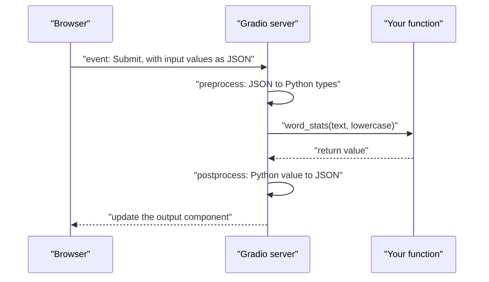

**Gradio** is a Python library for wrapping a function in a web interface. Where [Streamlit](/learn/application-development/streamlit) thinks in terms of a script that draws a page, Gradio thinks in terms of *functions with typed inputs and outputs*: you say "this function takes an image and returns a label", and Gradio builds the upload widget, the result display, a shareable link and an HTTP API for you. That model fits machine learning demos so well that Gradio is the default way to put a model in front of people on Hugging Face Spaces, and it is a quick way to build a chat UI for an LLM.

This lesson covers the two ways to build a Gradio app, the components you will use most, chat interfaces with streaming, and how to share and serve an app.

## The core idea: a function with typed inputs and outputs

Install it with `pip install gradio`. The smallest useful app is a `gr.Interface`:

```python
import gradio as gr

def word_stats(text: str, lowercase: bool) -> str:
    words = text.lower().split() if lowercase else text.split()
    return f"{len(words)} words, {len(set(words))} unique"

demo = gr.Interface(
    fn=word_stats,
    inputs=[gr.Textbox(label="Text", lines=4), gr.Checkbox(label="Lowercase first")],
    outputs=gr.Textbox(label="Stats"),
    title="Word statistics",
    examples=[["the cat sat on the mat", True]],
)

if __name__ == "__main__":
    demo.launch()
```

Run `python app.py` and open `http://127.0.0.1:7860`. The page shows a two-column layout: the inputs on the left with **Submit** and **Clear** buttons, the output on the right, and a clickable row of examples underneath. The order of `inputs` matches the order of the function's parameters, and the return value fills `outputs`.

What happens on each click is worth knowing, because it differs from Streamlit:



Only the function bound to the event runs, not the whole file. Each component converts between what the browser sends and the Python type your function receives: `gr.Image(type="pil")` hands you a PIL image, `gr.Image(type="numpy")` a NumPy array, and `gr.Image(type="filepath")` a path to a temporary file.

## Components

| Component | Your function receives or returns |
| --- | --- |
| `gr.Textbox` | `str` |
| `gr.Number`, `gr.Slider` | `float` or `int` |
| `gr.Checkbox` | `bool` |
| `gr.Dropdown`, `gr.Radio` | The selected choice (a list with `multiselect=True`) |
| `gr.Image` | PIL image, NumPy array or file path, set by `type` |
| `gr.Audio` | `(sample_rate, numpy_array)` or a file path |
| `gr.File` | A file path (or list of paths) |
| `gr.Dataframe` | A pandas DataFrame |
| `gr.Label` | Output only: a dict of class to confidence, shown as bars |
| `gr.JSON`, `gr.Markdown`, `gr.HTML` | Formatted output |
| `gr.Chatbot` | A list of `{"role": ..., "content": ...}` messages |

In `gr.Interface` you can also pass shortcut strings such as `"text"` or `"image"` instead of component objects, but explicit components let you set labels and options.

## Blocks: full control over layout and events

`gr.Interface` gives you one function and a fixed layout. For anything more, such as several buttons, intermediate results or outputs that feed other steps, use **`gr.Blocks`**. You lay out components inside a `with` block and wire events to functions explicitly:

```python
import gradio as gr

def summarise(text, max_words):
    words = text.split()
    return " ".join(words[: int(max_words)]) + ("..." if len(words) > max_words else "")

def count(text):
    return len(text.split())

with gr.Blocks(title="Summariser") as demo:
    gr.Markdown("## Summariser")
    with gr.Row():
        with gr.Column():
            source = gr.Textbox(label="Document", lines=8)
            max_words = gr.Slider(10, 200, value=50, step=10, label="Max words")
            run = gr.Button("Summarise", variant="primary")
        with gr.Column():
            summary = gr.Textbox(label="Summary", lines=8)
            n_words = gr.Number(label="Words in document")

    run.click(fn=summarise, inputs=[source, max_words], outputs=summary)
    source.change(fn=count, inputs=source, outputs=n_words)

if __name__ == "__main__":
    demo.launch()
```

`gr.Row`, `gr.Column`, `gr.Tab` and `gr.Accordion` arrange components. Each component has event listeners (`.click`, `.change`, `.submit`, `.upload` and others) that take `fn`, `inputs` and `outputs`. Listeners can be chained with `.then(...)` to run a second function after the first finishes, for example to clear the input box once a message has been sent.

| | `gr.Interface` | `gr.Blocks` |
| --- | --- | --- |
| Functions | One | Any number |
| Layout | Fixed: inputs left, outputs right | Rows, columns, tabs, accordions |
| Events | Submit button (or `live=True`) | Any listener on any component |
| Best for | A single model demo in ten lines | Multi-step tools, dashboards, custom chat UIs |

Per-user state in Blocks lives in `gr.State`, an invisible component: include it in both `inputs` and `outputs`, and your function receives the current value and returns the new one. Each browser session gets its own copy.

## Chat interfaces with streaming

For chatbots, `gr.ChatInterface` builds the whole UI: a message list, an input box, submit and stop buttons, and a way to retry or clear. You supply a function with the signature `fn(message, history)`, where `message` is the new user text and `history` is a list of earlier `{"role": ..., "content": ...}` dictionaries, the same shape the chat APIs expect.

To stream, make the function a **generator** that yields the reply so far. Gradio replaces the displayed message with each yielded value, so you yield the *accumulated* text, not the individual delta:

```python
import gradio as gr
from openai import OpenAI

MODEL = "your-chat-model"   # put a current model name from the provider's docs here
client = OpenAI()           # reads OPENAI_API_KEY from the environment

def respond(message, history):
    messages = [{"role": "system", "content": "You are a concise assistant."}]
    messages += [{"role": m["role"], "content": m["content"]} for m in history]
    messages.append({"role": "user", "content": message})

    stream = client.chat.completions.create(model=MODEL, messages=messages, stream=True)
    reply = ""
    for chunk in stream:
        if chunk.choices and chunk.choices[0].delta.content:
            reply += chunk.choices[0].delta.content
            yield reply              # the full text so far, not just the new piece

demo = gr.ChatInterface(respond, title="Assistant", examples=["Explain RAG in two sentences"])

if __name__ == "__main__":
    demo.launch()
```

The history is copied into fresh dictionaries with only `role` and `content` because Gradio may add extra keys (such as display metadata) that an LLM API would reject. Streaming works the same way in `gr.Interface` and `gr.Blocks`: any event function that is a generator updates its outputs on each `yield`.

> [!TIP]
> If your stream looks like it is stuttering, showing only one word at a time with each replacing the last, you are yielding the delta instead of the accumulated text. Yield the running total.

Extra controls go in `additional_inputs`, which ChatInterface places in an accordion below the chat and passes to your function after `history`: `gr.ChatInterface(respond, additional_inputs=[gr.Slider(0, 1, value=0.7, label="Temperature")])` calls `respond(message, history, temperature)`.

## Queuing and concurrency

LLM calls and model inference are slow, and a GPU can only serve so many requests at once. Gradio puts every event through a **queue**: requests wait their turn, the browser shows a position-in-queue indicator and progress, and long-running or streaming functions do not hit HTTP timeouts because results are pushed back to the browser.

You control concurrency per event or globally:

```python
demo.queue(default_concurrency_limit=4, max_size=50)
```

`default_concurrency_limit` is how many calls of each event function may run at the same time (if you do not set it, the default is 1, which suits a single GPU model but is needlessly cautious for functions that just wait on a remote API); `max_size` caps how many requests may wait before new ones are rejected. Individual listeners accept `concurrency_limit=` to override the default, for example a high limit for API-bound chat and 1 for a local GPU model.

> [!KEY]
> Match concurrency to the bottleneck. For a function that calls a hosted LLM API, the work happens elsewhere, so a higher limit is fine. For a local model on one GPU, running many requests at once can exhaust memory, so keep the limit low and let the queue absorb bursts.

## Sharing and deployment

| Option | How | Notes |
| --- | --- | --- |
| Local | `demo.launch()` | `http://127.0.0.1:7860`; `server_name="0.0.0.0"` to listen on all interfaces |
| Temporary public link | `demo.launch(share=True)` | Tunnels through Gradio's share servers to a random `gradio.live` URL that expires; your machine still does the work |
| Password protection | `demo.launch(auth=("user", "secret"))` | Simple login screen; not a substitute for real authentication |
| Hugging Face Spaces | Push `app.py` and `requirements.txt` to a Space with the Gradio SDK | Free CPU hardware, paid GPUs; secrets are set in the Space settings and arrive as environment variables |
| Inside FastAPI | `gr.mount_gradio_app(app, demo, path="/ui")` | Serve the UI alongside your existing [FastAPI](/learn/fastapi/fastapi-fundamentals) routes |

Every Gradio app also exposes an API. A **"Use via API"** link in the page footer documents the endpoints, and the `gradio_client` package can call them from Python:

```python
from gradio_client import Client

client = Client("http://127.0.0.1:7860/")
print(client.predict("the cat sat on the mat", True, api_name="/word_stats"))
```

```output
6 words, 5 unique
```

Recent Gradio versions name each endpoint after its function (older versions used `/predict` for an Interface); the "Use via API" page always shows the exact names. That makes a Space usable as a quick model API, though for production traffic you will want the purpose-built serving covered later in [Model serving](/learn/production-ai-systems/model-serving).

> [!WARNING]
> A `share=True` link is public to anyone who has it and runs code on your computer. Never share a link to an app that can read your files or spend money on your API key without adding `auth` first.

## Exercises

**1.** Write a `gr.Interface` for a function `classify(text)` that returns a dictionary of label to probability, such as `{"positive": 0.8, "negative": 0.2}`, and displays it as confidence bars.

<details>
<summary>Show solution</summary>

```python
import gradio as gr

def classify(text):
    score = min(len(text) / 100, 1.0)          # stand-in for a real model
    return {"positive": score, "negative": 1 - score}

demo = gr.Interface(fn=classify, inputs=gr.Textbox(label="Review"),
                    outputs=gr.Label(num_top_classes=2))
demo.launch()
```

`gr.Label` takes a dictionary of class names to confidences and draws them as sorted bars.

</details>

**2.** A colleague's streaming chat function contains `yield chunk.choices[0].delta.content`. Users report that the reply flickers and only ever shows a single word. Explain and fix it.

<details>
<summary>Show solution</summary>

Gradio replaces the output with each yielded value, so yielding only the delta shows one fragment at a time. Accumulate and yield the running total:

```python
reply = ""
for chunk in stream:
    if chunk.choices and chunk.choices[0].delta.content:
        reply += chunk.choices[0].delta.content
        yield reply
```

</details>

**3.** Using `gr.Blocks`, build a page with a text box, a "Translate to French" button and a "Translate to German" button, both writing to the same output box. Use a single function `translate(text, language)` and pass the language as a fixed value.

<details>
<summary>Show solution</summary>

```python
import gradio as gr

def translate(text, language):
    return f"[{language}] {text}"       # call your LLM here

with gr.Blocks() as demo:
    source = gr.Textbox(label="English")
    with gr.Row():
        fr = gr.Button("Translate to French")
        de = gr.Button("Translate to German")
    result = gr.Textbox(label="Translation")

    fr.click(lambda t: translate(t, "French"), inputs=source, outputs=result)
    de.click(lambda t: translate(t, "German"), inputs=source, outputs=result)

demo.launch()
```

Small lambdas bind the fixed argument, so both buttons share one function. A hidden `gr.State("French")` input would also work.

</details>

```quiz
[
  {
    "q": "When should you choose `gr.Blocks` over `gr.Interface`?",
    "options": [
      "Whenever the function returns text",
      "When you need several functions, custom layout or events beyond a single submit",
      "Only when deploying to Hugging Face Spaces",
      "When you want a public share link"
    ],
    "answer": 1,
    "why": "`gr.Interface` wraps one function in a fixed layout; `gr.Blocks` lets you arrange components freely and wire any event to any function."
  },
  {
    "q": "A Gradio chat function is a generator. What should it yield on each step?",
    "options": [
      "Only the newest token",
      "The full message history",
      "`None` until the reply is complete",
      "The reply text accumulated so far"
    ],
    "answer": 3,
    "why": "Gradio replaces the displayed output with each yielded value, so you yield the running total."
  },
  {
    "q": "Your app runs a local model on one GPU. Many users submit at once. What is the sensible setting?",
    "options": [
      "A low concurrency limit, letting the queue hold waiting requests",
      "Disable the queue so requests run immediately",
      "A very high concurrency limit so nobody waits",
      "Use `share=True` to spread load"
    ],
    "answer": 0,
    "why": "Running many requests at once on one GPU can exhaust memory; a low limit plus the queue serialises the work safely."
  },
  {
    "q": "What does `demo.launch(share=True)` do?",
    "options": [
      "Deploys the app permanently to Hugging Face Spaces",
      "Adds a login screen",
      "Creates a temporary public URL that tunnels to the app running on your machine",
      "Publishes the source code"
    ],
    "answer": 2,
    "why": "The app still runs locally; the share link is a temporary tunnel, so anyone with it can use your machine and any keys it holds."
  }
]
```
