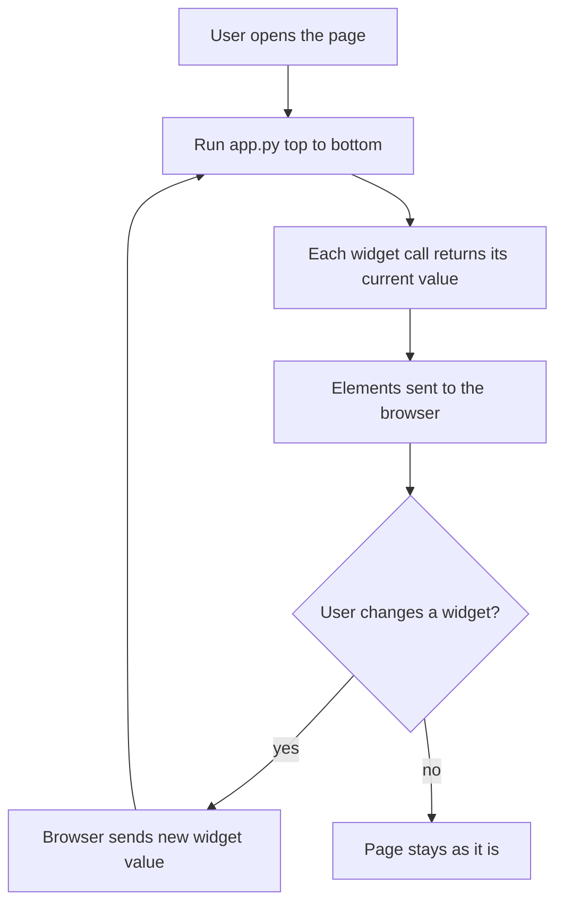

You have a model, a prompt chain or a RAG pipeline that works in a notebook, and now someone else needs to try it. Writing a web frontend from scratch means HTML, JavaScript, a build tool and an API layer before anyone sees a single button. **Streamlit** removes all of that: you write an ordinary Python script, run it with `streamlit run`, and it becomes an interactive web app in your browser. It is the fastest route from "it works on my machine" to "my team can use it", which is why so many internal AI tools, demos and evaluation dashboards are built with it.

The price of that speed is an unusual execution model. Once you understand it, everything else in Streamlit follows naturally; if you skip it, you will spend hours wondering why your variables keep resetting.

## Your first app

Install Streamlit into your project's virtual environment (`pip install streamlit`), save this as `app.py`, and run `streamlit run app.py`:

```python
import streamlit as st

st.title("Token estimator")

text = st.text_area("Paste some text")
words = len(text.split())

st.write(f"About {words} words, roughly {round(words * 1.3)} tokens.")

if st.button("Shout"):
    st.write(text.upper())
```

A browser tab opens at `http://localhost:8501` with a title, a text box, a line of output and a button. Every `st.` call adds an element to the page in the order it runs. There is no HTML, no route and no callback registration: the script *is* the page. (The 1.3 tokens-per-word factor is only a rough rule of thumb for English.)

## The execution model: rerun on every interaction

Here is the central idea. **Whenever the user interacts with a widget, Streamlit reruns your entire script from top to bottom.** On each run, every widget function returns its *current* value: `st.text_area` returns whatever is in the box now, and `st.button` returns `True` only on the single run triggered by the click.



The page is always a function of the script and the current widget values, which makes it easy to reason about. It has two consequences you must design for:

| Consequence | Symptom | Fix |
| --- | --- | --- |
| Ordinary variables are recreated on every run | A counter never gets past 1, a chat history disappears | Store values in `st.session_state` |
| Expensive code runs on every interaction | The model reloads each time you move a slider | Cache with `st.cache_resource` or `st.cache_data` |

You can see the first problem without Streamlit at all. The function below plays the role of a script that is rerun on each click; one counter is an ordinary local variable, the other lives in a dictionary that survives between runs, which is exactly what `st.session_state` is:

```python
session_state = {}

def script(clicked):
    count = 0                                  # recreated on every run
    session_state.setdefault("count", 0)       # created only on the first run
    if clicked:
        count += 1
        session_state["count"] += 1
    return count, session_state["count"]

for _ in range(3):
    print(script(clicked=True))
```

```output
(1, 1)
(1, 2)
(1, 3)
```

## Widgets and session state

Streamlit has a widget for most inputs you will need: `st.text_input`, `st.text_area`, `st.number_input`, `st.slider`, `st.selectbox`, `st.multiselect`, `st.checkbox`, `st.radio`, `st.toggle` and `st.button`. Each returns its value directly, so a temperature control is one line: `temperature = st.slider("Temperature", 0.0, 1.0, 0.7)`.

`st.session_state` is a dictionary-like object that persists for one browser session (one tab) across reruns. It supports both `st.session_state["key"]` and `st.session_state.key`:

```python
import streamlit as st

if "count" not in st.session_state:
    st.session_state.count = 0

if st.button("Add one"):
    st.session_state.count += 1

st.write("Count:", st.session_state.count)
```

Any widget given a `key=` argument also stores its value in session state under that key, so `st.text_input("Name", key="name")` can be read anywhere as `st.session_state.name`. Widgets accept an `on_change` (or, for buttons, `on_click`) callback, which runs *before* the rerun; that is the cleanest place to update state in response to an event.

When you want several inputs to be submitted together, so that typing in one box does not trigger a rerun, wrap them in a form:

```python
with st.form("settings"):
    model = st.selectbox("Model", ["small", "large"])
    max_tokens = st.number_input("Max tokens", 50, 4000, 500)
    submitted = st.form_submit_button("Apply")
```

## Caching: load a model once

Because the script reruns constantly, loading a model or reading a large file at the top of it would repeat that work on every click. Streamlit provides two decorators, and the difference between them matters.

| | `st.cache_data` | `st.cache_resource` |
| --- | --- | --- |
| For | Data: DataFrames, API responses, computed results | Resources: ML models, tokenizers, database connections, API clients |
| Returns | A fresh **copy** of the cached value on each call | The **same object** to every caller, across all sessions |
| Return value must be | Serialisable (picklable) | Anything |
| Mutating the result | Safe: you only change your copy | Affects every user, so avoid it or make it thread-safe |

```python
import pandas as pd
import streamlit as st
from transformers import pipeline

@st.cache_resource
def load_classifier():
    return pipeline("sentiment-analysis")      # downloaded and loaded once per server process

@st.cache_data(ttl=3600)
def load_reviews(path):
    return pd.read_csv(path)                   # re-read at most once an hour per distinct path

classifier = load_classifier()
reviews = load_reviews("reviews.csv")
```

Both caches key on the function's source code and its arguments, so `load_reviews("a.csv")` and `load_reviews("b.csv")` are cached separately. `ttl` (time to live, in seconds) and `max_entries` bound how stale or how large a cache can get, and `load_reviews.clear()` empties it.

> [!KEY]
> Models and clients go in `st.cache_resource`; data goes in `st.cache_data`. Per-user state, such as a conversation, goes in `st.session_state`, never in a cache, because caches are shared by every user of the app.

## Layout

By default elements stack vertically. A handful of containers cover most layouts:

| Container | Use |
| --- | --- |
| `st.sidebar` | Settings and navigation in a collapsible left panel |
| `st.columns(n)` | Side-by-side columns, for example input and output |
| `st.tabs([...])` | Alternative views of the same result |
| `st.expander("...")` | Detail hidden until clicked, such as retrieved sources |
| `st.container()` / `st.empty()` | A placeholder you fill or replace later in the script |

All of them work as context managers: `left, right = st.columns(2)` followed by `with left:` places everything in that block in the left column.

## A streaming chatbot

Streamlit has chat elements built in. `st.chat_input` draws an input pinned to the bottom of the page and returns the submitted text (or `None` on runs where nothing was sent). `st.chat_message(role)` is a container that renders a message bubble with an avatar for `"user"` or `"assistant"`. `st.write_stream` takes a generator of text chunks, writes them as they arrive with a typewriter effect, and returns the full text once the stream ends.

```python
import streamlit as st
from openai import OpenAI

MODEL = "your-chat-model"   # put a current model name from the provider's docs here

@st.cache_resource
def get_client():
    return OpenAI(api_key=st.secrets["OPENAI_API_KEY"])

client = get_client()
st.title("Chat")

if "messages" not in st.session_state:
    st.session_state.messages = []

# 1. Redraw the conversation so far (the script reruns on every message)
for msg in st.session_state.messages:
    with st.chat_message(msg["role"]):
        st.markdown(msg["content"])

# 2. Handle a new message
if prompt := st.chat_input("Ask something"):
    st.session_state.messages.append({"role": "user", "content": prompt})
    with st.chat_message("user"):
        st.markdown(prompt)

    def token_stream():
        stream = client.chat.completions.create(
            model=MODEL, messages=st.session_state.messages, stream=True
        )
        for chunk in stream:
            if chunk.choices and chunk.choices[0].delta.content:
                yield chunk.choices[0].delta.content

    with st.chat_message("assistant"):
        reply = st.write_stream(token_stream())
    st.session_state.messages.append({"role": "assistant", "content": reply})
```

Read it with the rerun model in mind. On every run the loop redraws the whole history from session state, because nothing on the page survives a rerun unless the script draws it again. A new message is drawn, the reply streamed, and both saved so the next run can redraw them. The streaming loop is the one from [Streaming responses](/learn/working-with-llms/streaming-responses).

`st.secrets` reads `.streamlit/secrets.toml` locally (keep it out of Git) and the secrets settings on hosted platforms. The key stays on the server: Streamlit runs your Python there and sends only rendered elements to the browser.

## File uploads and multipage apps

`st.file_uploader` returns an `UploadedFile`, a file-like object in memory, or `None` until the user picks a file:

```python
uploaded = st.file_uploader("Upload a document", type=["txt", "md"])
if uploaded is not None:
    text = uploaded.read().decode("utf-8")
    st.write(f"{uploaded.name}: {len(text)} characters")
```

Pass `accept_multiple_files=True` to get a list. For a "chat with your PDF" app you would feed the bytes into the loaders and chunkers from [Document parsing](/learn/rag-fundamentals/document-parsing), caching the expensive indexing step with `st.cache_data` keyed on the file contents.

As an app grows, split it into pages. The simplest way is a `pages/` folder next to your main script: each `.py` file in it becomes a page in the sidebar. For more control, define the pages explicitly in the entry script:

```python
pg = st.navigation([
    st.Page("chat.py", title="Chat"),
    st.Page("evaluate.py", title="Evaluation"),
])
pg.run()
```

`st.session_state` is shared across the pages of one session, so a setting chosen on one page is visible on another.

## Deployment and limits

| Option | Notes |
| --- | --- |
| Streamlit Community Cloud | Connect a GitHub repository; free for public apps; secrets set in the dashboard |
| Hugging Face Spaces | Supports Streamlit apps (via a Docker Space); convenient for ML demos next to your models |
| Your own container | `streamlit run app.py --server.port 8501` in a Docker image on any cloud; covered in [Docker fundamentals](/learn/docker-and-containers/docker-fundamentals) |

Streamlit is excellent for prototypes, internal tools and dashboards. Know its limits before you build a product on it:

- **Every session is a live connection with state held in server memory.** Many concurrent users means many Python sessions on your server, and state is lost if the server restarts.
- **Rerunning the whole script** gets slow and hard to reason about in large apps. `st.fragment` can rerun just part of a page, but complex interaction flows fight the model.
- **Limited control of the UI.** You get Streamlit's components and theming; pixel-precise design, custom interactions and mobile-first layouts need a custom frontend.
- **No public API.** The app is a UI, not a backend other clients can call. Put shared logic in a FastAPI service if other systems need it.

> [!WARNING]
> A public Streamlit app that calls a paid LLM API with your key will happily spend your money for anyone who finds it. Add authentication or rate limiting, and set spending limits with the provider, before you share the link widely.

## Exercises

**1.** A colleague's app shows a list of to-do items. Each time they add an item with a text input and an "Add" button, the previous item disappears and only the newest one is shown. Their code starts with `items = []`. Explain the bug and fix it.

<details>
<summary>Show solution</summary>

Clicking the button reruns the script, so `items = []` recreates an empty list every time. Keep the list in session state:

```python
import streamlit as st

if "items" not in st.session_state:
    st.session_state.items = []

new = st.text_input("New item")
if st.button("Add") and new:
    st.session_state.items.append(new)

for item in st.session_state.items:
    st.write("-", item)
```

</details>

**2.** For each of the following, choose `st.cache_resource`, `st.cache_data`, `st.session_state` or nothing: (a) a sentence-transformers embedding model; (b) the parsed result of a 200 MB CSV; (c) the current user's chat history; (d) the current time shown in the header.

<details>
<summary>Show solution</summary>

(a) `st.cache_resource`: a model is a shared resource that should be loaded once. (b) `st.cache_data`: it is data, and each caller gets a copy so one user's edits cannot affect another's. (c) `st.session_state`: it belongs to one user and must never be shared. (d) Nothing: it should be recomputed on every run.

</details>

**3.** Extend the chatbot so the sidebar has a "Clear conversation" button and a temperature slider whose value is passed to the API call.

<details>
<summary>Show solution</summary>

```python
with st.sidebar:
    temperature = st.slider("Temperature", 0.0, 1.0, 0.7)
    if st.button("Clear conversation"):
        st.session_state.messages = []
```

Place this after the `messages` initialisation and before the loop that redraws history, so the cleared list is used on the same run. Then add `temperature=temperature` to the `client.chat.completions.create(...)` call.

</details>

```quiz
[
  {
    "q": "What happens when a user moves a slider in a Streamlit app?",
    "options": [
      "Only the line containing the slider is re-executed",
      "The whole script reruns from top to bottom with the slider's new value",
      "A JavaScript callback updates the page without running Python",
      "Nothing until the user presses a submit button"
    ],
    "answer": 1,
    "why": "Streamlit's execution model reruns the entire script on every widget interaction; each widget call returns its current value."
  },
  {
    "q": "Where should you load a 1 GB embedding model in a Streamlit app?",
    "options": [
      "At the top of the script with no decorator",
      "Inside `st.session_state`",
      "In a function decorated with `st.cache_data`",
      "In a function decorated with `st.cache_resource`"
    ],
    "answer": 3,
    "why": "`st.cache_resource` returns the same object to every session without copying or pickling it, so the model loads once per server process."
  },
  {
    "q": "In the chatbot, why does the script loop over `st.session_state.messages` and redraw every message on each run?",
    "options": [
      "Because nothing drawn on a previous run survives a rerun unless the script draws it again",
      "Because `st.chat_message` only works inside a loop",
      "To send the history to the LLM",
      "To make the page load faster"
    ],
    "answer": 0,
    "why": "Each rerun builds the page from scratch, so the conversation must be kept in session state and redrawn every time."
  },
  {
    "q": "What does `st.write_stream` return?",
    "options": [
      "A generator of chunks",
      "`None`",
      "The full concatenated text once the stream finishes",
      "The number of tokens streamed"
    ],
    "answer": 2,
    "why": "It renders chunks as they arrive and then returns the complete text, which you typically append to the chat history."
  }
]
```
