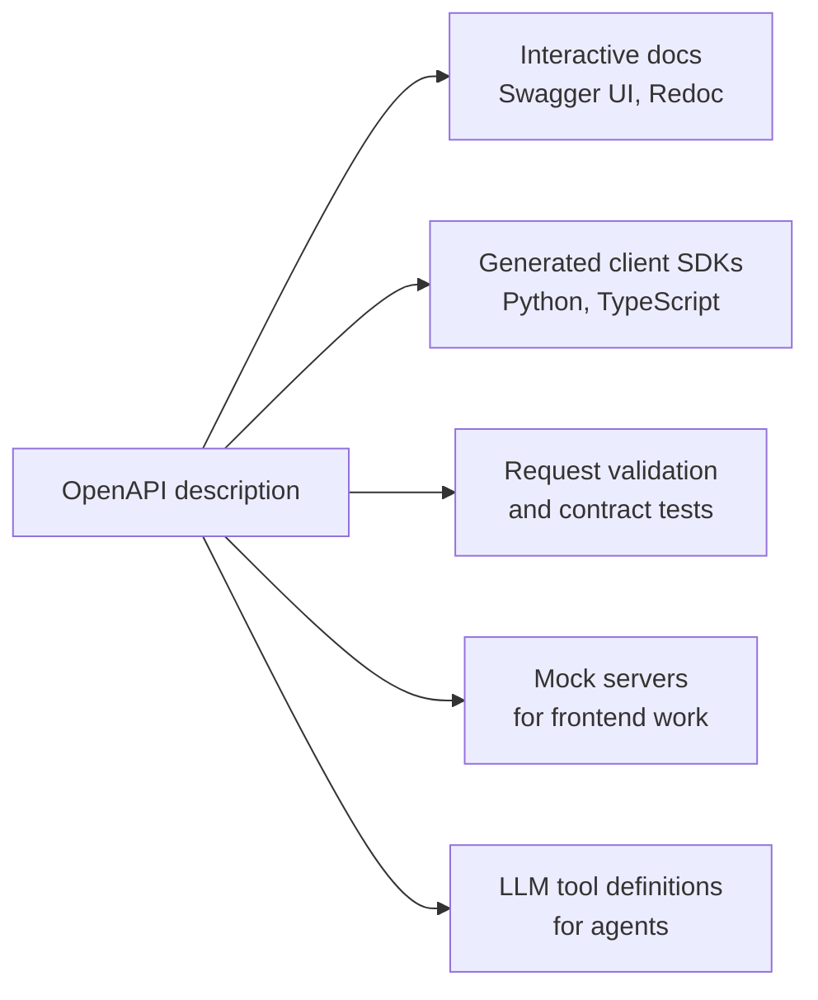
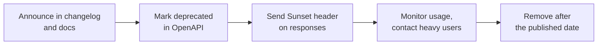

An API without documentation is a puzzle that every consumer has to solve by trial and error. For AI services the consumers are increasingly not only frontend developers and partner teams but also other programs: code generators that build typed clients, test tools, and LLM agents that read an API description to decide which tool to call and with what arguments. All of them work best from the same thing: a precise, machine-readable description of your API, kept in sync with the code, plus human-written guidance and a record of changes.

## What good API documentation contains

| Part | Answers | Form |
| --- | --- | --- |
| Reference | Every endpoint, parameter, field, type, status code | Generated from an OpenAPI description |
| Examples | What does a real request and response look like? | Copy-pasteable `curl` and SDK snippets |
| Guides | How do I authenticate, paginate, stream, handle errors? | Prose with code |
| Changelog | What changed, when, and does it break me? | Dated list of changes |
| Policies | Rate limits, versioning, deprecation timelines | Short reference pages |

The reference is the part a machine can produce. The others need a human, and they are what developers actually read first.

## OpenAPI

The **OpenAPI Specification** (formerly Swagger) is the standard format for describing HTTP APIs in YAML or JSON. Version 3.1 uses JSON Schema for data models, so the schemas you met in the [JSON lesson](/learn/backend-development/json) slot straight in. Here is a small but complete description:

```yaml
openapi: 3.1.0
info:
  title: Summaries API
  version: 1.2.0
  description: Summarise documents with a language model.
servers:
  - url: https://api.example.com/v1
paths:
  /summaries:
    post:
      operationId: createSummary
      summary: Summarise a text
      tags: [summaries]
      security:
        - bearerAuth: []
      requestBody:
        required: true
        content:
          application/json:
            schema:
              $ref: "#/components/schemas/SummaryRequest"
            example:
              text: "The transformer architecture replaced recurrence with attention..."
              max_words: 40
      responses:
        "201":
          description: Summary created
          content:
            application/json:
              schema:
                $ref: "#/components/schemas/Summary"
        "422":
          description: Validation failed
          content:
            application/problem+json:
              schema:
                $ref: "#/components/schemas/Problem"
components:
  securitySchemes:
    bearerAuth:
      type: http
      scheme: bearer
  schemas:
    SummaryRequest:
      type: object
      required: [text]
      properties:
        text: {type: string, minLength: 1}
        max_words: {type: integer, minimum: 10, maximum: 500, default: 100}
    Summary:
      type: object
      required: [id, summary]
      properties:
        id: {type: string, examples: ["smr_81f2"]}
        summary: {type: string}
    Problem:
      type: object
      properties:
        type: {type: string}
        title: {type: string}
        status: {type: integer}
```

The main pieces:

- **`paths`**: each URL and method, with parameters, request body and every response by status code.
- **`components/schemas`**: reusable data models, referenced with `$ref` so a `Summary` is defined once.
- **`securitySchemes`**: how clients authenticate (bearer token, API key in a header, OAuth 2.0 flows).
- **`operationId`**: a unique name per operation. Code generators turn it into method names, such as `client.create_summary(...)`, so choose it carefully.

## What a description enables

Because the description is structured data, tools can consume it:



The last arrow is worth noticing. The [function calling](/learn/working-with-llms/function-calling) schemas you give a model are JSON Schema too, so an OpenAPI operation with a clear `summary`, descriptive parameter names and documented constraints converts almost directly into a tool an agent can use. Vague descriptions produce vague tool calls.

Since a description is just data, you can also inspect it with a few lines of Python. Here is a reference table generated from a cut-down spec (as a dictionary, which is what `yaml.safe_load` or `json.load` would return):

```python
spec = {
    "paths": {
        "/summaries": {
            "post": {"operationId": "createSummary", "summary": "Summarise a text",
                     "responses": {"201": {}, "422": {}}},
            "get": {"operationId": "listSummaries", "summary": "List your summaries",
                    "responses": {"200": {}}},
        },
        "/summaries/{id}": {
            "get": {"operationId": "getSummary", "summary": "Fetch one summary",
                    "responses": {"200": {}, "404": {}}},
            "delete": {"operationId": "deleteSummary", "summary": "Delete a summary",
                       "responses": {"204": {}, "404": {}}, "deprecated": True},
        },
    }
}

for path, methods in spec["paths"].items():
    for method, op in methods.items():
        flag = " (deprecated)" if op.get("deprecated") else ""
        codes = ",".join(op["responses"])
        print(f"{method.upper():<7}{path:<17}{op['operationId']:<15}{codes:<9}{op['summary']}{flag}")
```

```output
POST   /summaries       createSummary  201,422  Summarise a text
GET    /summaries       listSummaries  200      List your summaries
GET    /summaries/{id}  getSummary     200,404  Fetch one summary
DELETE /summaries/{id}  deleteSummary  204,404  Delete a summary (deprecated)
```

## Code-first or design-first

There are two ways to keep the description and the server in sync.

| | Code-first | Design-first |
| --- | --- | --- |
| Source of truth | Your code; the framework generates OpenAPI | The OpenAPI file; code implements it |
| Example | FastAPI builds the description from type hints and Pydantic models | Write the YAML, review it, then implement and validate against it |
| Strength | Never out of date, little extra work | API is reviewed before code exists; teams work in parallel against mocks |
| Risk | The API shape becomes an accident of implementation | The file drifts from the code without contract tests |

FastAPI, the next module, is firmly code-first: it serves interactive docs at `/docs` with no extra work. Whichever you choose, add a check in CI that fails when the served description and the committed one disagree, or when a contract test finds a response that does not match its schema.

## Examples are the most-read part

Developers copy examples first and read schemas later, if ever. Make every example:

- **Complete and runnable**, including headers: a `curl` command someone can paste.
- **Realistic**: plausible IDs and text, not `"string"` and `0`.
- **Correct**: generate or test them in CI so they cannot rot.
- **Covering failure**: show a `422` and a `429` body, not only the happy path.

```bash
curl https://api.example.com/v1/summaries \
  -H "Authorization: Bearer $EXAMPLE_API_KEY" \
  -H "Content-Type: application/json" \
  -d '{"text": "The transformer architecture replaced recurrence with attention...", "max_words": 40}'
```

```json
{"id": "smr_81f2", "summary": "Transformers use attention instead of recurrence, enabling parallel training."}
```

> [!TIP]
> Document the behaviour that surprises people: whether timestamps are UTC, how `null` differs from a missing field, the maximum request size, which errors are retryable, and how long idempotency keys are remembered. These questions fill support inboxes when left unanswered.

## Changelogs and deprecation

Every change to a public API should appear in a dated **changelog**, with breaking changes impossible to miss:

```text
2025-03-10  v1.2.0
  Added    `language` field on POST /summaries (optional, defaults to "en").
  Added    `next_cursor` on GET /summaries; `offset` still works.
  Deprecated  DELETE /summaries/{id}; use POST /summaries/{id}/archive.
              Removal no earlier than 2025-09-10.

2025-01-20  v1.1.0
  Fixed    `created_at` now always includes a UTC offset.
```

Removing something takes a process, not a commit:



The `Sunset` response header (RFC 8594) tells clients programmatically when an endpoint will stop working, and a `Link` header can point to the migration guide:

```text
HTTP/1.1 204 No Content
Sunset: Wed, 10 Sep 2025 00:00:00 GMT
Link: <https://api.example.com/docs/migrations/archive>; rel="sunset"
```

Monitoring matters most: logs of which API keys still call a deprecated endpoint tell you whom to contact before removal day.

> [!KEY]
> Treat your API description as code: versioned, reviewed, tested in CI and published with every release. Documentation that can drift from reality eventually will.

## Exercises

**1.** Using the `spec` dictionary, print the `operationId` of every operation that can return `404`.

<details>
<summary>Show solution</summary>

```python
print([op["operationId"]
       for methods in spec["paths"].values()
       for op in methods.values()
       if "404" in op["responses"]])
```

```output
['getSummary', 'deleteSummary']
```

</details>

**2.** Classify each change as breaking or non-breaking for existing clients: (a) adding an optional `language` request field; (b) making `max_words` required; (c) adding a `tokens_used` field to responses; (d) changing `id` from string to integer; (e) adding a new value to a response enum.

<details>
<summary>Show solution</summary>

(a) Non-breaking. (b) Breaking: old requests without it now fail. (c) Non-breaking, provided clients ignore unknown fields. (d) Breaking. (e) Potentially breaking: clients with an exhaustive `match` or `switch` over the enum may crash on the new value, so document up front that enums may grow.

</details>

**3.** Write a function that compares two versions of a `required` list for a request schema and reports newly required fields (a breaking change). Test it with `["text"]` and `["text", "max_words"]`.

<details>
<summary>Show solution</summary>

```python
def newly_required(old, new):
    return sorted(set(new) - set(old))

print(newly_required(["text"], ["text", "max_words"]))
```

```output
['max_words']
```

Tools such as `oasdiff` perform this kind of check across a whole OpenAPI description and can run in CI.

</details>

```quiz
[
  {
    "q": "In an OpenAPI description, what is `components/schemas` used for?",
    "options": ["Listing the servers", "Defining reusable data models referenced with `$ref`", "Storing API keys", "Describing rate limits"],
    "answer": 1,
    "why": "Schemas are defined once under components and referenced wherever they appear, keeping the description consistent."
  },
  {
    "q": "What is the main advantage of a code-first approach such as FastAPI's?",
    "options": ["The API is reviewed before any code exists", "The description is generated from the code, so it cannot drift from the implementation", "It requires no type hints", "It produces faster servers"],
    "answer": 1,
    "why": "Generated descriptions stay in sync automatically. Design-first offers early review instead."
  },
  {
    "q": "Which change is breaking for existing clients?",
    "options": ["Adding an optional query parameter", "Adding a field to the response", "Removing a response field clients read", "Adding a new endpoint"],
    "answer": 2,
    "why": "Clients that read the removed field will fail. The other changes are additive."
  },
  {
    "q": "What does the `Sunset` response header communicate?",
    "options": ["The server's local time zone", "When the resource or endpoint is expected to stop being available", "The cache expiry time", "When the rate limit resets"],
    "answer": 1,
    "why": "RFC 8594 defines `Sunset` as the date after which the resource is expected to become unresponsive."
  }
]
```
