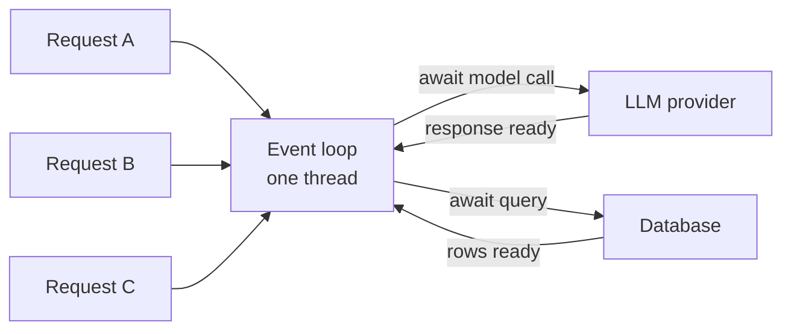
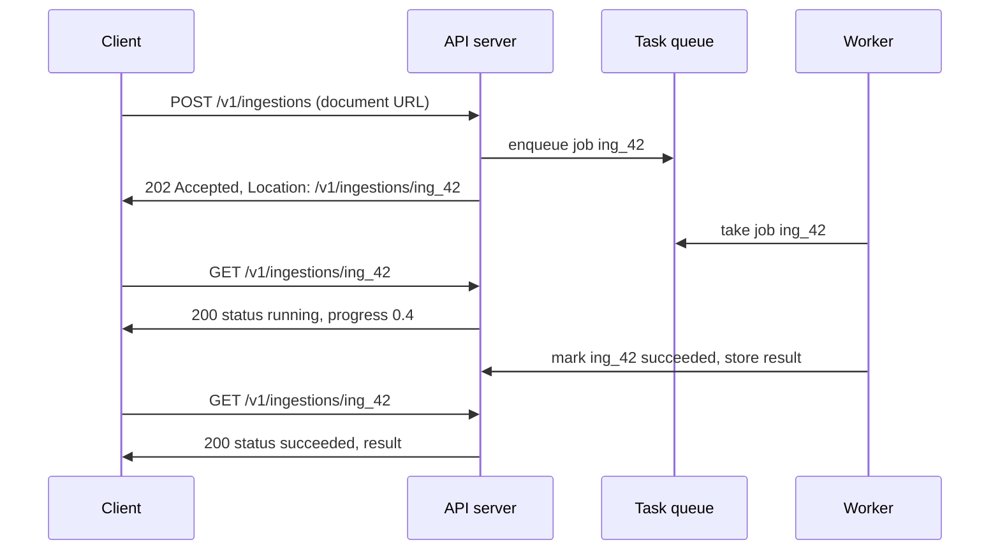

An LLM backend spends most of its life waiting. A chat request might take a few milliseconds of your CPU and several seconds waiting for the model provider. A document-ingestion request might need minutes of embedding calls. "Asynchronous" covers two different answers to that waiting. Inside one request, **async I/O** lets a single server process wait on many slow calls at once instead of one after another. Across requests, **asynchronous APIs** stop making the client wait at all: accept the work, return immediately, and deliver the result later by polling or webhook. You met `async` and `await` in [Asynchronous programming](/learn/python-programming/asynchronous-programming); this lesson applies them to servers.

## Why waiting dominates

Consider a server handling chat requests, each spending 2 seconds waiting for a model and 5 milliseconds computing. With one request at a time, the CPU sits idle more than 99 percent of the time and throughput is one request every 2 seconds.

There are two ways to overlap the waiting:

| Model | How it serves concurrent requests | Strength | Weakness |
| --- | --- | --- | --- |
| Threads / processes (WSGI servers such as Gunicorn with sync workers) | One OS thread or process per in-flight request | Simple blocking code; any library works | Each waiting request holds a thread; hundreds of slow LLM calls need hundreds of threads |
| Event loop (ASGI servers such as Uvicorn) | One thread runs many coroutines, switching whenever one awaits I/O | Thousands of concurrent waits cheaply; natural fit for streaming and WebSockets | One blocking call freezes every request in that process |

**WSGI** and **ASGI** are the Python interfaces between a server and your application code; Flask and Django grew up on WSGI, while FastAPI is built on ASGI, which is why it supports `async def` endpoints.



While request A awaits the provider, the loop runs B until it awaits the database, then C, then resumes A when its response arrives.

## Async I/O for LLM calls

The effect is easy to measure. Here five simulated model calls each take 0.3 seconds of waiting:

```python
import asyncio
import time

async def call_model(prompt):
    await asyncio.sleep(0.3)                # stands in for awaiting an HTTP response
    return f"answer to {prompt!r}"

async def sequential(prompts):
    return [await call_model(p) for p in prompts]

async def concurrent(prompts):
    return await asyncio.gather(*(call_model(p) for p in prompts))

prompts = [f"q{i}" for i in range(5)]
for fn in (sequential, concurrent):
    start = time.perf_counter()
    results = asyncio.run(fn(prompts))
    print(f"{fn.__name__:<10} {len(results)} results in {time.perf_counter() - start:.1f}s")
```

```output
sequential 5 results in 1.5s
concurrent 5 results in 0.3s
```

With a real provider you would use an async HTTP client, such as `httpx.AsyncClient` or the async client in an LLM SDK, so that each call yields to the event loop while waiting.

### The cardinal sin: blocking the loop

An `async def` function that calls something blocking (`time.sleep`, `requests.post`, a synchronous database driver, heavy CPU work such as tokenising a large file) does not yield. The whole event loop, and every other request in that process, stops until it returns.

```python
async def call_model_blocking(prompt):
    time.sleep(0.3)                         # blocking call inside a coroutine
    return f"answer to {prompt!r}"

async def concurrent_blocking(prompts):
    return await asyncio.gather(*(call_model_blocking(p) for p in prompts))

start = time.perf_counter()
asyncio.run(concurrent_blocking(prompts))
print(f"'concurrent' with a blocking call: {time.perf_counter() - start:.1f}s")
```

```output
'concurrent' with a blocking call: 1.5s
```

`gather` did nothing useful: the calls ran one after another. If you must use a blocking library, move the call to a thread with `await asyncio.to_thread(fn, ...)`; for heavy CPU work, use a process pool or a separate worker.

> [!WARNING]
> One `requests.post(...)` to an LLM provider inside an `async def` endpoint can serialise your entire server. It works in testing with one user and collapses under load. Use async clients in async code.

### Limiting concurrency

Unbounded concurrency has its own failure: fire 1,000 provider calls at once and you hit the provider's rate limit, get a wave of `429` errors, and retry them all together. A **semaphore** caps how many calls are in flight:

```python
async def embed_all(chunks, max_in_flight=3):
    sem = asyncio.Semaphore(max_in_flight)
    in_flight, peak = 0, 0

    async def embed(chunk):
        nonlocal in_flight, peak
        async with sem:
            in_flight += 1
            peak = max(peak, in_flight)
            await asyncio.sleep(0.05)
            in_flight -= 1
            return len(chunk)

    results = await asyncio.gather(*(embed(c) for c in chunks))
    return results, peak

results, peak = asyncio.run(embed_all(["chunk"] * 10))
print(len(results), "chunks embedded, peak concurrency", peak)
```

```output
10 chunks embedded, peak concurrency 3
```

## When the work outlives the request

Some jobs are too long for a single HTTP request: ingesting a 500-page PDF, running an evaluation suite, a batch of thousands of completions, an agent task with many steps. Holding the connection open for minutes is fragile: proxies and load balancers time out, the user closes the tab, a deploy restarts the server, and a client retry starts the whole job again.

The asynchronous request-reply pattern decouples them:



The API server only validates and enqueues, so it answers in milliseconds. **Workers**, separate processes that can scale independently, do the slow part. The job's state lives in a database or the queue's result store, not in the memory of any one process.

```python
import itertools

JOBS = {}
queue = asyncio.Queue()
_ids = itertools.count(42)

async def submit(document_url):                   # handler for POST /v1/ingestions
    job_id = f"ing_{next(_ids)}"
    JOBS[job_id] = {"id": job_id, "status": "queued", "progress": 0.0}
    await queue.put((job_id, document_url))
    return 202, {"Location": f"/v1/ingestions/{job_id}"}, JOBS[job_id]

async def get_status(job_id):                     # handler for GET /v1/ingestions/{id}
    return 200, dict(JOBS[job_id])

async def worker():
    while True:
        job_id, url = await queue.get()
        JOBS[job_id]["status"] = "running"
        for step in range(1, 5):                  # e.g. download, chunk, embed, index
            await asyncio.sleep(0.1)
            JOBS[job_id]["progress"] = step / 4
        JOBS[job_id].update(status="succeeded", result={"chunks": 128})
        queue.task_done()

async def demo():
    worker_task = asyncio.create_task(worker())
    status, headers, body = await submit("https://example.com/report.pdf")
    print(status, headers, body)
    while True:
        await asyncio.sleep(0.12)                 # client polling interval
        _, job = await get_status(body["id"])
        print(job)
        if job["status"] in ("succeeded", "failed"):
            break
    worker_task.cancel()

asyncio.run(demo())
```

```output
202 {'Location': '/v1/ingestions/ing_42'} {'id': 'ing_42', 'status': 'queued', 'progress': 0.0}
{'id': 'ing_42', 'status': 'running', 'progress': 0.25}
{'id': 'ing_42', 'status': 'running', 'progress': 0.5}
{'id': 'ing_42', 'status': 'running', 'progress': 0.75}
{'id': 'ing_42', 'status': 'succeeded', 'progress': 1.0, 'result': {'chunks': 128}}
```

In production the in-memory `asyncio.Queue` becomes a durable **task queue** so jobs survive restarts and run on separate machines. Common Python choices include Celery, RQ, Dramatiq and arq, backed by Redis or a message broker such as RabbitMQ; cloud platforms offer managed queues. Whichever you use, design for:

- **At-least-once delivery.** A worker can crash after finishing but before acknowledging, so the job runs again. Make jobs idempotent (for example, upsert by document ID rather than insert).
- **Retries with backoff**, and a **dead-letter queue** for jobs that keep failing, so one bad document does not loop forever.
- **Timeouts and cancellation**: a `DELETE /v1/ingestions/{id}` or `POST .../cancel` endpoint that workers check between steps.
- **Polling etiquette**: return a `Retry-After` header suggesting how long to wait between status checks.

## Webhooks: let the server call back

Polling wastes requests when jobs take a long time. A **webhook** reverses the direction: the client registers a URL, and your server sends an HTTP `POST` to it when the job finishes. It suits server-to-server integrations; browsers cannot receive webhooks.

```text
POST /hooks/ingestion HTTP/1.1
Host: customer.example.org
Content-Type: application/json
Webhook-Id: evt_9c1
Webhook-Timestamp: 1735689600
Webhook-Signature: v1=0f0b6c...

{"type": "ingestion.succeeded", "data": {"id": "ing_42", "chunks": 128}}
```

Because anyone can POST to a public URL, the receiver must verify that the call really came from you. The standard technique is an **HMAC signature** over the timestamp and body, using a secret shared when the webhook was registered:

```python
import hashlib
import hmac

SECRET = b"whsec_demo_shared_secret"

def sign(timestamp, body):
    return hmac.new(SECRET, f"{timestamp}.".encode() + body, hashlib.sha256).hexdigest()

def verify(timestamp, body, signature, now, tolerance=300):
    if abs(now - int(timestamp)) > tolerance:      # reject old messages: replay protection
        return False
    return hmac.compare_digest(sign(timestamp, body), signature)

body = b'{"type": "ingestion.succeeded", "data": {"id": "ing_42", "chunks": 128}}'
sig = sign("1735689600", body)
print(verify("1735689600", body, sig, now=1735689630))
print(verify("1735689600", body.replace(b"128", b"999"), sig, now=1735689630))
print(verify("1735689600", body, sig, now=1735699999))
```

```output
True
False
False
```

The tampered body fails, and so does a genuine message replayed hours later. Further rules for sending webhooks: retry failed deliveries with backoff for a day or more, include a unique event ID so receivers can ignore duplicates, keep payloads small (receivers can fetch details from your API), and never let a slow receiver block your own workers.

> [!KEY]
> Use async I/O to wait on many things at once within a request. Use 202 plus a job resource, with polling or webhooks, when the work should not live inside a request at all.

## Exercises

**1.** Rewrite `call_model_blocking` so that `concurrent_blocking` finishes in about 0.3 seconds without changing the blocking `time.sleep` itself.

<details>
<summary>Show solution</summary>

```python
def blocking_work(prompt):
    time.sleep(0.3)
    return f"answer to {prompt!r}"

async def call_model_threaded(prompt):
    return await asyncio.to_thread(blocking_work, prompt)

async def concurrent_threaded(prompts):
    return await asyncio.gather(*(call_model_threaded(p) for p in prompts))

start = time.perf_counter()
asyncio.run(concurrent_threaded(prompts))
print(f"{time.perf_counter() - start:.1f}s")
```

```output
0.3s
```

`asyncio.to_thread` runs the blocking call in a worker thread so the event loop stays free.

</details>

**2.** A worker crashes after inserting 128 chunks into the vector store but before marking the job done, and the queue redelivers the job. What goes wrong, and how do you make the job safe to rerun?

<details>
<summary>Show solution</summary>

The rerun inserts the 128 chunks a second time, so searches return duplicates. Make the job idempotent: give each chunk a deterministic ID (for example a hash of document ID plus chunk index) and **upsert** by that ID, or delete the document's existing chunks at the start of the job.

</details>

**3.** Why does the webhook signature cover the timestamp as well as the body?

<details>
<summary>Show solution</summary>

If only the body were signed, an attacker who captured one genuine webhook could resend it at any time and it would still verify. Signing the timestamp and rejecting old timestamps limits replays to a short window, and the receiver's duplicate check on the event ID closes that window.

</details>

```quiz
[
  {
    "q": "Inside an `async def` endpoint, what happens if you call `requests.post` to an LLM provider?",
    "options": ["It runs concurrently with other requests automatically", "It blocks the event loop, stalling every other request in that process until it returns", "Python converts it to an async call", "It raises a `SyntaxError`"],
    "answer": 1,
    "why": "`requests` is synchronous. It never yields to the loop, so nothing else can run while it waits."
  },
  {
    "q": "What is the correct response to `POST /v1/ingestions` when the job will take several minutes?",
    "options": ["`200 OK` after the job finishes", "`201 Created` with the final result", "`202 Accepted` with a `Location` header pointing to a job status resource", "`504 Gateway Timeout`"],
    "answer": 2,
    "why": "`202` means accepted for processing but not complete; the client polls the job resource for the result."
  },
  {
    "q": "Why should background jobs be idempotent?",
    "options": ["Task queues usually provide at-least-once delivery, so a job may run more than once", "It makes them faster", "Workers cannot read databases otherwise", "HTTP requires it"],
    "answer": 0,
    "why": "Crashes and redeliveries mean a job can be executed again; idempotent jobs produce the same final state."
  },
  {
    "q": "What does `asyncio.Semaphore(5)` achieve when embedding thousands of chunks?",
    "options": ["Runs the calls in five separate processes", "Ensures at most five calls are in flight at once, avoiding provider rate limits", "Retries each call five times", "Splits the chunks into five batches"],
    "answer": 1,
    "why": "The semaphore bounds concurrency while still overlapping the waiting of up to five calls."
  }
]
```
