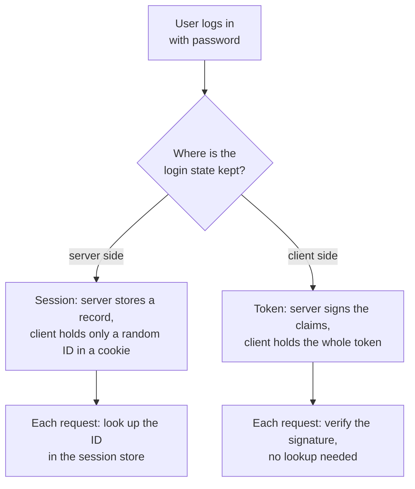
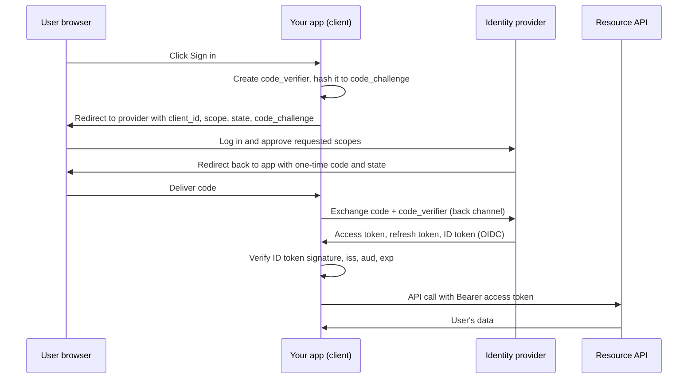

**Authentication** answers one question: *who is making this request?* HTTP is stateless, so every request must carry proof of identity, and your server must check it every time. For an AI backend the stakes are concrete: an unauthenticated endpoint that calls an LLM is an open tap on your provider bill, and a leaked conversation history is a privacy incident. This lesson covers the main mechanisms (sessions, tokens, API keys, JWTs, OAuth 2.0 and OpenID Connect) and the one job you must never get wrong: storing passwords.

## Sessions versus tokens

There are two broad ways to remember that a user has logged in.



| | Server-side session | Self-contained token (JWT) |
| --- | --- | --- |
| Client holds | Random session ID, usually a cookie | Signed token with claims |
| Server stores | Session record (DB or Redis) | Nothing per user, just the signing key |
| Revoke one login | Delete the record, instantly effective | Hard; token stays valid until it expires |
| Fits | Browser apps on your own domain | Service-to-service calls, many independent services |
| Main risk | Store becomes a dependency | Long-lived tokens that cannot be recalled |

Neither is universally better. A common, sound default for a web product is a session cookie (`HttpOnly`, `Secure`, `SameSite`) for the browser and API keys or short-lived tokens for programmatic clients.

## Storing passwords: never plain hashes

If you accept passwords, you store something that lets you check them later. Never the password itself, and **never a plain fast hash** such as SHA-256:

```python
import hashlib

print(hashlib.sha256(b"password123").hexdigest())
```

```output
ef92b778bafe771e89245b89ecbc08a44a4e166c06659911881f383d4473e94f
```

That output is the same for every user with that password, on every system, forever. Attackers who steal your database look such hashes up in precomputed tables, and for unlisted passwords a GPU can try billions of SHA-256 guesses per second. A password hash must be:

1. **Salted**: a random value per user is mixed in, so identical passwords produce different hashes and precomputed tables are useless.
2. **Slow and memory-hard**: each guess costs real time and memory, which cripples bulk guessing.

The algorithms built for this are **Argon2id** (the current recommendation of OWASP's password storage guidance), **scrypt** and **bcrypt**. Python's standard library includes scrypt:

```python
import hmac
import os

def hash_password(password: str) -> str:
    salt = os.urandom(16)
    digest = hashlib.scrypt(password.encode(), salt=salt, n=2**14, r=8, p=1)
    return f"scrypt${salt.hex()}${digest.hex()}"

def verify_password(password: str, stored: str) -> bool:
    _, salt_hex, digest_hex = stored.split("$")
    digest = hashlib.scrypt(password.encode(), salt=bytes.fromhex(salt_hex), n=2**14, r=8, p=1)
    return hmac.compare_digest(digest.hex(), digest_hex)

a = hash_password("password123")
b = hash_password("password123")
print(a == b)                                  # different salts
print(verify_password("password123", a))
print(verify_password("password124", a))
```

```output
False
True
False
```

In production, prefer a maintained library that stores its parameters inside the hash string and lets you raise the cost later, such as `argon2-cffi` or `bcrypt`:

```python
from argon2 import PasswordHasher      # pip install argon2-cffi

ph = PasswordHasher()
stored = ph.hash("password123")        # '$argon2id$v=19$m=...,t=...,p=...$salt$hash'
ph.verify(stored, "password123")       # returns True, raises VerifyMismatchError if wrong
```

> [!WARNING]
> Compare secrets with `hmac.compare_digest`, not `==`. Ordinary comparison stops at the first differing character, and the timing difference can, in principle, leak how much of a guess was correct.

## API keys

Programmatic clients, such as another team's service or a customer's script, usually authenticate with an **API key** sent in a header, like the keys you used for LLM providers. Treat them like passwords:

- Generate them with a cryptographically secure source: `secrets.token_urlsafe(32)`.
- Show the full key **once**, at creation. Store only a hash (a fast hash such as SHA-256 is acceptable here, because the key is long and random, so guessing is hopeless).
- Add a recognisable prefix such as `sk_live_` so leaked keys are easy to spot by secret scanners.
- Support several keys per account, so keys can be rotated without downtime, and revoked individually.

```python
import secrets

def new_api_key():
    key = "sk_live_" + secrets.token_urlsafe(24)
    return key, hashlib.sha256(key.encode()).hexdigest()

key, key_hash = new_api_key()
print(key[:8], len(key))
print(hmac.compare_digest(hashlib.sha256(key.encode()).hexdigest(), key_hash))
```

```output
sk_live_ 40
True
```

## JSON Web Tokens

A **JWT** is three base64url-encoded parts joined by dots: `header.payload.signature`. The header names the signing algorithm; the payload holds **claims** such as the subject (`sub`), issued-at time (`iat`) and expiry (`exp`); the signature proves that whoever holds the key produced exactly this header and payload.

Here is a sample token. Decoding its first two parts needs no key at all:

```python
import base64
import json

token = ("eyJhbGciOiJIUzI1NiIsInR5cCI6IkpXVCJ9."
         "eyJzdWIiOiJ1c2VyXzEyMyIsIm5hbWUiOiJBZGEiLCJyb2xlIjoiYW5hbHlzdCIsImlhdCI6MTczNTY4OTYwMCwiZXhwIjoxNzM1NjkzMjAwfQ."
         "exuYTwYfNyEI3mSLhwI6NTMpV9h63CZllSWcvoktDpQ")

def b64url_decode(part):
    return base64.urlsafe_b64decode(part + "=" * (-len(part) % 4))   # restore stripped padding

header, payload, signature = token.split(".")
print(json.loads(b64url_decode(header)))
print(json.loads(b64url_decode(payload)))
```

```output
{'alg': 'HS256', 'typ': 'JWT'}
{'sub': 'user_123', 'name': 'Ada', 'role': 'analyst', 'iat': 1735689600, 'exp': 1735693200}
```

> [!KEY]
> A JWT is **signed, not encrypted**. Anyone who sees the token can read every claim. Never put secrets or sensitive personal data in a payload.

Verification recomputes the signature with the key. With HS256 that is an HMAC-SHA256 over `header.payload`:

```python
signing_input = f"{header}.{payload}".encode()
expected = base64.urlsafe_b64encode(
    hmac.new(b"demo-secret", signing_input, hashlib.sha256).digest()
).rstrip(b"=").decode()
print(hmac.compare_digest(expected, signature))
```

```output
True
```

In real code, use a library such as PyJWT and always pass the list of algorithms you accept:

```python
import jwt   # pip install pyjwt

try:
    jwt.decode(token, "demo-secret", algorithms=["HS256"])
except jwt.ExpiredSignatureError as e:
    print("rejected:", e)

claims = jwt.decode(token, "demo-secret", algorithms=["HS256"], options={"verify_exp": False})
print(claims["sub"])
```

```output
rejected: Signature has expired
user_123
```

The `exp` claim (1 January 2025, 01:00 UTC) is in the past, so the library refuses it, as it should. Recent PyJWT versions also print an `InsecureKeyLengthWarning` here, because an 11-byte secret is far too short for HS256; a real secret should be at least 32 random bytes.

### JWT pitfalls

| Pitfall | Consequence | Defence |
| --- | --- | --- |
| Trusting the token's own `alg` header | `alg: none` or algorithm-confusion attacks bypass the signature | Pin `algorithms=[...]` on decode |
| Decoding without verifying | Anyone can forge claims like `"role": "admin"` | Always verify signature, `exp`, `iss`, `aud` |
| Long expiry | A stolen token works for days | Short-lived access tokens (minutes) plus refresh tokens |
| No revocation plan | Logging out does not end access | Short expiry, or a deny-list of token IDs (`jti`) |
| Weak HS256 secret | Secret can be brute-forced offline from any token | Long random secret, or asymmetric RS256/ES256 |
| Storing in `localStorage` | Any injected script can steal it | Prefer `HttpOnly` cookies in browsers |

## OAuth 2.0 and OpenID Connect

**OAuth 2.0** solves delegation: letting an application act on a user's behalf at another service (read their Google Drive, post to their GitHub) without ever seeing their password. **OpenID Connect** (OIDC) is a thin layer on top that adds login: alongside the access token it returns an **ID token**, a JWT that says who the user is. "Sign in with Google" is OIDC.

The flow for web and mobile apps is the **authorization code flow with PKCE** (Proof Key for Code Exchange):



Key points to remember:

- The password is typed only at the identity provider; your app never sees it.
- The **code** travels through the browser, but it is useless without the `code_verifier`, which never left your app. That is what PKCE adds.
- The **`state`** value is checked on return to stop an attacker from injecting their own login (a form of CSRF).
- **Scopes** limit what the access token may do, such as read-only calendar access.
- For machine-to-machine calls with no user, the **client credentials** flow exchanges a client ID and secret for a token directly.

Do not implement an identity provider yourself. Use a managed one or a well-tested library, and focus your effort on verifying tokens correctly.

## Exercises

**1.** Decode the payload of this token and say whether it would be safe to trust its `role` claim without verifying the signature: `eyJhbGciOiJub25lIn0.eyJzdWIiOiJ1c2VyXzkiLCJyb2xlIjoiYWRtaW4ifQ.`

<details>
<summary>Show solution</summary>

```python
h, p, s = "eyJhbGciOiJub25lIn0.eyJzdWIiOiJ1c2VyXzkiLCJyb2xlIjoiYWRtaW4ifQ.".split(".")
print(json.loads(b64url_decode(h)), json.loads(b64url_decode(p)), repr(s))
```

```output
{'alg': 'none'} {'sub': 'user_9', 'role': 'admin'} ''
```

It is unsigned (`alg: none`, empty signature). Anyone can write this token, so the `role` claim is worthless. A server that pins `algorithms=["HS256"]` rejects it.

</details>

**2.** A colleague proposes storing passwords as `sha256(salt + password)` with a per-user salt. What is still wrong?

<details>
<summary>Show solution</summary>

The salt defeats precomputed tables, but SHA-256 is designed to be fast. An attacker with the database can still try billions of guesses per second per GPU against each user. Use a deliberately slow, memory-hard algorithm: Argon2id, scrypt or bcrypt.

</details>

**3.** Why does an API key store only a SHA-256 hash, when the lesson says SHA-256 is unacceptable for passwords?

<details>
<summary>Show solution</summary>

Slow hashing exists to protect low-entropy secrets that humans choose. A 24-byte key from `secrets` has around 192 bits of randomness, so guessing it is infeasible at any speed. The hash only needs to prevent a database leak from revealing usable keys, and a fast hash makes the per-request lookup cheap.

</details>

```quiz
[
  {
    "q": "What is true of a standard signed JWT?",
    "options": ["Its payload is encrypted and unreadable without the key", "Anyone can read its payload; the signature only proves it was not altered", "It can be revoked instantly by the server", "It must be stored in `localStorage`"],
    "answer": 1,
    "why": "The header and payload are just base64url-encoded JSON. The signature protects integrity, not confidentiality."
  },
  {
    "q": "Which is an appropriate way to store user passwords?",
    "options": ["SHA-256 of the password", "AES-encrypted password with the key in config", "Argon2id with a per-user salt", "MD5 with a global salt"],
    "answer": 2,
    "why": "Argon2id is salted, slow and memory-hard by design. Encryption is reversible, and fast hashes allow huge guessing rates."
  },
  {
    "q": "In the authorization code flow with PKCE, what prevents a stolen authorization code from being used by an attacker?",
    "options": ["The code expires after a year", "Exchanging it requires the `code_verifier`, which never left the legitimate app", "The code is encrypted with the user's password", "The `state` parameter"],
    "answer": 1,
    "why": "Only the app that created the `code_challenge` holds the matching `code_verifier`. The `state` parameter defends against a different attack, login CSRF."
  },
  {
    "q": "What does OpenID Connect add on top of OAuth 2.0?",
    "options": ["Password hashing", "An ID token that identifies the user, turning delegation into login", "Rate limiting", "Encrypted cookies"],
    "answer": 1,
    "why": "OAuth 2.0 grants access to resources. OIDC adds a standard ID token so the client learns who the user is."
  }
]
```
