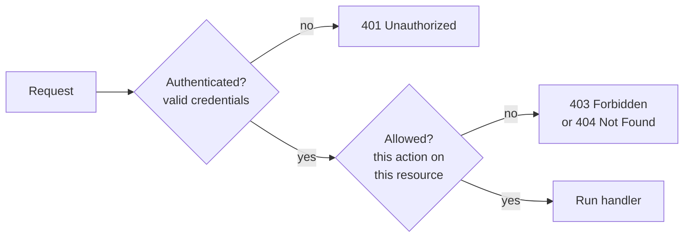
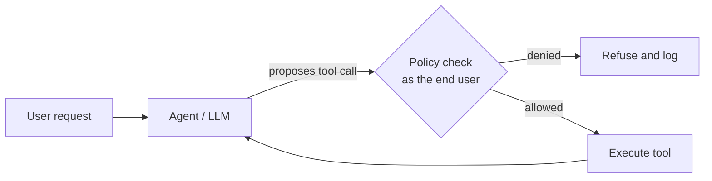

[Authentication](/learn/backend-development/authentication) tells you *who* is calling. **Authorization** decides *what they may do*. The two are easy to confuse because they often sit in the same few lines of code, but they fail differently: a broken login is usually obvious, while a broken permission check silently hands user A's data to user B. Broken access control sits at or near the top of the OWASP list of web application risks, year after year. AI systems add a new twist: an LLM agent with tools acts on behalf of a user, and it must never be able to do more than that user could.

## Authentication versus authorization



| | Authentication | Authorization |
| --- | --- | --- |
| Question | Who are you? | May you do this? |
| Input | Credentials: password, token, key | Identity + action + resource + context |
| Failure status | `401 Unauthorized` (misnamed; it means unauthenticated) | `403 Forbidden` |
| Checked | Once per request | At every action, often several times per request |

## Role-based access control (RBAC)

In **RBAC**, permissions are granted to **roles**, and users are assigned roles. You reason about a handful of roles instead of thousands of individual users.

```python
ROLE_PERMISSIONS = {
    "viewer": {"documents:read"},
    "editor": {"documents:read", "documents:write"},
    "admin": {"documents:read", "documents:write", "documents:delete", "users:manage"},
}

def has_permission(user, permission):
    return any(permission in ROLE_PERMISSIONS[role] for role in user["roles"])

ada = {"id": "u1", "roles": ["editor"]}
print(has_permission(ada, "documents:write"))
print(has_permission(ada, "documents:delete"))
```

```output
True
False
```

Check **permissions**, not role names. Code that says `if "admin" in user["roles"]` scatters policy throughout the codebase; adding a "support" role then means hunting down every such line. `has_permission(user, "documents:delete")` keeps the mapping in one place.

RBAC is simple, auditable and enough for many applications. It struggles when decisions depend on the specific resource or circumstances: "editors may edit documents *in their own department*, *during business hours*, *unless the document is locked*". Encoding that as roles leads to role explosion: `editor-finance`, `editor-finance-locked-override`, and so on.

## Attribute-based access control (ABAC)

**ABAC** decides using attributes of the **subject** (user), the **resource**, the **action** and the **environment**. A policy is a function of all four.

```python
def can_edit(user, doc, env):
    return (
        "documents:write" in {p for r in user["roles"] for p in ROLE_PERMISSIONS[r]}
        and doc["department"] == user["department"]
        and not doc["locked"]
        and (doc["classification"] != "restricted" or env["network"] == "corporate")
    )

user = {"id": "u1", "roles": ["editor"], "department": "finance"}
docs = [
    {"id": "d1", "department": "finance", "locked": False, "classification": "internal"},
    {"id": "d2", "department": "legal", "locked": False, "classification": "internal"},
    {"id": "d3", "department": "finance", "locked": False, "classification": "restricted"},
]
for doc in docs:
    print(doc["id"], can_edit(user, doc, {"network": "home"}), can_edit(user, doc, {"network": "corporate"}))
```

```output
d1 True True
d2 False False
d3 False True
```

| | RBAC | ABAC |
| --- | --- | --- |
| Decision based on | User's roles | Any attributes of user, resource, action, environment |
| Strength | Simple to understand and audit | Expressive, fine-grained |
| Weakness | Role explosion for fine rules | Harder to audit ("who can see this?" needs evaluation) |
| Typical use | Most SaaS products, admin panels | Regulated data, multi-tenant platforms, document-level RAG |

Real systems usually combine them: roles grant broad capabilities, and attribute checks narrow them per resource. When policies grow large, teams move them out of application code into a dedicated policy engine (Open Policy Agent and Cedar are well-known examples) so they can be reviewed and tested on their own.

## Object-level authorization and IDOR

The most common real-world authorization bug is not a missing role check; it is a missing **ownership** check. Consider:

```text
GET /v1/conversations/c_1042
Authorization: Bearer <token for user A>
```

If the handler loads conversation `c_1042` by ID and returns it, any logged-in user can read anyone's conversation by changing the number. This is an **Insecure Direct Object Reference** (IDOR), called Broken Object Level Authorization in the OWASP API Security list, where it ranks first.

```python
CONVERSATIONS = {
    "c_1042": {"owner_id": "u2", "messages": ["my medical question..."]},
    "c_1043": {"owner_id": "u1", "messages": ["summarise this contract"]},
}

def get_conversation_vulnerable(user, conv_id):
    return 200, CONVERSATIONS.get(conv_id)

def get_conversation(user, conv_id):
    conv = CONVERSATIONS.get(conv_id)
    if conv is None or conv["owner_id"] != user["id"]:
        return 404, {"error": "not found"}
    return 200, conv

alice = {"id": "u1"}
print(get_conversation_vulnerable(alice, "c_1042"))
print(get_conversation(alice, "c_1042"))
print(get_conversation(alice, "c_1043"))
```

```output
(200, {'owner_id': 'u2', 'messages': ['my medical question...']})
(404, {'error': 'not found'})
(200, {'owner_id': 'u1', 'messages': ['summarise this contract']})
```

Two details in the fixed version matter:

- It returns **`404`, not `403`**, for someone else's object. A `403` would confirm that `c_1042` exists, which leaks information. Use `403` when the user may know the resource exists but cannot perform this action on it.
- The safest pattern scopes the **query** itself: `SELECT ... WHERE id = :id AND owner_id = :user_id`. Then forgetting the check is impossible because the data never loads.

> [!WARNING]
> Unguessable IDs (UUIDs, random strings) make IDOR harder to exploit but do not fix it. IDs leak through logs, URLs, shared links and browser history. Every object access needs an explicit check.

## Least privilege

**Least privilege** means every user, service and credential gets the minimum access needed for its job, and no more:

- API keys scoped to specific actions (`read-only`, one project) rather than full account access.
- Database users for the web app that cannot drop tables.
- Short-lived credentials instead of permanent ones.
- Admin powers granted temporarily, with an audit log, rather than permanently.

When something is compromised, least privilege limits how far the damage spreads.

## Authorization in AI systems

LLM features create new paths to data, and each must respect the same rules.

- **Tool calls.** When an agent calls `delete_file(id)` or `send_email(...)`, the tool must run with the *end user's* permissions and perform the same object-level checks as the API endpoint would. The model's output is untrusted input: a prompt injection in a retrieved web page can ask the model to call a tool, and the authorization layer is what stops it.
- **Retrieval (RAG).** A vector search over all company documents will happily retrieve a document the user may not read and put it in the prompt. Filter by access-control attributes (owner, team, tenant) inside the search query, not after the model has seen the text.
- **Multi-tenancy.** Every query, cache key and vector index lookup must include the tenant ID. A cache keyed only on the prompt can serve one customer's answer to another.



> [!KEY]
> Enforce authorization on the server, at the point where data is accessed, using the identity of the human the request is for. Never rely on the client, the UI hiding a button, or the model "knowing" it should not do something.

## Exercises

**1.** Add a `support` role that can read documents and manage users but not write or delete documents. Which existing function needs to change?

<details>
<summary>Show solution</summary>

```python
ROLE_PERMISSIONS["support"] = {"documents:read", "users:manage"}
sam = {"id": "u7", "roles": ["support"]}
print(has_permission(sam, "users:manage"), has_permission(sam, "documents:write"))
```

```output
True False
```

No function changes, only the mapping. That is the benefit of checking permissions rather than role names.

</details>

**2.** Write `delete_conversation(user, conv_id)` that lets owners delete their own conversations and lets users with the `admin` role delete any conversation, returning `404` for non-existent or invisible ones.

<details>
<summary>Show solution</summary>

```python
def delete_conversation(user, conv_id):
    conv = CONVERSATIONS.get(conv_id)
    is_admin = "admin" in user.get("roles", [])
    if conv is None or (conv["owner_id"] != user["id"] and not is_admin):
        return 404, None
    del CONVERSATIONS[conv_id]
    return 204, None

print(delete_conversation({"id": "u1"}, "c_1042"))
print(delete_conversation({"id": "u9", "roles": ["admin"]}, "c_1042"))
print(delete_conversation({"id": "u9", "roles": ["admin"]}, "c_1042"))
```

```output
(404, None)
(204, None)
(404, None)
```

</details>

**3.** A RAG chatbot retrieves the top five chunks from a shared index, then removes chunks the user may not read before building the prompt. What problem remains compared with filtering inside the search?

<details>
<summary>Show solution</summary>

Post-filtering can leave the user with fewer than five chunks, or none, even though permitted relevant documents exist further down the ranking, so answer quality drops unpredictably. It also means forbidden content passes through more of the system (logs, caches, debugging traces). Filtering inside the search returns the top five *permitted* chunks.

</details>

```quiz
[
  {
    "q": "A logged-in user requests `GET /invoices/981`, which belongs to another customer. What is the best response?",
    "options": ["`200` with the invoice", "`401 Unauthorized`", "`404 Not Found`", "`500 Internal Server Error`"],
    "answer": 2,
    "why": "The user is authenticated, so `401` is wrong. `404` avoids confirming that another customer's invoice exists."
  },
  {
    "q": "Which requirement is a natural fit for ABAC rather than plain RBAC?",
    "options": ["Admins can manage users", "Viewers can read documents", "Editors can edit only unlocked documents in their own department", "Anonymous users can see the pricing page"],
    "answer": 2,
    "why": "The decision depends on attributes of the resource (department, locked) relative to the user, which roles alone express poorly."
  },
  {
    "q": "Why do random UUIDs not fix an IDOR vulnerability?",
    "options": ["UUIDs can collide frequently", "IDs leak through logs, links and history, and the server still never checks ownership", "UUIDs are slower to look up", "Clients cannot store UUIDs"],
    "answer": 1,
    "why": "Hard-to-guess IDs reduce exploitation but the missing ownership check remains. Anyone who obtains the ID gets the data."
  },
  {
    "q": "An agent's `send_email` tool is triggered by text hidden in a retrieved web page. Which control is most effective?",
    "options": ["Asking the model in the system prompt not to obey web pages", "Authorizing each tool call server-side with the end user's permissions and policies", "Using a larger model", "Hiding the tool in the UI"],
    "answer": 1,
    "why": "Model instructions are not a security boundary. Server-side authorization of every tool call is."
  }
]
```
