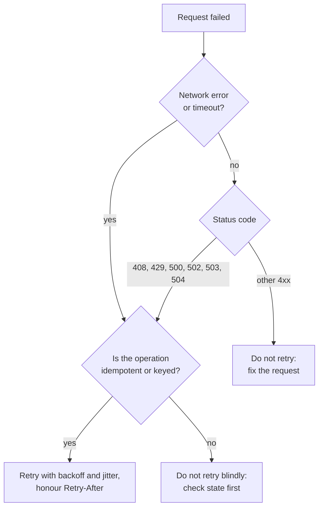

Errors are part of your API's interface, not an afterthought. A client cannot fix a request it does not understand the failure of, and an operator cannot fix a bug nobody can trace. AI backends fail more often and in more ways than typical web services: the model provider rate-limits you, times out, returns malformed JSON or is briefly down, and a request may fail halfway through a multi-step agent run. This lesson covers how to report errors consistently, how to keep internal details out of responses, and how clients and servers should retry safely. It builds on Python [exception handling](/learn/python-programming/exception-handling).

## Three audiences for every error

| Audience | Needs | Gets it from |
| --- | --- | --- |
| Client code | A stable, machine-readable reason to branch on | Status code and an error `type` |
| Developer calling your API | A human explanation of what to change | `title`, `detail`, field errors |
| Your on-call engineer | Full context: stack trace, inputs, upstream responses | Server logs, linked by an ID |

The first two go in the response. The third stays on your side. Mixing them up, by putting a stack trace in a response, is both unhelpful to the client and a security risk.

## A consistent error body: problem details

If every endpoint invents its own error shape (`{"error": "..."}` here, `{"message": ..., "code": ...}` there), every client needs special cases. **RFC 9457, Problem Details for HTTP APIs**, defines a standard JSON shape with the media type `application/problem+json`:

```json
{
  "type": "https://api.example.com/problems/quota-exceeded",
  "title": "Monthly token quota exceeded",
  "status": 429,
  "detail": "Your plan includes 1,000,000 tokens per month and 1,000,412 have been used.",
  "instance": "/v1/chat/completions/req_7Fq2",
  "quota_reset": "2025-04-01T00:00:00Z"
}
```

| Member | Meaning |
| --- | --- |
| `type` | A URI identifying the problem type; clients branch on this. Ideally it links to documentation |
| `title` | Short, human-readable summary of the type; the same every time it occurs |
| `status` | The HTTP status code, repeated for convenience |
| `detail` | Explanation specific to this occurrence |
| `instance` | A URI identifying this occurrence, useful for support |
| extensions | Any extra members you define, such as `quota_reset` or a list of field errors |

Clients should rely on `type` and `status`, never on parsing the `detail` text, which you are free to reword.

For validation failures, report every invalid field at once as an extension member:

```json
{
  "type": "https://api.example.com/problems/validation",
  "title": "Request body failed validation",
  "status": 422,
  "errors": [
    {"pointer": "/max_tokens", "detail": "must be at most 4096"},
    {"pointer": "/messages/0/role", "detail": "must be one of system, user, assistant"}
  ]
}
```

## Mapping exceptions to responses in one place

Handlers should raise meaningful exceptions and let one central layer (usually middleware or a framework exception handler) turn them into responses. Here is that layer:

```python
import json
import traceback

log_lines = []                               # stands in for your logging system

class APIError(Exception):
    status, type_, title = 500, "about:blank", "Internal Server Error"
    def __init__(self, detail=None, **extra):
        self.detail, self.extra = detail, extra

class NotFound(APIError):
    status, type_, title = 404, "/problems/not-found", "Resource not found"

class UpstreamTimeout(APIError):
    status, type_, title = 504, "/problems/upstream-timeout", "Model provider timed out"

def problem(status, type_, title, detail=None, request_id=None, **extra):
    body = {"type": type_, "title": title, "status": status}
    if detail:
        body["detail"] = detail
    if request_id:
        body["instance"] = f"/requests/{request_id}"
    body.update(extra)
    return status, {"Content-Type": "application/problem+json"}, body

def handle(handler, request_id):
    try:
        return handler()
    except APIError as e:                    # expected errors: safe to describe
        return problem(e.status, e.type_, e.title, e.detail, request_id, **e.extra)
    except Exception:                        # bugs: log everything, reveal nothing
        log_lines.append(f"{request_id} " + traceback.format_exc().strip().splitlines()[-1])
        return problem(500, "about:blank", "Internal Server Error",
                       "An unexpected error occurred. Quote the request ID when contacting support.",
                       request_id)

def get_doc():
    raise NotFound("No document with id 'doc_9'")

def call_model():
    raise UpstreamTimeout("No response within 30 s", retryable=True)

def buggy():
    config = {"db_password": "hunter2"}
    return config["db_pasword"]              # typo: KeyError

for h, rid in [(get_doc, "req_1"), (call_model, "req_2"), (buggy, "req_3")]:
    status, headers, body = handle(h, rid)
    print(status, json.dumps(body))
print("server log:", log_lines)
```

```output
404 {"type": "/problems/not-found", "title": "Resource not found", "status": 404, "detail": "No document with id 'doc_9'", "instance": "/requests/req_1"}
504 {"type": "/problems/upstream-timeout", "title": "Model provider timed out", "status": 504, "detail": "No response within 30 s", "instance": "/requests/req_2", "retryable": true}
500 {"type": "about:blank", "title": "Internal Server Error", "status": 500, "detail": "An unexpected error occurred. Quote the request ID when contacting support.", "instance": "/requests/req_3"}
server log: ["req_3 KeyError: 'db_pasword'"]
```

Expected errors (`APIError` subclasses) carry messages written for clients. Everything else is a bug: the client gets a generic `500` with a request ID, and the full traceback goes to the server log under that same ID, so support can find it.

## Never leak internals

A raw traceback in a response, or a framework's debug page in production, can reveal file paths, library versions, SQL queries, configuration values and sometimes secrets. That is free reconnaissance for an attacker.

| Do not return | Return instead |
| --- | --- |
| Stack traces, exception class names | Generic `500` body with a request ID |
| Raw database errors (`duplicate key value violates unique constraint "users_email_key"`) | `409` with "A user with this email already exists" |
| The upstream LLM provider's raw error, which may include your account details | Your own `502`/`503`/`504` problem type |
| "Wrong password" vs "no such user" | One message: "Invalid email or password", to avoid revealing which accounts exist |

> [!WARNING]
> Turn off debug mode in production. Frameworks' debug modes are invaluable locally and dangerous on the internet: some even provide an interactive console in the error page.

## Which errors are worth retrying

Retrying the wrong errors wastes money and hides bugs; never retrying the right ones turns a brief blip into a user-visible failure.



The idempotency check matters because a timeout does not tell you whether the server did the work. Retrying `GET`, `PUT` or `DELETE` is safe; retrying `POST` is safe only with an idempotency key, as shown in [REST APIs](/learn/backend-development/rest-apis).

## Exponential backoff with jitter

Retrying immediately, in a tight loop, hammers a service that is already struggling. **Exponential backoff** doubles the wait after each failure. **Jitter** randomises the wait so that thousands of clients that failed at the same moment do not all retry at the same moment, creating a synchronised **retry storm**. With "full jitter", the wait before attempt $n$ (counting from 0) is drawn uniformly:

$$
\text{wait}_n \sim \text{Uniform}\left(0,\ \min(\text{cap},\ \text{base} \cdot 2^{n})\right)
$$

where base is the initial delay and cap is the longest wait you allow.

```python
import random

class TransientError(Exception):
    def __init__(self, status, retry_after=None):
        self.status, self.retry_after = status, retry_after

def call_with_retries(fn, max_attempts=5, base=0.5, cap=8.0, sleep=print):
    for attempt in range(max_attempts):
        try:
            return fn()
        except TransientError as e:
            if attempt == max_attempts - 1:
                raise
            delay = e.retry_after if e.retry_after else random.uniform(0, min(cap, base * 2**attempt))
            sleep(f"attempt {attempt + 1} got {e.status}, waiting {delay:.2f}s")

random.seed(7)
responses = iter([TransientError(503), TransientError(503), TransientError(429, retry_after=2.0), "ok: summary text"])

def flaky_llm_call():
    r = next(responses)
    if isinstance(r, Exception):
        raise r
    return r

print(call_with_retries(flaky_llm_call))
```

```output
attempt 1 got 503, waiting 0.16s
attempt 2 got 503, waiting 0.15s
attempt 3 got 429, waiting 2.00s
ok: summary text
```

In real code `sleep` would be `time.sleep` or `asyncio.sleep`; passing `print` here lets you see the schedule without waiting. Note how the `429` uses the server's `Retry-After` instead of guessing. Libraries such as `tenacity` package this pattern, and most LLM SDKs already retry some errors internally, so check before wrapping them in a second retry loop: three retries inside five retries is fifteen calls.

> [!KEY]
> Retry only transient failures, only idempotent (or keyed) operations, with capped exponential backoff plus jitter, a maximum attempt count and an overall deadline.

## Server-side: failing well

Your server is also a client of databases and model providers. Some habits keep partial failures contained:

- **Timeouts on every outbound call.** A hung provider call ties up a worker indefinitely.
- **Map upstream failures to your own errors.** Provider down becomes your `503` with `Retry-After`; provider timeout becomes `504`.
- **Degrade gracefully** where possible: fall back to a smaller model, return cached results, or skip an optional reranking step.
- **Circuit breakers**: after many consecutive upstream failures, stop calling it for a short period and fail fast, giving it room to recover.

## Exercises

**1.** Add a `RateLimited` exception class that produces a `429` problem with a `retry_after` extension of 30, and run it through `handle`.

<details>
<summary>Show solution</summary>

```python
class RateLimited(APIError):
    status, type_, title = 429, "/problems/rate-limited", "Too many requests"

def limited():
    raise RateLimited("Limit is 60 requests per minute", retry_after=30)

print(handle(limited, "req_9")[2])
```

```output
{'type': '/problems/rate-limited', 'title': 'Too many requests', 'status': 429, 'detail': 'Limit is 60 requests per minute', 'instance': '/requests/req_9', 'retry_after': 30}
```

The HTTP response should also carry the standard `Retry-After: 30` header, which generic clients understand.

</details>

**2.** Since Python 3.11, `asyncio.wait_for` and socket timeouts raise the built-in `TimeoutError`. (HTTP libraries often have their own timeout exceptions, such as `httpx.TimeoutException`, which you would map the same way.) Make `handle` turn any `TimeoutError` into the `UpstreamTimeout` problem instead of a generic `500`.

<details>
<summary>Show solution</summary>

Add a branch before the catch-all. The order of `except` clauses decides which one wins, so it must come before `except Exception`:

```python
def handle(handler, request_id):
    try:
        return handler()
    except APIError as e:
        return problem(e.status, e.type_, e.title, e.detail, request_id, **e.extra)
    except TimeoutError:
        e = UpstreamTimeout("The model provider did not respond in time", retryable=True)
        return problem(e.status, e.type_, e.title, e.detail, request_id, **e.extra)
    except Exception:
        log_lines.append(f"{request_id} " + traceback.format_exc().strip().splitlines()[-1])
        return problem(500, "about:blank", "Internal Server Error", None, request_id)

def slow_provider():
    raise TimeoutError("read timed out")

status, _, body = handle(slow_provider, "req_5")
print(status, body["type"])
```

```output
504 /problems/upstream-timeout
```

</details>

**3.** A client calls `POST /v1/messages` (no idempotency key) and gets a connection reset after sending the body. Should it retry automatically?

<details>
<summary>Show solution</summary>

No. The server may have processed the request before the connection dropped, so a blind retry could send the message twice. Either the API should support an `Idempotency-Key` header, so the retry is safe, or the client should first check whether the message exists.

</details>

```quiz
[
  {
    "q": "In an RFC 9457 problem details body, which member should client code branch on?",
    "options": ["`detail`", "`title`", "`type` (together with `status`)", "`instance`"],
    "answer": 2,
    "why": "`type` is a stable identifier for the kind of problem. `detail` is free text that may change."
  },
  {
    "q": "An unhandled `KeyError` occurs inside a handler in production. What should the response contain?",
    "options": ["The full traceback to help the client debug", "The exception message `KeyError: 'db_pasword'`", "A generic 500 problem body with a request ID; the traceback goes to server logs", "An empty `200` response"],
    "answer": 2,
    "why": "Internals stay on the server, linked by an ID. The client learns only that an unexpected error occurred."
  },
  {
    "q": "Why add random jitter to exponential backoff?",
    "options": ["To make retries faster on average", "To stop many clients that failed together from retrying in synchronised waves", "To satisfy RFC 9457", "To avoid needing a maximum retry count"],
    "answer": 1,
    "why": "Without jitter, clients that failed at the same moment retry at the same moments, repeatedly overloading the server."
  },
  {
    "q": "Which failure is generally safe and sensible to retry automatically?",
    "options": ["`422` on `POST /v1/chat`", "`503` on `GET /v1/models`", "`401` on any request", "A timeout on `POST /v1/payments` with no idempotency key"],
    "answer": 1,
    "why": "`503` is transient and `GET` is idempotent. `422` and `401` need the request fixed, and an unkeyed `POST` may already have taken effect."
  }
]
```
