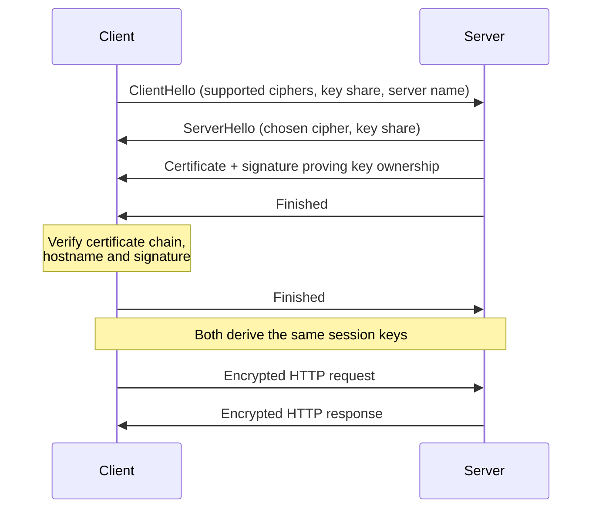

Every time you called an LLM provider in [Working with APIs](/learn/python-programming/working-with-apis), your code spoke HTTP. Now you are moving to the other side of the conversation: you will write the server that receives requests, decides what they mean and sends back responses. A backend engineer has to know HTTP well, not just well enough to call `requests.get`, because caching bugs, retry storms, broken cookies and failed TLS handshakes all live at this level. This lesson covers the protocol itself and the encryption layer, HTTPS, that every production API runs on.

## The shape of an HTTP message

HTTP is a request-response protocol. A client opens a connection, sends a **request**, and the server sends back exactly one **response**. In HTTP/1.1 both are plain text, which makes them easy to read:

```text
POST /v1/summaries HTTP/1.1
Host: api.example.com
Content-Type: application/json
Accept: application/json
Authorization: Bearer eyJhbGciOi...
Content-Length: 47

{"text": "Long article...", "max_words": 50}
```

The first line is the **request line**: method, path (the **target**) and protocol version. Then come **headers**, one `Name: value` per line, then a blank line, then an optional **body**. The response has the same layout with a **status line** instead:

```text
HTTP/1.1 201 Created
Content-Type: application/json
Location: /v1/summaries/smr_81f2
Content-Length: 58

{"id": "smr_81f2", "summary": "The article argues ..."}
```

`curl -v` prints both sides of a real exchange:

```bash
curl -v https://api.example.com/v1/models -H "Authorization: Bearer $API_KEY"
```

### A real exchange in Python

The standard library contains a tiny HTTP server and client, enough to watch a full round trip on your own machine. The server runs in a background thread so the same script can call it.

```python
import http.client
import json
import threading
from http.server import BaseHTTPRequestHandler, HTTPServer

class Handler(BaseHTTPRequestHandler):
    def do_GET(self):
        body = json.dumps({"path": self.path, "agent": self.headers["User-Agent"]}).encode()
        self.send_response(200)
        self.send_header("Content-Type", "application/json")
        self.send_header("Content-Length", str(len(body)))
        self.end_headers()
        self.wfile.write(body)

    def log_message(self, *args):   # silence the default access log
        pass

server = HTTPServer(("127.0.0.1", 0), Handler)   # port 0: pick any free port
threading.Thread(target=server.serve_forever, daemon=True).start()

conn = http.client.HTTPConnection("127.0.0.1", server.server_port)
conn.request("GET", "/health?verbose=1", headers={"User-Agent": "lesson-client/1.0"})
resp = conn.getresponse()
print(resp.status, resp.reason)
print(resp.getheader("Content-Type"))
print(resp.read().decode())
```

```output
200 OK
application/json
{"path": "/health?verbose=1", "agent": "lesson-client/1.0"}
```

The server sees the raw path, query string included, and the headers the client sent. Nothing more: HTTP is **stateless**, so each request must carry everything the server needs.

## Methods and their semantics

The method tells the server what the client intends. Two properties matter more than the names:

- **Safe**: the request does not change server state. Clients, crawlers and caches may send it freely.
- **Idempotent**: sending the same request once or ten times leaves the server in the same state. Clients can safely retry it after a timeout.

| Method | Typical use | Safe | Idempotent | Has body |
| --- | --- | --- | --- | --- |
| `GET` | Read a resource | Yes | Yes | No |
| `HEAD` | Same as GET, headers only | Yes | Yes | No |
| `OPTIONS` | Ask what is allowed (CORS preflight) | Yes | Yes | Rarely |
| `POST` | Create, or run an action | No | **No** | Yes |
| `PUT` | Replace a resource completely | No | Yes | Yes |
| `PATCH` | Change part of a resource | No | Not guaranteed | Yes |
| `DELETE` | Remove a resource | No | Yes | Rarely |

These are promises your server makes. A `GET` that triggers an LLM call and changes data will be fired by accident by prefetchers and monitors. And a client that retries a timed-out `POST /charges` may charge twice; [REST APIs](/learn/backend-development/rest-apis) shows how idempotency keys fix that.

> [!KEY]
> Idempotent does not mean "returns the same response". A second `DELETE /files/7` may return `404` instead of `204`, but the state of the server, file 7 gone, is the same either way.

## Status codes

The three-digit status code is the first thing a client checks, so choose it carefully. The first digit gives the class.

| Code | Meaning | When your server sends it |
| --- | --- | --- |
| `200 OK` | Success with a body | Successful GET, or an action that returns a result |
| `201 Created` | A resource was created | Successful POST that creates; add a `Location` header |
| `202 Accepted` | Accepted, not finished | Long jobs such as batch embedding |
| `204 No Content` | Success, no body | Successful DELETE |
| `304 Not Modified` | Cached copy is still valid | Conditional GET matched |
| `400 Bad Request` | Malformed request | Invalid JSON, missing fields |
| `401 Unauthorized` | Not authenticated | Missing or invalid credentials |
| `403 Forbidden` | Authenticated, not allowed | User lacks permission |
| `404 Not Found` | No such resource | Unknown ID or path |
| `409 Conflict` | Clashes with current state | Duplicate name, version conflict |
| `422 Unprocessable Content` | Well-formed but invalid | Fields fail validation |
| `429 Too Many Requests` | Rate limit hit | Add a `Retry-After` header |
| `500 Internal Server Error` | Your bug | Unhandled exception |
| `502` / `503` / `504` | Upstream or availability problem | LLM provider down, overloaded, timed out |

The rule of thumb: `4xx` means the client must change something before retrying, `5xx` means the server failed and a retry later might work.

## Headers, caching and cookies

Headers carry metadata: what the body is (`Content-Type`, `Content-Length`), what the client accepts (`Accept`, `Accept-Encoding`), who the client is (`Authorization`, `User-Agent`), and how the response may be stored.

### Caching

A response can be reused by browsers, CDNs and proxies if the server allows it. `Cache-Control` sets the rules:

| Directive | Meaning |
| --- | --- |
| `max-age=600` | Fresh for 600 seconds; reuse without asking |
| `no-cache` | May store, but must revalidate with the server before each use |
| `no-store` | Never store (use for anything personal or secret) |
| `private` | Only the end user's browser may store it, not shared caches |
| `public` | Shared caches such as CDNs may store it |

**Revalidation** saves bandwidth when content has not changed. The server sends an `ETag`, a fingerprint of the current version. The client later asks "only if it changed":

```text
GET /v1/models HTTP/1.1
If-None-Match: "a1b2c3"

HTTP/1.1 304 Not Modified
ETag: "a1b2c3"
```

A `304` has no body, so the client reuses its stored copy.

### Cookies

A **cookie** is a small value the server asks the browser to store and send back on later requests to the same site. It is how browsers keep a session despite HTTP being stateless.

```text
Set-Cookie: session=7f3a9c; Path=/; HttpOnly; Secure; SameSite=Lax; Max-Age=3600
```

`HttpOnly` hides it from JavaScript (limiting damage from cross-site scripting), `Secure` sends it only over HTTPS, and `SameSite` controls whether it is sent on requests started by other sites, a defence against cross-site request forgery. You will use these in [Authentication](/learn/backend-development/authentication).

## HTTP/1.1, HTTP/2 and HTTP/3

The meaning of messages (methods, status codes, headers) is identical across versions. What changes is how bytes travel.

| Version | Transport | Key idea | Weakness it fixes |
| --- | --- | --- | --- |
| HTTP/1.1 | TCP | Text messages, one request at a time per connection | (baseline) |
| HTTP/2 | TCP | Binary frames, many concurrent **streams** on one connection, header compression | Needing many connections; slow requests blocking later ones |
| HTTP/3 | QUIC over UDP | Streams handled by the transport itself, faster connection setup | One lost TCP packet stalling every stream |

Your application code rarely notices: a proxy in front often speaks HTTP/2 or 3 to clients and HTTP/1.1 to your app.

## HTTPS and TLS

Plain HTTP is readable by anyone on the path, API keys included. **HTTPS** is HTTP sent inside a **TLS** connection, which provides three guarantees:

1. **Confidentiality**: the bytes are encrypted.
2. **Integrity**: tampering is detected.
3. **Authentication**: the client knows it is talking to the real `api.example.com`, not an impostor.

### The handshake

Before any HTTP is sent, the client and server agree on keys. In TLS 1.3, the current version, this takes one round trip:



The **key shares** let both sides compute a shared secret (Diffie-Hellman key exchange) that an eavesdropper cannot derive from the messages; fast symmetric encryption keyed from it protects the rest of the connection.

### Certificates

A key exchange alone would happily set up encryption with an attacker. The **certificate** prevents that: it binds a domain name to a public key, is signed by a **certificate authority** (CA), and the server proves it holds the private key by signing the handshake. The client checks:

- The certificate chain leads to a root CA in its trust store.
- The name in the certificate matches the host it asked for.
- The certificate is within its validity dates.

Python's `ssl` module does all of this by default:

```python
import ssl

ctx = ssl.create_default_context()
print(ctx.verify_mode == ssl.CERT_REQUIRED)
print(ctx.check_hostname)
print(ctx.minimum_version.name)
```

```output
True
True
TLSv1_2
```

> [!WARNING]
> Never "fix" a certificate error with `verify=False` in `requests` or `httpx`, or by disabling hostname checks. That silently removes the authentication guarantee, and such code has a habit of reaching production. Fix the real cause: an expired certificate, a missing intermediate, or a corporate proxy whose CA you should add to the trust store.

Server-side, you rarely handle TLS in Python: a load balancer or reverse proxy (nginx, Caddy, a cloud platform) **terminates** TLS and forwards plain HTTP to your app over a private network. Free automated CAs such as Let's Encrypt make certificates routine.

## Exercises

**1.** For each endpoint, say whether the method is a good fit and why: `GET /users/5/delete`, `PUT /documents/9` with a full document body, `POST /embeddings` that returns vectors without storing anything.

<details>
<summary>Show solution</summary>

- `GET /users/5/delete` is wrong: GET must be safe, and prefetchers or crawlers would delete users. Use `DELETE /users/5`.
- `PUT /documents/9` with the full document is correct: replacing with the same body twice gives the same state, so it is idempotent.
- `POST /embeddings` is a reasonable fit. Nothing is stored, but the request body can be large and the operation is a computation rather than a fetch of a resource, which is the usual reason APIs use POST for model inference.

</details>

**2.** A client times out waiting for the response to `POST /v1/jobs`. It does not know whether the server received the request. Why is retrying risky here but not for `PUT /v1/jobs/42`?

<details>
<summary>Show solution</summary>

`POST` is not idempotent: if the first request did arrive, a retry creates a second job. `PUT /v1/jobs/42` replaces one named resource with the same body, so applying it twice leaves the same state and a retry is harmless.

</details>

**3.** A user's dashboard response contains their private usage statistics. Which `Cache-Control` value should it carry, and why not `public, max-age=3600`?

<details>
<summary>Show solution</summary>

`Cache-Control: private, no-cache` (or `no-store` if the data is sensitive). `public` would allow a shared cache or CDN to store one user's statistics and serve them to another user, a data leak. `private` restricts storage to the user's own browser, and `no-cache` makes it revalidate so numbers stay current.

</details>

```quiz
[
  {
    "q": "Which method is idempotent but not safe?",
    "options": ["`GET`", "`POST`", "`PUT`", "`HEAD`"],
    "answer": 2,
    "why": "`PUT` changes state, so it is not safe, but repeating the same full replacement leaves the same state, so it is idempotent. `GET` and `HEAD` are both safe; `POST` is neither."
  },
  {
    "q": "A client sends `If-None-Match: \"v7\"` and the resource's ETag is still `\"v7\"`. What should the server return?",
    "options": ["`200 OK` with the full body", "`304 Not Modified` with no body", "`204 No Content`", "`412 Precondition Failed`"],
    "answer": 1,
    "why": "A matching ETag means the client's cached copy is current, so the server sends `304` and no body."
  },
  {
    "q": "During the TLS handshake, what stops an attacker from simply performing the key exchange in place of the real server?",
    "options": ["The key exchange is secret", "The server's certificate, signed by a trusted CA and matching the hostname, plus a signature proving the server holds its private key", "HTTP/2 binary framing", "The `Secure` cookie attribute"],
    "answer": 1,
    "why": "The key exchange gives encryption with whoever is on the other end. Certificate verification is what authenticates that the other end is the real server."
  },
  {
    "q": "Which statement about HTTP/2 and HTTP/3 is correct?",
    "options": ["They introduce new methods and status codes", "HTTP/3 runs over QUIC on UDP so one lost packet does not stall every stream", "HTTP/2 sends messages as plain text", "Your application must be rewritten to use them"],
    "answer": 1,
    "why": "Semantics are unchanged across versions. HTTP/3 moves to QUIC, removing TCP's head-of-line blocking across streams."
  }
]
```
