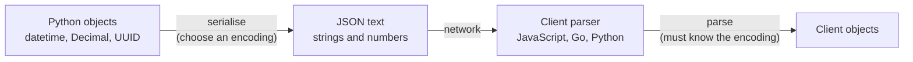

You have already read and written JSON files in [JSON and CSV](/learn/python-programming/json-and-csv). On a server, JSON stops being a file format and becomes a **contract**: every request body you accept and every response you send is JSON that some other program, possibly written in JavaScript, Go or Swift, must parse correctly. Most JSON bugs in APIs are not syntax errors. They are values that serialise without complaint but mean something different on the other side: a date in the wrong time zone, a price that lost a cent, an ID that changed its last digits. This lesson covers how JSON maps to Python, where it silently loses information, and how to describe and enforce its shape with JSON Schema.

## The type system you actually have

JSON has only six kinds of value. Everything else must be encoded into one of them.

| JSON | Python (`json.loads`) | Notes |
| --- | --- | --- |
| object `{}` | `dict` | Keys are always strings |
| array `[]` | `list` | Tuples serialise as arrays and come back as lists |
| string `""` | `str` | UTF-8 on the wire |
| number | `int` or `float` | No separate integer type in the spec |
| `true` / `false` | `True` / `False` | |
| `null` | `None` | |

There is no date, no decimal, no bytes, no set and no integer-versus-float distinction. A good API documents how each of those is represented, then does it the same way everywhere.



Every arrow is a place to lose information. The rest of this lesson is about the classic losses.

## Pitfall 1: dates and times

`json.dumps` refuses to serialise a `datetime`:

```python
import datetime
import json

created = datetime.datetime(2025, 3, 1, 9, 30, tzinfo=datetime.timezone.utc)
try:
    json.dumps({"created_at": created})
except TypeError as e:
    print(e)
```

```output
Object of type datetime is not JSON serializable
```

The usual answer is an **ISO 8601 string in UTC with an explicit offset**:

```python
print(json.dumps({"created_at": created.isoformat()}))
print(datetime.datetime.fromisoformat("2025-03-01T09:30:00+00:00") == created)
```

```output
{"created_at": "2025-03-01T09:30:00+00:00"}
True
```

Avoid naive datetimes (no time zone) in APIs: `"2025-03-01T09:30:00"` means different instants to a server in London and a client in Tokyo. Unix timestamps (seconds since 1970) are also unambiguous, but check whether a client expects seconds or milliseconds; JavaScript's `Date` uses milliseconds.

## Pitfall 2: decimals and money

JSON numbers are usually parsed as binary floating point, which cannot represent most decimal fractions exactly:

```python
import decimal

print(0.1 + 0.2)
print(json.loads('{"price": 19.99}', parse_float=decimal.Decimal))
```

```output
0.30000000000000004
{'price': Decimal('19.99')}
```

For money or token-cost accounting, either send **integer minor units** (`"amount_cents": 1999`) or a **decimal string** (`"amount": "19.99"`). Both survive any parser. Python's `parse_float=Decimal` helps on your side, but you cannot control every client.

## Pitfall 3: large integers

JavaScript stores every number as a 64-bit float, which represents integers exactly only up to $2^{53}$ (about $9 \times 10^{15}$). Larger IDs, such as 64-bit database or snowflake IDs, are silently rounded:

```python
big_id = 2**53 + 1
print(big_id)
print(int(float(big_id)))          # what a JavaScript client would see
print(json.dumps({"id": str(big_id)}))
```

```output
9007199254740993
9007199254740992
{"id": "9007199254740993"}
```

The client ends up fetching, or deleting, the wrong record. The fix is to send large IDs as strings. Many large APIs do exactly that for every ID.

## Pitfall 4: NaN, Infinity and duplicate keys

Model outputs and metrics sometimes contain `NaN` (for example a loss that diverged). Python's `json` module writes it as the bare token `NaN`, which is **not valid JSON**; strict parsers, including JavaScript's `JSON.parse`, reject the whole response.

```python
scores = {"loss": float("nan")}
print(json.dumps(scores))
try:
    json.dumps(scores, allow_nan=False)
except ValueError as e:
    print(e)
```

```output
{"loss": NaN}
Out of range float values are not JSON compliant: nan
```

Pass `allow_nan=False` in API code so the bug surfaces on your server, and convert such values to `null` deliberately.

Duplicate keys are another quiet trap. The spec does not forbid them, and Python keeps the last one:

```python
print(json.loads('{"role": "user", "role": "admin"}'))
```

```output
{'role': 'admin'}
```

If a proxy or validator in front of your app keeps the first value and your app keeps the last, an attacker can make the two disagree. Strict parsing (rejecting duplicates) closes that gap.

## A custom encoder, done once

Rather than converting fields by hand in every endpoint, give the serialiser one `default` function that handles your extra types consistently:

```python
import uuid

def to_json(obj):
    if isinstance(obj, datetime.datetime):
        if obj.tzinfo is None:
            raise ValueError("naive datetime in API response")
        return obj.astimezone(datetime.timezone.utc).isoformat()
    if isinstance(obj, decimal.Decimal):
        return str(obj)
    if isinstance(obj, uuid.UUID):
        return str(obj)
    raise TypeError(f"cannot serialise {type(obj).__name__}")

record = {
    "id": uuid.UUID("12345678-1234-5678-1234-567812345678"),
    "cost": decimal.Decimal("0.0042"),
    "created_at": created,
}
print(json.dumps(record, default=to_json, allow_nan=False))
```

```output
{"id": "12345678-1234-5678-1234-567812345678", "cost": "0.0042", "created_at": "2025-03-01T09:30:00+00:00"}
```

`default` is called only for objects the encoder does not already understand. Raising for anything unexpected is deliberate: an accidental `repr` of an internal object in a response is a bug you want to see.

## JSON Schema: writing the contract down

A **JSON Schema** is a JSON document that describes what valid data looks like: types, required fields, ranges, string patterns. It serves as documentation, as a validator for incoming requests, and as the basis of the OpenAPI format you will meet in [API documentation](/learn/backend-development/api-documentation). It is also how LLM providers let you constrain [structured outputs](/learn/working-with-llms/structured-outputs).

Here is a schema for a summarisation request, validated with the `jsonschema` package (`pip install jsonschema`):

```python
from jsonschema import Draft202012Validator

schema = {
    "type": "object",
    "properties": {
        "text": {"type": "string", "minLength": 1},
        "max_words": {"type": "integer", "minimum": 10, "maximum": 500},
        "style": {"enum": ["bullet", "paragraph"]},
    },
    "required": ["text"],
    "additionalProperties": False,
}

validator = Draft202012Validator(schema)
bad = {"max_words": 5, "style": "haiku", "temprature": 0.2}
for error in sorted(validator.iter_errors(bad), key=lambda e: e.message):
    print(list(error.path), "-", error.message)
```

```output
['style'] - 'haiku' is not one of ['bullet', 'paragraph']
[] - 'text' is a required property
['max_words'] - 5 is less than the minimum of 10
[] - Additional properties are not allowed ('temprature' was unexpected)
```

`iter_errors` reports every problem at once, which lets your API return all of them in one `422` response instead of making the client fix one field per round trip. `"additionalProperties": false` catches typos such as `temprature`, which would otherwise be ignored silently and leave the client wondering why the temperature had no effect.

> [!TIP]
> Validate at the edge, once, as the request enters your server, and work with trusted typed objects after that. In the next module, Pydantic does this for you by generating the JSON Schema from Python classes.

## Conventions worth fixing early

| Decision | Common choice | Why it matters |
| --- | --- | --- |
| Key casing | `snake_case` (or `camelCase`), never mixed | Clients map keys to code |
| Missing vs `null` | Document the difference | `PATCH {"bio": null}` may mean "clear it", absent means "leave it" |
| Top-level shape | Object, not bare array | You can add `next_cursor` later without breaking clients |
| Enums | Lowercase strings | Readable and extensible |
| Content type | `Content-Type: application/json` | Clients and proxies dispatch on it |

## Exercises

**1.** A response contains `{"user_id": 1234567890123456789}`. A JavaScript dashboard displays a different ID. Explain, then fix the response.

<details>
<summary>Show solution</summary>

The value exceeds $2^{53}$, so JavaScript's 64-bit float cannot hold it exactly and rounds it to the nearest representable number. Send it as a string: `{"user_id": "1234567890123456789"}`.

```python
print(int(float(1234567890123456789)))
```

```output
1234567890123456768
```

</details>

**2.** Extend `to_json` so that `set` values serialise as sorted lists, then serialise `{"tags": {"rag", "agents", "eval"}}`.

<details>
<summary>Show solution</summary>

```python
def to_json_v2(obj):
    if isinstance(obj, set):
        return sorted(obj)
    return to_json(obj)

print(json.dumps({"tags": {"rag", "agents", "eval"}}, default=to_json_v2))
```

```output
{"tags": ["agents", "eval", "rag"]}
```

Sorting makes the output deterministic, which helps caching (stable ETags) and tests.

</details>

**3.** Add a `language` property to the schema that must be a two-letter lowercase code, and check that `"EN"` is rejected.

<details>
<summary>Show solution</summary>

```python
schema["properties"]["language"] = {"type": "string", "pattern": "^[a-z]{2}$"}
v = Draft202012Validator(schema)
print([e.message for e in v.iter_errors({"text": "hi", "language": "EN"})])
```

```output
["'EN' does not match '^[a-z]{2}$'"]
```

</details>

```quiz
[
  {
    "q": "What is the safest way to send a monetary amount of 19.99 in a JSON API?",
    "options": ["`19.99` as a number", "`\"19.99\"` as a string or `1999` in minor units", "`19.990000` for extra precision", "As a float rounded on the client"],
    "answer": 1,
    "why": "Strings and integer minor units are exact in every parser. Binary floats cannot represent most decimal fractions exactly."
  },
  {
    "q": "What does `json.dumps({\"x\": float(\"nan\")})` produce in Python by default?",
    "options": ["`{\"x\": null}`", "It raises `ValueError`", "`{\"x\": NaN}`, which strict JSON parsers reject", "`{\"x\": \"NaN\"}`"],
    "answer": 2,
    "why": "Python emits the non-standard token `NaN` unless you pass `allow_nan=False`, in which case it raises."
  },
  {
    "q": "Why do many APIs send 64-bit IDs as strings?",
    "options": ["Strings are smaller", "JavaScript numbers lose precision above 2^53, corrupting large IDs", "JSON cannot contain integers", "To make IDs sortable"],
    "answer": 1,
    "why": "JavaScript parses every JSON number as a 64-bit float, which cannot represent every integer above 2^53."
  },
  {
    "q": "In JSON Schema, what does `\"additionalProperties\": false` do?",
    "options": ["Makes every property required", "Rejects objects containing properties not listed in `properties`", "Allows `null` values", "Disables validation of nested objects"],
    "answer": 1,
    "why": "Unknown keys, often typos, become validation errors instead of being silently ignored."
  }
]
```
