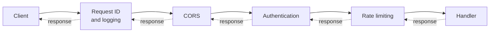
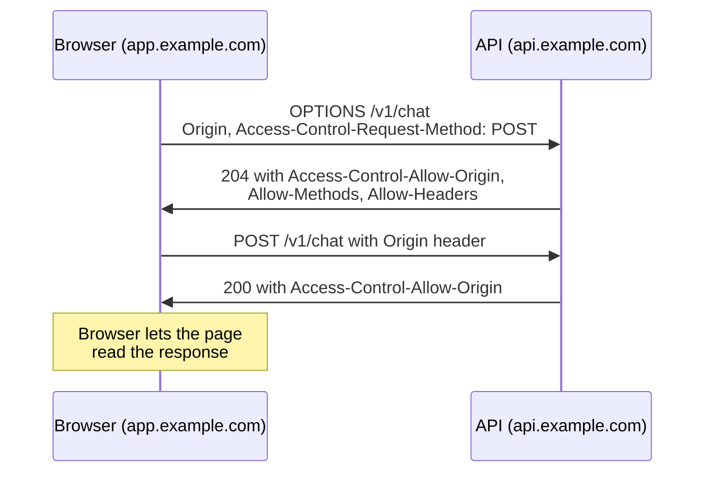

Some work has to happen for nearly every request: logging it, timing it, attaching a request ID, checking credentials, enforcing rate limits, adding CORS headers, compressing the response. Writing that into each handler would be repetitive and easy to forget. **Middleware** is code that wraps every handler, running before the request reaches it and after the response leaves it. Every web framework has the concept, and once you see it as plain function wrapping, like the [decorators](/learn/python-programming/decorators-and-generators) you already know, framework middleware stops being magic.

## The pipeline

Middleware layers form an onion. The request travels inward through each layer to the handler; the response travels back outward through the same layers in reverse order.



Any layer can **short-circuit**: the rate limiter can return `429` without the handler ever running, and the authentication layer can return `401`. Order therefore matters. Logging goes outermost so it records even rejected requests; authentication runs before rate limiting when limits are per user, because the limiter needs to know who the user is.

## Middleware as function wrapping

Strip away the framework and a handler is a function from request to response, and middleware is a function that takes a handler and returns a new handler.

```python
import itertools
import json

def handler(request):
    return {"status": 200, "headers": {}, "body": {"echo": request["body"]}}

_ids = itertools.count(1)

def request_id_middleware(next_handler):
    def wrapped(request):
        request_id = request["headers"].get("X-Request-ID") or f"req_{next(_ids):04d}"
        request["request_id"] = request_id
        response = next_handler(request)
        response["headers"]["X-Request-ID"] = request_id
        return response
    return wrapped

def logging_middleware(next_handler):
    def wrapped(request):
        response = next_handler(request)
        print(json.dumps({"id": request.get("request_id"), "method": request["method"],
                          "path": request["path"], "status": response["status"]}))
        return response
    return wrapped

def build(handler, middlewares):
    for mw in reversed(middlewares):      # first in the list ends up outermost
        handler = mw(handler)
    return handler

app = build(handler, [request_id_middleware, logging_middleware])
resp = app({"method": "POST", "path": "/v1/echo", "headers": {}, "body": "hi"})
print(resp["headers"])
```

```output
{"id": "req_0001", "method": "POST", "path": "/v1/echo", "status": 200}
{'X-Request-ID': 'req_0001'}
```

The request ID middleware runs first, so the logging layer inside it can include the ID. Real middleware APIs (ASGI in FastAPI and Starlette, WSGI in Flask and Django) have more ceremony, but the shape is identical.

## Logging and request IDs

A request ID ties together everything that happened for one request: your access log line, the application logs inside the handler, the LLM provider call it made, and the error report if it failed. Good practice:

- Accept an incoming ID header from a trusted proxy, otherwise generate one (a UUID in production).
- Return it in the response so users can quote it in bug reports.
- Log in a **structured** format (one JSON object per line) with method, path, status, duration and user ID, so logs can be searched and aggregated.
- **Never log secrets or full prompts by default.** `Authorization` headers, API keys and user content often end up in logs that many people can read. Redact them in the middleware.

## CORS

Browsers enforce the **same-origin policy**: JavaScript on `https://app.example.com` cannot read responses from `https://api.example.com` (a different origin) unless the API explicitly allows it. **CORS** (Cross-Origin Resource Sharing) is how the server grants permission, and it is a classic middleware job.

For "non-simple" requests, such as a `POST` with `Content-Type: application/json` or an `Authorization` header, the browser first sends a **preflight** `OPTIONS` request:



```text
HTTP/1.1 204 No Content
Access-Control-Allow-Origin: https://app.example.com
Access-Control-Allow-Methods: GET, POST
Access-Control-Allow-Headers: Content-Type, Authorization
Access-Control-Max-Age: 600
```

Points that trip people up:

- CORS protects **users' browsers**, not your API. `curl` and server-side scripts ignore it completely. It is not an authentication mechanism.
- `Access-Control-Allow-Origin: *` cannot be combined with credentials (cookies). For credentialed requests, echo back the specific origin, but only if it is on your allow-list. Echoing back *any* origin is equivalent to disabling the protection.
- A CORS error in the browser console often hides a different failure, such as a `500` that lacked the CORS headers.

## Rate limiting with a token bucket

Rate limiting protects your service and your LLM budget from runaway clients, scrapers and bugs such as retry loops. The **token bucket** algorithm is the most common choice because it allows short bursts while enforcing an average rate.

Picture a bucket holding up to $C$ tokens (the **capacity**). Tokens drip in at a rate of $r$ per second. Each request removes one token; if the bucket is empty, the request is rejected with `429`. After an idle period of $\Delta t$ seconds, the bucket holds

$$
\text{tokens} = \min\left(C,\ \text{tokens}_{\text{previous}} + r \cdot \Delta t\right)
$$

so a client can burst up to $C$ requests at once, but sustains at most $r$ requests per second.

```python
class TokenBucket:
    def __init__(self, capacity, refill_per_second, clock):
        self.capacity = capacity
        self.rate = refill_per_second
        self.clock = clock                    # injected so we can test with a fake clock
        self.tokens = capacity
        self.updated = clock()

    def allow(self, cost=1):
        now = self.clock()
        self.tokens = min(self.capacity, self.tokens + (now - self.updated) * self.rate)
        self.updated = now
        if self.tokens >= cost:
            self.tokens -= cost
            return True, 0.0
        retry_after = (cost - self.tokens) / self.rate
        return False, retry_after

fake_now = [0.0]
bucket = TokenBucket(capacity=3, refill_per_second=1.0, clock=lambda: fake_now[0])

for t in [0.0, 0.1, 0.2, 0.3, 0.4, 1.5, 1.6, 5.0]:
    fake_now[0] = t
    ok, retry = bucket.allow()
    status = "200" if ok else f"429 Retry-After {retry:.1f}s"
    print(f"t={t:>3}s tokens_left={bucket.tokens:.1f} -> {status}")
```

```output
t=0.0s tokens_left=2.0 -> 200
t=0.1s tokens_left=1.1 -> 200
t=0.2s tokens_left=0.2 -> 200
t=0.3s tokens_left=0.3 -> 429 Retry-After 0.7s
t=0.4s tokens_left=0.4 -> 429 Retry-After 0.6s
t=1.5s tokens_left=0.5 -> 200
t=1.6s tokens_left=0.6 -> 429 Retry-After 0.4s
t=5.0s tokens_left=2.0 -> 200
```

The first three requests burst through, the next two are rejected with an accurate `Retry-After`, the bucket refills over time, and after a long pause it is full again (capped at 3).

Wrapping it as middleware, with one bucket per API key:

```python
buckets = {}

def rate_limit_middleware(next_handler):
    def wrapped(request):
        key = request["headers"].get("Authorization", "anonymous")
        bucket = buckets.setdefault(key, TokenBucket(3, 1.0, lambda: fake_now[0]))
        ok, retry = bucket.allow()
        if not ok:
            return {"status": 429, "headers": {"Retry-After": str(max(1, round(retry)))},
                    "body": {"error": "rate limit exceeded"}}
        return next_handler(request)
    return wrapped

app = build(handler, [request_id_middleware, logging_middleware, rate_limit_middleware])
fake_now[0] = 100.0
for _ in range(4):
    app({"method": "POST", "path": "/v1/echo", "headers": {"Authorization": "key_A"}, "body": "x"})
```

```output
{"id": "req_0002", "method": "POST", "path": "/v1/echo", "status": 200}
{"id": "req_0003", "method": "POST", "path": "/v1/echo", "status": 200}
{"id": "req_0004", "method": "POST", "path": "/v1/echo", "status": 200}
{"id": "req_0005", "method": "POST", "path": "/v1/echo", "status": 429}
```

The rejected request is still logged, because logging is the outer layer.

> [!TIP]
> For LLM endpoints, a request count is a poor measure of cost: one request may use 50 tokens and the next 50,000. Use the `cost` parameter to charge buckets by estimated tokens, and keep a separate per-user daily budget.

An in-memory dictionary only works for a single process. With several server instances behind a load balancer, keep the buckets in a shared store such as Redis, updated atomically, or each instance will grant the full rate.

> [!KEY]
> Middleware is for cross-cutting concerns that apply uniformly. Logic specific to one endpoint belongs in that endpoint; logic that must never be forgotten belongs in middleware.

## Exercises

**1.** Write a `timing_middleware` that adds a `Server-Timing` header with the handler's duration in milliseconds. Where in the list should it go to measure only the handler?

<details>
<summary>Show solution</summary>

```python
import time

def timing_middleware(next_handler):
    def wrapped(request):
        start = time.perf_counter()
        response = next_handler(request)
        elapsed_ms = (time.perf_counter() - start) * 1000
        response["headers"]["Server-Timing"] = f"app;dur={elapsed_ms:.1f}"
        return response
    return wrapped

timed = build(handler, [timing_middleware])
print(list(timed({"method": "GET", "path": "/", "headers": {}, "body": None})["headers"]))
```

```output
['Server-Timing']
```

Put it last (innermost) to time just the handler, or first (outermost) to include the cost of all other middleware.

</details>

**2.** With `capacity=5` and `refill_per_second=0.5`, how many requests can a client make in the first 10 seconds if it sends as fast as possible from a full bucket?

<details>
<summary>Show solution</summary>

5 immediately from the full bucket, plus $0.5 \times 10 = 5$ more as tokens refill, so about 10.

```python
fake_now[0] = 0.0
b = TokenBucket(5, 0.5, lambda: fake_now[0])
allowed = 0
for step in range(0, 21):                 # try every 0.5 s, from t=0 to t=10
    fake_now[0] = step / 2
    allowed += b.allow()[0]
print(allowed)
```

```output
10
```

</details>

**3.** A developer "fixes" CORS errors by echoing whatever `Origin` the request sends into `Access-Control-Allow-Origin` and setting `Access-Control-Allow-Credentials: true`. What can a malicious site now do?

<details>
<summary>Show solution</summary>

Any website a logged-in user visits can send credentialed requests to your API from that user's browser and read the responses, because your API approves every origin. It can steal the user's data. Only echo origins that are on an explicit allow-list.

</details>

```quiz
[
  {
    "q": "Middleware is listed as [logging, auth, rate_limit] with logging outermost. The rate limiter rejects a request. What happens?",
    "options": ["Nothing is logged because the handler never ran", "The logging layer still records the 429 on the way out", "The auth layer retries the request", "The handler runs anyway"],
    "answer": 1,
    "why": "The response travels back out through every outer layer, so logging sees the short-circuited 429."
  },
  {
    "q": "What does CORS protect against?",
    "options": ["Unauthenticated `curl` requests to your API", "Scripts on other websites reading your API's responses through a user's browser", "SQL injection", "Denial-of-service attacks"],
    "answer": 1,
    "why": "CORS is enforced by browsers for cross-origin JavaScript. Non-browser clients ignore it entirely."
  },
  {
    "q": "A token bucket has capacity 10 and refills 2 tokens per second. What does it allow?",
    "options": ["Exactly 2 requests every second, never more", "Bursts of up to 10 requests, with a sustained average of 2 per second", "10 requests per second sustained", "Unlimited requests after a 5 second wait"],
    "answer": 1,
    "why": "Capacity sets the burst size; the refill rate sets the long-run average."
  },
  {
    "q": "Why does an in-memory rate limiter fail when you run four server instances behind a load balancer?",
    "options": ["Python dictionaries are not thread-safe", "Each instance has its own buckets, so a client gets up to four times the intended rate", "Load balancers strip `Authorization` headers", "Token buckets only work with HTTP/2"],
    "answer": 1,
    "why": "The limit must be enforced on shared state, such as Redis, for all instances to agree."
  }
]
```
