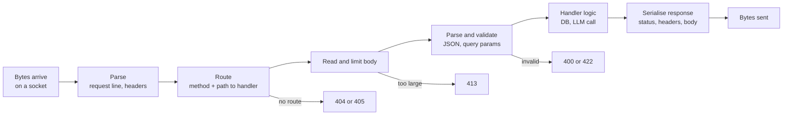

The [HTTP lesson](/learn/backend-development/http-and-https) showed what a request and a response look like. This lesson is about what your server does in between: turning a stream of bytes into a trustworthy, typed request, routing it to the right code, and building a response the client can rely on. Frameworks such as FastAPI, covered next, automate most of these steps, but every one of them still happens. Knowing them is what lets you debug a `415` you did not expect, or understand why a 2 GB upload took your server down.

## The lifecycle of one request



Each rejection happens as early as possible. A request that fails validation should never reach the code that spends money on an LLM call.

## What a request gives you

A server sees five sources of input. Each has a conventional purpose.

| Part | Example | Use it for |
| --- | --- | --- |
| Method | `POST` | What to do |
| Path and path parameters | `/v1/documents/doc_42` | Which resource |
| Query string | `?limit=20&status=ready` | Filtering, paging, options on reads |
| Headers | `Authorization`, `Content-Type`, `Accept` | Metadata: credentials, formats, tracing |
| Body | `{"text": "..."}` | The payload for writes and computations |

All of it comes from the client, so all of it is untrusted. Query values are always strings (`"20"`, not `20`), headers are case-insensitive, and the body is just bytes until you decide how to decode it.

```python
from urllib.parse import parse_qs, urlsplit

parts = urlsplit("/v1/documents?status=ready&tag=rag&tag=eval&limit=20")
query = parse_qs(parts.query)
print(parts.path)
print(query)
print(int(query["limit"][0]) + 1)
```

```output
/v1/documents
{'status': ['ready'], 'tag': ['rag', 'eval'], 'limit': ['20']}
21
```

`parse_qs` returns a list for every key because a parameter may repeat (`tag=rag&tag=eval`). Your code decides whether repetition is allowed, and must convert and range-check numbers itself.

## Content negotiation

Two headers describe formats, and they point in opposite directions:

- **`Content-Type`** on a request says what the *body you are sending* is. On a response it says what the server sent back.
- **`Accept`** on a request says what formats the client *wants back*.

If a client posts form data to a JSON endpoint, answer `415 Unsupported Media Type`. If it asks for `Accept: text/csv` and you only produce JSON, answer `406 Not Acceptable`, or, as many APIs do, ignore `Accept` and send JSON. For AI APIs the interesting case is streaming: a client that sends `Accept: text/event-stream` is asking for tokens as they are generated rather than one final body, which [WebSockets](/learn/backend-development/websockets) covers.

## A small server that does it properly

Here is a complete handler built on the standard library. It routes by method and path, enforces a body size limit, checks the content type, parses JSON, validates fields and returns the right status for each failure.

```python
import json
import threading
import urllib.error
import urllib.request
from http.server import BaseHTTPRequestHandler, ThreadingHTTPServer

MAX_BODY = 10_000          # bytes
DOCUMENTS = {}

class API(BaseHTTPRequestHandler):
    def send_json(self, status, payload, headers=None):
        body = json.dumps(payload).encode()
        self.send_response(status)
        self.send_header("Content-Type", "application/json")
        self.send_header("Content-Length", str(len(body)))
        for name, value in (headers or {}).items():
            self.send_header(name, value)
        self.end_headers()
        self.wfile.write(body)

    def do_GET(self):
        if self.path.startswith("/v1/documents/"):
            doc_id = self.path.rsplit("/", 1)[1]
            if doc_id in DOCUMENTS:
                return self.send_json(200, DOCUMENTS[doc_id])
        self.send_json(404, {"error": "not found"})

    def do_POST(self):
        if self.path != "/v1/documents":
            return self.send_json(404, {"error": "not found"})
        if self.headers.get("Content-Type", "").split(";")[0] != "application/json":
            return self.send_json(415, {"error": "send application/json"})
        length = int(self.headers.get("Content-Length", 0))
        if length > MAX_BODY:
            return self.send_json(413, {"error": f"body over {MAX_BODY} bytes"})
        try:
            data = json.loads(self.rfile.read(length))
        except json.JSONDecodeError:
            return self.send_json(400, {"error": "malformed JSON"})
        if not isinstance(data, dict) or not isinstance(data.get("text"), str) or not data["text"]:
            return self.send_json(422, {"error": "'text' must be a non-empty string"})
        doc_id = f"doc_{len(DOCUMENTS) + 1}"
        DOCUMENTS[doc_id] = {"id": doc_id, "text": data["text"], "words": len(data["text"].split())}
        self.send_json(201, DOCUMENTS[doc_id], {"Location": f"/v1/documents/{doc_id}"})

    def log_message(self, *args):
        pass

server = ThreadingHTTPServer(("127.0.0.1", 0), API)
threading.Thread(target=server.serve_forever, daemon=True).start()
BASE = f"http://127.0.0.1:{server.server_port}"

def call(method, path, body=None, content_type="application/json"):
    req = urllib.request.Request(BASE + path, data=body, method=method,
                                 headers={"Content-Type": content_type})
    try:
        with urllib.request.urlopen(req) as resp:
            return resp.status, resp.headers.get("Location"), json.loads(resp.read())
    except urllib.error.HTTPError as err:       # urllib raises for 4xx and 5xx
        return err.code, None, json.loads(err.read())

print(call("POST", "/v1/documents", b'{"text": "Attention is all you need"}'))
print(call("GET", "/v1/documents/doc_1"))
print(call("POST", "/v1/documents", b'{"text": '))
print(call("POST", "/v1/documents", b'{"text": ""}'))
print(call("POST", "/v1/documents", b"text=hello", "application/x-www-form-urlencoded"))
print(call("POST", "/v1/documents", b'{"text": "' + b"a" * 20_000 + b'"}'))
print(call("GET", "/v1/documents/doc_99"))
```

```output
(201, '/v1/documents/doc_1', {'id': 'doc_1', 'text': 'Attention is all you need', 'words': 5})
(200, None, {'id': 'doc_1', 'text': 'Attention is all you need', 'words': 5})
(400, None, {'error': 'malformed JSON'})
(422, None, {'error': "'text' must be a non-empty string"})
(415, None, {'error': 'send application/json'})
(413, None, {'error': 'body over 10000 bytes'})
(404, None, {'error': 'not found'})
```

Every failure is a different status code with a machine-readable body, so a client can tell "fix your JSON" from "fix your field" from "this does not exist". Note the order of checks: the size limit is applied **before** reading the body, so an oversized upload is never loaded into memory.

> [!WARNING]
> Always cap request bodies. Without a limit, one client sending a huge body (by accident, such as a whole PDF base64-encoded into a prompt field, or deliberately) can exhaust your server's memory. Reverse proxies apply a limit too, but your app should not rely on that alone.

## Building a good response

A response is more than a body. Each part has a job:

| Part | Guidance |
| --- | --- |
| Status | The most specific correct code; clients branch on it |
| `Content-Type` | Always set it, with the charset if not JSON |
| `Location` | On `201 Created` and `202 Accepted`, the URL of the new resource or job |
| `Cache-Control` | Say explicitly whether the response may be cached |
| Request ID header | Echo an ID such as `X-Request-ID` so users can quote it in bug reports |
| Body | Consistent envelope across endpoints; same error shape everywhere |

### Streaming responses

Most responses are sent at once with a known `Content-Length`. When the body is produced gradually, as when an LLM generates tokens, the server can start sending before it knows the total size. HTTP/1.1 does this with **chunked transfer encoding**: instead of `Content-Length`, the response says `Transfer-Encoding: chunked` and sends the body as a series of sized pieces. HTTP/2 and 3 stream natively with frames. The user sees the first words in a fraction of a second instead of waiting many seconds for the complete answer, which is why [streaming](/learn/working-with-llms/streaming-responses) is standard in chat interfaces.

```text
HTTP/1.1 200 OK
Content-Type: text/plain; charset=utf-8
Transfer-Encoding: chunked

6
Hello,
7
 world.
0

```

Each chunk is its length in hexadecimal, then the data; a zero-length chunk ends the body.

## Timeouts on both sides

A server that waits forever is a server that eventually runs out of connections. Set timeouts for reading the request (slow clients), for every outbound call (database, LLM provider), and an overall deadline for the handler. When an upstream LLM call times out, return `504 Gateway Timeout` or `503 Service Unavailable` rather than hanging, so the client can decide what to do.

> [!KEY]
> Treat every request as hostile until validated, reject it as early as possible, and make every response self-describing: a precise status code, an explicit content type and a consistent body.

## Exercises

**1.** Add a `DELETE /v1/documents/{id}` handler to the `API` class that returns `204` with no body when the document exists and `404` otherwise. Test both cases.

<details>
<summary>Show solution</summary>

```python
def do_DELETE(self):
    doc_id = self.path.rsplit("/", 1)[1]
    if DOCUMENTS.pop(doc_id, None) is None:
        return self.send_json(404, {"error": "not found"})
    self.send_response(204)
    self.end_headers()

API.do_DELETE = do_DELETE

for _ in range(2):
    req = urllib.request.Request(BASE + "/v1/documents/doc_1", method="DELETE")
    try:
        with urllib.request.urlopen(req) as resp:
            print(resp.status)
    except urllib.error.HTTPError as err:
        print(err.code)
```

```output
204
404
```

The second call returns `404`, yet the server state is the same as after the first: DELETE is still idempotent.

</details>

**2.** The handler checks `isinstance(data, dict)`. What request body would crash it without that check, and with what status would the client then see the failure?

<details>
<summary>Show solution</summary>

A body that is valid JSON but not an object, such as `[1, 2]` or `"hello"`. `data.get` would raise `AttributeError`, the handler would crash, and the client would see a `500` or a dropped connection. Validating the top-level type turns that into a clean `422`.

</details>

**3.** Why does the server read `Content-Length` and reject large bodies before calling `self.rfile.read`?

<details>
<summary>Show solution</summary>

Reading first would load the whole body into memory, which is exactly the resource exhaustion the limit exists to prevent. Checking the declared length lets the server refuse cheaply. (A production server also caps how many bytes it actually reads, since a client can lie about `Content-Length`.)

</details>

```quiz
[
  {
    "q": "A client sends `Content-Type: text/plain` to an endpoint that only accepts JSON. Which status fits best?",
    "options": ["`400 Bad Request`", "`406 Not Acceptable`", "`415 Unsupported Media Type`", "`422 Unprocessable Content`"],
    "answer": 2,
    "why": "`415` is about the request body's format. `406` is about the format the client asked to receive via `Accept`."
  },
  {
    "q": "What does `parse_qs(\"tag=a&tag=b\")` return?",
    "options": ["`{'tag': 'b'}`", "`{'tag': ['a', 'b']}`", "`{'tag': 'a,b'}`", "It raises an error for duplicate keys"],
    "answer": 1,
    "why": "Query parameters may repeat, so `parse_qs` always returns a list of values per key."
  },
  {
    "q": "Why is chunked transfer encoding useful for LLM responses?",
    "options": ["It compresses the response", "The server can send tokens as they are generated without knowing the total length in advance", "It encrypts each chunk separately", "It lets the client send its prompt in pieces"],
    "answer": 1,
    "why": "Chunked encoding replaces `Content-Length`, so the body can be streamed while it is still being produced."
  },
  {
    "q": "In what order should a well-designed handler perform these steps?",
    "options": ["Call the LLM, then validate the input", "Read the full body, then check its size", "Route, check size, parse, validate, then run the handler logic", "Validate the response, then parse the request"],
    "answer": 2,
    "why": "Reject cheaply and early: an invalid or oversized request should never reach expensive work."
  }
]
```
