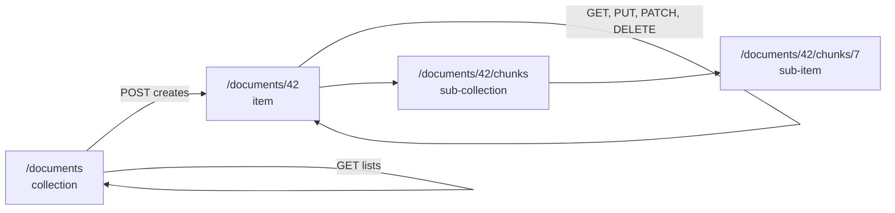
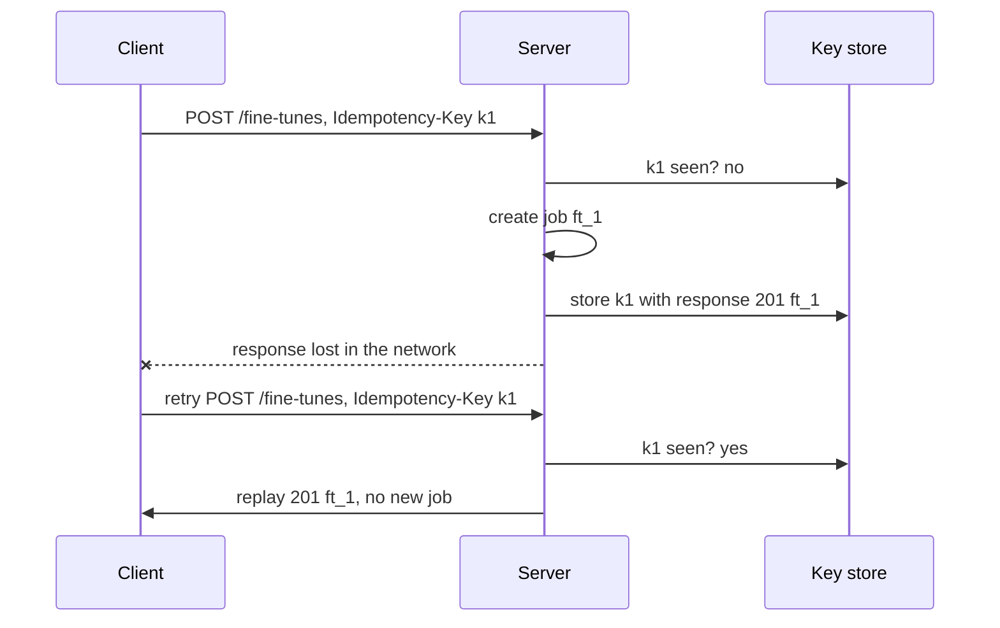

HTTP gives you methods, paths and status codes. **REST** (Representational State Transfer) is a style for using them consistently, so that someone who has seen one of your endpoints can guess the rest. Most public AI APIs, from model providers to vector databases, are broadly RESTful, and when you put a model behind your own API in the next module, these conventions decide whether other teams find it pleasant or baffling to use.

## Resources, not actions

The central idea is to model your API as **resources**: nouns that clients read and change with the standard methods. The URL names the thing; the method says what to do with it.

| Request | Meaning | Success status |
| --- | --- | --- |
| `GET /documents` | List documents | `200` |
| `POST /documents` | Create a document | `201` + `Location` |
| `GET /documents/42` | Read one document | `200` |
| `PUT /documents/42` | Replace it | `200` or `204` |
| `PATCH /documents/42` | Update some fields | `200` |
| `DELETE /documents/42` | Delete it | `204` |
| `GET /documents/42/chunks` | List a sub-collection | `200` |

Compare an action-style design: `POST /getDocument`, `POST /deleteDocument?id=42`, `POST /createNewDoc`. Every endpoint is POST, so caches cannot help, clients cannot retry safely, and every endpoint must be learned separately.



### When the operation is not CRUD

Some operations do not map onto create, read, update and delete: "embed this text", "cancel this job", "search". Two honest options:

- **Model the result as a resource.** `POST /embeddings` creates an embedding result; `POST /jobs/17/cancellation` creates a cancellation.
- **Use a clearly named action sub-path.** `POST /jobs/17:cancel` or `POST /jobs/17/cancel`. Purists object, but it is common and readable.

Do not contort an API to be "pure". Consistency within your API matters far more.

## URL design conventions

| Convention | Good | Avoid |
| --- | --- | --- |
| Plural nouns for collections | `/users/7` | `/user/7`, `/getUser` |
| Lowercase, hyphens | `/api-keys` | `/APIKeys`, `/api_keys` |
| Hierarchy only for real ownership | `/projects/3/datasets` | `/a/b/c/d/e` nesting |
| Opaque, stable IDs | `/runs/run_8fK2` | IDs that leak counts, like `/runs/10432` |
| Query strings for filtering, not identity | `/runs?status=failed` | `/runs/failed` |

Prefixed IDs such as `run_8fK2` or `doc_91aZ` are a small kindness: a stray ID in a log tells you what kind of object it is.

## Versioning

Clients break when you change a response shape, rename a field or change a meaning. **Versioning** lets you change the API without breaking existing clients.

| Scheme | Example | Notes |
| --- | --- | --- |
| URL path | `/v1/documents` | Most common, visible, easy to route |
| Header | `Api-Version: 2024-06-01` | Clean URLs; date-based versions are popular with large API providers |
| Query parameter | `/documents?version=2` | Easy to forget, mixes with filters |

Whichever you choose, the important rule is about what counts as **breaking**. Adding an optional request field or a new response field is usually safe, so clients must ignore unknown fields. Removing or renaming a field, changing a type, or tightening validation is breaking and needs a new version. The [API documentation](/learn/backend-development/api-documentation) lesson covers announcing such changes.

## Pagination

A collection may hold millions of items, so list endpoints return a page at a time.

**Offset pagination** (`?limit=20&offset=40`) is simple and lets users jump to page 50, but it gets slow on large tables (the database still walks past the skipped rows) and shows duplicates or gaps when items are inserted while someone is paging.

**Cursor pagination** returns an opaque token pointing just after the last item seen. The next request asks for items after that position, which an index can find directly and which stays correct under inserts. Here is a working implementation over an in-memory list sorted by ID:

```python
import base64
import json

DOCS = [{"id": i, "title": f"doc {i}"} for i in range(1, 8)]

def encode_cursor(last_id):
    return base64.urlsafe_b64encode(json.dumps({"after": last_id}).encode()).decode()

def decode_cursor(cursor):
    return json.loads(base64.urlsafe_b64decode(cursor))["after"]

def list_documents(limit=3, cursor=None):
    after = decode_cursor(cursor) if cursor else 0
    page = [d for d in DOCS if d["id"] > after][:limit]          # SQL: WHERE id > :after ORDER BY id LIMIT :limit
    has_more = bool(page) and page[-1]["id"] < DOCS[-1]["id"]
    return {"data": page, "next_cursor": encode_cursor(page[-1]["id"]) if has_more else None}

cursor = None
while True:
    resp = list_documents(limit=3, cursor=cursor)
    print([d["id"] for d in resp["data"]], resp["next_cursor"])
    cursor = resp["next_cursor"]
    if cursor is None:
        break
```

```output
[1, 2, 3] eyJhZnRlciI6IDN9
[4, 5, 6] eyJhZnRlciI6IDZ9
[7] None
```

The cursor is base64 so clients treat it as opaque and do not build their own, which leaves you free to change what is inside. It is not secret; anyone can decode it, so never put anything private in it.

## Filtering, sorting and field selection

Query parameters shape a collection response:

```bash
curl "https://api.example.com/v1/runs?status=failed&model=small&created_after=2025-01-01&sort=-created_at&limit=50"
```

Keep the conventions consistent: exact-match filters named after fields, a `sort` parameter where a leading `-` means descending, and an explicit allow-list of sortable and filterable fields. Accepting arbitrary field names and passing them into SQL is how injection bugs and accidental full-table scans happen.

## Idempotency keys

`POST` is not idempotent, yet networks fail. Suppose a client sends `POST /v1/fine-tunes`, the server starts an expensive job, and the response is lost. The client cannot tell whether it worked. Retrying might start a second job.

The fix used by payment providers and increasingly by AI APIs is an **idempotency key**: the client generates a unique value per logical operation and sends it in a header. The server remembers the response for each key and replays it for repeats.



```python
import uuid

jobs, idempotency_store = [], {}

def create_fine_tune(body, idempotency_key):
    if idempotency_key in idempotency_store:
        stored_body, stored_response = idempotency_store[idempotency_key]
        if stored_body != body:
            return 422, {"error": "Idempotency-Key reused with a different body"}
        return stored_response
    job = {"id": f"ft_{len(jobs) + 1}", "model": body["model"]}
    jobs.append(job)
    response = (201, job)
    idempotency_store[idempotency_key] = (body, response)
    return response

key = "3f0c1d4e-demo-key"              # in real clients: str(uuid.uuid4())
print(create_fine_tune({"model": "small"}, key))
print(create_fine_tune({"model": "small"}, key))   # retry after a timeout
print(create_fine_tune({"model": "large"}, key))   # misuse
print(len(jobs), "job(s) created")
```

```output
(201, {'id': 'ft_1', 'model': 'small'})
(201, {'id': 'ft_1', 'model': 'small'})
(422, {'error': 'Idempotency-Key reused with a different body'})
1 job(s) created
```

In production the store is a database table or Redis with an expiry of a day or so, and the "check then create" must be atomic (a unique constraint on the key) so two concurrent retries cannot both create a job.

## HATEOAS: the honest version

Roy Fielding's original description of REST includes **HATEOAS** (Hypermedia as the Engine of Application State): responses contain links telling the client what it can do next, so the client navigates the API like a person clicks through a website.

```json
{
  "id": "run_8fK2",
  "status": "running",
  "links": {
    "self": "/v1/runs/run_8fK2",
    "cancel": "/v1/runs/run_8fK2/cancel",
    "logs": "/v1/runs/run_8fK2/logs"
  }
}
```

In practice very few APIs follow it fully, and almost no clients are written to discover actions from links; they are written against documentation. Most "REST APIs" you will meet, and build, are really resource-oriented HTTP APIs. Including a `self` link or a `next` page URL is useful; building your whole client around hypermedia rarely is.

> [!KEY]
> The practical value of REST is predictability: nouns for URLs, methods with their real semantics, honest status codes, stable versions. Get those right and the label matters little.

## Exercises

**1.** Redesign these action-style endpoints as resources: `POST /createProject`, `POST /getProjectDatasets?projectId=3`, `POST /removeDataset?id=9`, `POST /startEvaluation` (an evaluation runs on a dataset).

<details>
<summary>Show solution</summary>

| Old | Resource style |
| --- | --- |
| `POST /createProject` | `POST /projects` |
| `POST /getProjectDatasets?projectId=3` | `GET /projects/3/datasets` |
| `POST /removeDataset?id=9` | `DELETE /datasets/9` |
| `POST /startEvaluation` | `POST /evaluations` with `{"dataset_id": "..."}`, returning `201` or `202` |

</details>

**2.** Using `list_documents`, insert a new document with ID 8 between fetching the first and second page. Does cursor pagination still return every document exactly once? What would offset pagination do if a document were inserted at the start instead?

<details>
<summary>Show solution</summary>

```python
first = list_documents(limit=3)
DOCS.append({"id": 8, "title": "doc 8"})
second = list_documents(limit=3, cursor=first["next_cursor"])
third = list_documents(limit=3, cursor=second["next_cursor"])
print([d["id"] for d in first["data"] + second["data"] + third["data"]])
```

```output
[1, 2, 3, 4, 5, 6, 7, 8]
```

Every document appears once. With offset pagination, inserting an item at the start shifts every later item by one, so the item at the boundary of page one is shown again on page two.

</details>

**3.** Why should the idempotency store compare the request body, rather than only the key?

<details>
<summary>Show solution</summary>

A key reused with a different body is a client bug. Silently replaying the old response would tell the client its new request succeeded when it was never executed. Rejecting it with an error makes the bug visible.

</details>

```quiz
[
  {
    "q": "Which design best follows REST conventions for deleting dataset 9 in project 3?",
    "options": ["`POST /deleteDataset?id=9`", "`GET /projects/3/datasets/9/delete`", "`DELETE /projects/3/datasets/9`", "`PUT /projects/3/datasets/9?action=delete`"],
    "answer": 2,
    "why": "The URL names the resource and the method states the operation. GET must be safe, and action names in the URL hide the semantics."
  },
  {
    "q": "Why does cursor pagination stay correct when new rows are inserted while a client pages through results?",
    "options": ["It caches all pages on the server", "Each page starts after a fixed position (the last item seen), not after a count of rows", "It locks the table", "Cursors are encrypted"],
    "answer": 1,
    "why": "An offset counts rows, which shift on insert. A cursor anchors to a value such as the last ID, which does not move."
  },
  {
    "q": "A client retries `POST /fine-tunes` with the same `Idempotency-Key` after a timeout. The first request had succeeded. What should the server do?",
    "options": ["Create a second job", "Return `409 Conflict`", "Return the stored response from the first request without creating a new job", "Return `500`"],
    "answer": 2,
    "why": "That is the whole purpose of the key: repeats of one logical operation get the original result."
  },
  {
    "q": "Which change is usually non-breaking for existing clients?",
    "options": ["Renaming a response field", "Adding a new optional field to the response", "Changing a field from string to integer", "Making an optional request field required"],
    "answer": 1,
    "why": "Well-behaved clients ignore unknown fields. The other changes break clients that relied on the old shape or behaviour."
  }
]
```
