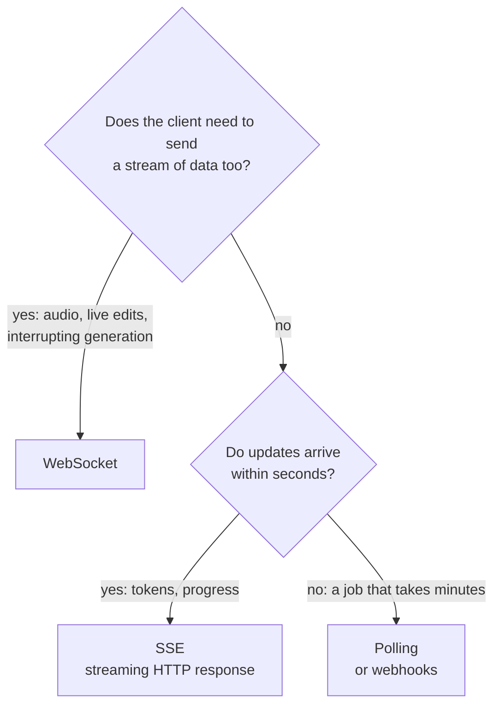
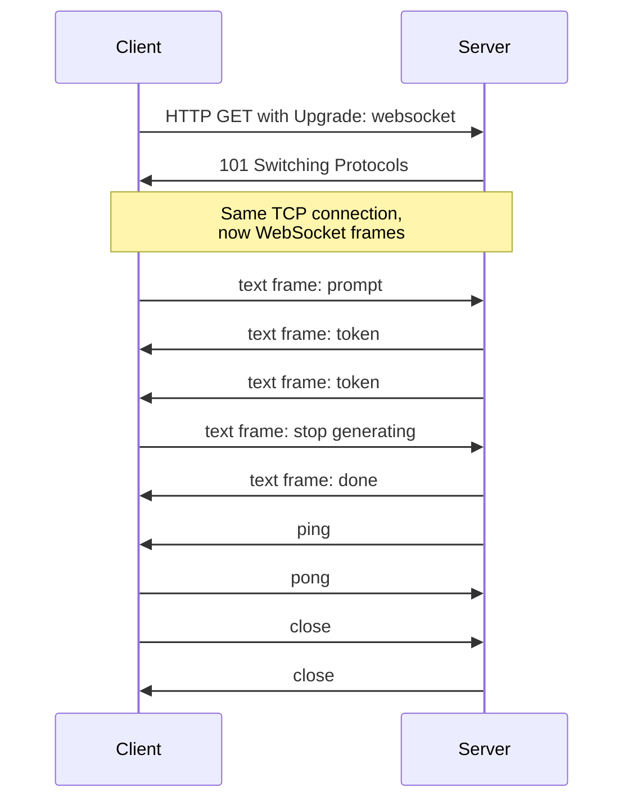

Plain HTTP is request-response: the client asks, the server answers once, and the exchange is over. Many AI features do not fit that shape. A chat interface wants tokens to appear as the model generates them; a voice assistant streams audio both ways at once; an agent dashboard shows each tool call as it happens; a collaborative editor pushes other users' changes the moment they occur. This lesson covers the three ways to get data to a client over time (polling, Server-Sent Events and WebSockets), how the WebSocket protocol works, and how to choose between them for streaming LLM output.

## Three ways to push updates

| | Polling | Server-Sent Events (SSE) | WebSockets |
| --- | --- | --- | --- |
| Direction | Client asks repeatedly | Server to client only | Both ways, any time |
| Protocol | Ordinary HTTP requests | One long HTTP response, `text/event-stream` | HTTP upgrade to a separate framed protocol |
| Data | Anything | UTF-8 text events | Text or binary messages |
| Reconnection | Built in (it is just requests) | Automatic in browsers, resumes with `Last-Event-ID` | You implement it |
| Works through proxies, caches, HTTP/2 | Yes | Yes | Usually, but needs proxy support for upgrades |
| Server cost | A request per poll, mostly empty | One open connection per client | One open connection per client |
| Good for | Job status every few seconds | LLM token streaming, notifications, progress | Chat with interruptions, voice, games, collaboration |



A useful rule: **start with the simplest thing that works.** For a single LLM response, the client already sends its whole prompt in one request; only the answer streams. That is exactly what SSE does, and it is what most LLM provider APIs use for their streaming mode, as you saw in [Streaming responses](/learn/working-with-llms/streaming-responses).

## Server-Sent Events: streaming over plain HTTP

SSE is just an HTTP response that does not end immediately. The server sets `Content-Type: text/event-stream` and writes events as they become available. Each event is one or more `field: value` lines followed by a blank line:

```text
HTTP/1.1 200 OK
Content-Type: text/event-stream
Cache-Control: no-cache

event: token
data: {"text": "Attention"}

event: token
data: {"text": " lets"}

event: done
data: {"finish_reason": "stop", "output_tokens": 9}

```

Producing that format is a few lines of code:

```python
import json

def sse_event(data, event=None, event_id=None):
    lines = []
    if event_id is not None:
        lines.append(f"id: {event_id}")
    if event:
        lines.append(f"event: {event}")
    for line in json.dumps(data).splitlines():
        lines.append(f"data: {line}")
    return "\n".join(lines) + "\n\n"

print(sse_event({"text": " lets"}, event="token", event_id=2), end="")
```

```output
id: 2
event: token
data: {"text": " lets"}
```

In the browser, `new EventSource(url)` parses the stream and reconnects automatically, sending the last `id` it saw in a `Last-Event-ID` header so the server can resume. One limitation: `EventSource` only makes GET requests without custom headers, so LLM frontends commonly read SSE from a `fetch` POST response body instead, parsing the same format by hand.

## The WebSocket protocol

A **WebSocket** is a persistent, two-way connection. It starts life as an ordinary HTTP/1.1 request asking to **upgrade** the connection to a different protocol:

```text
GET /v1/realtime HTTP/1.1
Host: api.example.com
Upgrade: websocket
Connection: Upgrade
Sec-WebSocket-Key: dGhlIHNhbXBsZSBub25jZQ==
Sec-WebSocket-Version: 13
Origin: https://app.example.com

HTTP/1.1 101 Switching Protocols
Upgrade: websocket
Connection: Upgrade
Sec-WebSocket-Accept: s3pPLMBiTxaQ9kYGzzhZRbK+xOo=
```

After the `101 Switching Protocols` response, the same TCP connection stops carrying HTTP. Both sides now send **frames**: small binary-headed packets carrying text messages, binary messages, or control signals (ping, pong, close).

The `Sec-WebSocket-Accept` value proves the server understood the WebSocket request rather than being a confused HTTP server or cache. RFC 6455 defines it as the base64 SHA-1 of the client's key joined to a fixed GUID:

```python
import base64
import hashlib

GUID = "258EAFA5-E914-47DA-95CA-C5AB0DC85B11"   # constant from RFC 6455

def accept_value(client_key):
    return base64.b64encode(hashlib.sha1((client_key + GUID).encode()).digest()).decode()

print(accept_value("dGhlIHNhbXBsZSBub25jZQ=="))
```

```output
s3pPLMBiTxaQ9kYGzzhZRbK+xOo=
```

It matches the response above, which is the example from the RFC itself. This is not security; it is a handshake check. Security comes from using `wss://` (WebSocket over TLS) and from authenticating the connection.



## Streaming LLM tokens over a WebSocket

Here is a working server and client using the `websockets` library. The fake model yields tokens with a small delay, standing in for a real streaming LLM call.

```python
import asyncio
from websockets.asyncio.client import connect
from websockets.asyncio.server import serve

async def fake_llm(prompt):
    for token in ["Attention", " lets", " each", " token", " see", " the", " others", "."]:
        await asyncio.sleep(0.01)           # a real model call would await the provider here
        yield token

async def chat(websocket):
    async for message in websocket:         # one message per user turn
        request = json.loads(message)
        async for token in fake_llm(request["prompt"]):
            await websocket.send(json.dumps({"type": "token", "text": token}))
        await websocket.send(json.dumps({"type": "done"}))

async def main():
    async with serve(chat, "127.0.0.1", 0) as server:
        port = server.sockets[0].getsockname()[1]
        async with connect(f"ws://127.0.0.1:{port}") as ws:
            await ws.send(json.dumps({"prompt": "Explain attention in one sentence"}))
            tokens = []
            async for raw in ws:
                event = json.loads(raw)
                if event["type"] == "done":
                    break
                tokens.append(event["text"])
                print("received", repr(event["text"]))
            print("final:", "".join(tokens))

asyncio.run(main())
```

```output
received 'Attention'
received ' lets'
received ' each'
received ' token'
received ' see'
received ' the'
received ' others'
received '.'
final: Attention lets each token see the others.
```

Notice that the protocol is yours to design. WebSockets only move messages; you decide on message types (`token`, `done`, `error`, `cancel`), and you should document them like any other API. A typed envelope such as `{"type": ..., ...}` makes it easy to add new message kinds later.

> [!KEY]
> For one prompt and one streamed answer, SSE is usually enough and simpler to operate. Reach for WebSockets when the client must keep sending while the server is sending: cancelling mid-generation, streaming microphone audio, or multi-user sessions.

## Operating WebSockets in production

Long-lived connections change how a backend behaves. Plan for:

- **Authentication.** Browsers cannot set custom headers such as `Authorization` on a WebSocket. Common patterns are a session cookie (and then you **must check the `Origin` header**, because cookies are sent from any site), or a short-lived single-use ticket obtained over normal HTTPS and passed in the URL or the first message.
- **Heartbeats.** Proxies and load balancers close connections that look idle. Ping/pong frames every 20 to 30 seconds keep them alive and detect dead peers. The `websockets` library sends pings automatically by default.
- **Reconnection.** Networks drop. Clients must reconnect with backoff and jitter, and the server should let them resume, for example by resending events after a given ID.
- **Back-pressure.** If a client reads more slowly than you produce, buffers grow. Awaiting `send` (as above) lets the library slow the producer down.
- **Scaling.** Each connection is pinned to one server process. If user A's message must reach user B on another instance, you need a shared channel such as Redis pub/sub between instances. Deploys also drop every open connection, so clients must expect it.
- **Limits.** Cap message sizes and connections per user, and time out connections that never authenticate.

> [!WARNING]
> A WebSocket bypasses much of your HTTP middleware after the handshake. Rate limiting, logging and authorization that you apply per HTTP request will not run per WebSocket message unless you apply them inside the message loop yourself.

## Exercises

**1.** Compute the `Sec-WebSocket-Accept` value for the client key `x3JJHMbDL1EzLkh9GBhXDw==`.

<details>
<summary>Show solution</summary>

```python
print(accept_value("x3JJHMbDL1EzLkh9GBhXDw=="))
```

```output
HSmrc0sMlYUkAGmm5OPpG2HaGWk=
```

</details>

**2.** For each feature, choose polling, SSE or WebSockets and justify it: (a) a progress bar for a 20-minute fine-tuning job; (b) a chatbot reply streamed token by token; (c) a voice assistant that streams microphone audio and can be interrupted while speaking.

<details>
<summary>Show solution</summary>

(a) Polling, every few seconds or more slowly; updates are rare and the job outlives any single connection (webhooks are an alternative for server-to-server use). (b) SSE: one request, a one-way stream of tokens, plain HTTP. (c) WebSockets: audio flows both ways continuously and the client must signal interruptions mid-response.

</details>

**3.** Extend the `sse_event` helper so that a `data` value containing a newline (a multi-line string) is sent correctly. Why does it matter?

<details>
<summary>Show solution</summary>

A blank line ends an SSE event, and each line of data needs its own `data:` prefix. `json.dumps` already escapes newlines inside strings as `\n`, so the JSON version is safe. For raw text, split it:

```python
def sse_text(text):
    return "".join(f"data: {line}\n" for line in text.split("\n")) + "\n"

print(sse_text("line one\nline two"), end="")
```

```output
data: line one
data: line two
```

Without this, a model output containing a blank line would end the event early and corrupt the stream.

</details>

```quiz
[
  {
    "q": "What status code does a server return to accept a WebSocket upgrade?",
    "options": ["`200 OK`", "`101 Switching Protocols`", "`204 No Content`", "`426 Upgrade Required`"],
    "answer": 1,
    "why": "`101` confirms the switch; after it the connection carries WebSocket frames instead of HTTP."
  },
  {
    "q": "A chat app sends a prompt and streams back one answer token by token. Which is usually the simplest fitting choice?",
    "options": ["Polling every 100 ms", "Server-Sent Events", "A WebSocket", "A webhook"],
    "answer": 1,
    "why": "The stream is one-way, server to client, so a streaming HTTP response with SSE fits without the operational cost of WebSockets."
  },
  {
    "q": "Why must a WebSocket server check the `Origin` header when it authenticates with cookies?",
    "options": ["The handshake fails without it", "Browsers send cookies from any site's pages, so a malicious site could open an authenticated connection", "It is needed to compute `Sec-WebSocket-Accept`", "Proxies require it"],
    "answer": 1,
    "why": "This attack is called cross-site WebSocket hijacking. Checking `Origin` against an allow-list prevents it."
  },
  {
    "q": "Which problem is specific to long-lived connections such as WebSockets?",
    "options": ["Status codes are unavailable", "Idle connections are closed by proxies unless heartbeats are sent", "JSON cannot be used", "TLS is not supported"],
    "answer": 1,
    "why": "Intermediaries close idle connections, so ping/pong heartbeats keep them open and detect dead peers."
  }
]
```
