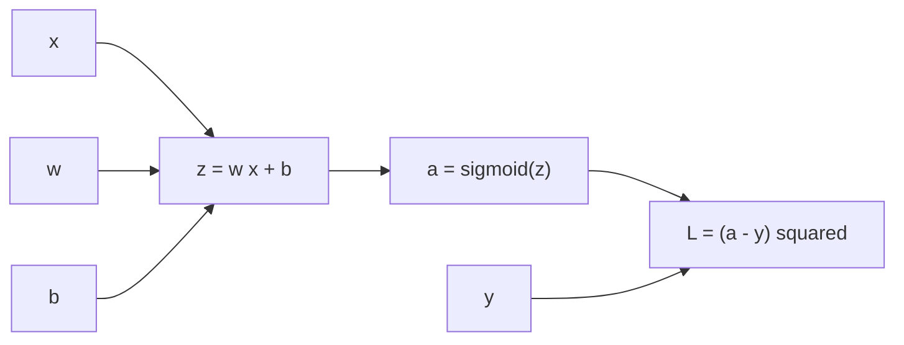
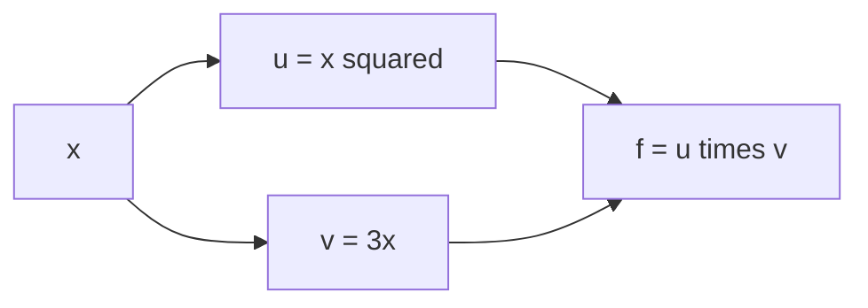

A neural network is a chain of functions: multiply by weights, add a bias, apply an activation, repeat, and finally compute a loss. To train it, you need the derivative of the loss with respect to every weight, even the ones buried many layers deep. The **chain rule** is the tool that makes this possible. It says that the slope of a chain of functions is the product of the slopes of its links. Backpropagation, the algorithm that trains essentially every deep learning model, is the chain rule applied systematically and efficiently. This lesson makes sure you understand it before you meet backpropagation properly.

## Intuition: rates multiply

Suppose a car's fuel use depends on its speed, and its speed depends on how far you press the accelerator. If pressing the pedal 1 cm further adds 10 km/h, and each extra km/h burns 0.02 litres more per hour, then pressing 1 cm further burns $10 \times 0.02 = 0.2$ litres more per hour. Rates of change along a chain **multiply**.

Functions work the same way. If $y = f(u)$ and $u = g(x)$, a small nudge to $x$ changes $u$ by about $g'(x)$ times the nudge, and that change in $u$ changes $y$ by about $f'(u)$ times as much again.

## The rule

For a composition $y = f(g(x))$, with $u = g(x)$ as the inner value:

$$
\frac{dy}{dx} = \frac{dy}{du} \cdot \frac{du}{dx} = f'(g(x)) \cdot g'(x)
$$

In words: differentiate the outer function, evaluated at the inner value, then multiply by the derivative of the inner function. The Leibniz notation on the left looks as though the $du$ terms cancel. They are not really fractions, but the mnemonic gives the right answer.

**Example.** For $y = \sin(x^2)$, the outer function is $\sin(u)$ with derivative $\cos(u)$, and the inner is $u = x^2$ with derivative $2x$:

$$
\frac{dy}{dx} = \cos(x^2) \cdot 2x
$$

Check it numerically at $x = 1.5$:

```python
import math

def numerical_derivative(f, x, h=1e-5):
    return (f(x + h) - f(x - h)) / (2 * h)

f = lambda x: math.sin(x**2)
f_prime = lambda x: math.cos(x**2) * 2 * x

print(round(f_prime(1.5), 6), round(numerical_derivative(f, 1.5), 6))
```

```output
-1.884521 -1.884521
```

Longer chains just keep multiplying. For $y = f(g(h(x)))$:

$$
\frac{dy}{dx} = f'(g(h(x))) \cdot g'(h(x)) \cdot h'(x)
$$

> [!KEY]
> The derivative of a chain is the product of the local derivatives of its links, each evaluated at the value that flowed into it. Every link only needs to know its own derivative. That locality is what lets frameworks like PyTorch differentiate models of any shape automatically.

## A neuron as a chain

Here is a single neuron with one input, a sigmoid activation and squared-error loss:

$$
z = wx + b, \qquad a = \sigma(z), \qquad L = (a - y)^2
$$

Here $x$ is the input, $y$ the target, $w$ and $b$ the parameters, $z$ the pre-activation, $a$ the activation (the prediction) and $L$ the loss. Draw it as a **computational graph**: each node is a simple operation, and values flow left to right.



The loss depends on $w$ only through $z$ and then $a$. The chain rule gives

$$
\frac{\partial L}{\partial w} = \frac{\partial L}{\partial a} \cdot \frac{\partial a}{\partial z} \cdot \frac{\partial z}{\partial w}
$$

and each link is a derivative you already know:

| Link | Local derivative |
| --- | --- |
| $L = (a - y)^2$ | $\dfrac{\partial L}{\partial a} = 2(a - y)$ |
| $a = \sigma(z)$ | $\dfrac{\partial a}{\partial z} = a(1 - a)$ |
| $z = wx + b$ | $\dfrac{\partial z}{\partial w} = x, \quad \dfrac{\partial z}{\partial b} = 1$ |

Notice the order of work. You first need the **forward pass** to get the values $z$ and $a$, because the local derivatives are evaluated at them. Then the **backward pass** multiplies local derivatives from the loss back towards the parameters. The shared prefix $\partial L / \partial z$ is computed once and reused for both $w$ and $b$.

## Step through it

Step through the forward and backward pass for one example with $x = 2$, $y = 1$, $w = 0.5$ and $b = -0.5$. Watch how each backward step reuses the value from the step before.

```trace
{
  "title": "forward and backward pass through one neuron",
  "code": [
    "x, y = 2.0, 1.0",
    "w, b = 0.5, -0.5",
    "z = w * x + b",
    "a = sigmoid(z)",
    "L = (a - y) ** 2",
    "dL_da = 2 * (a - y)",
    "da_dz = a * (1 - a)",
    "dL_dz = dL_da * da_dz",
    "dL_dw = dL_dz * x",
    "dL_db = dL_dz * 1.0",
    "print(round(dL_dw, 4), round(dL_db, 4))"
  ],
  "steps": [
    { "line": 2, "vars": { "x": "2.0", "y": "1.0", "w": "0.5", "b": "-0.5" }, "note": "One training example and the current parameters." },
    { "line": 3, "vars": { "x": "2.0", "y": "1.0", "w": "0.5", "b": "-0.5", "z": "0.5" }, "note": "Forward pass begins. z = 0.5 * 2 - 0.5 = 0.5." },
    { "line": 4, "vars": { "x": "2.0", "y": "1.0", "w": "0.5", "b": "-0.5", "z": "0.5", "a": "0.6225" }, "note": "The sigmoid squashes 0.5 to about 0.6225. The target is 1, so the prediction is too low." },
    { "line": 5, "vars": { "x": "2.0", "y": "1.0", "w": "0.5", "b": "-0.5", "z": "0.5", "a": "0.6225", "L": "0.1425" }, "note": "Loss = (0.6225 - 1) squared, about 0.1425. The forward pass is done and every intermediate value is stored." },
    { "line": 6, "vars": { "z": "0.5", "a": "0.6225", "L": "0.1425", "dL_da": "-0.7551" }, "note": "Backward pass, starting at the loss. Negative: raising a would lower the loss." },
    { "line": 7, "vars": { "z": "0.5", "a": "0.6225", "L": "0.1425", "dL_da": "-0.7551", "da_dz": "0.2350" }, "note": "The sigmoid's local slope, a(1 - a), computed from the stored a. No need to recompute the sigmoid." },
    { "line": 8, "vars": { "z": "0.5", "a": "0.6225", "dL_da": "-0.7551", "da_dz": "0.2350", "dL_dz": "-0.1774" }, "note": "Chain rule: multiply the two links. This value is shared by both parameters." },
    { "line": 9, "vars": { "x": "2.0", "dL_dz": "-0.1774", "dL_dw": "-0.3549" }, "note": "dz/dw = x = 2, so dL/dw = -0.1774 * 2 = -0.3549." },
    { "line": 10, "vars": { "x": "2.0", "dL_dz": "-0.1774", "dL_dw": "-0.3549", "dL_db": "-0.1774" }, "note": "dz/db = 1, so dL/db is just dL/dz." },
    { "line": 11, "vars": { "dL_dw": "-0.3549", "dL_db": "-0.1774" }, "out": ["-0.3549 -0.1774"], "note": "Both derivatives are negative: increasing w or b would reduce the loss, which makes sense because the prediction is below the target." }
  ]
}
```

A numerical check on the whole loss confirms both numbers:

```python
import math

def sigmoid(z):
    return 1 / (1 + math.exp(-z))

def loss(w, b, x=2.0, y=1.0):
    return (sigmoid(w * x + b) - y) ** 2

h = 1e-5
print(round((loss(0.5 + h, -0.5) - loss(0.5 - h, -0.5)) / (2 * h), 4))
print(round((loss(0.5, -0.5 + h) - loss(0.5, -0.5 - h)) / (2 * h), 4))
```

```output
-0.3549
-0.1774
```

## When paths branch: the multivariable chain rule

Sometimes a variable influences the output along more than one path. If $f$ depends on $u$ and $v$, and both depend on $x$, then the contributions from each path **add**:

$$
\frac{df}{dx} = \frac{\partial f}{\partial u}\frac{du}{dx} + \frac{\partial f}{\partial v}\frac{dv}{dx}
$$

For example, $f = u \cdot v$ with $u = x^2$ and $v = 3x$ gives $\dfrac{df}{dx} = v \cdot 2x + u \cdot 3 = 6x^2 + 3x^2 = 9x^2$, which matches differentiating $f = 3x^3$ directly.



The rule is: **multiply along each path, add across paths.** In a neural network a hidden unit feeds many units in the next layer, so its gradient is a sum over all of them. That sum-of-products, organised layer by layer and written with matrices, is exactly backpropagation, covered in depth in [Backpropagation](/learn/neural-network-fundamentals/backpropagation).

## Vanishing and exploding gradients

The chain rule also explains a classic training problem. In a deep network the gradient for an early weight is a product of many local derivatives, one per layer. The sigmoid's slope is at most 0.25, so ten sigmoid layers can shrink the signal by a factor of up to $0.25^{10} \approx 10^{-6}$: the early layers barely learn. This is the **vanishing gradient** problem. If local factors are consistently larger than 1, the product grows instead and gradients **explode**.

> [!NOTE]
> This is why ReLU, whose slope is exactly 1 for positive inputs, became the default activation, and why techniques like careful initialisation, residual connections and normalisation layers exist. You will meet them in the neural network modules; all of them are, at heart, ways to keep a long product of chain-rule factors well-behaved.

## Exercises

**1.** Differentiate $y = (3x + 1)^5$ with the chain rule and check at $x = 0$.

<details>
<summary>Show solution</summary>

Outer $u^5$ has derivative $5u^4$; inner $u = 3x + 1$ has derivative 3. So $y' = 15(3x + 1)^4$, and $y'(0) = 15$.

```python
def numerical_derivative(f, x, h=1e-5):
    return (f(x + h) - f(x - h)) / (2 * h)

print(round(numerical_derivative(lambda x: (3 * x + 1) ** 5, 0.0), 6))
```

```output
15.0
```

</details>

**2.** Differentiate $y = e^{-x^2}$ and evaluate the derivative at $x = 1$.

<details>
<summary>Show solution</summary>

Outer $e^u$ has derivative $e^u$; inner $u = -x^2$ has derivative $-2x$. So $y' = -2x e^{-x^2}$, and $y'(1) = -2/e \approx -0.7358$.

</details>

**3.** Repeat the neuron calculation for $x = 2$, $y = 0$, $w = 0.5$, $b = -0.5$ (same parameters, target now 0). What are the signs of $\partial L / \partial w$ and $\partial L / \partial b$, and why?

<details>
<summary>Show solution</summary>

The forward pass is unchanged: $a \approx 0.6225$. Now $\partial L / \partial a = 2(0.6225 - 0) \approx 1.2449$, and $\partial L / \partial z = 1.2449 \times 0.2350 \approx 0.2926$. So $\partial L / \partial w \approx 0.5851$ and $\partial L / \partial b \approx 0.2926$. Both are positive: the prediction is too high, so decreasing either parameter lowers the loss.

</details>

```quiz
[
  {
    "q": "What is the derivative of y = (x^2 + 1)^3?",
    "options": ["3(x^2 + 1)^2", "6x(x^2 + 1)^2", "3(2x)^2", "6x(x^2 + 1)^3"],
    "answer": 1,
    "why": "Outer derivative 3u^2 evaluated at u = x^2 + 1, times inner derivative 2x, gives 6x(x^2 + 1)^2."
  },
  {
    "q": "Why must the forward pass be run before the backward pass?",
    "options": [
      "The local derivatives are evaluated at the intermediate values computed in the forward pass",
      "The backward pass changes the weights first",
      "The loss must be zero before differentiating",
      "It is a convention with no mathematical reason"
    ],
    "answer": 0,
    "why": "Terms like a(1 - a) or x need the actual values that flowed through the graph, so they must be computed and stored first."
  },
  {
    "q": "A variable x affects f along two separate paths. How are the contributions combined?",
    "options": [
      "Multiply the two path derivatives",
      "Take the larger of the two",
      "Add the two path derivatives, each being a product along its path",
      "Average them"
    ],
    "answer": 2,
    "why": "Multiply along each path, then add across paths. This is the multivariable chain rule."
  },
  {
    "q": "Why do deep networks with sigmoid activations suffer from vanishing gradients?",
    "options": [
      "The sigmoid is not differentiable",
      "Each layer contributes a factor of at most 0.25, and the product of many such factors becomes tiny",
      "The sigmoid's output can be negative",
      "Sigmoid networks have too few weights"
    ],
    "answer": 1,
    "why": "The chain rule multiplies one local derivative per layer. With sigmoid slopes no bigger than 0.25, the product shrinks quickly with depth."
  }
]
```
