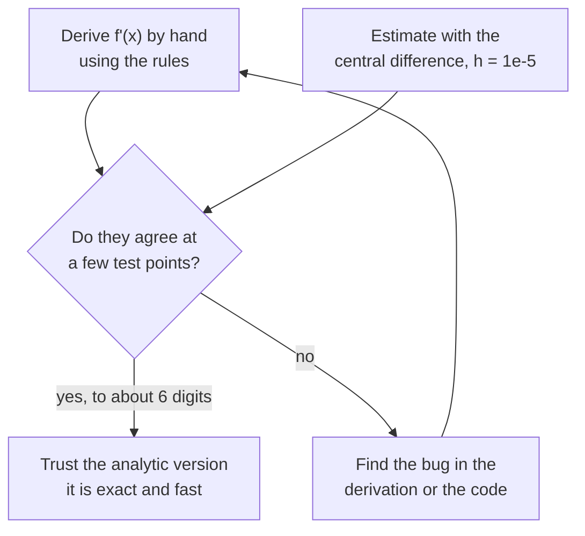

The derivative tells you how fast a function's output changes when you nudge its input. Picture standing on a curve: the derivative is the steepness under your feet, with a sign that says whether stepping right takes you uphill or downhill. For a model, the "curve" is the loss and the "input" is a weight, so the derivative answers the question training needs: should this weight go up or down, and how strongly does it matter? This lesson builds the idea, gives you the rules for computing derivatives by hand, and shows how to check every one of them numerically in plain Python.

## Slope as rate of change

For a straight line, slope is rise over run, and it is the same everywhere. A car's distance-time graph that is a straight line means constant speed: the slope **is** the speed, a rate of change.

A curve's steepness varies. The **derivative** of $f$ at a point $x$ is the slope of the line that just touches the curve there, the **tangent line**. You saw in the [limits](/learn/calculus/limits) lesson how to get it: take the slope between two nearby points and let the gap shrink to nothing.

$$
f'(x) = \lim_{h \to 0} \frac{f(x + h) - f(x)}{h}
$$

Here $f'(x)$, read "f prime of x", is the derivative, and $h$ is the small step. Another common notation is $\dfrac{df}{dx}$, read "d f by d x", which reminds you that it is a ratio of a tiny change in $f$ to a tiny change in $x$.

The sign and size of the derivative carry all the information you need:

| $f'(x)$ | What the curve is doing at $x$ | Which way is downhill |
| --- | --- | --- |
| Large positive | Rising steeply | Step left (decrease $x$) |
| Small positive | Rising gently | Step left, but the gain is small |
| Zero | Flat: a minimum, maximum or plateau | Nowhere, locally |
| Negative | Falling | Step right (increase $x$) |

> [!KEY]
> The derivative points **uphill**. To go downhill, move against its sign. This single fact is the whole basis of [gradient descent](/learn/calculus/gradient-descent).

A useful way to read the derivative: for a small step $\Delta x$ (a small change in $x$),

$$
f(x + \Delta x) \approx f(x) + f'(x)\,\Delta x
$$

If $f'(3) = 6$, nudging $x$ from 3 to 3.01 raises $f$ by roughly $6 \times 0.01 = 0.06$. This **linear approximation** is what makes derivatives useful: locally, every smooth curve looks like a straight line.

## Working one out from the definition

Take $f(x) = x^2$. Expand the top of the difference quotient:

$$
\frac{(x + h)^2 - x^2}{h} = \frac{x^2 + 2xh + h^2 - x^2}{h} = 2x + h
$$

As $h \to 0$ this approaches $2x$. So the derivative of $x^2$ is $2x$, and at $x = 3$ the slope is 6, matching the secant slopes you computed in the previous lesson.

## The rules you actually use

Nobody computes limits every time. A small set of rules covers nearly everything in machine learning. In the table, $c$ and $n$ are constants, and $u$ and $v$ are functions of $x$.

| Rule | Function | Derivative |
| --- | --- | --- |
| Constant | $c$ | $0$ |
| Power | $x^n$ | $n x^{n-1}$ |
| Constant multiple | $c \cdot u$ | $c \cdot u'$ |
| Sum | $u + v$ | $u' + v'$ |
| Product | $u \cdot v$ | $u' v + u v'$ |
| Exponential | $e^x$ | $e^x$ |
| Natural logarithm | $\log x$ | $1/x$ |
| Sigmoid | $\sigma(x)$ | $\sigma(x)\,(1 - \sigma(x))$ |
| ReLU | $\max(0, x)$ | $0$ if $x < 0$, $1$ if $x > 0$ |

Combining them: for $f(x) = x^3 - 2x$, the power rule gives $3x^2$ for the first term and $-2$ for the second, so $f'(x) = 3x^2 - 2$.

The exponential $e^x$ is special: it is its own derivative. Its slope at any point equals its height, which is why it appears whenever growth is proportional to size. The sigmoid's tidy derivative $\sigma(1 - \sigma)$ is why it was popular in early neural networks: once you have computed $\sigma(x)$ in the forward pass, its slope costs one multiplication.

## Checking derivatives numerically

You should never fully trust a derivative you derived by hand, and nor do professionals: **gradient checking** compares an analytic derivative with a numerical estimate. The best simple estimate is the **central difference**, which looks a step either side of $x$:

$$
f'(x) \approx \frac{f(x + h) - f(x - h)}{2h}
$$

```python
import math

def numerical_derivative(f, x, h=1e-5):
    """Central difference: slope of the line through x-h and x+h."""
    return (f(x + h) - f(x - h)) / (2 * h)

def f(x):
    return x**3 - 2 * x

def f_prime(x):
    return 3 * x**2 - 2

for x in [-1.0, 0.0, 2.0]:
    print(f"x={x:>4}  analytic={f_prime(x):.6f}  numerical={numerical_derivative(f, x):.6f}")
```

```output
x=-1.0  analytic=1.000000  numerical=1.000000
x= 0.0  analytic=-2.000000  numerical=-2.000000
x= 2.0  analytic=10.000000  numerical=10.000000
```

The same check confirms the sigmoid rule from the table:

```python
import math

def numerical_derivative(f, x, h=1e-5):
    return (f(x + h) - f(x - h)) / (2 * h)

def sigmoid(z):
    return 1 / (1 + math.exp(-z))

def sigmoid_prime(z):
    s = sigmoid(z)
    return s * (1 - s)

for z in [-4.0, 0.0, 2.0]:
    a = sigmoid_prime(z)
    n = numerical_derivative(sigmoid, z)
    print(f"z={z:>4}  analytic={a:.8f}  numerical={n:.8f}  diff={abs(a - n):.1e}")
```

```output
z=-4.0  analytic=0.01766271  numerical=0.01766271  diff=4.9e-14
z= 0.0  analytic=0.25000000  numerical=0.25000000  diff=6.7e-12
z= 2.0  analytic=0.10499359  numerical=0.10499359  diff=1.1e-13
```

Notice that the sigmoid's slope is at most 0.25, at $z = 0$, and only about 0.018 at $z = -4$. That small maximum is one cause of the **vanishing gradient** problem in deep networks, which you will see when slopes get multiplied through many layers in the [chain rule](/learn/calculus/chain-rule) lesson.

### Why central beats forward

The one-sided **forward difference** $(f(x + h) - f(x))/h$ has an error roughly proportional to $h$. The central difference cancels that leading error term, leaving one proportional to $h^2$. Compare them on $\sin$, whose exact derivative is $\cos$:

```python
import math

def forward(f, x, h):
    return (f(x + h) - f(x)) / h

def central(f, x, h):
    return (f(x + h) - f(x - h)) / (2 * h)

true = math.cos(1.0)          # the exact derivative of sin at x = 1
for h in [1e-1, 1e-3, 1e-5]:
    e_fwd = abs(forward(math.sin, 1.0, h) - true)
    e_cen = abs(central(math.sin, 1.0, h) - true)
    print(f"h={h:<6} forward error={e_fwd:.2e}  central error={e_cen:.2e}")
```

```output
h=0.1    forward error=4.29e-02  central error=9.00e-04
h=0.001  forward error=4.21e-04  central error=9.01e-08
h=1e-05  forward error=4.21e-06  central error=1.11e-11
```

Shrinking $h$ a hundredfold cuts the forward error a hundredfold but the central error about ten-thousandfold, until floating-point rounding takes over.



> [!TIP]
> Why not always use numerical derivatives? Cost. Each estimate needs two function evaluations per input. A model with a million weights would need two million forward passes for one update. Analytic derivatives, computed by backpropagation, get all of them for roughly the cost of one extra pass.

## Derivatives in training: a first look

Return to the one-weight model from [functions and graphs](/learn/calculus/functions-and-graphs), with loss $L(w) = \frac{1}{n}\sum_i (w x_i - y_i)^2$. Using the sum and power rules (and a small step of the chain rule that the next lessons make precise), its derivative is

$$
L'(w) = \frac{2}{n} \sum_{i=1}^{n} (w x_i - y_i)\, x_i
$$

At $w = 1$ the model under-predicts every target, the residuals $w x_i - y_i$ are all negative, and so $L'(1)$ is negative: the loss falls as $w$ increases. The derivative has told you, without trying any other values, to increase the weight.

## Pitfalls

- **Points where there is no derivative.** At a corner (ReLU at 0) or a jump the derivative does not exist. Frameworks choose a convention; it rarely matters.
- **Flat is not the same as finished.** $f'(x) = 0$ at minima, but also at maxima and plateaus. The [optimization](/learn/calculus/optimization) lesson shows how to tell them apart.
- **Units.** A derivative is "output units per input unit". If you rescale an input feature by 1000, the derivative with respect to its weight scales too, which is one reason feature scaling helps training.

## Exercises

**1.** Using the rules, differentiate $f(x) = 4x^3 + 5x^2 - 7$. Check your answer at $x = 1$ with `numerical_derivative`.

<details>
<summary>Show solution</summary>

$f'(x) = 12x^2 + 10x$, so $f'(1) = 22$.

```python
def numerical_derivative(f, x, h=1e-5):
    return (f(x + h) - f(x - h)) / (2 * h)

f = lambda x: 4 * x**3 + 5 * x**2 - 7
print(round(numerical_derivative(f, 1.0), 6))
```

```output
22.0
```

</details>

**2.** Use the product rule to differentiate $g(x) = x \, e^x$, then check at $x = 0.5$.

<details>
<summary>Show solution</summary>

With $u = x$ and $v = e^x$: $g'(x) = 1 \cdot e^x + x \cdot e^x = (1 + x)e^x$.

```python
import math

def numerical_derivative(f, x, h=1e-5):
    return (f(x + h) - f(x - h)) / (2 * h)

g = lambda x: x * math.exp(x)
print(round((1 + 0.5) * math.exp(0.5), 6), round(numerical_derivative(g, 0.5), 6))
```

```output
2.473082 2.473082
```

</details>

**3.** Using the linear approximation, estimate $\sqrt{4.1}$ from $f(x) = \sqrt{x} = x^{1/2}$ at $x = 4$. Compare with `math.sqrt(4.1)`.

<details>
<summary>Show solution</summary>

By the power rule $f'(x) = \tfrac{1}{2} x^{-1/2}$, so $f'(4) = 0.25$. Then $\sqrt{4.1} \approx 2 + 0.25 \times 0.1 = 2.025$. The true value is about 2.02485, so the approximation is good to three decimal places for this small step.

</details>

```quiz
[
  {
    "q": "At some weight w, the derivative of the loss is L'(w) = -3. To reduce the loss, you should:",
    "options": [
      "Decrease w",
      "Increase w",
      "Leave w unchanged, because the derivative is negative",
      "Set w to -3"
    ],
    "answer": 1,
    "why": "A negative derivative means the loss falls as w increases. Move against the sign of the derivative: increase w."
  },
  {
    "q": "What is the derivative of f(x) = 5x^4?",
    "options": ["20x^3", "5x^3", "20x^4", "4x^3"],
    "answer": 0,
    "why": "Power rule: bring down the exponent and reduce it by one, then multiply by the constant: 5 times 4x^3 = 20x^3."
  },
  {
    "q": "Why is the central difference (f(x+h) - f(x-h)) / 2h preferred over the forward difference for checking derivatives?",
    "options": [
      "It needs fewer function evaluations",
      "It works at points where the derivative does not exist",
      "Its error shrinks like h squared rather than like h, so it is much more accurate for the same h",
      "It avoids floating-point rounding entirely"
    ],
    "answer": 2,
    "why": "The symmetric formula cancels the leading error term. Both formulas need two evaluations, and both still suffer rounding error if h is too small."
  },
  {
    "q": "The sigmoid's derivative is s(1 - s) where s = sigmoid(x). What is its largest possible value?",
    "options": ["1", "0.5", "0.25", "It has no maximum"],
    "answer": 2,
    "why": "s(1 - s) is largest when s = 0.5, which happens at x = 0, giving 0.25. This small maximum contributes to vanishing gradients in deep sigmoid networks."
  }
]
```
