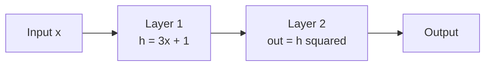
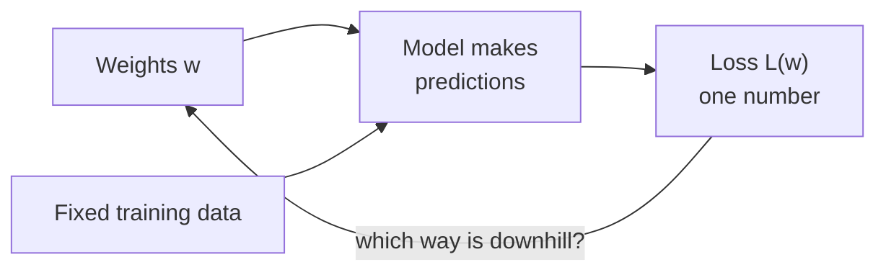

Calculus is the mathematics of change, and every machine learning model learns by asking one question over and over: if I nudge this number a little, does the error get better or worse? Before you can answer that, you need a clear picture of the thing being nudged. That thing is a **function**, and the picture is its **graph**. If it has been years since you last did any calculus, start here: this lesson rebuilds the vocabulary from the ground up and shows you why a trained model is, quite literally, a function.

## A function is a machine

A function takes an input and produces exactly one output. You already write them in Python; mathematics uses the same idea with a terser notation.

$$
f(x) = 2x + 1
$$

Here $f$ is the name of the function, $x$ is the input, and $2x + 1$ is the rule. Feed in $x = 3$ and you get $f(3) = 7$. The Python version is identical in spirit:

```python
def f(x):
    return 2 * x + 1

print(f(3))
```

```output
7
```

The key word is **exactly one**. A given input never produces two different outputs. Different inputs may share an output, though: $g(x) = x^2$ gives $4$ for both $x = 2$ and $x = -2$.

| Term | Meaning | Example for $g(x) = x^2$ |
| --- | --- | --- |
| Input (argument) | The value you feed in | $x = -2$ |
| Output (value) | What comes out | $g(-2) = 4$ |
| Domain | All inputs the function accepts | Every real number |
| Range | All outputs it can produce | Zero and the positive numbers |

Domains matter in practice. The logarithm $\log(x)$ only accepts $x > 0$, which is why cross-entropy loss code clips predicted probabilities away from zero before taking a log; `math.log(0)` raises `ValueError`.

## Reading a graph

The **graph** of a function is every point $(x, f(x))$ drawn on a plane: input along the horizontal axis, output up the vertical axis. A graph turns a rule into a shape, and shapes are what calculus studies.

Three features of a graph will matter for the rest of this module:

- **Where it goes up and down.** Moving right, is the curve rising or falling? That is the sign of the slope.
- **How steep it is.** A steep part means a small change in input causes a big change in output.
- **Where it bottoms out.** The lowest point of a curve is a minimum. Training a model is the search for a minimum.

For the straight line $f(x) = 2x + 1$ the steepness is the same everywhere: every step of 1 to the right raises the output by 2. That number, 2, is the **slope**. Curves do not have a single slope; their steepness changes from place to place, and measuring it at each point is exactly what [derivatives](/learn/calculus/derivatives) do.

> [!KEY]
> Keep one picture in mind for this whole module: a curve, a point on it, and the question "if I step a little to the right, how much does the height change?" Everything from limits to gradient descent is a refinement of that question.

## The functions you will meet in AI

A handful of shapes appear again and again in machine learning. You do not need to memorise their graphs in detail, but you should know their character.

| Function | Rule | Shape and role |
| --- | --- | --- |
| Linear | $f(x) = wx + b$ | Straight line. The core of linear regression and of every neural network layer |
| Quadratic | $f(x) = x^2$ | A U-shaped bowl with one lowest point. Squared-error loss looks like this |
| Exponential | $f(x) = e^x$ | Always positive, grows faster and faster. Used in softmax |
| Logarithm | $f(x) = \log x$ | Defined only for $x > 0$, grows slowly. The heart of cross-entropy loss |
| Sigmoid | $\sigma(z) = \dfrac{1}{1 + e^{-z}}$ | An S-curve squashing any number into the range 0 to 1. Turns a score into a probability |
| ReLU | $\text{ReLU}(z) = \max(0, z)$ | Zero for negative inputs, the identity for positive ones. The most common activation function |

Here $e \approx 2.718$ is Euler's number, and $\log$ means the natural logarithm, the inverse of $e^x$. Evaluating two of these in Python shows their behaviour:

```python
import math

def sigmoid(z):
    return 1 / (1 + math.exp(-z))

def relu(z):
    return max(0.0, z)

for z in [-4.0, -1.0, 0.0, 1.0, 4.0]:
    print(f"z={z:>5}  sigmoid={sigmoid(z):.4f}  relu={relu(z)}")
```

```output
z= -4.0  sigmoid=0.0180  relu=0.0
z= -1.0  sigmoid=0.2689  relu=0.0
z=  0.0  sigmoid=0.5000  relu=0.0
z=  1.0  sigmoid=0.7311  relu=1.0
z=  4.0  sigmoid=0.9820  relu=4.0
```

Notice the sigmoid flattening out at both ends: going from $z = 1$ to $z = 4$ adds less than 0.26. Flat regions have tiny slopes, and you will see later that tiny slopes make learning slow.

## Composition: functions inside functions

You can feed the output of one function into another. Writing $f(g(x))$ means "apply $g$ first, then $f$ to the result". This is called **composition**, sometimes written $f \circ g$.

A neural network is nothing more than a long composition: each layer is a function, and the output of one is the input of the next.



```python
def layer1(x):
    return 3 * x + 1

def layer2(h):
    return h ** 2

def model(x):
    return layer2(layer1(x))   # composition: layer2 after layer1

print(model(2))
print(layer1(layer2(2)))       # order matters
```

```output
49
13
```

Order matters: $(3 \cdot 2 + 1)^2 = 49$ but $3 \cdot 2^2 + 1 = 13$. When you reach the [chain rule](/learn/calculus/chain-rule) you will learn how to find the slope of a composition, which is the mathematical engine of training deep networks.

## Functions of several inputs

Many functions take more than one input. The area of a rectangle is $A(w, h) = w \cdot h$. Its graph is no longer a curve but a **surface**: for each pair of inputs there is a height above the floor. With more than two inputs you can no longer draw it, but the idea is the same, and the vectors from [Linear Algebra](/learn/linear-algebra/scalars-vectors-and-matrices) give you a compact way to write it: $f(\mathbf{x})$ where $\mathbf{x}$ is a vector of inputs.

A model with a million weights is a function of a million inputs. You cannot picture that surface, but you can still ask which way is downhill.

## Loss as a function of the weights

Here is the idea that ties this module together. Take a tiny dataset and a one-parameter model $\hat{y} = wx$. For each choice of the weight $w$, you can compute how wrong the model is, using the **mean squared error** (MSE):

$$
L(w) = \frac{1}{n} \sum_{i=1}^{n} (w x_i - y_i)^2
$$

where $n$ is the number of examples, $x_i$ and $y_i$ are the input and target of example $i$, and $L$ is the **loss**. The data are fixed; the only thing that varies is $w$. So the loss is a function of the weight.

```python
xs = [1.0, 2.0, 3.0, 4.0]
ys = [2.1, 3.9, 6.2, 7.8]

def loss(w):
    """Mean squared error of the model y_hat = w * x."""
    errors = [(w * x - y) ** 2 for x, y in zip(xs, ys)]
    return sum(errors) / len(errors)

for w in [1.0, 1.5, 2.0, 2.5, 3.0]:
    print(f"w={w:.1f}  loss={loss(w):.4f}")
```

```output
w=1.0  loss=7.3750
w=1.5  loss=1.8250
w=2.0  loss=0.0250
w=2.5  loss=1.9750
w=3.0  loss=7.6750
```

Plot those points and you get a U-shaped bowl with its bottom near $w = 2$. Training means finding the bottom of that bowl. Trying every value, as this loop does, works for one weight; for a million weights it is hopeless. You need a way to tell, from where you stand, which direction leads down. That is what the rest of this module builds.



> [!NOTE]
> In everyday maths you think of $x$ as the variable. In machine learning the roles swap: the data $x$ are fixed constants, and the weights are the variables you adjust. Keep this flip in mind whenever you read a formula.

## Exercises

**1.** Write a Python function for $h(x) = \log(x)$ using `math.log`, and evaluate it at 0.5, 1, 2 and 4. What happens at 0? What is the domain of $h$?

<details>
<summary>Show solution</summary>

```python
import math

for x in [0.5, 1, 2, 4]:
    print(x, round(math.log(x), 4))
```

```output
0.5 -0.6931
1 0.0
2 0.6931
4 1.3863
```

`math.log(0)` raises `ValueError: math domain error`. The domain is all $x > 0$. Note that $\log(4) = 2 \log(2)$: each doubling adds the same amount, which is why logarithms grow so slowly.

</details>

**2.** Using `layer1` and `layer2` from the composition section, what is `model(-1)`? Is there any input for which `model` returns a negative number?

<details>
<summary>Show solution</summary>

`layer1(-1)` is $3 \cdot (-1) + 1 = -2$, and squaring gives 4. The model can never return a negative number, because its last step squares its input. The range of the composition is limited by the range of the outer function.

</details>

**3.** Extend the loss example to evaluate $L(w)$ at $w = 1.9$, $1.95$ and $2.0$. Which is lowest? What does that suggest about where the bottom of the bowl is?

<details>
<summary>Show solution</summary>

Add those values to the list in the loop. $L(1.9) = 0.085$, $L(1.95) = 0.03625$ and $L(2.0) = 0.025$, so $w = 2.0$ is lowest of the three and the loss is still falling as $w$ approaches 2. The true bottom is close by but not exactly at 2: it is at $w = 1.99$, where $L = 0.02425$. Finding it by trial and error took several guesses for a single weight, which is the motivation for using slopes instead.

</details>

```quiz
[
  {
    "q": "Which of these is NOT a valid function of x?",
    "options": [
      "A rule that gives 4 for both x = 2 and x = -2",
      "A rule that gives both 3 and 5 for x = 1",
      "A rule that gives 0 for every x",
      "A rule defined only for x greater than 0"
    ],
    "answer": 1,
    "why": "A function must give exactly one output for each input. Sharing outputs between inputs, constant outputs and restricted domains are all fine."
  },
  {
    "q": "In machine learning, when you write the loss as L(w), what is treated as the variable?",
    "options": ["The training inputs x", "The targets y", "The model weights w", "The number of examples n"],
    "answer": 2,
    "why": "The data are fixed; training adjusts the weights, so the loss is viewed as a function of the weights."
  },
  {
    "q": "With f(x) = x + 1 and g(x) = 2x, what is f(g(3))?",
    "options": ["8", "7", "6", "9"],
    "answer": 1,
    "why": "Apply g first: g(3) = 6. Then f(6) = 7. The other order, g(f(3)), would give 8."
  },
  {
    "q": "Why does the sigmoid's shape cause slow learning for very large or very small inputs?",
    "options": [
      "It is undefined there",
      "Its output becomes negative",
      "The curve is almost flat there, so its slope is tiny",
      "It grows without limit"
    ],
    "answer": 2,
    "why": "Far from zero the sigmoid flattens towards 0 or 1. A flat curve has a slope near zero, so nudging the input barely changes the output."
  }
]
```
