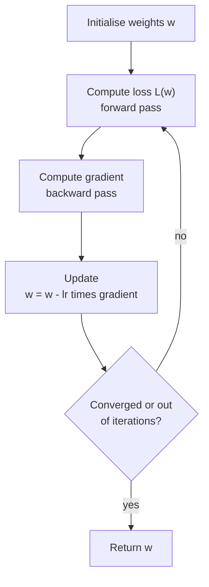
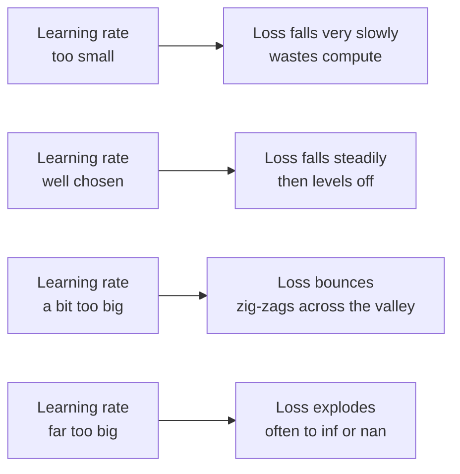

Gradient descent is how models learn. The idea fits in one sentence: compute the gradient of the loss, take a small step in the opposite direction, and repeat. Imagine standing on a foggy hillside, unable to see the valley, but able to feel the slope under your feet. Step downhill, feel again, step again, and you will eventually reach low ground. Linear regression, logistic regression, neural networks and large language models are all trained by variations of this loop. This lesson turns the [gradient](/learn/calculus/gradients) into an algorithm, traces it step by step with real numbers, and shows how the learning rate can make or break it.

## The update rule

Let $\mathbf{w}$ be the current weights, $L(\mathbf{w})$ the loss, and $\eta$ (the Greek letter eta) the **learning rate**, a small positive number that sets the step size. One step of gradient descent is

$$
\mathbf{w} \leftarrow \mathbf{w} - \eta \, \nabla L(\mathbf{w})
$$

The arrow means "replace with". Each part has a job:

| Part | Role |
| --- | --- |
| $\nabla L(\mathbf{w})$ | Points uphill, with length equal to the steepness |
| The minus sign | Turns uphill into downhill |
| $\eta$ | Scales the step: how far to trust the local slope |

With one weight, the gradient is just the derivative, and the rule is $w \leftarrow w - \eta \, L'(w)$. If the slope is positive, $w$ decreases; if negative, $w$ increases. Steep slopes produce big steps and gentle slopes small ones, so the steps shrink automatically as you approach a flat bottom.



## Tracing the iterations

Take the simplest possible loss, $L(w) = (w - 3)^2$, whose minimum is obviously at $w = 3$. Its derivative is $L'(w) = 2(w - 3)$. Start at $w = 0$ with learning rate $\eta = 0.1$ and step through four iterations.

```trace
{
  "title": "gradient descent on L(w) = (w - 3) squared",
  "code": [
    "w = 0.0",
    "lr = 0.1",
    "for step in range(4):",
    "    loss = (w - 3) ** 2",
    "    grad = 2 * (w - 3)",
    "    print(f\"w={w:.4f} loss={loss:.4f} grad={grad:.4f}\")",
    "    w = w - lr * grad",
    "print(f\"final w={w:.4f}\")"
  ],
  "steps": [
    { "line": 2, "vars": { "w": "0.0", "lr": "0.1" }, "note": "Start far from the minimum at w = 3, with a learning rate of 0.1." },
    { "line": 4, "vars": { "w": "0.0", "lr": "0.1", "step": "0", "loss": "9.0" }, "note": "Loss = (0 - 3) squared = 9." },
    { "line": 5, "vars": { "w": "0.0", "lr": "0.1", "step": "0", "loss": "9.0", "grad": "-6.0" }, "note": "The slope is -6: the loss falls as w increases, so we should increase w." },
    { "line": 7, "vars": { "w": "0.6", "lr": "0.1", "step": "0", "loss": "9.0", "grad": "-6.0" }, "out": ["w=0.0000 loss=9.0000 grad=-6.0000"], "note": "w = 0 - 0.1 * (-6) = 0.6. Subtracting a negative gradient moves w up." },
    { "line": 5, "vars": { "w": "0.6", "lr": "0.1", "step": "1", "loss": "5.76", "grad": "-4.8" }, "out": ["w=0.0000 loss=9.0000 grad=-6.0000"], "note": "Loss has dropped to 5.76. The slope is gentler now, -4.8, because we are closer to the bottom." },
    { "line": 7, "vars": { "w": "1.08", "lr": "0.1", "step": "1", "loss": "5.76", "grad": "-4.8" }, "out": ["w=0.0000 loss=9.0000 grad=-6.0000", "w=0.6000 loss=5.7600 grad=-4.8000"], "note": "w = 0.6 + 0.48 = 1.08. The step was smaller than the first one (0.48 versus 0.6)." },
    { "line": 7, "vars": { "w": "1.464", "lr": "0.1", "step": "2", "loss": "3.6864", "grad": "-3.84" }, "out": ["w=0.0000 loss=9.0000 grad=-6.0000", "w=0.6000 loss=5.7600 grad=-4.8000", "w=1.0800 loss=3.6864 grad=-3.8400"], "note": "Loss 3.6864, gradient -3.84, step 0.384. Each step closes 20 percent of the remaining gap to 3." },
    { "line": 7, "vars": { "w": "1.7712", "lr": "0.1", "step": "3", "loss": "2.3593", "grad": "-3.072" }, "out": ["w=0.0000 loss=9.0000 grad=-6.0000", "w=0.6000 loss=5.7600 grad=-4.8000", "w=1.0800 loss=3.6864 grad=-3.8400", "w=1.4640 loss=2.3593 grad=-3.0720"], "note": "w = 1.464 + 0.3072 = 1.7712. Progress slows as the slope flattens." },
    { "line": 8, "vars": { "w": "1.7712", "lr": "0.1" }, "out": ["w=0.0000 loss=9.0000 grad=-6.0000", "w=0.6000 loss=5.7600 grad=-4.8000", "w=1.0800 loss=3.6864 grad=-3.8400", "w=1.4640 loss=2.3593 grad=-3.0720", "final w=1.7712"], "note": "After four steps the loss has fallen from 9 to about 1.5. More iterations would carry w ever closer to 3." }
  ]
}
```

Why exactly 20 percent? Substituting the derivative into the update gives $w \leftarrow w - 0.2(w - 3)$, so the distance to the minimum, $w - 3$, is multiplied by $0.8$ each step. That multiplier, $1 - 2\eta$ for this loss, is the key to understanding learning rates.

## The learning rate: too small, just right, too big

Run 20 steps from $w = 0$ with different learning rates:

```python
def run(lr, steps=20, w=0.0):
    for _ in range(steps):
        w = w - lr * 2 * (w - 3)
    return w

for lr in [0.01, 0.1, 0.5, 0.9, 1.1]:
    w = run(lr)
    print(f"lr={lr:<5} w after 20 steps={w:12.4f}  loss={(w - 3) ** 2:.4g}")
```

```output
lr=0.01  w after 20 steps=      0.9972  loss=4.011
lr=0.1   w after 20 steps=      2.9654  loss=0.001196
lr=0.5   w after 20 steps=      3.0000  loss=0
lr=0.9   w after 20 steps=      2.9654  loss=0.001196
lr=1.1   w after 20 steps=   -112.0128  loss=1.323e+04
```

The multiplier $1 - 2\eta$ explains every row:

| $\eta$ | Multiplier on the gap | Behaviour |
| --- | --- | --- |
| 0.01 | 0.98 | Too small: crawls, still far away after 20 steps |
| 0.1 | 0.8 | Steady, smooth convergence |
| 0.5 | 0 | Lands exactly on the minimum in one step (a lucky fit for this particular bowl) |
| 0.9 | -0.8 | Overshoots to the other side each time, zig-zagging inwards. Same distance as 0.1, but oscillating |
| 1.1 | -1.2 | Too big: each overshoot is larger than the last, and the weights **diverge** |



> [!WARNING]
> If your training loss suddenly jumps to `inf` or `nan`, a learning rate that is too large is the first suspect. If the loss falls but painfully slowly, try a larger one. Real models have no single "right" value; practitioners try values spread by factors of about 3 to 10 and watch the loss curve. The [learning rates](/learn/neural-network-fundamentals/learning-rates) lesson covers schedules that change $\eta$ during training.

## Gradient descent for linear regression

Now a real model. Fit $\hat{y} = wx + b$ to the four points used throughout this module, using the partial derivatives from the [partial derivatives](/learn/calculus/partial-derivatives) lesson, written with NumPy:

```python
import numpy as np

x = np.array([1.0, 2.0, 3.0, 4.0])
y = np.array([2.1, 3.9, 6.2, 7.8])

w, b = 0.0, 0.0
lr = 0.05

for epoch in range(1, 501):
    error = w * x + b - y            # residuals
    loss = np.mean(error ** 2)
    dw = 2 * np.mean(error * x)      # dL/dw
    db = 2 * np.mean(error)          # dL/db
    w -= lr * dw
    b -= lr * db
    if epoch in (1, 10, 50, 100, 500):
        print(f"epoch {epoch:>3}: loss={loss:.4f}  w={w:.4f}  b={b:.4f}")
```

```output
epoch   1: loss=29.7250  w=1.4925  b=0.5000
epoch  10: loss=0.0471  w=1.8063  b=0.5430
epoch  50: loss=0.0285  w=1.8669  b=0.3650
epoch 100: loss=0.0223  w=1.9056  b=0.2511
epoch 500: loss=0.0205  w=1.9399  b=0.1502
```

(The printed loss is the value before that epoch's update.) The exact least-squares answer, from `np.polyfit(x, y, 1)`, is $w = 1.94$, $b = 0.15$, and gradient descent has found it. Notice the two phases: the loss collapses in the first ten epochs, then the parameters creep slowly as $b$ trades off against $w$. Long slow tails like this are typical, and they are one reason better optimisers exist.

> [!KEY]
> Linear regression has a closed-form solution, so you would not normally use gradient descent for it. Neural networks have no closed form; gradient descent, with gradients from backpropagation, is the only practical way to train them. The loop above is, structurally, the same loop that trains a large language model.

## Batch, stochastic and mini-batch

The loss is an average over the training set. Computing its exact gradient means touching every example for every step, which is slow for millions of examples. The fix is to estimate the gradient from a sample:

| Variant | Gradient computed from | Trade-off |
| --- | --- | --- |
| Batch gradient descent | The whole training set | Exact but slow per step |
| Stochastic gradient descent (SGD) | One random example | Very cheap but noisy steps |
| Mini-batch gradient descent | A random batch, say 32 to 512 examples | The standard compromise; batches suit GPUs well |

In everyday speech "SGD" usually means the mini-batch version. The noise is not purely a cost: it can jostle the weights out of poor regions of the loss surface. One full pass through the training data is called an **epoch**.

## When to stop

There is no bell that rings at the minimum. Common stopping rules: a fixed number of steps or epochs; stop when the loss improves by less than some tolerance; stop when the gradient's length falls below a threshold; or, for real models, stop when the loss on held-out validation data stops improving (early stopping).

## Exercises

**1.** Apply gradient descent by hand to $L(w) = w^2$ starting at $w = 4$ with $\eta = 0.25$. Write down $w$ after three steps. What is the multiplier on $w$ each step?

<details>
<summary>Show solution</summary>

$L'(w) = 2w$, so $w \leftarrow w - 0.25 \cdot 2w = 0.5w$. The multiplier is 0.5: $w$ goes $4 \to 2 \to 1 \to 0.5$.

</details>

**2.** For $L(w) = (w - 3)^2$, what is the largest learning rate that does not diverge? Explain using the multiplier $1 - 2\eta$.

<details>
<summary>Show solution</summary>

The gap shrinks only if $|1 - 2\eta| < 1$, which means $0 < \eta < 1$. At $\eta = 1$ the multiplier is $-1$, so $w$ bounces between 0 and 6 forever without converging, and above 1 it diverges. A steeper bowl, such as $5(w - 3)^2$, has a smaller safe range: steeper curvature demands a smaller learning rate.

</details>

**3.** Modify the linear regression loop to stop as soon as the gradient's length $\sqrt{dw^2 + db^2}$ falls below $10^{-3}$, and print the epoch at which it stops.

<details>
<summary>Show solution</summary>

```python
import numpy as np

x = np.array([1.0, 2.0, 3.0, 4.0])
y = np.array([2.1, 3.9, 6.2, 7.8])
w, b, lr = 0.0, 0.0, 0.05

for epoch in range(1, 10_001):
    error = w * x + b - y
    dw = 2 * np.mean(error * x)
    db = 2 * np.mean(error)
    if np.hypot(dw, db) < 1e-3:
        break
    w -= lr * dw
    b -= lr * db

print(epoch, round(w, 4), round(b, 4))
```

```output
331 1.9389 0.1531
```

It stops at epoch 331, already within about 0.003 of the exact answer $(1.94, 0.15)$. A tolerance on the gradient adapts to the problem rather than relying on a guessed epoch count; a tighter tolerance would run longer and get closer.

</details>

```quiz
[
  {
    "q": "In the update w = w - lr * grad, what is the purpose of the minus sign?",
    "options": [
      "It keeps the weights small",
      "It makes the step move downhill, since the gradient points uphill",
      "It reverses the effect of the learning rate",
      "It ensures the loss is positive"
    ],
    "answer": 1,
    "why": "The gradient points in the direction of steepest ascent. Subtracting it moves towards lower loss."
  },
  {
    "q": "Your training loss becomes nan after a few hundred steps, having grown rapidly. What is the most likely first fix?",
    "options": [
      "Increase the learning rate",
      "Train for more epochs",
      "Decrease the learning rate",
      "Remove the minus sign from the update"
    ],
    "answer": 2,
    "why": "Rapidly growing loss is the signature of divergence from steps that overshoot. A smaller learning rate is the first thing to try."
  },
  {
    "q": "With L(w) = (w - 3)^2 and learning rate 0.9, gradient descent from w = 0 does what?",
    "options": [
      "Converges while overshooting to alternating sides of 3",
      "Diverges",
      "Converges smoothly from one side",
      "Stays at 0"
    ],
    "answer": 0,
    "why": "The gap to 3 is multiplied by 1 - 2(0.9) = -0.8 each step: its size shrinks but its sign flips, so w zig-zags towards 3."
  },
  {
    "q": "What distinguishes mini-batch gradient descent from batch gradient descent?",
    "options": [
      "It uses a different update rule",
      "It estimates the gradient from a random subset of examples at each step",
      "It does not need a learning rate",
      "It only works for linear models"
    ],
    "answer": 1,
    "why": "The update is the same; only the gradient is estimated from a sample, making each step much cheaper at the cost of some noise."
  }
]
```
