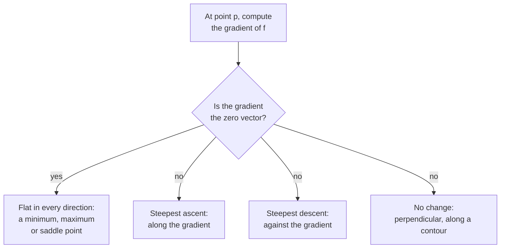

The gradient gathers all the partial derivatives of a function into a single vector. That vector has a remarkable geometric meaning: it points in the direction in which the function increases fastest, and its length says how steep that climb is. Flip its sign and you have the direction of steepest descent, which is exactly what you want when the function is a loss. Every time a deep learning framework "computes gradients", this is the object it produces, one entry per weight. This lesson builds on [partial derivatives](/learn/calculus/partial-derivatives) and on the vectors and dot products from Linear Algebra.

## From partial derivatives to a vector

For a function $f(x_1, x_2, \dots, x_n)$ of $n$ variables, the **gradient** is the vector of its partial derivatives:

$$
\nabla f = \begin{bmatrix} \dfrac{\partial f}{\partial x_1} \\[6pt] \dfrac{\partial f}{\partial x_2} \\[2pt] \vdots \\[2pt] \dfrac{\partial f}{\partial x_n} \end{bmatrix}
$$

The symbol $\nabla$ is called "nabla" or "del"; $\nabla f$ is read "grad f". When the variables are model weights $\mathbf{w}$, you will often see $\nabla_{\mathbf{w}} L$, the gradient of the loss with respect to the weights. It has exactly the same shape as $\mathbf{w}$: one entry per weight.

**Example.** For the bowl-shaped $f(x, y) = x^2 + 3y^2$:

$$
\nabla f(x, y) = \begin{bmatrix} 2x \\ 6y \end{bmatrix}, \qquad \nabla f(1, 1) = \begin{bmatrix} 2 \\ 6 \end{bmatrix}
$$

The gradient is a different vector at every point: it is a **vector field**, an arrow attached to each location on the surface.

## Directional derivatives: slope in any direction

Partial derivatives give the slope going due east or due north. What about walking at an angle? Pick a **unit vector** $\mathbf{u}$ (length 1, see [norms and distances](/learn/linear-algebra/norms-and-distances)) for your direction. The slope in that direction, the **directional derivative**, is a [dot product](/learn/linear-algebra/dot-product):

$$
D_{\mathbf{u}} f = \nabla f \cdot \mathbf{u}
$$

This is the multivariable version of the linear approximation from the derivatives lesson: a small step $\Delta \mathbf{x}$ changes $f$ by about $\nabla f \cdot \Delta \mathbf{x}$.

## Why the gradient points uphill

Recall that a dot product equals $\|\nabla f\| \, \|\mathbf{u}\| \cos\theta$, where $\theta$ is the angle between the two vectors. With $\|\mathbf{u}\| = 1$:

$$
D_{\mathbf{u}} f = \|\nabla f\| \cos\theta
$$

Since $\cos\theta$ is at most 1, reached when $\theta = 0$, the slope is greatest when you walk **in the direction of the gradient**, and that greatest slope equals the gradient's length. Walk directly against it ($\theta = 180°$) and you get the steepest descent, $-\|\nabla f\|$. Walk at right angles ($\theta = 90°$) and the slope is zero: you are moving along a **contour line**, a path of constant height.

| Direction of travel | Angle to gradient | Slope |
| --- | --- | --- |
| Along $\nabla f$ | 0° | $+\lVert \nabla f \rVert$, steepest ascent |
| Perpendicular to $\nabla f$ | 90° | 0, along a contour |
| Against $\nabla f$ | 180° | $-\lVert \nabla f \rVert$, steepest descent |

Check this numerically on the bowl at $(1, 1)$:

```python
import numpy as np

def f(p):
    x, y = p
    return x**2 + 3 * y**2

def grad_f(p):
    x, y = p
    return np.array([2 * x, 6 * y])

p = np.array([1.0, 1.0])
g = grad_f(p)
print("gradient:", g, " length:", round(np.linalg.norm(g), 4))

# rate of change of f when stepping in each unit direction u: grad . u
for name, u in [("east", [1, 0]), ("north", [0, 1]),
                ("along gradient", g / np.linalg.norm(g)),
                ("against gradient", -g / np.linalg.norm(g))]:
    print(f"{name:<17} slope = {np.dot(g, u):.4f}")
```

```output
gradient: [2. 6.]  length: 6.3246
east              slope = 2.0000
north             slope = 6.0000
along gradient    slope = 6.3246
against gradient  slope = -6.3246
```

No direction is steeper than the gradient's own, 6.3246. Notice also that the gradient $(2, 6)$ does not point at the bottom of the bowl, which is at the origin $(0, 0)$: it is tilted towards the $y$ axis because the bowl is steeper in $y$. Steepest descent is a local, short-sighted direction, a point that matters in the [gradient descent](/learn/calculus/gradient-descent) lesson.

> [!KEY]
> The gradient points in the direction of steepest **ascent**, and its length is the steepness. To reduce a loss, step in the direction $-\nabla L$. Where the gradient is the zero vector, the surface is flat in every direction.



## A gradient checker for any function

The numerical derivative extends to vectors by nudging one coordinate at a time. This is the standard **gradient check** used to validate hand-written backward passes.

```python
import numpy as np

def numerical_gradient(f, p, h=1e-5):
    grad = np.zeros_like(p)
    for i in range(len(p)):
        step = np.zeros_like(p)
        step[i] = h
        grad[i] = (f(p + step) - f(p - step)) / (2 * h)
    return grad
```

It costs two evaluations of $f$ per coordinate, so it is only for testing, never for training.

## The gradient of a linear model's loss

Now the payoff from Linear Algebra. Stack $n$ training examples with $d$ features into a matrix $X$ (shape $n \times d$), the targets into a vector $\mathbf{y}$ (length $n$), and the weights into $\mathbf{w}$ (length $d$). The predictions are $X\mathbf{w}$, and the mean squared error is

$$
L(\mathbf{w}) = \frac{1}{n} \|X\mathbf{w} - \mathbf{y}\|^2
$$

Applying the partial derivative calculation from the previous lesson to every weight at once gives a compact matrix formula:

$$
\nabla_{\mathbf{w}} L = \frac{2}{n} X^\top (X\mathbf{w} - \mathbf{y})
$$

Read it right to left: compute the residual vector $X\mathbf{w} - \mathbf{y}$, then $X^\top$ combines the residuals, weighted by each feature, into one number per weight. It is the same "average of residual times input" you saw for one weight, done for all $d$ weights in one matrix product. Verify it against the checker:

```python
rng = np.random.default_rng(0)
X = rng.normal(size=(50, 3))                 # 50 examples, 3 features
y = X @ np.array([2.0, -1.0, 0.5]) + 0.1 * rng.normal(size=50)

def mse(w):
    return np.mean((X @ w - y) ** 2)

def mse_grad(w):
    return 2 / len(y) * X.T @ (X @ w - y)

w = np.zeros(3)
print("analytic :", np.round(mse_grad(w), 6))
print("numerical:", np.round(numerical_gradient(mse, w), 6))
```

```output
analytic : [-5.0599    1.125803 -1.295395]
numerical: [-5.0599    1.125803 -1.295395]
```

The data were generated with true weights $(2, -1, 0.5)$. Starting from zero, the negative gradient $(5.06, -1.13, 1.30)$ has the same sign pattern as those true weights: the steepest-descent direction already points roughly the right way.

> [!TIP]
> Whenever you write a gradient by hand, in NumPy or as a custom layer, run a gradient check on a small random input before training. A mismatch beyond about six significant digits almost always means a bug. Deep learning frameworks compute gradients automatically, but their test suites rely on this same check.

## Exercises

**1.** Find the gradient of $f(x, y, z) = xy + yz + zx$ at $(1, 2, 3)$, and verify it with `numerical_gradient`.

<details>
<summary>Show solution</summary>

$\nabla f = (y + z,\; x + z,\; x + y)$, which at $(1, 2, 3)$ is $(5, 4, 3)$.

```python
f = lambda p: p[0] * p[1] + p[1] * p[2] + p[2] * p[0]
print(np.round(numerical_gradient(f, np.array([1.0, 2.0, 3.0])), 6))
```

```output
[5. 4. 3.]
```

</details>

**2.** For $f(x, y) = x^2 + 3y^2$ at $(1, 1)$, give a unit direction in which the slope is exactly zero.

<details>
<summary>Show solution</summary>

You need $\nabla f \cdot \mathbf{u} = 0$ with $\nabla f = (2, 6)$. The vector $(6, -2)$ is perpendicular, and dividing by its length $\sqrt{40} \approx 6.3246$ gives $\mathbf{u} \approx (0.9487, -0.3162)$. The opposite vector also works. Both lie along the contour line through $(1, 1)$.

</details>

**3.** In `mse_grad`, what are the shapes of `X @ w - y`, `X.T` and the result? Why must the result have that shape?

<details>
<summary>Show solution</summary>

`X @ w - y` has shape `(50,)`, one residual per example. `X.T` has shape `(3, 50)`. Their product has shape `(3,)`. It must match `w`, because the gradient has one partial derivative per weight, and the update `w - lr * grad` needs matching shapes.

</details>

```quiz
[
  {
    "q": "At a point, the gradient of f is (3, 4). What is the largest possible slope of f in any direction from that point?",
    "options": ["3", "4", "5", "7"],
    "answer": 2,
    "why": "The steepest slope equals the length of the gradient: the square root of 9 + 16, which is 5."
  },
  {
    "q": "To reduce a loss L as fast as possible locally, you should move the weights:",
    "options": [
      "In the direction of the gradient",
      "Against the gradient",
      "Perpendicular to the gradient",
      "Towards the origin"
    ],
    "answer": 1,
    "why": "The gradient points towards steepest ascent, so its negative points towards steepest descent."
  },
  {
    "q": "A model has weights stored in an array of shape (128, 64). What is the shape of the gradient of the loss with respect to those weights?",
    "options": ["(64, 128)", "A single number", "(128,)", "(128, 64)"],
    "answer": 3,
    "why": "There is one partial derivative per weight, so the gradient has exactly the same shape as the weights."
  },
  {
    "q": "Walking perpendicular to the gradient, what happens to the function's value (for a very small step)?",
    "options": [
      "It increases at the maximum rate",
      "It decreases at the maximum rate",
      "It stays the same, because you are moving along a contour line",
      "It becomes undefined"
    ],
    "answer": 2,
    "why": "The directional derivative is the gradient dotted with the direction. At 90 degrees the dot product is zero, so the function is locally constant."
  }
]
```
