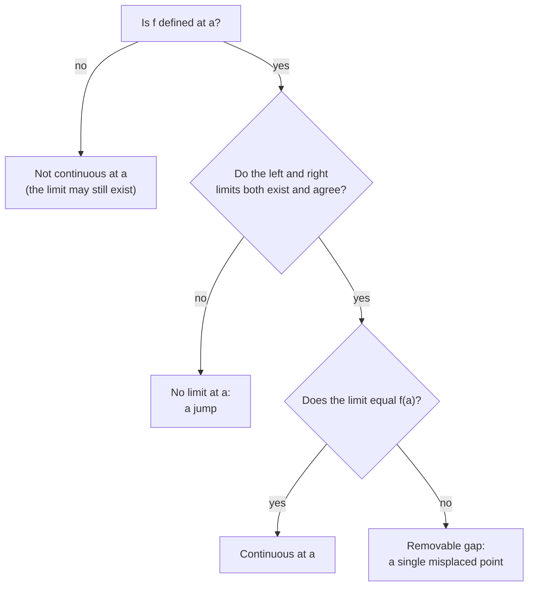
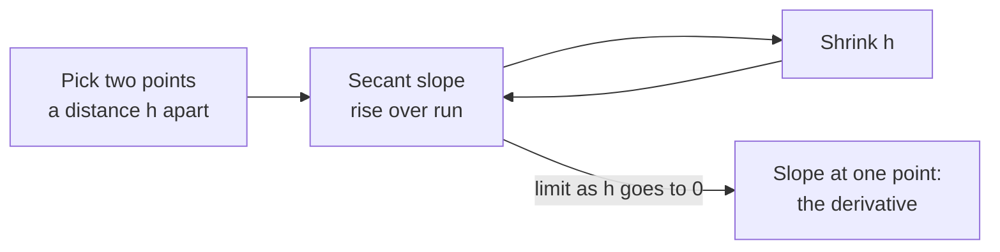

A limit answers the question "what value is this function heading towards as the input gets closer and closer to some point?" It sounds like a technicality, and in day-to-day AI work you will rarely compute one by hand. But limits are the foundation the derivative is built on, and they explain two very practical things: why numerical derivatives in code have a sweet spot for the step size, and why functions like the sigmoid flatten out. This lesson gives you the intuition, the notation, and the floating-point consequences.

## Heading towards a value

Consider this function:

$$
f(x) = \frac{x^2 - 1}{x - 1}
$$

At $x = 1$ it is undefined: the bottom becomes zero, and so does the top, giving $0/0$. But you can still ask what happens **near** 1. Try it:

```python
def f(x):
    return (x**2 - 1) / (x - 1)

for x in [0.9, 0.99, 0.999, 1.001, 1.01, 1.1]:
    print(f"x={x:<6} f(x)={f(x):.6f}")
```

```output
x=0.9    f(x)=1.900000
x=0.99   f(x)=1.990000
x=0.999  f(x)=1.999000
x=1.001  f(x)=2.001000
x=1.01   f(x)=2.010000
x=1.1    f(x)=2.100000
```

From both sides the outputs close in on 2. We say the **limit** of $f(x)$ as $x$ approaches 1 is 2, and write:

$$
\lim_{x \to 1} \frac{x^2 - 1}{x - 1} = 2
$$

The algebra confirms it: $x^2 - 1 = (x - 1)(x + 1)$, so for every $x \neq 1$ the function is just $x + 1$, which is heading for 2. The graph is the straight line $y = x + 1$ with a single missing point at $x = 1$. The limit fills in the hole.

> [!KEY]
> A limit is about where a function is **going**, not where it is. The function does not even need to be defined at the point itself. This is exactly what lets us talk about the slope "at a single point", which is the derivative.

## A less obvious limit

Some limits cannot be untangled with simple algebra. The ratio $\sin(x)/x$ is $0/0$ at $x = 0$, yet numerically:

```python
import math

for x in [1.0, 0.1, 0.01, 0.001]:
    print(f"x={x:<6} sin(x)/x={math.sin(x) / x:.8f}")
```

```output
x=1.0    sin(x)/x=0.84147098
x=0.1    sin(x)/x=0.99833417
x=0.01   sin(x)/x=0.99998333
x=0.001  sin(x)/x=0.99999983
```

The values approach 1, and indeed $\lim_{x \to 0} \sin(x)/x = 1$. Evaluating at points that get closer and closer is a good way to **guess** a limit, though not a proof: a function could in principle do something strange at a scale you did not test. For the smooth functions used in machine learning, the numerical guess is almost always right.

## The formal idea

The precise definition, due to Cauchy and Weierstrass, says $\lim_{x \to a} f(x) = L$ if you can make $f(x)$ as close to $L$ as you like by taking $x$ close enough to $a$ (but not equal to it). In symbols: for every tolerance $\varepsilon > 0$ there is a distance $\delta > 0$ such that

$$
0 < |x - a| < \delta \implies |f(x) - L| < \varepsilon
$$

Read it as a game. Someone challenges you with a tolerance $\varepsilon$, say "get within 0.001 of $L$". You win if you can name a $\delta$ such that every $x$ within $\delta$ of $a$ lands within the tolerance. If you can always win, however small the challenge, the limit is $L$. You will not need to write epsilon-delta proofs to build AI systems, but this is what the notation means.

## One-sided limits and ReLU

Sometimes the answer depends on which side you approach from. The **left limit** $\lim_{x \to a^-}$ uses only $x < a$; the **right limit** $\lim_{x \to a^+}$ uses only $x > a$. The ordinary limit exists only when both agree.

ReLU is the important example. Its slope is 0 for negative inputs and 1 for positive inputs. Approaching $z = 0$ from the left, the slope is heading to 0; from the right, to 1. The two one-sided limits disagree, so ReLU has no single slope at exactly zero: it has a corner.



A function is **continuous** at $a$ when the limit exists and equals $f(a)$: you can draw the graph through that point without lifting your pen. ReLU itself is continuous everywhere (its graph has a corner but no gap); it is its slope that jumps. Deep learning frameworks simply pick a value, usually 0, for the slope at exactly zero. Since an input landing on exactly 0.0 is rare, this makes no practical difference.

## Limits at infinity

You can also ask what happens as $x$ grows without bound. For the sigmoid $\sigma(z) = 1/(1 + e^{-z})$:

$$
\lim_{z \to \infty} \sigma(z) = 1, \qquad \lim_{z \to -\infty} \sigma(z) = 0
$$

As $z$ grows, $e^{-z}$ shrinks towards 0, so the fraction approaches $1/1$. These are the horizontal **asymptotes**: lines the curve approaches but never reaches mathematically. In floating point it does reach them. `sigmoid(40)` returns exactly `1.0` in Python, because $1 + e^{-40}$ is closer to 1 than the gap between 1 and the next representable float. Code that then computes `log(1 - sigmoid(z))` gets `log(0)` and fails, which is one reason libraries compute losses directly from the raw score $z$ instead of from the rounded probability.

## Why limits matter: the slope at a point

Here is the payoff. The slope between two points on a curve, $(x, f(x))$ and $(x + h, f(x + h))$, is rise over run:

$$
\text{slope} = \frac{f(x + h) - f(x)}{h}
$$

This straight line through two points on the curve is called a **secant**. The slope "at" $x$ is what this ratio approaches as the gap $h$ shrinks towards zero. At $h = 0$ the ratio is $0/0$, so it has to be a limit. For $f(x) = x^2$ at $x = 3$:

```python
def f(x):
    return x ** 2

x = 3.0
for h in [1.0, 0.1, 0.01, 0.001]:
    slope = (f(x + h) - f(x)) / h
    print(f"h={h:<6} secant slope={slope:.6f}")
```

```output
h=1.0    secant slope=7.000000
h=0.1    secant slope=6.100000
h=0.01   secant slope=6.010000
h=0.001  secant slope=6.001000
```

The slopes approach 6. That limit is the **derivative**, the subject of the [next lesson](/learn/calculus/derivatives).



## Pitfall: computers cannot take h to zero

Mathematically, smaller $h$ is always better. On a computer it is not. Floating-point numbers carry about 16 significant digits, and subtracting two nearly equal numbers throws most of them away. Push $h$ too far and the answer degrades, then collapses:

```python
def f(x):
    return x ** 2

x = 3.0
for h in [1e-4, 1e-8, 1e-12, 1e-15, 1e-17]:
    slope = (f(x + h) - f(x)) / h
    print(f"h={h:<7} slope={slope}")
```

```output
h=0.0001  slope=6.000100000012054
h=1e-08   slope=5.999999963535174
h=1e-12   slope=6.000533403494046
h=1e-15   slope=5.329070518200751
h=1e-17   slope=0.0
```

At $h = 10^{-17}$, adding $h$ to 3.0 changes nothing at all, so the numerator is exactly zero. This effect is called **catastrophic cancellation**.

> [!WARNING]
> When you estimate a derivative numerically, use a moderate step, around $10^{-5}$ to $10^{-7}$ for 64-bit floats, not the smallest number you can type. The [derivatives](/learn/calculus/derivatives) lesson shows a better formula, the central difference, that is far more accurate at the same step size.

## Exercises

**1.** Estimate $\lim_{x \to 2} \dfrac{x^2 - 4}{x - 2}$ numerically, then confirm it with algebra.

<details>
<summary>Show solution</summary>

```python
g = lambda x: (x**2 - 4) / (x - 2)
for x in [1.99, 1.999, 2.001, 2.01]:
    print(x, round(g(x), 6))
```

```output
1.99 3.99
1.999 3.999
2.001 4.001
2.01 4.01
```

The values approach 4. Algebraically, $x^2 - 4 = (x - 2)(x + 2)$, so for $x \neq 2$ the function equals $x + 2$, whose limit at 2 is 4.

</details>

**2.** Compute the left and right secant slopes of ReLU at 0 using $h = 0.001$: that is, $(\text{ReLU}(0) - \text{ReLU}(-h))/h$ and $(\text{ReLU}(h) - \text{ReLU}(0))/h$. What do they tell you?

<details>
<summary>Show solution</summary>

```python
relu = lambda z: max(0.0, z)
h = 0.001
print((relu(0) - relu(-h)) / h)   # from the left
print((relu(h) - relu(0)) / h)    # from the right
```

```output
0.0
1.0
```

The slope from the left is 0 and from the right is 1. They disagree for any $h$, so the limit that would define the slope at 0 does not exist: ReLU has a corner there.

</details>

**3.** For $f(x) = x^3$ at $x = 2$, compute the secant slope with $h = 0.1$, $0.01$ and $0.001$. What value is it approaching?

<details>
<summary>Show solution</summary>

```python
f = lambda x: x ** 3
for h in [0.1, 0.01, 0.001]:
    print(h, round((f(2 + h) - f(2)) / h, 6))
```

```output
0.1 12.61
0.01 12.0601
0.001 12.006001
```

The slopes approach 12. You will see in the next lesson that the derivative of $x^3$ is $3x^2$, and $3 \cdot 2^2 = 12$.

</details>

```quiz
[
  {
    "q": "f(x) = (x^2 - 9)/(x - 3) is undefined at x = 3. What is its limit as x approaches 3?",
    "options": ["0", "It does not exist", "6", "3"],
    "answer": 2,
    "why": "For x not equal to 3 the function simplifies to x + 3, which approaches 6. The limit does not need the function to be defined at the point."
  },
  {
    "q": "Why does ReLU have no single slope at z = 0?",
    "options": [
      "ReLU is not defined at 0",
      "The slope approaching from the left is 0 and from the right is 1, so the one-sided limits disagree",
      "ReLU is not continuous at 0",
      "The slope is infinite at 0"
    ],
    "answer": 1,
    "why": "ReLU is continuous with value 0 at 0, but its slope jumps from 0 to 1. Disagreeing one-sided limits mean no single slope there."
  },
  {
    "q": "You estimate a derivative with (f(x + h) - f(x)) / h and use h = 1e-17. The result is exactly 0. Why?",
    "options": [
      "The true derivative is 0",
      "x + h rounds to x in floating point, so the numerator is exactly 0",
      "Python cannot divide by very small numbers",
      "The function is not continuous"
    ],
    "answer": 1,
    "why": "64-bit floats keep about 16 significant digits. Adding 1e-17 to a number like 3.0 leaves it unchanged, so f(x + h) - f(x) is 0."
  },
  {
    "q": "What is the limit of the sigmoid 1/(1 + e^(-z)) as z goes to minus infinity?",
    "options": ["1", "0.5", "Minus infinity", "0"],
    "answer": 3,
    "why": "As z goes to minus infinity, e^(-z) grows without bound, so the fraction 1/(1 + e^(-z)) shrinks towards 0."
  }
]
```
